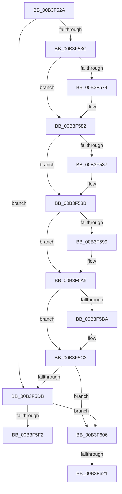

# sub_00B3F52A

- RVA: `0x00B3F52A`–`0x00B3F62F` (길이 `261` bytes)
- VA: `0x0000000140B3F52A`
- 실행 섹션: `PAGE`
- PDB 이름 있음: `아니요`; PDB Function 태그: `아니요`
- unwind 정보 RVA: `0x000B497C`
- 디코드: `60`개 명령, `261/261` bytes 표시
- 미해석 바이트: `0` (있으면 어셈블리에 `.byte`로 보존)

> 이 문서는 커널 이미지의 기계어와 PDB 기호를 분석해 생성했습니다. 4번과 5번은 함수 원형과 자료형을 바이너리 사용 방식에서 추정한 C 해석이며 원본 소스 복구 결과는 아닙니다.

## 1. Dependencies

- 직접 호출 지점: **7**; 고유 호출 대상: **7**
- 직접 호출자로 확인된 함수: **0**
- RIP 상대 이미지 참조: **0**

### Outgoing calls
- `0x00B3F564` → [KeAbPreAcquire](../../text/21/KeAbPreAcquire_function_00210230.md) (function, `0x00210230`)
- `0x00B3F57D` → [ExfAcquirePushLockExclusiveEx](../../text/20/ExfAcquirePushLockExclusiveEx_function_0020FC90.md) (function, `0x0020FC90`)
- `0x00B3F5BE` → [ExfTryToWakePushLock](../../text/26/ExfTryToWakePushLock_function_00265DD0.md) (function, `0x00265DD0`)
- `0x00B3F5C7` → [KeAbPostRelease](../../text/2E/KeAbPostRelease_function_002E1600.md) (function, `0x002E1600`)
- `0x00B3F5CC` → [KeLeaveCriticalRegion](../../text/25/KeLeaveCriticalRegion_function_0025D8B0.md) (function, `0x0025D8B0`)
- `0x00B3F5E9` → [SepCompareClaimAttributes](../8F/SepCompareClaimAttributes_function_008F7198.md) (function, `0x008F7198`)
- `0x00B3F624` → [SepDeleteClaimAttributes](../A8/SepDeleteClaimAttributes_function_00A8F64C.md) (function, `0x00A8F64C`)

### Direct callers
- 이 함수 시작 RVA로 연결되는 직접 call은 확인되지 않았습니다. 간접 호출은 완전히 역산할 수 없습니다.

### Static image references
- 디코드된 RIP-relative 메모리 참조가 없습니다.

## 2. Other-region calls and transfers

- 다른 실행 섹션으로 향하는 call: **5**
  - `0x00B3F564` → [KeAbPreAcquire](../../text/21/KeAbPreAcquire_function_00210230.md) (`PAGE` → `.text`)
  - `0x00B3F57D` → [ExfAcquirePushLockExclusiveEx](../../text/20/ExfAcquirePushLockExclusiveEx_function_0020FC90.md) (`PAGE` → `.text`)
  - `0x00B3F5BE` → [ExfTryToWakePushLock](../../text/26/ExfTryToWakePushLock_function_00265DD0.md) (`PAGE` → `.text`)
  - `0x00B3F5C7` → [KeAbPostRelease](../../text/2E/KeAbPostRelease_function_002E1600.md) (`PAGE` → `.text`)
  - `0x00B3F5CC` → [KeLeaveCriticalRegion](../../text/25/KeLeaveCriticalRegion_function_0025D8B0.md) (`PAGE` → `.text`)
- call이 아닌 외부 분기/꼬리 이동: **3**
  - `0x00B3F601` → [SepSetTokenClaims + 0x6E](../A6/SepSetTokenClaims_function_00A6E0D8.md) (`tail-transfer`)
  - `0x00B3F61B` → [SepSetTokenClaims + 0x6E](../A6/SepSetTokenClaims_function_00A6E0D8.md) (`tail-transfer`)
  - `0x00B3F62A` → [SepSetTokenClaims + 0x6E](../A6/SepSetTokenClaims_function_00A6E0D8.md) (`tail-transfer`)

## 3. Assembly (complete function range)

```asm
00B3F52A  48 8B 87 D8 00 00 00            mov rax, qword ptr [rdi + 0xd8]
00B3F531  48 83 78 78 00                  cmp qword ptr [rax + 0x78], 0
00B3F536  0F 85 9F 00 00 00               jne 0x140b3f5db
00B3F53C  65 48 8B 04 25 88 01 00 00      mov rax, qword ptr gs:[0x188]
00B3F545  48 83 CB FF                     or rbx, 0xffffffffffffffff
00B3F549  45 33 C0                        xor r8d, r8d
00B3F54C  33 D2                           xor edx, edx
00B3F54E  66 01 98 E4 01 00 00            add word ptr [rax + 0x1e4], bx
00B3F555  90                              nop
00B3F556  48 8B B7 D8 00 00 00            mov rsi, qword ptr [rdi + 0xd8]
00B3F55D  48 83 C6 70                     add rsi, 0x70
00B3F561  48 8B CE                        mov rcx, rsi
00B3F564  E8 C7 0C 6D FF                  call 0x140210230
00B3F569  F0 48 0F BA 2E 00               lock bts qword ptr [rsi], 0
00B3F56F  48 8B E8                        mov rbp, rax
00B3F572  73 0E                           jae 0x140b3f582
00B3F574  4C 8B C6                        mov r8, rsi
00B3F577  48 8B D0                        mov rdx, rax
00B3F57A  48 8B CE                        mov rcx, rsi
00B3F57D  E8 0E 07 6D FF                  call 0x14020fc90
00B3F582  48 85 ED                        test rbp, rbp
00B3F585  74 04                           je 0x140b3f58b
00B3F587  C6 45 0A 01                     mov byte ptr [rbp + 0xa], 1
00B3F58B  48 8B 8F D8 00 00 00            mov rcx, qword ptr [rdi + 0xd8]
00B3F592  48 83 79 78 00                  cmp qword ptr [rcx + 0x78], 0
00B3F597  75 0C                           jne 0x140b3f5a5
00B3F599  48 8B 44 24 30                  mov rax, qword ptr [rsp + 0x30]
00B3F59E  41 B6 01                        mov r14b, 1
00B3F5A1  48 89 41 78                     mov qword ptr [rcx + 0x78], rax
00B3F5A5  48 8B B7 D8 00 00 00            mov rsi, qword ptr [rdi + 0xd8]
00B3F5AC  F0 48 0F C1 5E 70               lock xadd qword ptr [rsi + 0x70], rbx
00B3F5B2  80 E3 06                        and bl, 6
00B3F5B5  80 FB 02                        cmp bl, 2
00B3F5B8  75 09                           jne 0x140b3f5c3
00B3F5BA  48 8D 4E 70                     lea rcx, [rsi + 0x70]
00B3F5BE  E8 0D 68 72 FF                  call 0x140265dd0
00B3F5C3  48 8D 4E 70                     lea rcx, [rsi + 0x70]
00B3F5C7  E8 34 20 7A FF                  call 0x1402e1600
00B3F5CC  E8 DF E2 71 FF                  call 0x14025d8b0
00B3F5D1  48 8B 5C 24 30                  mov rbx, qword ptr [rsp + 0x30]
00B3F5D6  45 84 F6                        test r14b, r14b
00B3F5D9  75 2B                           jne 0x140b3f606
00B3F5DB  48 8B 97 D8 00 00 00            mov rdx, qword ptr [rdi + 0xd8]
00B3F5E2  48 8B CB                        mov rcx, rbx
00B3F5E5  48 8B 52 78                     mov rdx, qword ptr [rdx + 0x78]
00B3F5E9  E8 AA 7B DB FF                  call 0x1408f7198
00B3F5EE  84 C0                           test al, al
00B3F5F0  75 14                           jne 0x140b3f606
00B3F5F2  0F BA AF C8 00 00 00 0F         bts dword ptr [rdi + 0xc8], 0xf
00B3F5FA  48 89 9F 48 04 00 00            mov qword ptr [rdi + 0x448], rbx
00B3F601  E9 40 EB F2 FF                  jmp 0x140a6e146
00B3F606  48 8B 87 D8 00 00 00            mov rax, qword ptr [rdi + 0xd8]
00B3F60D  48 8B 50 78                     mov rdx, qword ptr [rax + 0x78]
00B3F611  48 89 97 48 04 00 00            mov qword ptr [rdi + 0x448], rdx
00B3F618  45 84 F6                        test r14b, r14b
00B3F61B  0F 85 25 EB F2 FF               jne 0x140a6e146
00B3F621  48 8B CB                        mov rcx, rbx
00B3F624  E8 23 00 F5 FF                  call 0x140a8f64c
00B3F629  90                              nop
00B3F62A  E9 17 EB F2 FF                  jmp 0x140a6e146
```

## 4. C-style interpretation (structured pseudocode)

```c
__int64 __fastcall sub_00B3F52A(__int64 a1, int a2, int a3, __int64 a4, __int64 a5, __int64 a6)
{
    __int64 result;
    __int64 v_r14;
    __int64 v_rbx;
    __int64 v_rsi;

    if ((*(unsigned __int64 *)(*(unsigned __int64 *)(v_rdi + 216) + 120)) != 0) goto loc_00B3F5DB;
    v_rbx = (v_rbx) | (-1);
    a3 = 0;
    a2 = 0;
    v_rsi = (*(unsigned __int64 *)(v_rdi + 216)) + (112);
    result = KeAbPreAcquire(v_rsi, a2, a3, a4);
    if (!(condition_is_above_or_equal)) {
        a3 = v_rsi;
        a2 = result;
        a1 = v_rsi;
        result = ExfAcquirePushLockExclusiveEx(a1, a2, a3, a4);
    }
    if (result != 0) {
        *(unsigned __int8 *)(result + 10) = 1;
    }
    if ((*(unsigned __int64 *)(*(unsigned __int64 *)(v_rdi + 216) + 120)) == 0) {
        result = a6;
        v_r14 = 1;
        *(unsigned __int64 *)(*(unsigned __int64 *)(v_rdi + 216) + 120) = result;
    }
    v_rbx = (unsigned __int8)((v_rbx) & (6));
    if (((unsigned __int8)(v_rbx)) == 2) {
        a1 = *(unsigned __int64 *)(v_rdi + 216) + 112;
        result = ExfTryToWakePushLock(a1, a2, a3, a4);
    }
    result = KeAbPostRelease(*(unsigned __int64 *)(v_rdi + 216) + 112, a2, a3, a4);
    result = KeLeaveCriticalRegion(*(unsigned __int64 *)(v_rdi + 216) + 112, a2, a3, a4);
    if ((unsigned __int8)(v_r14) != 0) goto loc_00B3F606;
loc_00B3F5DB:
    result = SepCompareClaimAttributes(a6, *(unsigned __int64 *)(*(unsigned __int64 *)(v_rdi + 216) + 120), a3, a4);
    if ((unsigned __int8)(result) != 0) goto loc_00B3F606;
    *(unsigned __int64 *)(v_rdi + 1096) = a6;
loc_00B3F606:
    *(unsigned __int64 *)(v_rdi + 1096) = *(unsigned __int64 *)(*(unsigned __int64 *)(v_rdi + 216) + 120);
    result = SepDeleteClaimAttributes(a6, *(unsigned __int64 *)(*(unsigned __int64 *)(v_rdi + 216) + 120), a3, a4);
}
```

## 5. (Beta) C Style

```c
int64_t sub_00B3F52A(int64_t Arg1, int32_t Arg2, int32_t Arg3, int64_t Arg4, uint64_t Arg5, int64_t Arg6)
{
    int64_t result;
    int64_t local_r14;
    int64_t local_rbx;
    int64_t local_rsi;

    if ((*(uint64_t *)(*(uint64_t *)(local_rdi + 0xD8) + 0x78)) != 0) goto loc_00B3F5DB;
    local_rbx = (local_rbx) | (-1);
    Arg3 = 0;
    Arg2 = 0;
    local_rsi = (*(uint64_t *)(local_rdi + 0xD8)) + (112);
    result = KeAbPreAcquire(local_rsi, Arg2, Arg3, Arg4);
    if (!(condition_is_above_or_equal)) {
        Arg3 = local_rsi;
        Arg2 = result;
        Arg1 = local_rsi;
        result = ExfAcquirePushLockExclusiveEx(Arg1, Arg2, Arg3, Arg4);
    }
    if (result != 0) {
        *(uint8_t *)(result + 0xA) = 1;
    }
    if ((*(uint64_t *)(*(uint64_t *)(local_rdi + 0xD8) + 0x78)) == 0) {
        result = Arg6;
        local_r14 = 1;
        *(uint64_t *)(*(uint64_t *)(local_rdi + 0xD8) + 0x78) = result;
    }
    local_rbx = (uint8_t)((local_rbx) & (6));
    if (((uint8_t)(local_rbx)) == 2) {
        Arg1 = *(uint64_t *)(local_rdi + 0xD8) + 112;
        result = ExfTryToWakePushLock(Arg1, Arg2, Arg3, Arg4);
    }
    result = KeAbPostRelease(*(uint64_t *)(local_rdi + 0xD8) + 112, Arg2, Arg3, Arg4);
    result = KeLeaveCriticalRegion(*(uint64_t *)(local_rdi + 0xD8) + 112, Arg2, Arg3, Arg4);
    if ((uint8_t)(local_r14) != 0) goto loc_00B3F606;
loc_00B3F5DB:
    result = SepCompareClaimAttributes(Arg6, *(uint64_t *)(*(uint64_t *)(local_rdi + 0xD8) + 0x78), Arg3, Arg4);
    if ((uint8_t)(result) != 0) goto loc_00B3F606;
    *(uint64_t *)(local_rdi + 0x448) = Arg6;
loc_00B3F606:
    *(uint64_t *)(local_rdi + 0x448) = *(uint64_t *)(*(uint64_t *)(local_rdi + 0xD8) + 0x78);
    result = SepDeleteClaimAttributes(Arg6, *(uint64_t *)(*(uint64_t *)(local_rdi + 0xD8) + 0x78), Arg3, Arg4);
}
```

## 6. Execution-region graph

[열기: 2D/3D 그래프와 함수 탐색 컨트롤 패널](../../../control-panel.html?section=page&rva=0x00B3F52A&view=graph)

- 2D 그래프는 위에서 아래로 흐르고, 3D 그래프는 빈 공간을 드래그해 회전합니다. Shift+드래그는 이동, 휠은 확대·축소, 함수 노드 선택은 대상 보고서 이동입니다.

### Static fallback


