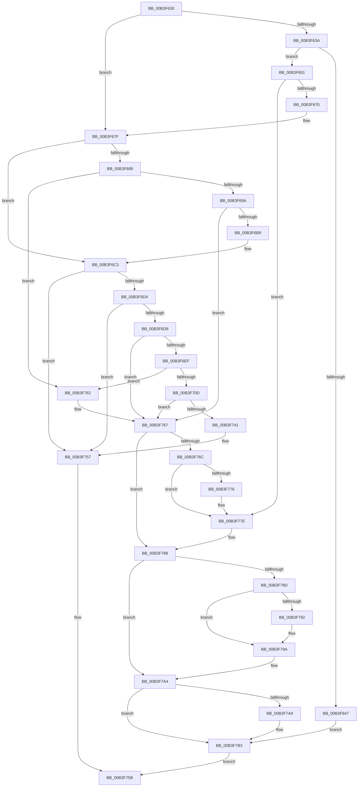

# sub_00B3F630

- RVA: `0x00B3F630`–`0x00B3F7BF` (길이 `399` bytes)
- VA: `0x0000000140B3F630`
- 실행 섹션: `PAGE`
- PDB 이름 있음: `아니요`; PDB Function 태그: `아니요`
- unwind 정보 RVA: `0x000B49A8`
- 디코드: `102`개 명령, `399/399` bytes 표시
- 미해석 바이트: `0` (있으면 어셈블리에 `.byte`로 보존)

> 이 문서는 커널 이미지의 기계어와 PDB 기호를 분석해 생성했습니다. 4번과 5번은 함수 원형과 자료형을 바이너리 사용 방식에서 추정한 C 해석이며 원본 소스 복구 결과는 아닙니다.

## 1. Dependencies

- 직접 호출 지점: **14**; 고유 호출 대상: **8**
- 직접 호출자로 확인된 함수: **0**
- RIP 상대 이미지 참조: **0**

### Outgoing calls
- `0x00B3F63A` → [AuthzBasepAllocateSecurityAttributesList](../../text/30/AuthzBasepAllocateSecurityAttributesList_function_003013F4.md) (function, `0x003013F4`)
- `0x00B3F661` → [AuthzBasepSetSecurityAttributesToken](../../text/3A/AuthzBasepSetSecurityAttributesToken_function_003A8D1C.md) (function, `0x003A8D1C`)
- `0x00B3F689` → [AuthzBasepAllocateSecurityAttributesList](../../text/30/AuthzBasepAllocateSecurityAttributesList_function_003013F4.md) (function, `0x003013F4`)
- `0x00B3F6AA` → [AuthzBasepSetSecurityAttributesToken](../../text/3A/AuthzBasepSetSecurityAttributesToken_function_003A8D1C.md) (function, `0x003A8D1C`)
- `0x00B3F6E4` → [SepLengthSidAndAttributesArray](../9C/SepLengthSidAndAttributesArray_function_009C9CB8.md) (function, `0x009C9CB8`)
- `0x00B3F700` → [ExAllocatePool2](../../poolcode/B8/ExAllocatePool2_function_00B820F0.md) (function, `0x00B820F0`)
- `0x00B3F736` → [SeCaptureSidAndAttributesArray](../9C/SeCaptureSidAndAttributesArray_function_009C9D70.md) (function, `0x009C9D70`)
- `0x00B3F752` → [RtlSidHashInitialize](../../text/41/RtlSidHashInitialize_function_00416EA0.md) (function, `0x00416EA0`)
- `0x00B3F779` → [AuthzBasepFreeSecurityAttributesList](../../text/30/AuthzBasepFreeSecurityAttributesList_function_00301230.md) (function, `0x00301230`)
- `0x00B3F783` → [ExFreePoolWithTag](../../poolcode/B8/ExFreePoolWithTag_function_00B82870.md) (function, `0x00B82870`)
- `0x00B3F795` → [AuthzBasepFreeSecurityAttributesList](../../text/30/AuthzBasepFreeSecurityAttributesList_function_00301230.md) (function, `0x00301230`)
- `0x00B3F79F` → [ExFreePoolWithTag](../../poolcode/B8/ExFreePoolWithTag_function_00B82870.md) (function, `0x00B82870`)
- `0x00B3F7AE` → [ExFreePoolWithTag](../../poolcode/B8/ExFreePoolWithTag_function_00B82870.md) (function, `0x00B82870`)
- `0x00B3F7B8` → [ExFreePoolWithTag](../../poolcode/B8/ExFreePoolWithTag_function_00B82870.md) (function, `0x00B82870`)

### Direct callers
- 이 함수 시작 RVA로 연결되는 직접 call은 확인되지 않았습니다. 간접 호출은 완전히 역산할 수 없습니다.

### Static image references
- 디코드된 RIP-relative 메모리 참조가 없습니다.

## 2. Other-region calls and transfers

- 다른 실행 섹션으로 향하는 call: **12**
  - `0x00B3F63A` → [AuthzBasepAllocateSecurityAttributesList](../../text/30/AuthzBasepAllocateSecurityAttributesList_function_003013F4.md) (`PAGE` → `.text`)
  - `0x00B3F661` → [AuthzBasepSetSecurityAttributesToken](../../text/3A/AuthzBasepSetSecurityAttributesToken_function_003A8D1C.md) (`PAGE` → `.text`)
  - `0x00B3F689` → [AuthzBasepAllocateSecurityAttributesList](../../text/30/AuthzBasepAllocateSecurityAttributesList_function_003013F4.md) (`PAGE` → `.text`)
  - `0x00B3F6AA` → [AuthzBasepSetSecurityAttributesToken](../../text/3A/AuthzBasepSetSecurityAttributesToken_function_003A8D1C.md) (`PAGE` → `.text`)
  - `0x00B3F700` → [ExAllocatePool2](../../poolcode/B8/ExAllocatePool2_function_00B820F0.md) (`PAGE` → `POOLCODE`)
  - `0x00B3F752` → [RtlSidHashInitialize](../../text/41/RtlSidHashInitialize_function_00416EA0.md) (`PAGE` → `.text`)
  - `0x00B3F779` → [AuthzBasepFreeSecurityAttributesList](../../text/30/AuthzBasepFreeSecurityAttributesList_function_00301230.md) (`PAGE` → `.text`)
  - `0x00B3F783` → [ExFreePoolWithTag](../../poolcode/B8/ExFreePoolWithTag_function_00B82870.md) (`PAGE` → `POOLCODE`)
  - `0x00B3F795` → [AuthzBasepFreeSecurityAttributesList](../../text/30/AuthzBasepFreeSecurityAttributesList_function_00301230.md) (`PAGE` → `.text`)
  - `0x00B3F79F` → [ExFreePoolWithTag](../../poolcode/B8/ExFreePoolWithTag_function_00B82870.md) (`PAGE` → `POOLCODE`)
  - `0x00B3F7AE` → [ExFreePoolWithTag](../../poolcode/B8/ExFreePoolWithTag_function_00B82870.md) (`PAGE` → `POOLCODE`)
  - `0x00B3F7B8` → [ExFreePoolWithTag](../../poolcode/B8/ExFreePoolWithTag_function_00B82870.md) (`PAGE` → `POOLCODE`)
- call이 아닌 외부 분기/꼬리 이동: **1**
  - `0x00B3F75D` → [SepCreateClaimAttributes + 0x64](../A6/SepCreateClaimAttributes_function_00A6E154.md) (`tail-transfer`)

## 3. Assembly (complete function range)

```asm
00B3F630  48 39 9C 24 B8 00 00 00         cmp qword ptr [rsp + 0xb8], rbx
00B3F638  74 45                           je 0x140b3f67f
00B3F63A  E8 B5 1D 7C FF                  call 0x1403013f4
00B3F63F  4C 8B F0                        mov r14, rax
00B3F642  48 85 C0                        test rax, rax
00B3F645  75 0A                           jne 0x140b3f651
00B3F647  BB 9A 00 00 C0                  mov ebx, 0xc000009a
00B3F64C  E9 62 01 00 00                  jmp 0x140b3f7b3
00B3F651  4C 8B 84 24 B8 00 00 00         mov r8, qword ptr [rsp + 0xb8]
00B3F659  48 8D 54 24 54                  lea rdx, [rsp + 0x54]
00B3F65E  49 8B CE                        mov rcx, r14
00B3F661  E8 B6 96 86 FF                  call 0x1403a8d1c
00B3F666  8B D8                           mov ebx, eax
00B3F668  85 C0                           test eax, eax
00B3F66A  0F 88 0E 01 00 00               js 0x140b3f77e
00B3F670  C6 84 24 B0 00 00 00 01         mov byte ptr [rsp + 0xb0], 1
00B3F678  4C 89 B7 40 02 00 00            mov qword ptr [rdi + 0x240], r14
00B3F67F  48 39 B4 24 C0 00 00 00         cmp qword ptr [rsp + 0xc0], rsi
00B3F687  74 3A                           je 0x140b3f6c3
00B3F689  E8 66 1D 7C FF                  call 0x1403013f4
00B3F68E  48 8B F0                        mov rsi, rax
00B3F691  48 85 C0                        test rax, rax
00B3F694  0F 84 C8 00 00 00               je 0x140b3f762
00B3F69A  4C 8B 84 24 C0 00 00 00         mov r8, qword ptr [rsp + 0xc0]
00B3F6A2  48 8D 54 24 54                  lea rdx, [rsp + 0x54]
00B3F6A7  48 8B C8                        mov rcx, rax
00B3F6AA  E8 6D 96 86 FF                  call 0x1403a8d1c
00B3F6AF  8B D8                           mov ebx, eax
00B3F6B1  85 C0                           test eax, eax
00B3F6B3  0F 88 AE 00 00 00               js 0x140b3f767
00B3F6B9  41 B4 01                        mov r12b, 1
00B3F6BC  48 89 B7 48 02 00 00            mov qword ptr [rdi + 0x248], rsi
00B3F6C3  48 8B 84 24 D0 00 00 00         mov rax, qword ptr [rsp + 0xd0]
00B3F6CB  48 85 C0                        test rax, rax
00B3F6CE  0F 84 83 00 00 00               je 0x140b3f757
00B3F6D4  45 85 FF                        test r15d, r15d
00B3F6D7  74 7E                           je 0x140b3f757
00B3F6D9  4C 8D 44 24 58                  lea r8, [rsp + 0x58]
00B3F6DE  41 8B D7                        mov edx, r15d
00B3F6E1  48 8B C8                        mov rcx, rax
00B3F6E4  E8 CF A5 E8 FF                  call 0x1409c9cb8
00B3F6E9  8B D8                           mov ebx, eax
00B3F6EB  85 C0                           test eax, eax
00B3F6ED  78 78                           js 0x140b3f767
00B3F6EF  8B 5C 24 58                     mov ebx, dword ptr [rsp + 0x58]
00B3F6F3  B9 00 01 00 00                  mov ecx, 0x100
00B3F6F8  8B D3                           mov edx, ebx
00B3F6FA  41 B8 53 65 54 64               mov r8d, 0x64546553
00B3F700  E8 EB 29 04 00                  call 0x140b820f0
00B3F705  48 8B E8                        mov rbp, rax
00B3F708  48 85 C0                        test rax, rax
00B3F70B  74 55                           je 0x140b3f762
00B3F70D  48 8B 8C 24 D0 00 00 00         mov rcx, qword ptr [rsp + 0xd0]
00B3F715  48 8D 44 24 58                  lea rax, [rsp + 0x58]
00B3F71A  48 89 44 24 40                  mov qword ptr [rsp + 0x40], rax
00B3F71F  4C 8B CD                        mov r9, rbp
00B3F722  48 8D 44 24 60                  lea rax, [rsp + 0x60]
00B3F727  45 33 C0                        xor r8d, r8d
00B3F72A  48 89 44 24 38                  mov qword ptr [rsp + 0x38], rax
00B3F72F  41 8B D7                        mov edx, r15d
00B3F732  89 5C 24 20                     mov dword ptr [rsp + 0x20], ebx
00B3F736  E8 35 A6 E8 FF                  call 0x1409c9d70
00B3F73B  8B D8                           mov ebx, eax
00B3F73D  85 C0                           test eax, eax
00B3F73F  78 26                           js 0x140b3f767
00B3F741  4C 8D 47 20                     lea r8, [rdi + 0x20]
00B3F745  44 89 3F                        mov dword ptr [rdi], r15d
00B3F748  41 8B D7                        mov edx, r15d
00B3F74B  48 89 6F 08                     mov qword ptr [rdi + 8], rbp
00B3F74F  48 8B CD                        mov rcx, rbp
00B3F752  E8 49 77 8D FF                  call 0x140416ea0
00B3F757  49 89 7D 00                     mov qword ptr [r13], rdi
00B3F75B  8B C3                           mov eax, ebx
00B3F75D  E9 56 EA F2 FF                  jmp 0x140a6e1b8
00B3F762  BB 9A 00 00 C0                  mov ebx, 0xc000009a
00B3F767  4D 85 F6                        test r14, r14
00B3F76A  74 1C                           je 0x140b3f788
00B3F76C  80 BC 24 B0 00 00 00 00         cmp byte ptr [rsp + 0xb0], 0
00B3F774  74 08                           je 0x140b3f77e
00B3F776  49 8B CE                        mov rcx, r14
00B3F779  E8 B2 1A 7C FF                  call 0x140301230
00B3F77E  33 D2                           xor edx, edx
00B3F780  49 8B CE                        mov rcx, r14
00B3F783  E8 E8 30 04 00                  call 0x140b82870
00B3F788  48 85 F6                        test rsi, rsi
00B3F78B  74 17                           je 0x140b3f7a4
00B3F78D  45 84 E4                        test r12b, r12b
00B3F790  74 08                           je 0x140b3f79a
00B3F792  48 8B CE                        mov rcx, rsi
00B3F795  E8 96 1A 7C FF                  call 0x140301230
00B3F79A  33 D2                           xor edx, edx
00B3F79C  48 8B CE                        mov rcx, rsi
00B3F79F  E8 CC 30 04 00                  call 0x140b82870
00B3F7A4  48 85 ED                        test rbp, rbp
00B3F7A7  74 0A                           je 0x140b3f7b3
00B3F7A9  33 D2                           xor edx, edx
00B3F7AB  48 8B CD                        mov rcx, rbp
00B3F7AE  E8 BD 30 04 00                  call 0x140b82870
00B3F7B3  33 D2                           xor edx, edx
00B3F7B5  48 8B CF                        mov rcx, rdi
00B3F7B8  E8 B3 30 04 00                  call 0x140b82870
00B3F7BD  EB 9C                           jmp 0x140b3f75b
```

## 4. C-style interpretation (structured pseudocode)

```c
__int64 __fastcall sub_00B3F630(__int64 a1, __int64 a2, __int64 a3, __int64 a4, __int64 a5, __int64 a6, __int64 a7, __int64 a8, __int64 a9, __int64 a10, unsigned int a11, __int64 a12, __int64 a13, __int64 a14, __int64 a15, __int64 a16, __int64 a17, __int64 a18, __int64 a19, __int64 a20, __int64 a21, unsigned __int8 a22, __int64 a23, __int64 a24, __int64 a25, __int64 a26)
{
    __int64 result;
    unsigned int v_stack_p20;
    unsigned __int64 v_stack_p38;
    unsigned __int64 v_stack_p40;
    unsigned __int64 v_stack_p54;
    unsigned __int8 v_stack_pB0;

    if (a23 == v_rbx) goto loc_00B3F67F;
    result = AuthzBasepAllocateSecurityAttributesList(a1, a2, a3, a4);
    if (result != 0) goto loc_00B3F651;
    goto loc_00B3F7B3;
loc_00B3F651:
    result = AuthzBasepSetSecurityAttributesToken(result, v_stack_p54, a23, a4);
    if (sign_flag) goto loc_00B3F77E;
    v_stack_pB0 = 1;
    *(unsigned __int64 *)(v_rdi + 576) = result;
loc_00B3F67F:
    if (a24 == v_rsi) goto loc_00B3F6C3;
    result = AuthzBasepAllocateSecurityAttributesList(result, v_stack_p54, a23, a4);
    if (result == 0) goto loc_00B3F762;
    result = AuthzBasepSetSecurityAttributesToken(result, v_stack_p54, a24, a4);
    if (sign_flag) goto loc_00B3F767;
    *(unsigned __int64 *)(v_rdi + 584) = result;
loc_00B3F6C3:
    if (a26 == 0) goto loc_00B3F757;
    if ((unsigned int)(v_r15) == 0) goto loc_00B3F757;
    result = SepLengthSidAndAttributesArray(a26, (unsigned int)((unsigned int)(v_r15)), a11, a4);
    if (sign_flag) goto loc_00B3F767;
    result = ExAllocatePool2(256, (unsigned int)((unsigned int)((unsigned int)(a11))), (unsigned int)(0x64546553ULL), a4);
    if (result == 0) goto loc_00B3F762;
    v_stack_p40 = a11;
    a3 = 0;
    v_stack_p38 = a12;
    v_stack_p20 = (unsigned int)((unsigned int)(a11));
    result = SeCaptureSidAndAttributesArray(a26, (unsigned int)((unsigned int)(v_r15)), a3, result);
    if (sign_flag) goto loc_00B3F767;
    *(unsigned int *)(v_rdi) = (unsigned int)(v_r15);
    *(unsigned __int64 *)(v_rdi + 8) = result;
    result = RtlSidHashInitialize(result, (unsigned int)((unsigned int)(v_r15)), v_rdi + 32, result);
loc_00B3F757:
    *(unsigned __int64 *)(v_r13) = v_rdi;
loc_00B3F75B:
loc_00B3F762:
loc_00B3F767:
    if (result == 0) goto loc_00B3F788;
    result = (unsigned int)((unsigned int)((unsigned int)((unsigned int)(result))));
    if (a22 != 0) {
        a1 = result;
        result = AuthzBasepFreeSecurityAttributesList(a1, (unsigned int)((unsigned int)(v_r15)), v_rdi + 32, result);
    }
    a2 = 0;
    result = ExFreePoolWithTag(result, a2, v_rdi + 32, result);
loc_00B3F788:
    if (result == 0) goto loc_00B3F7A4;
    if (1 != 0) {
        a1 = result;
        result = AuthzBasepFreeSecurityAttributesList(a1, a2, v_rdi + 32, result);
    }
    a2 = 0;
    result = ExFreePoolWithTag(result, a2, v_rdi + 32, result);
loc_00B3F7A4:
    if (result != 0) {
        a2 = 0;
        a1 = result;
        result = ExFreePoolWithTag(a1, a2, v_rdi + 32, result);
    }
    a2 = 0;
    result = ExFreePoolWithTag(v_rdi, a2, v_rdi + 32, result);
    goto loc_00B3F75B;
}
```

## 5. (Beta) C Style

```c
int64_t sub_00B3F630(int64_t Arg1, int64_t Arg2, int64_t Arg3, int64_t Arg4, uint64_t Arg5, uint64_t Arg6, uint64_t Arg7, uint64_t Arg8, uint64_t Arg9, uint64_t Arg10, uint32_t Arg11, int64_t Arg12, uint64_t Arg13, uint64_t Arg14, uint64_t Arg15, uint64_t Arg16, uint64_t Arg17, uint64_t Arg18, uint64_t Arg19, uint64_t Arg20, uint64_t Arg21, uint8_t Arg22, int64_t Arg23, int64_t Arg24, uint64_t Arg25, int64_t Arg26)
{
    int64_t result;
    uint32_t v_stack_p20;
    uint64_t v_stack_p38;
    uint64_t v_stack_p40;
    uint64_t v_stack_p54;
    uint8_t v_stack_pB0;

    if (Arg23 == local_rbx) goto loc_00B3F67F;
    result = AuthzBasepAllocateSecurityAttributesList(Arg1, Arg2, Arg3, Arg4);
    if (result != 0) goto loc_00B3F651;
    goto loc_00B3F7B3;
loc_00B3F651:
    result = AuthzBasepSetSecurityAttributesToken(result, v_stack_p54, Arg23, Arg4);
    if (sign_flag) goto loc_00B3F77E;
    v_stack_pB0 = 1;
    *(uint64_t *)(local_rdi + 0x240) = result;
loc_00B3F67F:
    if (Arg24 == local_rsi) goto loc_00B3F6C3;
    result = AuthzBasepAllocateSecurityAttributesList(result, v_stack_p54, Arg23, Arg4);
    if (result == 0) goto loc_00B3F762;
    result = AuthzBasepSetSecurityAttributesToken(result, v_stack_p54, Arg24, Arg4);
    if (sign_flag) goto loc_00B3F767;
    *(uint64_t *)(local_rdi + 0x248) = result;
loc_00B3F6C3:
    if (Arg26 == 0) goto loc_00B3F757;
    if ((uint32_t)(local_r15) == 0) goto loc_00B3F757;
    result = SepLengthSidAndAttributesArray(Arg26, (uint32_t)((uint32_t)(local_r15)), Arg11, Arg4);
    if (sign_flag) goto loc_00B3F767;
    result = ExAllocatePool2(256, (uint32_t)((uint32_t)((uint32_t)(Arg11))), (uint32_t)(0x64546553ULL), Arg4);
    if (result == 0) goto loc_00B3F762;
    v_stack_p40 = Arg11;
    Arg3 = 0;
    v_stack_p38 = Arg12;
    v_stack_p20 = (uint32_t)((uint32_t)(Arg11));
    result = SeCaptureSidAndAttributesArray(Arg26, (uint32_t)((uint32_t)(local_r15)), Arg3, result);
    if (sign_flag) goto loc_00B3F767;
    *(uint32_t *)(local_rdi) = (uint32_t)(local_r15);
    *(uint64_t *)(local_rdi + 0x8) = result;
    result = RtlSidHashInitialize(result, (uint32_t)((uint32_t)(local_r15)), local_rdi + 32, result);
loc_00B3F757:
    *(uint64_t *)(local_r13) = local_rdi;
loc_00B3F75B:
loc_00B3F762:
loc_00B3F767:
    if (result == 0) goto loc_00B3F788;
    result = (uint32_t)((uint32_t)((uint32_t)((uint32_t)(result))));
    if (Arg22 != 0) {
        Arg1 = result;
        result = AuthzBasepFreeSecurityAttributesList(Arg1, (uint32_t)((uint32_t)(local_r15)), local_rdi + 32, result);
    }
    Arg2 = 0;
    result = ExFreePoolWithTag(result, Arg2, local_rdi + 32, result);
loc_00B3F788:
    if (result == 0) goto loc_00B3F7A4;
    if (1 != 0) {
        Arg1 = result;
        result = AuthzBasepFreeSecurityAttributesList(Arg1, Arg2, local_rdi + 32, result);
    }
    Arg2 = 0;
    result = ExFreePoolWithTag(result, Arg2, local_rdi + 32, result);
loc_00B3F7A4:
    if (result != 0) {
        Arg2 = 0;
        Arg1 = result;
        result = ExFreePoolWithTag(Arg1, Arg2, local_rdi + 32, result);
    }
    Arg2 = 0;
    result = ExFreePoolWithTag(local_rdi, Arg2, local_rdi + 32, result);
    goto loc_00B3F75B;
}
```

## 6. Execution-region graph

[열기: 2D/3D 그래프와 함수 탐색 컨트롤 패널](../../../control-panel.html?section=page&rva=0x00B3F630&view=graph)

- 2D 그래프는 위에서 아래로 흐르고, 3D 그래프는 빈 공간을 드래그해 회전합니다. Shift+드래그는 이동, 휠은 확대·축소, 함수 노드 선택은 대상 보고서 이동입니다.

### Static fallback


