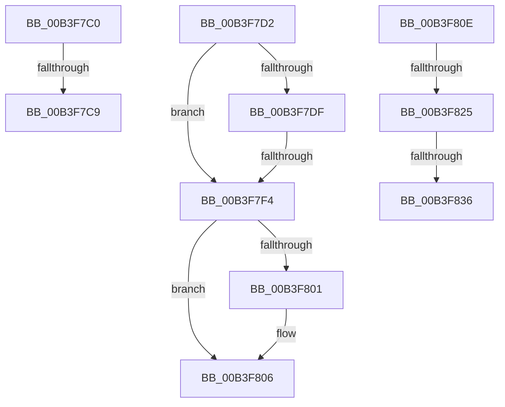

# sub_00B3F7C0

- RVA: `0x00B3F7C0`–`0x00B3F841` (길이 `129` bytes)
- VA: `0x0000000140B3F7C0`
- 실행 섹션: `PAGE`
- PDB 이름 있음: `아니요`; PDB Function 태그: `아니요`
- unwind 정보 RVA: `0x000B4A78`
- 디코드: `32`개 명령, `129/129` bytes 표시
- 미해석 바이트: `0` (있으면 어셈블리에 `.byte`로 보존)

> 이 문서는 커널 이미지의 기계어와 PDB 기호를 분석해 생성했습니다. 4번과 5번은 함수 원형과 자료형을 바이너리 사용 방식에서 추정한 C 해석이며 원본 소스 복구 결과는 아닙니다.

## 1. Dependencies

- 직접 호출 지점: **3**; 고유 호출 대상: **3**
- 직접 호출자로 확인된 함수: **0**
- RIP 상대 이미지 참조: **0**

### Outgoing calls
- `0x00B3F7E5` → [RtlDuplicateUnicodeString](../93/RtlDuplicateUnicodeString_function_009321F0.md) (function, `0x009321F0`)
- `0x00B3F811` → [KeAbPostRelease](../../text/2E/KeAbPostRelease_function_002E1600.md) (function, `0x002E1600`)
- `0x00B3F836` → [KiCheckForKernelApcDelivery](../../text/2E/KiCheckForKernelApcDelivery_function_002E2C80.md) (function, `0x002E2C80`)

### Direct callers
- 이 함수 시작 RVA로 연결되는 직접 call은 확인되지 않았습니다. 간접 호출은 완전히 역산할 수 없습니다.

### Static image references
- 디코드된 RIP-relative 메모리 참조가 없습니다.

## 2. Other-region calls and transfers

- 다른 실행 섹션으로 향하는 call: **2**
  - `0x00B3F811` → [KeAbPostRelease](../../text/2E/KeAbPostRelease_function_002E1600.md) (`PAGE` → `.text`)
  - `0x00B3F836` → [KiCheckForKernelApcDelivery](../../text/2E/KiCheckForKernelApcDelivery_function_002E2C80.md) (`PAGE` → `.text`)
- call이 아닌 외부 분기/꼬리 이동: **7**
  - `0x00B3F7C3` → [MiFindHotPatchRecord + 0x5D](../A6/MiFindHotPatchRecord_function_00A6E618.md) (`tail-transfer`)
  - `0x00B3F7CD` → [MiFindHotPatchRecord + 0x5D](../A6/MiFindHotPatchRecord_function_00A6E618.md) (`tail-transfer`)
  - `0x00B3F7EE` → [MiFindHotPatchRecord + 0x85](../A6/MiFindHotPatchRecord_function_00A6E618.md) (`tail-transfer`)
  - `0x00B3F809` → [MiFindHotPatchRecord + 0x85](../A6/MiFindHotPatchRecord_function_00A6E618.md) (`tail-transfer`)
  - `0x00B3F81F` → [MiFindHotPatchRecord + 0x8D](../A6/MiFindHotPatchRecord_function_00A6E618.md) (`tail-transfer`)
  - `0x00B3F830` → [MiFindHotPatchRecord + 0x8D](../A6/MiFindHotPatchRecord_function_00A6E618.md) (`tail-transfer`)
  - `0x00B3F83C` → [MiFindHotPatchRecord + 0x8D](../A6/MiFindHotPatchRecord_function_00A6E618.md) (`tail-transfer`)

## 3. Assembly (complete function range)

```asm
00B3F7C0  48 85 DB                        test rbx, rbx
00B3F7C3  0F 84 AC EE F2 FF               je 0x140a6e675
00B3F7C9  C6 43 0A 01                     mov byte ptr [rbx + 0xa], 1
00B3F7CD  E9 A3 EE F2 FF                  jmp 0x140a6e675
00B3F7D2  4C 8B 84 24 B0 00 00 00         mov r8, qword ptr [rsp + 0xb0]
00B3F7DA  4D 85 C0                        test r8, r8
00B3F7DD  74 15                           je 0x140b3f7f4
00B3F7DF  48 8D 53 28                     lea rdx, [rbx + 0x28]
00B3F7E3  33 C9                           xor ecx, ecx
00B3F7E5  E8 06 2A DF FF                  call 0x1409321f0
00B3F7EA  8B F8                           mov edi, eax
00B3F7EC  85 C0                           test eax, eax
00B3F7EE  0F 88 A9 EE F2 FF               js 0x140a6e69d
00B3F7F4  48 8B 8C 24 A8 00 00 00         mov rcx, qword ptr [rsp + 0xa8]
00B3F7FC  48 85 C9                        test rcx, rcx
00B3F7FF  74 05                           je 0x140b3f806
00B3F801  8B 43 20                        mov eax, dword ptr [rbx + 0x20]
00B3F804  89 01                           mov dword ptr [rcx], eax
00B3F806  41 8B FE                        mov edi, r14d
00B3F809  E9 8F EE F2 FF                  jmp 0x140a6e69d
00B3F80E  49 8B CF                        mov rcx, r15
00B3F811  E8 EA 1D 7A FF                  call 0x1402e1600
00B3F816  90                              nop
00B3F817  66 83 86 E6 01 00 00 01         add word ptr [rsi + 0x1e6], 1
00B3F81F  0F 85 80 EE F2 FF               jne 0x140a6e6a5
00B3F825  48 8D 86 98 00 00 00            lea rax, [rsi + 0x98]
00B3F82C  90                              nop
00B3F82D  48 39 00                        cmp qword ptr [rax], rax
00B3F830  0F 84 6F EE F2 FF               je 0x140a6e6a5
00B3F836  E8 45 34 7A FF                  call 0x1402e2c80
00B3F83B  90                              nop
00B3F83C  E9 64 EE F2 FF                  jmp 0x140a6e6a5
```

## 4. C-style interpretation (structured pseudocode)

```c
__int64 __fastcall sub_00B3F7C0(int a1)
{
    unsigned __int64 v_stack_pA8;
    unsigned __int64 v_stack_pB0;

    *(unsigned __int8 *)(v_rbx + 10) = 1;
}
```

## 5. (Beta) C Style

```c
int64_t sub_00B3F7C0(int32_t Arg1)
{
    uint64_t v_stack_pA8;
    uint64_t v_stack_pB0;

    *(uint8_t *)(local_rbx + 0xA) = 1;
}
```

## 6. Execution-region graph

[열기: 2D/3D 그래프와 함수 탐색 컨트롤 패널](../../../control-panel.html?section=page&rva=0x00B3F7C0&view=graph)

- 2D 그래프는 위에서 아래로 흐르고, 3D 그래프는 빈 공간을 드래그해 회전합니다. Shift+드래그는 이동, 휠은 확대·축소, 함수 노드 선택은 대상 보고서 이동입니다.

### Static fallback


