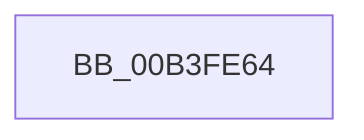

# sub_00B3FE64

- RVA: `0x00B3FE64`–`0x00B3FE90` (길이 `44` bytes)
- VA: `0x0000000140B3FE64`
- 실행 섹션: `PAGE`
- PDB 이름 있음: `아니요`; PDB Function 태그: `아니요`
- unwind 정보 RVA: `0x000B4D64`
- 디코드: `10`개 명령, `44/44` bytes 표시
- 미해석 바이트: `0` (있으면 어셈블리에 `.byte`로 보존)

> 이 문서는 커널 이미지의 기계어와 PDB 기호를 분석해 생성했습니다. 4번과 5번은 함수 원형과 자료형을 바이너리 사용 방식에서 추정한 C 해석이며 원본 소스 복구 결과는 아닙니다.

## 1. Dependencies

- 직접 호출 지점: **1**; 고유 호출 대상: **1**
- 직접 호출자로 확인된 함수: **0**
- RIP 상대 이미지 참조: **2**

### Outgoing calls
- `0x00B3FE85` → [PiGetDriverMutableStateDirectory](../72/PiGetDriverMutableStateDirectory_function_00729038.md) (function, `0x00729038`)

### Direct callers
- 이 함수 시작 RVA로 연결되는 직접 call은 확인되지 않았습니다. 간접 호출은 완전히 역산할 수 없습니다.

### Static image references
- `0x00B3FE68` → RVA `0x00AFD610` (` ?? ::NNGAKEGL::`string'`; read)
- `0x00B3FE6F` → RVA `0x00AFD620` (` ?? ::NNGAKEGL::`string'`; read)

## 2. Other-region calls and transfers

- 다른 실행 섹션으로 향하는 call: **0**
- call이 아닌 외부 분기/꼬리 이동: **1**
  - `0x00B3FE8B` → [IoGetDriverDirectory + 0xF6](../A6/IoGetDriverDirectory_function_00A6F180.md) (`tail-transfer`)

## 3. Assembly (complete function range)

```asm
00B3FE64  44 38 65 30                     cmp byte ptr [rbp + 0x30], r12b
00B3FE68  48 8D 15 A1 D7 FB FF            lea rdx, [rip - 0x4285f]
00B3FE6F  48 8D 05 AA D7 FB FF            lea rax, [rip - 0x42856]
00B3FE76  48 0F 45 D0                     cmovne rdx, rax
00B3FE7A  45 33 C0                        xor r8d, r8d
00B3FE7D  4C 8D 4D E0                     lea r9, [rbp - 0x20]
00B3FE81  48 8D 4D E8                     lea rcx, [rbp - 0x18]
00B3FE85  E8 AE 91 BE FF                  call 0x140729038
00B3FE8A  90                              nop
00B3FE8B  E9 E6 F3 F2 FF                  jmp 0x140a6f276
```

## 4. C-style interpretation (structured pseudocode)

```c
__int64 __fastcall sub_00B3FE64(__int64 a1, __int64 a2, int a3)
{
    __int64 result;

    a2 = v_rip - 272479;
    if ((*(unsigned __int8 *)(v_rbp + 48)) != ((unsigned __int8)(v_r12))) { a2 = v_rip - 272470; }
    a3 = 0;
    result = PiGetDriverMutableStateDirectory(v_rbp - 24, a2, a3, v_rbp - 32);
}
```

## 5. (Beta) C Style

```c
int64_t sub_00B3FE64(int64_t Arg1, int64_t Arg2, int32_t Arg3)
{
    int64_t result;

    Arg2 = v_rip - 272479;
    if ((*(uint8_t *)(local_rbp + 0x30)) != ((uint8_t)(local_r12))) { Arg2 = v_rip - 272470; }
    Arg3 = 0;
    result = PiGetDriverMutableStateDirectory(local_rbp - 24, Arg2, Arg3, local_rbp - 32);
}
```

## 6. Execution-region graph

[열기: 2D/3D 그래프와 함수 탐색 컨트롤 패널](../../../control-panel.html?section=page&rva=0x00B3FE64&view=graph)

- 2D 그래프는 위에서 아래로 흐르고, 3D 그래프는 빈 공간을 드래그해 회전합니다. Shift+드래그는 이동, 휠은 확대·축소, 함수 노드 선택은 대상 보고서 이동입니다.

### Static fallback


