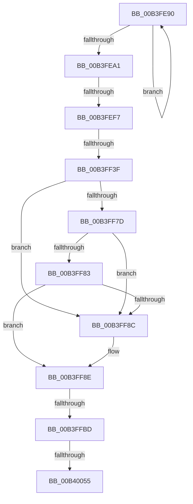

# sub_00B3FE90

- RVA: `0x00B3FE90`–`0x00B4005A` (길이 `458` bytes)
- VA: `0x0000000140B3FE90`
- 실행 섹션: `PAGE`
- PDB 이름 있음: `아니요`; PDB Function 태그: `아니요`
- unwind 정보 RVA: `0x000B4DB4`
- 디코드: `119`개 명령, `458/458` bytes 표시
- 미해석 바이트: `0` (있으면 어셈블리에 `.byte`로 보존)

> 이 문서는 커널 이미지의 기계어와 PDB 기호를 분석해 생성했습니다. 4번과 5번은 함수 원형과 자료형을 바이너리 사용 방식에서 추정한 C 해석이며 원본 소스 복구 결과는 아닙니다.

## 1. Dependencies

- 직접 호출 지점: **9**; 고유 호출 대상: **8**
- 직접 호출자로 확인된 함수: **0**
- RIP 상대 이미지 참조: **5**

### Outgoing calls
- `0x00B3FECE` → [RtlFreeAnsiString](../9C/RtlFreeAnsiString_function_009C0800.md) (function, `0x009C0800`)
- `0x00B3FEE6` → [ExAllocatePool2](../../poolcode/B8/ExAllocatePool2_function_00B820F0.md) (function, `0x00B820F0`)
- `0x00B3FF1B` → [RtlStringCbPrintfW](../../text/40/RtlStringCbPrintfW_function_0040FB40.md) (function, `0x0040FB40`)
- `0x00B3FF30` → [_PnpCtxGetCachedContextBaseKey](../8E/_PnpCtxGetCachedContextBaseKey_function_008EFB2C.md) (function, `0x008EFB2C`)
- `0x00B3FF46` → [RtlInitUnicodeString](../../text/42/RtlInitUnicodeString_function_0042A780.md) (function, `0x0042A780`)
- `0x00B3FF6E` → [ZwQueryValueKey](../../text/6A/ZwQueryValueKey_function_006AD3B0.md) (function, `0x006AD3B0`)
- `0x00B3FFAC` → [ZwSetValueKey](../../text/6A/ZwSetValueKey_function_006ADCD0.md) (function, `0x006ADCD0`)
- `0x00B40016` → [RtlStringCchPrintfExW](../../text/42/RtlStringCchPrintfExW_function_0042B390.md) (function, `0x0042B390`)
- `0x00B40046` → [ZwSetValueKey](../../text/6A/ZwSetValueKey_function_006ADCD0.md) (function, `0x006ADCD0`)

### Direct callers
- 이 함수 시작 RVA로 연결되는 직접 call은 확인되지 않았습니다. 간접 호출은 완전히 역산할 수 없습니다.

### Static image references
- `0x00B3FEFE` → RVA `0x00AFDDE0` (` ?? ::NNGAKEGL::`string'`; read)
- `0x00B3FF09` → RVA `0x00AFDE00` (` ?? ::NNGAKEGL::`string'`; read)
- `0x00B3FF20` → RVA `0x00E66398` (`.data`; read)
- `0x00B3FFC0` → RVA `0x00AFDEA0` (` ?? ::NNGAKEGL::`string'`; read)
- `0x00B3FFFB` → RVA `0x00AFDE20` (` ?? ::NNGAKEGL::`string'`; read)

## 2. Other-region calls and transfers

- 다른 실행 섹션으로 향하는 call: **7**
  - `0x00B3FEE6` → [ExAllocatePool2](../../poolcode/B8/ExAllocatePool2_function_00B820F0.md) (`PAGE` → `POOLCODE`)
  - `0x00B3FF1B` → [RtlStringCbPrintfW](../../text/40/RtlStringCbPrintfW_function_0040FB40.md) (`PAGE` → `.text`)
  - `0x00B3FF46` → [RtlInitUnicodeString](../../text/42/RtlInitUnicodeString_function_0042A780.md) (`PAGE` → `.text`)
  - `0x00B3FF6E` → [ZwQueryValueKey](../../text/6A/ZwQueryValueKey_function_006AD3B0.md) (`PAGE` → `.text`)
  - `0x00B3FFAC` → [ZwSetValueKey](../../text/6A/ZwSetValueKey_function_006ADCD0.md) (`PAGE` → `.text`)
  - `0x00B40016` → [RtlStringCchPrintfExW](../../text/42/RtlStringCchPrintfExW_function_0042B390.md) (`PAGE` → `.text`)
  - `0x00B40046` → [ZwSetValueKey](../../text/6A/ZwSetValueKey_function_006ADCD0.md) (`PAGE` → `.text`)
- call이 아닌 외부 분기/꼬리 이동: **5**
  - `0x00B3FEF1` → [PipMakeGloballyUniqueId + 0x1EF](../A6/PipMakeGloballyUniqueId_function_00A6F428.md) (`tail-transfer`)
  - `0x00B3FF39` → [PipMakeGloballyUniqueId + 0x1F4](../A6/PipMakeGloballyUniqueId_function_00A6F428.md) (`tail-transfer`)
  - `0x00B3FFB7` → [PipMakeGloballyUniqueId + 0x1F4](../A6/PipMakeGloballyUniqueId_function_00A6F428.md) (`tail-transfer`)
  - `0x00B4004F` → [PipMakeGloballyUniqueId + 0x1F4](../A6/PipMakeGloballyUniqueId_function_00A6F428.md) (`tail-transfer`)
  - `0x00B40055` → [PipMakeGloballyUniqueId + 0x1A7](../A6/PipMakeGloballyUniqueId_function_00A6F428.md) (`tail-transfer`)

## 3. Assembly (complete function range)

```asm
00B3FE90  0F B7 01                        movzx eax, word ptr [rcx]
00B3FE93  6B D2 25                        imul edx, edx, 0x25
00B3FE96  03 D0                           add edx, eax
00B3FE98  48 83 C1 02                     add rcx, 2
00B3FE9C  49 3B C8                        cmp rcx, r8
00B3FE9F  72 EF                           jb 0x140b3fe90
00B3FEA1  69 C2 A5 B0 B9 12               imul eax, edx, 0x12b9b0a5
00B3FEA7  48 8D 4D CF                     lea rcx, [rbp - 0x31]
00B3FEAB  8B D8                           mov ebx, eax
00B3FEAD  F7 DB                           neg ebx
00B3FEAF  0F 48 D8                        cmovs ebx, eax
00B3FEB2  B8 99 2F B8 44                  mov eax, 0x44b82f99
00B3FEB7  F7 EB                           imul ebx
00B3FEB9  C1 FA 1C                        sar edx, 0x1c
00B3FEBC  8B C2                           mov eax, edx
00B3FEBE  C1 E8 1F                        shr eax, 0x1f
00B3FEC1  03 D0                           add edx, eax
00B3FEC3  69 C2 07 CA 9A 3B               imul eax, edx, 0x3b9aca07
00B3FEC9  2B D8                           sub ebx, eax
00B3FECB  89 5D EF                        mov dword ptr [rbp - 0x11], ebx
00B3FECE  E8 2D 09 E8 FF                  call 0x1409c0800
00B3FED3  8B 45 B7                        mov eax, dword ptr [rbp - 0x49]
00B3FED6  45 8B C4                        mov r8d, r12d
00B3FED9  03 C0                           add eax, eax
00B3FEDB  B9 00 01 00 00                  mov ecx, 0x100
00B3FEE0  8B D0                           mov edx, eax
00B3FEE2  48 89 45 F7                     mov qword ptr [rbp - 9], rax
00B3FEE6  E8 05 22 04 00                  call 0x140b820f0
00B3FEEB  48 8B F8                        mov rdi, rax
00B3FEEE  48 85 C0                        test rax, rax
00B3FEF1  0F 84 20 F7 F2 FF               je 0x140a6f617
00B3FEF7  41 8B 85 98 00 00 00            mov eax, dword ptr [r13 + 0x98]
00B3FEFE  4C 8D 0D DB DE FB FF            lea r9, [rip - 0x42125]
00B3FF05  48 8B 55 F7                     mov rdx, qword ptr [rbp - 9]
00B3FF09  4C 8D 05 F0 DE FB FF            lea r8, [rip - 0x42110]
00B3FF10  89 44 24 28                     mov dword ptr [rsp + 0x28], eax
00B3FF14  48 8B CF                        mov rcx, rdi
00B3FF17  89 5C 24 20                     mov dword ptr [rsp + 0x20], ebx
00B3FF1B  E8 20 FC 8C FF                  call 0x14040fb40
00B3FF20  48 8B 0D 71 64 32 00            mov rcx, qword ptr [rip + 0x326471]
00B3FF27  4C 8D 45 DF                     lea r8, [rbp - 0x21]
00B3FF2B  BA 05 00 00 00                  mov edx, 5
00B3FF30  E8 F7 FB DA FF                  call 0x1408efb2c
00B3FF35  8B D8                           mov ebx, eax
00B3FF37  85 C0                           test eax, eax
00B3FF39  0F 88 DD F6 F2 FF               js 0x140a6f61c
00B3FF3F  48 8B D7                        mov rdx, rdi
00B3FF42  48 8D 4D CF                     lea rcx, [rbp - 0x31]
00B3FF46  E8 35 A8 8E FF                  call 0x14042a780
00B3FF4B  48 8B 4D DF                     mov rcx, qword ptr [rbp - 0x21]
00B3FF4F  48 8D 45 B7                     lea rax, [rbp - 0x49]
00B3FF53  48 89 44 24 28                  mov qword ptr [rsp + 0x28], rax
00B3FF58  4C 8D 4D 07                     lea r9, [rbp + 7]
00B3FF5C  41 B8 02 00 00 00               mov r8d, 2
00B3FF62  C7 44 24 20 10 00 00 00         mov dword ptr [rsp + 0x20], 0x10
00B3FF6A  48 8D 55 CF                     lea rdx, [rbp - 0x31]
00B3FF6E  E8 3D D4 B6 FF                  call 0x1406ad3b0
00B3FF73  33 C9                           xor ecx, ecx
00B3FF75  44 8D 49 04                     lea r9d, [rcx + 4]
00B3FF79  85 C0                           test eax, eax
00B3FF7B  78 0F                           js 0x140b3ff8c
00B3FF7D  44 39 4D 0B                     cmp dword ptr [rbp + 0xb], r9d
00B3FF81  75 09                           jne 0x140b3ff8c
00B3FF83  8B 45 13                        mov eax, dword ptr [rbp + 0x13]
00B3FF86  44 39 4D 0F                     cmp dword ptr [rbp + 0xf], r9d
00B3FF8A  74 02                           je 0x140b3ff8e
00B3FF8C  8B C1                           mov eax, ecx
00B3FF8E  48 8B 4D DF                     mov rcx, qword ptr [rbp - 0x21]
00B3FF92  48 8D 55 CF                     lea rdx, [rbp - 0x31]
00B3FF96  FF C0                           inc eax
00B3FF98  44 89 4C 24 28                  mov dword ptr [rsp + 0x28], r9d
00B3FF9D  89 45 C7                        mov dword ptr [rbp - 0x39], eax
00B3FFA0  45 33 C0                        xor r8d, r8d
00B3FFA3  48 8D 45 C7                     lea rax, [rbp - 0x39]
00B3FFA7  48 89 44 24 20                  mov qword ptr [rsp + 0x20], rax
00B3FFAC  E8 1F DD B6 FF                  call 0x1406adcd0
00B3FFB1  33 D2                           xor edx, edx
00B3FFB3  8B D8                           mov ebx, eax
00B3FFB5  85 C0                           test eax, eax
00B3FFB7  0F 88 5F F6 F2 FF               js 0x140a6f61c
00B3FFBD  8B 45 C7                        mov eax, dword ptr [rbp - 0x39]
00B3FFC0  48 8D 0D D9 DE FB FF            lea rcx, [rip - 0x42127]
00B3FFC7  FF C8                           dec eax
00B3FFC9  48 89 4D D7                     mov qword ptr [rbp - 0x29], rcx
00B3FFCD  48 8B 4D F7                     mov rcx, qword ptr [rbp - 9]
00B3FFD1  4C 8D 45 DF                     lea r8, [rbp - 0x21]
00B3FFD5  89 44 24 40                     mov dword ptr [rsp + 0x40], eax
00B3FFD9  45 33 C9                        xor r9d, r9d
00B3FFDC  89 45 C7                        mov dword ptr [rbp - 0x39], eax
00B3FFDF  8B 45 EF                        mov eax, dword ptr [rbp - 0x11]
00B3FFE2  89 44 24 38                     mov dword ptr [rsp + 0x38], eax
00B3FFE6  48 D1 E9                        shr rcx, 1
00B3FFE9  C7 45 CF 1C 00 1E 00            mov dword ptr [rbp - 0x31], 0x1e001c
00B3FFF0  41 8B 85 98 00 00 00            mov eax, dword ptr [r13 + 0x98]
00B3FFF7  89 44 24 30                     mov dword ptr [rsp + 0x30], eax
00B3FFFB  48 8D 05 1E DE FB FF            lea rax, [rip - 0x421e2]
00B40002  48 89 44 24 28                  mov qword ptr [rsp + 0x28], rax
00B40007  48 89 54 24 20                  mov qword ptr [rsp + 0x20], rdx
00B4000C  48 8B D1                        mov rdx, rcx
00B4000F  48 8B CF                        mov rcx, rdi
00B40012  48 89 7D DF                     mov qword ptr [rbp - 0x21], rdi
00B40016  E8 75 B3 8E FF                  call 0x14042b390
00B4001B  48 8B 45 DF                     mov rax, qword ptr [rbp - 0x21]
00B4001F  48 8D 55 CF                     lea rdx, [rbp - 0x31]
00B40023  48 8B 4D E7                     mov rcx, qword ptr [rbp - 0x19]
00B40027  48 2B C7                        sub rax, rdi
00B4002A  48 D1 F8                        sar rax, 1
00B4002D  41 B9 01 00 00 00               mov r9d, 1
00B40033  FF C0                           inc eax
00B40035  45 33 C0                        xor r8d, r8d
00B40038  89 45 B7                        mov dword ptr [rbp - 0x49], eax
00B4003B  03 C0                           add eax, eax
00B4003D  89 44 24 28                     mov dword ptr [rsp + 0x28], eax
00B40041  48 89 7C 24 20                  mov qword ptr [rsp + 0x20], rdi
00B40046  E8 85 DC B6 FF                  call 0x1406adcd0
00B4004B  8B D8                           mov ebx, eax
00B4004D  85 C0                           test eax, eax
00B4004F  0F 88 C7 F5 F2 FF               js 0x140a6f61c
00B40055  E9 75 F5 F2 FF                  jmp 0x140a6f5cf
```

## 4. C-style interpretation (structured pseudocode)

```c
__int64 __fastcall sub_00B3FE90(__int64 a1, int a2, __int64 a3)
{
    __int64 result;
    __int64 v_rbx;
    unsigned int v_stack_p20;
    unsigned int v_stack_p28;
    unsigned int v_stack_p30;
    unsigned int v_stack_p38;
    unsigned int v_stack_p40;

    a2 = (unsigned int)((a2) * (a2));
    a2 = (unsigned int)((a2) + ((unsigned int)(*(unsigned __int16 *)(a1))));
    a1 = (a1) + (2);
    if (a1 < a3) goto loc_00B3FE90;
    result = (unsigned int)((*(unsigned __int16 *)(a1)) * (a2));
    v_rbx = (unsigned int)(-((unsigned int)((unsigned int)(result))));
    if (sign_flag) { v_rbx = (unsigned int)(result); }
    a2 = (unsigned int)((a2) >> (28));
    result = (unsigned int)(((unsigned int)(a2)) >> (31));
    a2 = (unsigned int)((a2) + ((unsigned int)(result)));
    result = (unsigned int)((result) * (a2));
    v_rbx = (unsigned int)((v_rbx) - ((unsigned int)(result)));
    *(unsigned int *)(v_rbp - 17) = (unsigned int)(v_rbx);
    result = RtlFreeAnsiString(v_rbp - 49, a2, a3, a4);
    result = (unsigned int)(((unsigned int)(*(unsigned int *)(v_rbp - 73))) + ((unsigned int)((unsigned int)(*(unsigned int *)(v_rbp - 73)))));
    *(unsigned __int64 *)(v_rbp - 9) = result;
    result = ExAllocatePool2(256, (unsigned int)((unsigned int)(result)), (unsigned int)((unsigned int)(v_r12)), a4);
    v_stack_p28 = (unsigned int)((unsigned int)(*(unsigned int *)(v_r13 + 152)));
    v_stack_p20 = (unsigned int)(v_rbx);
    result = RtlStringCbPrintfW(result, *(unsigned __int64 *)(v_rbp - 9), v_rip - 270608, v_rip - 270629);
    result = _PnpCtxGetCachedContextBaseKey(*(unsigned __int64 *)(v_rip + 3302513), 5, v_rbp - 33, v_rip - 270629);
    result = RtlInitUnicodeString(v_rbp - 49, result, v_rbp - 33, v_rip - 270629);
    v_stack_p28 = v_rbp - 73;
    v_stack_p20 = 16;
    result = ZwQueryValueKey(*(unsigned __int64 *)(v_rbp - 33), v_rbp - 49, 2, v_rbp + 7);
    a1 = 0;
    if (sign_flag) goto loc_00B3FF8C;
    if ((*(unsigned int *)(v_rbp + 11)) != ((unsigned int)(a1 + 4))) goto loc_00B3FF8C;
    result = (unsigned int)(*(unsigned int *)(v_rbp + 19));
    if ((*(unsigned int *)(v_rbp + 15)) != ((unsigned int)(a1 + 4))) {
        result = 0;
    }
    result = (unsigned int)((result) + 1);
    v_stack_p28 = (unsigned int)(a1 + 4);
    *(unsigned int *)(v_rbp - 57) = (unsigned int)(result);
    a3 = 0;
    v_stack_p20 = v_rbp - 57;
    result = ZwSetValueKey(*(unsigned __int64 *)(v_rbp - 33), v_rbp - 49, a3, a1 + 4);
    a2 = 0;
    result = (unsigned int)(((unsigned int)(*(unsigned int *)(v_rbp - 57))) - 1);
    *(unsigned __int64 *)(v_rbp - 41) = v_rip - 270631;
    v_stack_p40 = (unsigned int)(result);
    a4 = 0;
    *(unsigned int *)(v_rbp - 57) = (unsigned int)(result);
    v_stack_p38 = (unsigned int)((unsigned int)(*(unsigned int *)(v_rbp - 17)));
    a1 = (*(unsigned __int64 *)(v_rbp - 9)) >> (1);
    *(unsigned int *)(v_rbp - 49) = 0x1E001CULL;
    v_stack_p30 = (unsigned int)((unsigned int)(*(unsigned int *)(v_r13 + 152)));
    v_stack_p28 = v_rip - 270818;
    v_stack_p20 = 0;
    *(unsigned __int64 *)(v_rbp - 33) = result;
    result = RtlStringCchPrintfExW(result, a1, v_rbp - 33, a4);
    result = (*(unsigned __int64 *)(v_rbp - 33)) - (result);
    result = (result) >> (1);
    result = (unsigned int)((result) + 1);
    a3 = 0;
    *(unsigned int *)(v_rbp - 73) = (unsigned int)(result);
    result = (unsigned int)((result) + ((unsigned int)(result)));
    v_stack_p28 = (unsigned int)(result);
    v_stack_p20 = result;
    result = ZwSetValueKey(*(unsigned __int64 *)(v_rbp - 25), v_rbp - 49, a3, 1);
}
```

## 5. (Beta) C Style

```c
int64_t sub_00B3FE90(int64_t Arg1, int32_t Arg2, int64_t Arg3)
{
    int64_t result;
    int64_t local_rbx;
    uint32_t v_stack_p20;
    uint32_t v_stack_p28;
    uint32_t v_stack_p30;
    uint32_t v_stack_p38;
    uint32_t v_stack_p40;

    Arg2 = (uint32_t)((Arg2) * (Arg2));
    Arg2 = (uint32_t)((Arg2) + ((uint32_t)(*(uint16_t *)(Arg1))));
    Arg1 = (Arg1) + (2);
    if (Arg1 < Arg3) goto loc_00B3FE90;
    result = (uint32_t)((*(uint16_t *)(Arg1)) * (Arg2));
    local_rbx = (uint32_t)(-((uint32_t)((uint32_t)(result))));
    if (sign_flag) { local_rbx = (uint32_t)(result); }
    Arg2 = (uint32_t)((Arg2) >> (28));
    result = (uint32_t)(((uint32_t)(Arg2)) >> (31));
    Arg2 = (uint32_t)((Arg2) + ((uint32_t)(result)));
    result = (uint32_t)((result) * (Arg2));
    local_rbx = (uint32_t)((local_rbx) - ((uint32_t)(result)));
    *(uint32_t *)(local_rbp - 0x11) = (uint32_t)(local_rbx);
    result = RtlFreeAnsiString(local_rbp - 49, Arg2, Arg3, a4);
    result = (uint32_t)(((uint32_t)(*(uint32_t *)(local_rbp - 0x49))) + ((uint32_t)((uint32_t)(*(uint32_t *)(local_rbp - 0x49)))));
    *(uint64_t *)(local_rbp - 0x9) = result;
    result = ExAllocatePool2(256, (uint32_t)((uint32_t)(result)), (uint32_t)((uint32_t)(local_r12)), a4);
    v_stack_p28 = (uint32_t)((uint32_t)(*(uint32_t *)(local_r13 + 0x98)));
    v_stack_p20 = (uint32_t)(local_rbx);
    result = RtlStringCbPrintfW(result, *(uint64_t *)(local_rbp - 0x9), v_rip - 270608, v_rip - 270629);
    result = _PnpCtxGetCachedContextBaseKey(*(uint64_t *)(v_rip + 0x326471), 5, local_rbp - 33, v_rip - 270629);
    result = RtlInitUnicodeString(local_rbp - 49, result, local_rbp - 33, v_rip - 270629);
    v_stack_p28 = local_rbp - 73;
    v_stack_p20 = 16;
    result = ZwQueryValueKey(*(uint64_t *)(local_rbp - 0x21), local_rbp - 49, 2, local_rbp + 7);
    Arg1 = 0;
    if (sign_flag) goto loc_00B3FF8C;
    if ((*(uint32_t *)(local_rbp + 0xB)) != ((uint32_t)(Arg1 + 4))) goto loc_00B3FF8C;
    result = (uint32_t)(*(uint32_t *)(local_rbp + 0x13));
    if ((*(uint32_t *)(local_rbp + 0xF)) != ((uint32_t)(Arg1 + 4))) {
        result = 0;
    }
    result = (uint32_t)((result) + 1);
    v_stack_p28 = (uint32_t)(Arg1 + 4);
    *(uint32_t *)(local_rbp - 0x39) = (uint32_t)(result);
    Arg3 = 0;
    v_stack_p20 = local_rbp - 57;
    result = ZwSetValueKey(*(uint64_t *)(local_rbp - 0x21), local_rbp - 49, Arg3, Arg1 + 4);
    Arg2 = 0;
    result = (uint32_t)(((uint32_t)(*(uint32_t *)(local_rbp - 0x39))) - 1);
    *(uint64_t *)(local_rbp - 0x29) = v_rip - 270631;
    v_stack_p40 = (uint32_t)(result);
    a4 = 0;
    *(uint32_t *)(local_rbp - 0x39) = (uint32_t)(result);
    v_stack_p38 = (uint32_t)((uint32_t)(*(uint32_t *)(local_rbp - 0x11)));
    Arg1 = (*(uint64_t *)(local_rbp - 0x9)) >> (1);
    *(uint32_t *)(local_rbp - 0x31) = 0x1E001CULL;
    v_stack_p30 = (uint32_t)((uint32_t)(*(uint32_t *)(local_r13 + 0x98)));
    v_stack_p28 = v_rip - 270818;
    v_stack_p20 = 0;
    *(uint64_t *)(local_rbp - 0x21) = result;
    result = RtlStringCchPrintfExW(result, Arg1, local_rbp - 33, a4);
    result = (*(uint64_t *)(local_rbp - 0x21)) - (result);
    result = (result) >> (1);
    result = (uint32_t)((result) + 1);
    Arg3 = 0;
    *(uint32_t *)(local_rbp - 0x49) = (uint32_t)(result);
    result = (uint32_t)((result) + ((uint32_t)(result)));
    v_stack_p28 = (uint32_t)(result);
    v_stack_p20 = result;
    result = ZwSetValueKey(*(uint64_t *)(local_rbp - 0x19), local_rbp - 49, Arg3, 1);
}
```

## 6. Execution-region graph

[열기: 2D/3D 그래프와 함수 탐색 컨트롤 패널](../../../control-panel.html?section=page&rva=0x00B3FE90&view=graph)

- 2D 그래프는 위에서 아래로 흐르고, 3D 그래프는 빈 공간을 드래그해 회전합니다. Shift+드래그는 이동, 휠은 확대·축소, 함수 노드 선택은 대상 보고서 이동입니다.

### Static fallback


