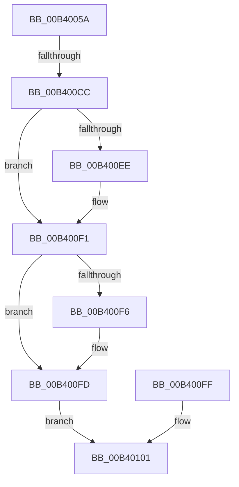

# sub_00B4005A

- RVA: `0x00B4005A`–`0x00B40108` (길이 `174` bytes)
- VA: `0x0000000140B4005A`
- 실행 섹션: `PAGE`
- PDB 이름 있음: `아니요`; PDB Function 태그: `아니요`
- unwind 정보 RVA: `0x000B4E68`
- 디코드: `35`개 명령, `174/174` bytes 표시
- 미해석 바이트: `0` (있으면 어셈블리에 `.byte`로 보존)

> 이 문서는 커널 이미지의 기계어와 PDB 기호를 분석해 생성했습니다. 4번과 5번은 함수 원형과 자료형을 바이너리 사용 방식에서 추정한 C 해석이며 원본 소스 복구 결과는 아닙니다.

## 1. Dependencies

- 직접 호출 지점: **1**; 고유 호출 대상: **1**
- 직접 호출자로 확인된 함수: **0**
- RIP 상대 이미지 참조: **0**

### Outgoing calls
- `0x00B400BF` → [MmMapViewOfSection](../98/MmMapViewOfSection_function_00981680.md) (function, `0x00981680`)

### Direct callers
- 이 함수 시작 RVA로 연결되는 직접 call은 확인되지 않았습니다. 간접 호출은 완전히 역산할 수 없습니다.

### Static image references
- 디코드된 RIP-relative 메모리 참조가 없습니다.

## 2. Other-region calls and transfers

- 다른 실행 섹션으로 향하는 call: **0**
- call이 아닌 외부 분기/꼬리 이동: **2**
  - `0x00B400C6` → [PspMapSiloSharedDataView + 0x27](../A6/PspMapSiloSharedDataView_function_00A6F850.md) (`tail-transfer`)
  - `0x00B40103` → [PspMapSiloSharedDataView + 0x27](../A6/PspMapSiloSharedDataView_function_00A6F850.md) (`tail-transfer`)

## 3. Assembly (complete function range)

```asm
00B4005A  48 89 5C 24 78                  mov qword ptr [rsp + 0x78], rbx
00B4005F  48 89 9C 24 88 00 00 00         mov qword ptr [rsp + 0x88], rbx
00B40067  48 89 9C 24 80 00 00 00         mov qword ptr [rsp + 0x80], rbx
00B4006F  48 8B 86 E0 05 00 00            mov rax, qword ptr [rsi + 0x5e0]
00B40076  48 8B 88 10 05 00 00            mov rcx, qword ptr [rax + 0x510]
00B4007D  C7 44 24 48 02 00 00 00         mov dword ptr [rsp + 0x48], 2
00B40085  C7 44 24 40 00 00 40 00         mov dword ptr [rsp + 0x40], 0x400000
00B4008D  C7 44 24 38 01 00 00 00         mov dword ptr [rsp + 0x38], 1
00B40095  48 8D 84 24 80 00 00 00         lea rax, [rsp + 0x80]
00B4009D  48 89 44 24 30                  mov qword ptr [rsp + 0x30], rax
00B400A2  48 8D 84 24 88 00 00 00         lea rax, [rsp + 0x88]
00B400AA  48 89 44 24 28                  mov qword ptr [rsp + 0x28], rax
00B400AF  48 89 5C 24 20                  mov qword ptr [rsp + 0x20], rbx
00B400B4  45 33 C9                        xor r9d, r9d
00B400B7  4C 8D 44 24 78                  lea r8, [rsp + 0x78]
00B400BC  48 8B D7                        mov rdx, rdi
00B400BF  E8 BC 15 E4 FF                  call 0x140981680
00B400C4  85 C0                           test eax, eax
00B400C6  0F 88 AB F7 F2 FF               js 0x140a6f877
00B400CC  48 8B 8F E0 02 00 00            mov rcx, qword ptr [rdi + 0x2e0]
00B400D3  48 8B 44 24 78                  mov rax, qword ptr [rsp + 0x78]
00B400D8  48 89 81 90 00 00 00            mov qword ptr [rcx + 0x90], rax
00B400DF  48 8B CB                        mov rcx, rbx
00B400E2  48 8B 87 10 03 00 00            mov rax, qword ptr [rdi + 0x310]
00B400E9  48 85 C0                        test rax, rax
00B400EC  74 03                           je 0x140b400f1
00B400EE  48 8B 08                        mov rcx, qword ptr [rax]
00B400F1  48 85 C9                        test rcx, rcx
00B400F4  74 07                           je 0x140b400fd
00B400F6  8B 44 24 78                     mov eax, dword ptr [rsp + 0x78]
00B400FA  89 41 50                        mov dword ptr [rcx + 0x50], eax
00B400FD  EB 02                           jmp 0x140b40101
00B400FF  8B D8                           mov ebx, eax
00B40101  8B C3                           mov eax, ebx
00B40103  E9 6F F7 F2 FF                  jmp 0x140a6f877
```

## 4. C-style interpretation (structured pseudocode)

```c
__int64 __fastcall sub_00B4005A(__int64 a1, __int64 a2, __int64 a3, int a4, __int64 a5, __int64 a6, __int64 a7, __int64 a8, __int64 a9, __int64 a10, __int64 a11, __int64 a12, __int64 a13, __int64 a14, unsigned int a15, __int64 a16, __int64 a17)
{
    __int64 result;
    unsigned __int64 v_stack_p20;
    unsigned __int64 v_stack_p28;
    unsigned __int64 v_stack_p30;
    unsigned int v_stack_p38;
    unsigned int v_stack_p40;
    unsigned int v_stack_p48;
    unsigned __int64 v_stack_p78;
    unsigned __int64 v_stack_p80;
    unsigned __int64 v_stack_p88;

    v_stack_p78 = v_rbx;
    v_stack_p88 = v_rbx;
    v_stack_p80 = v_rbx;
    v_stack_p48 = 2;
    v_stack_p40 = 0x400000ULL;
    v_stack_p38 = 1;
    v_stack_p30 = a16;
    v_stack_p28 = a17;
    v_stack_p20 = v_rbx;
    a4 = 0;
    result = MmMapViewOfSection(*(unsigned __int64 *)(*(unsigned __int64 *)(v_rsi + 1504) + 1296), v_rdi, a15, a4);
    *(unsigned __int64 *)(*(unsigned __int64 *)(v_rdi + 736) + 144) = a15;
    if (*(unsigned __int64 *)(v_rdi + 784) != 0) {
        a1 = *(unsigned __int64 *)(*(unsigned __int64 *)(v_rdi + 784));
    }
    result = *(unsigned __int64 *)(v_rdi + 784);
    if (a1 != 0) {
        result = a15;
        *(unsigned int *)(a1 + 80) = (unsigned int)(result);
    }
    goto loc_00B40101;
loc_00B40101:
}
```

## 5. (Beta) C Style

```c
int64_t sub_00B4005A(int64_t Arg1, int64_t Arg2, int64_t Arg3, int32_t Arg4, uint64_t Arg5, uint64_t Arg6, uint64_t Arg7, uint64_t Arg8, uint64_t Arg9, uint64_t Arg10, uint64_t Arg11, uint64_t Arg12, uint64_t Arg13, uint64_t Arg14, uint32_t Arg15, int64_t Arg16, int64_t Arg17)
{
    int64_t result;
    uint64_t v_stack_p20;
    uint64_t v_stack_p28;
    uint64_t v_stack_p30;
    uint32_t v_stack_p38;
    uint32_t v_stack_p40;
    uint32_t v_stack_p48;
    uint64_t v_stack_p78;
    uint64_t v_stack_p80;
    uint64_t v_stack_p88;

    v_stack_p78 = local_rbx;
    v_stack_p88 = local_rbx;
    v_stack_p80 = local_rbx;
    v_stack_p48 = 2;
    v_stack_p40 = 0x400000ULL;
    v_stack_p38 = 1;
    v_stack_p30 = Arg16;
    v_stack_p28 = Arg17;
    v_stack_p20 = local_rbx;
    Arg4 = 0;
    result = MmMapViewOfSection(*(uint64_t *)(*(uint64_t *)(local_rsi + 0x5E0) + 0x510), local_rdi, Arg15, Arg4);
    *(uint64_t *)(*(uint64_t *)(local_rdi + 0x2E0) + 0x90) = Arg15;
    if (*(uint64_t *)(local_rdi + 0x310) != 0) {
        Arg1 = *(uint64_t *)(*(uint64_t *)(local_rdi + 0x310));
    }
    result = *(uint64_t *)(local_rdi + 0x310);
    if (Arg1 != 0) {
        result = Arg15;
        *(uint32_t *)(Arg1 + 0x50) = (uint32_t)(result);
    }
    goto loc_00B40101;
loc_00B40101:
}
```

## 6. Execution-region graph

[열기: 2D/3D 그래프와 함수 탐색 컨트롤 패널](../../../control-panel.html?section=page&rva=0x00B4005A&view=graph)

- 2D 그래프는 위에서 아래로 흐르고, 3D 그래프는 빈 공간을 드래그해 회전합니다. Shift+드래그는 이동, 휠은 확대·축소, 함수 노드 선택은 대상 보고서 이동입니다.

### Static fallback


