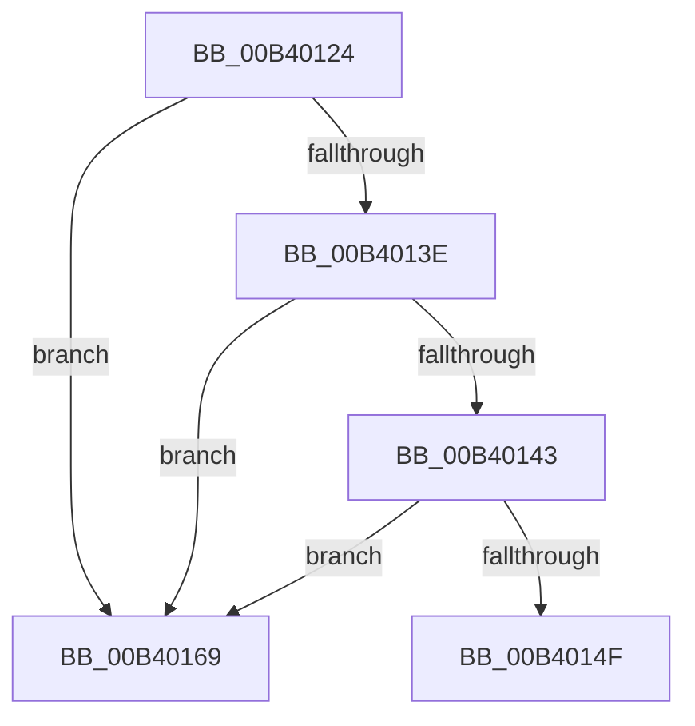

# sub_00B40124

- RVA: `0x00B40124`–`0x00B4018A` (길이 `102` bytes)
- VA: `0x0000000140B40124`
- 실행 섹션: `PAGE`
- PDB 이름 있음: `아니요`; PDB Function 태그: `아니요`
- unwind 정보 RVA: `0x000B4F24`
- 디코드: `26`개 명령, `102/102` bytes 표시
- 미해석 바이트: `0` (있으면 어셈블리에 `.byte`로 보존)

> 이 문서는 커널 이미지의 기계어와 PDB 기호를 분석해 생성했습니다. 4번과 5번은 함수 원형과 자료형을 바이너리 사용 방식에서 추정한 C 해석이며 원본 소스 복구 결과는 아닙니다.

## 1. Dependencies

- 직접 호출 지점: **2**; 고유 호출 대상: **2**
- 직접 호출자로 확인된 함수: **0**
- RIP 상대 이미지 참조: **1**

### Outgoing calls
- `0x00B40133` → [ObQueryNameStringMode](../8A/ObQueryNameStringMode_function_008A7ED0.md) (function, `0x008A7ED0`)
- `0x00B40174` → [RtlInitUnicodeString](../../text/42/RtlInitUnicodeString_function_0042A780.md) (function, `0x0042A780`)

### Direct callers
- 이 함수 시작 RVA로 연결되는 직접 call은 확인되지 않았습니다. 간접 호출은 완전히 역산할 수 없습니다.

### Static image references
- `0x00B40169` → RVA `0x00B00250` (` ?? ::NNGAKEGL::`string'`; read)

## 2. Other-region calls and transfers

- 다른 실행 섹션으로 향하는 call: **1**
  - `0x00B40174` → [RtlInitUnicodeString](../../text/42/RtlInitUnicodeString_function_0042A780.md) (`PAGE` → `.text`)
- call이 아닌 외부 분기/꼬리 이동: **2**
  - `0x00B40164` → [PiControlGetDeviceStack + 0x214](../A6/PiControlGetDeviceStack_function_00A6FE34.md) (`tail-transfer`)
  - `0x00B40185` → [PiControlGetDeviceStack + 0x214](../A6/PiControlGetDeviceStack_function_00A6FE34.md) (`tail-transfer`)

## 3. Assembly (complete function range)

```asm
00B40124  4C 8D 4D 48                     lea r9, [rbp + 0x48]
00B40128  40 88 7C 24 20                  mov byte ptr [rsp + 0x20], dil
00B4012D  48 8B D6                        mov rdx, rsi
00B40130  49 8B CF                        mov rcx, r15
00B40133  E8 98 7D D6 FF                  call 0x1408a7ed0
00B40138  8B D8                           mov ebx, eax
00B4013A  85 C0                           test eax, eax
00B4013C  78 2B                           js 0x140b40169
00B4013E  39 7D 48                        cmp dword ptr [rbp + 0x48], edi
00B40141  74 26                           je 0x140b40169
00B40143  41 B8 02 00 00 00               mov r8d, 2
00B40149  66 44 39 06                     cmp word ptr [rsi], r8w
00B4014D  72 1A                           jb 0x140b40169
00B4014F  0F 10 0E                        movups xmm1, xmmword ptr [rsi]
00B40152  F3 0F 7E 46 08                  movq xmm0, qword ptr [rsi + 8]
00B40157  0F 11 4D E8                     movups xmmword ptr [rbp - 0x18], xmm1
00B4015B  66 0F D6 45 F0                  movq qword ptr [rbp - 0x10], xmm0
00B40160  66 0F 7E CF                     movd edi, xmm1
00B40164  E9 DF FE F2 FF                  jmp 0x140a70048
00B40169  48 8D 15 E0 00 FC FF            lea rdx, [rip - 0x3ff20]
00B40170  48 8D 4D E8                     lea rcx, [rbp - 0x18]
00B40174  E8 07 A6 8E FF                  call 0x14042a780
00B40179  8B DF                           mov ebx, edi
00B4017B  0F B7 7D E8                     movzx edi, word ptr [rbp - 0x18]
00B4017F  41 B8 02 00 00 00               mov r8d, 2
00B40185  E9 BE FE F2 FF                  jmp 0x140a70048
```

## 4. C-style interpretation (structured pseudocode)

```c
__int64 __fastcall sub_00B40124(void)
{
    __int64 result;
    unsigned __int8 v_stack_p20;

    v_stack_p20 = (unsigned __int8)(v_rdi);
    result = ObQueryNameStringMode(v_r15, v_rsi, a3, v_rbp + 72);
    if (sign_flag) goto loc_00B40169;
    if ((*(unsigned int *)(v_rbp + 72)) == ((unsigned int)(v_rdi))) goto loc_00B40169;
    if ((*(unsigned __int16 *)(v_rsi)) < 2) goto loc_00B40169;
    *(unsigned __int64 *)(v_rbp - 24) = v_xmm1;
    *(unsigned __int64 *)(v_rbp - 16) = v_xmm0;
loc_00B40169:
    result = RtlInitUnicodeString(v_rbp - 24, v_rip - 261920, 2, v_rbp + 72);
}
```

## 5. (Beta) C Style

```c
void sub_00B40124(void)
{
    int64_t result;
    uint8_t v_stack_p20;

    v_stack_p20 = (uint8_t)(local_rdi);
    result = ObQueryNameStringMode(local_r15, local_rsi, a3, local_rbp + 72);
    if (sign_flag) goto loc_00B40169;
    if ((*(uint32_t *)(local_rbp + 0x48)) == ((uint32_t)(local_rdi))) goto loc_00B40169;
    if ((*(uint16_t *)(local_rsi)) < 2) goto loc_00B40169;
    *(uint64_t *)(local_rbp - 0x18) = v_xmm1;
    *(uint64_t *)(local_rbp - 0x10) = v_xmm0;
loc_00B40169:
    result = RtlInitUnicodeString(local_rbp - 24, v_rip - 261920, 2, local_rbp + 72);
}
```

## 6. Execution-region graph

[열기: 2D/3D 그래프와 함수 탐색 컨트롤 패널](../../../control-panel.html?section=page&rva=0x00B40124&view=graph)

- 2D 그래프는 위에서 아래로 흐르고, 3D 그래프는 빈 공간을 드래그해 회전합니다. Shift+드래그는 이동, 휠은 확대·축소, 함수 노드 선택은 대상 보고서 이동입니다.

### Static fallback


