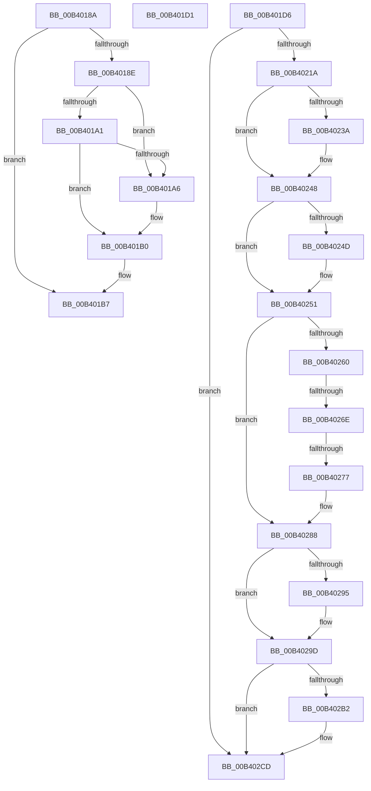

# sub_00B4018A

- RVA: `0x00B4018A`–`0x00B402DE` (길이 `340` bytes)
- VA: `0x0000000140B4018A`
- 실행 섹션: `PAGE`
- PDB 이름 있음: `아니요`; PDB Function 태그: `아니요`
- unwind 정보 RVA: `0x000B51A4`
- 디코드: `82`개 명령, `340/340` bytes 표시
- 미해석 바이트: `0` (있으면 어셈블리에 `.byte`로 보존)

> 이 문서는 커널 이미지의 기계어와 PDB 기호를 분석해 생성했습니다. 4번과 5번은 함수 원형과 자료형을 바이너리 사용 방식에서 추정한 C 해석이며 원본 소스 복구 결과는 아닙니다.

## 1. Dependencies

- 직접 호출 지점: **8**; 고유 호출 대상: **6**
- 직접 호출자로 확인된 함수: **0**
- RIP 상대 이미지 참조: **0**

### Outgoing calls
- `0x00B401D9` → [KiLeaveCriticalRegionUnsafe](../../text/25/KiLeaveCriticalRegionUnsafe_function_0025F010.md) (function, `0x0025F010`)
- `0x00B4020A` → [KeWaitForSingleObject](../../text/20/KeWaitForSingleObject_function_0020E6B0.md) (function, `0x0020E6B0`)
- `0x00B4022A` → [KeAbPreAcquire](../../text/21/KeAbPreAcquire_function_00210230.md) (function, `0x00210230`)
- `0x00B40243` → [ExfAcquirePushLockExclusiveEx](../../text/20/ExfAcquirePushLockExclusiveEx_function_0020FC90.md) (function, `0x0020FC90`)
- `0x00B40298` → [ExfTryToWakePushLock](../../text/26/ExfTryToWakePushLock_function_00265DD0.md) (function, `0x00265DD0`)
- `0x00B402A0` → [KeAbPostRelease](../../text/2E/KeAbPostRelease_function_002E1600.md) (function, `0x002E1600`)
- `0x00B402A8` → [KiLeaveCriticalRegionUnsafe](../../text/25/KiLeaveCriticalRegionUnsafe_function_0025F010.md) (function, `0x0025F010`)
- `0x00B402C5` → [KeWaitForSingleObject](../../text/20/KeWaitForSingleObject_function_0020E6B0.md) (function, `0x0020E6B0`)

### Direct callers
- 이 함수 시작 RVA로 연결되는 직접 call은 확인되지 않았습니다. 간접 호출은 완전히 역산할 수 없습니다.

### Static image references
- 디코드된 RIP-relative 메모리 참조가 없습니다.

## 2. Other-region calls and transfers

- 다른 실행 섹션으로 향하는 call: **8**
  - `0x00B401D9` → [KiLeaveCriticalRegionUnsafe](../../text/25/KiLeaveCriticalRegionUnsafe_function_0025F010.md) (`PAGE` → `.text`)
  - `0x00B4020A` → [KeWaitForSingleObject](../../text/20/KeWaitForSingleObject_function_0020E6B0.md) (`PAGE` → `.text`)
  - `0x00B4022A` → [KeAbPreAcquire](../../text/21/KeAbPreAcquire_function_00210230.md) (`PAGE` → `.text`)
  - `0x00B40243` → [ExfAcquirePushLockExclusiveEx](../../text/20/ExfAcquirePushLockExclusiveEx_function_0020FC90.md) (`PAGE` → `.text`)
  - `0x00B40298` → [ExfTryToWakePushLock](../../text/26/ExfTryToWakePushLock_function_00265DD0.md) (`PAGE` → `.text`)
  - `0x00B402A0` → [KeAbPostRelease](../../text/2E/KeAbPostRelease_function_002E1600.md) (`PAGE` → `.text`)
  - `0x00B402A8` → [KiLeaveCriticalRegionUnsafe](../../text/25/KiLeaveCriticalRegionUnsafe_function_0025F010.md) (`PAGE` → `.text`)
  - `0x00B402C5` → [KeWaitForSingleObject](../../text/20/KeWaitForSingleObject_function_0020E6B0.md) (`PAGE` → `.text`)
- call이 아닌 외부 분기/꼬리 이동: **5**
  - `0x00B401CC` → [NtReleaseKeyedEvent + 0x62](../A7/NtReleaseKeyedEvent_function_00A70AF0.md) (`tail-transfer`)
  - `0x00B401D1` → [NtReleaseKeyedEvent + 0x207](../A7/NtReleaseKeyedEvent_function_00A70AF0.md) (`tail-transfer`)
  - `0x00B40268` → [NtReleaseKeyedEvent + 0x144](../A7/NtReleaseKeyedEvent_function_00A70AF0.md) (`tail-transfer`)
  - `0x00B40271` → [NtReleaseKeyedEvent + 0x144](../A7/NtReleaseKeyedEvent_function_00A70AF0.md) (`tail-transfer`)
  - `0x00B402D9` → [NtReleaseKeyedEvent + 0x1E8](../A7/NtReleaseKeyedEvent_function_00A70AF0.md) (`tail-transfer`)

## 3. Assembly (complete function range)

```asm
00B4018A  84 C9                           test cl, cl
00B4018C  74 29                           je 0x140b401b7
00B4018E  48 8D 48 08                     lea rcx, [rax + 8]
00B40192  48 BA 00 00 FF FF FF 7F 00 00   movabs rdx, 0x7fffffff0000
00B4019C  48 3B CA                        cmp rcx, rdx
00B4019F  77 05                           ja 0x140b401a6
00B401A1  48 3B C8                        cmp rcx, rax
00B401A4  73 0A                           jae 0x140b401b0
00B401A6  8A 02                           mov al, byte ptr [rdx]
00B401A8  48 8B 84 24 C8 00 00 00         mov rax, qword ptr [rsp + 0xc8]
00B401B0  8A 8C 24 B8 00 00 00            mov cl, byte ptr [rsp + 0xb8]
00B401B7  48 8B 00                        mov rax, qword ptr [rax]
00B401BA  48 89 44 24 38                  mov qword ptr [rsp + 0x38], rax
00B401BF  48 8D 44 24 38                  lea rax, [rsp + 0x38]
00B401C4  48 89 84 24 C8 00 00 00         mov qword ptr [rsp + 0xc8], rax
00B401CC  E9 81 09 F3 FF                  jmp 0x140a70b52
00B401D1  E9 21 0B F3 FF                  jmp 0x140a70cf7
00B401D6  48 8B CF                        mov rcx, rdi
00B401D9  E8 32 EE 71 FF                  call 0x14025f010
00B401DE  4C 8D AF 18 05 00 00            lea r13, [rdi + 0x518]
00B401E5  48 8B 84 24 C8 00 00 00         mov rax, qword ptr [rsp + 0xc8]
00B401ED  48 89 44 24 20                  mov qword ptr [rsp + 0x20], rax
00B401F2  44 8A 8C 24 C0 00 00 00         mov r9b, byte ptr [rsp + 0xc0]
00B401FA  44 8A 84 24 B8 00 00 00         mov r8b, byte ptr [rsp + 0xb8]
00B40202  BA 15 00 00 00                  mov edx, 0x15
00B40207  49 8B CD                        mov rcx, r13
00B4020A  E8 A1 E4 6C FF                  call 0x14020e6b0
00B4020F  44 8B E0                        mov r12d, eax
00B40212  85 C0                           test eax, eax
00B40214  0F 84 B3 00 00 00               je 0x140b402cd
00B4021A  66 01 9F E4 01 00 00            add word ptr [rdi + 0x1e4], bx
00B40221  90                              nop
00B40222  45 33 C0                        xor r8d, r8d
00B40225  33 D2                           xor edx, edx
00B40227  48 8B CE                        mov rcx, rsi
00B4022A  E8 01 00 6D FF                  call 0x140210230
00B4022F  4C 8B F8                        mov r15, rax
00B40232  F0 48 0F BA 2E 00               lock bts qword ptr [rsi], 0
00B40238  73 0E                           jae 0x140b40248
00B4023A  4C 8B C6                        mov r8, rsi
00B4023D  48 8B D0                        mov rdx, rax
00B40240  48 8B CE                        mov rcx, rsi
00B40243  E8 48 FA 6C FF                  call 0x14020fc90
00B40248  4D 85 FF                        test r15, r15
00B4024B  74 04                           je 0x140b40251
00B4024D  45 88 77 0A                     mov byte ptr [r15 + 0xa], r14b
00B40251  48 8D 87 C8 04 00 00            lea rax, [rdi + 0x4c8]
00B40258  48 8B 08                        mov rcx, qword ptr [rax]
00B4025B  48 3B C8                        cmp rcx, rax
00B4025E  74 28                           je 0x140b40288
00B40260  48 8B 50 08                     mov rdx, qword ptr [rax + 8]
00B40264  48 39 41 08                     cmp qword ptr [rcx + 8], rax
00B40268  0F 85 C6 09 F3 FF               jne 0x140a70c34
00B4026E  48 39 02                        cmp qword ptr [rdx], rax
00B40271  0F 85 BD 09 F3 FF               jne 0x140a70c34
00B40277  48 89 0A                        mov qword ptr [rdx], rcx
00B4027A  48 89 51 08                     mov qword ptr [rcx + 8], rdx
00B4027E  48 89 40 08                     mov qword ptr [rax + 8], rax
00B40282  48 89 00                        mov qword ptr [rax], rax
00B40285  45 32 F6                        xor r14b, r14b
00B40288  F0 48 0F C1 1E                  lock xadd qword ptr [rsi], rbx
00B4028D  80 E3 06                        and bl, 6
00B40290  80 FB 02                        cmp bl, 2
00B40293  75 08                           jne 0x140b4029d
00B40295  48 8B CE                        mov rcx, rsi
00B40298  E8 33 5B 72 FF                  call 0x140265dd0
00B4029D  48 8B CE                        mov rcx, rsi
00B402A0  E8 5B 13 7A FF                  call 0x1402e1600
00B402A5  48 8B CF                        mov rcx, rdi
00B402A8  E8 63 ED 71 FF                  call 0x14025f010
00B402AD  45 84 F6                        test r14b, r14b
00B402B0  74 1B                           je 0x140b402cd
00B402B2  48 83 64 24 20 00               and qword ptr [rsp + 0x20], 0
00B402B8  45 33 C9                        xor r9d, r9d
00B402BB  45 33 C0                        xor r8d, r8d
00B402BE  41 8D 51 15                     lea edx, [r9 + 0x15]
00B402C2  49 8B CD                        mov rcx, r13
00B402C5  E8 E6 E3 6C FF                  call 0x14020e6b0
00B402CA  44 8B E0                        mov r12d, eax
00B402CD  48 8B 44 24 48                  mov rax, qword ptr [rsp + 0x48]
00B402D2  48 89 87 E8 04 00 00            mov qword ptr [rdi + 0x4e8], rax
00B402D9  E9 FA 09 F3 FF                  jmp 0x140a70cd8
```

## 4. C-style interpretation (structured pseudocode)

```c
__int64 __fastcall sub_00B4018A(unsigned __int8 a1, __int64 a2, __int64 a3, __int64 a4, __int64 a5, __int64 a6, __int64 a7, __int64 a8, __int64 a9, __int64 a10, __int64 a11, __int64 a12, __int64 a13, __int64 a14, __int64 a15, __int64 a16, __int64 a17, __int64 a18, __int64 a19, __int64 a20, __int64 a21, __int64 a22, unsigned __int8 a23, __int64 a24, __int64 a25)
{
    __int64 result;
    unsigned __int64 v_stack_p20;
    unsigned __int64 v_stack_p38;
    unsigned __int64 v_stack_p48;
    unsigned __int8 v_stack_pB8;
    unsigned __int8 v_stack_pC0;
    unsigned __int64 v_stack_pC8;

    if (a1 == 0) goto loc_00B401B7;
    if ((result + 8) > a2) goto loc_00B401A6;
    if ((result + 8) < result) {
        result = *(unsigned __int8 *)(a2);
        result = a25;
    }
loc_00B401B7:
    v_stack_p38 = *(unsigned __int64 *)(result);
    v_stack_pC8 = a7;
}
```

## 5. (Beta) C Style

```c
int64_t sub_00B4018A(uint8_t Arg1, int64_t Arg2, int64_t Arg3, int64_t Arg4, uint64_t Arg5, uint64_t Arg6, int64_t Arg7, uint64_t Arg8, uint64_t Arg9, uint64_t Arg10, uint64_t Arg11, uint64_t Arg12, uint64_t Arg13, uint64_t Arg14, uint64_t Arg15, uint64_t Arg16, uint64_t Arg17, uint64_t Arg18, uint64_t Arg19, uint64_t Arg20, uint64_t Arg21, uint64_t Arg22, uint8_t Arg23, uint64_t Arg24, int64_t Arg25)
{
    int64_t result;
    uint64_t v_stack_p20;
    uint64_t v_stack_p38;
    uint64_t v_stack_p48;
    uint8_t v_stack_pB8;
    uint8_t v_stack_pC0;
    uint64_t v_stack_pC8;

    if (Arg1 == 0) goto loc_00B401B7;
    if ((result + 8) > Arg2) goto loc_00B401A6;
    if ((result + 8) < result) {
        result = *(uint8_t *)(Arg2);
        result = Arg25;
    }
loc_00B401B7:
    v_stack_p38 = *(uint64_t *)(result);
    v_stack_pC8 = Arg7;
}
```

## 6. Execution-region graph

[열기: 2D/3D 그래프와 함수 탐색 컨트롤 패널](../../../control-panel.html?section=page&rva=0x00B4018A&view=graph)

- 2D 그래프는 위에서 아래로 흐르고, 3D 그래프는 빈 공간을 드래그해 회전합니다. Shift+드래그는 이동, 휠은 확대·축소, 함수 노드 선택은 대상 보고서 이동입니다.

### Static fallback


