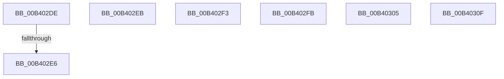

# sub_00B402DE

- RVA: `0x00B402DE`–`0x00B40319` (길이 `59` bytes)
- VA: `0x0000000140B402DE`
- 실행 섹션: `PAGE`
- PDB 이름 있음: `아니요`; PDB Function 태그: `아니요`
- unwind 정보 RVA: `0x000B52C4`
- 디코드: `16`개 명령, `59/59` bytes 표시
- 미해석 바이트: `0` (있으면 어셈블리에 `.byte`로 보존)

> 이 문서는 커널 이미지의 기계어와 PDB 기호를 분석해 생성했습니다. 4번과 5번은 함수 원형과 자료형을 바이너리 사용 방식에서 추정한 C 해석이며 원본 소스 복구 결과는 아닙니다.

## 1. Dependencies

- 직접 호출 지점: **0**; 고유 호출 대상: **0**
- 직접 호출자로 확인된 함수: **0**
- RIP 상대 이미지 참조: **0**

### Outgoing calls
- 직접 디코드된 call 명령이 없습니다.

### Direct callers
- 이 함수 시작 RVA로 연결되는 직접 call은 확인되지 않았습니다. 간접 호출은 완전히 역산할 수 없습니다.

### Static image references
- 디코드된 RIP-relative 메모리 참조가 없습니다.

## 2. Other-region calls and transfers

- 다른 실행 섹션으로 향하는 call: **0**
- call이 아닌 외부 분기/꼬리 이동: **7**
  - `0x00B402E0` → [SddlFilterSacl + 0x69](../A7/SddlFilterSacl_function_00A710E0.md) (`tail-transfer`)
  - `0x00B402E6` → [SddlFilterSacl + 0x61](../A7/SddlFilterSacl_function_00A710E0.md) (`tail-transfer`)
  - `0x00B402EE` → [SddlFilterSacl + 0x5F](../A7/SddlFilterSacl_function_00A710E0.md) (`tail-transfer`)
  - `0x00B402F6` → [SddlFilterSacl + 0x5F](../A7/SddlFilterSacl_function_00A710E0.md) (`tail-transfer`)
  - `0x00B40300` → [SddlFilterSacl + 0x12D](../A7/SddlFilterSacl_function_00A710E0.md) (`tail-transfer`)
  - `0x00B4030A` → [SddlFilterSacl + 0x12D](../A7/SddlFilterSacl_function_00A710E0.md) (`tail-transfer`)
  - `0x00B40314` → [SddlFilterSacl + 0x12D](../A7/SddlFilterSacl_function_00A710E0.md) (`tail-transfer`)

## 3. Assembly (complete function range)

```asm
00B402DE  84 DB                           test bl, bl
00B402E0  0F 89 63 0E F3 FF               jns 0x140a71149
00B402E6  E9 56 0E F3 FF                  jmp 0x140a71141
00B402EB  F6 C3 40                        test bl, 0x40
00B402EE  E9 4C 0E F3 FF                  jmp 0x140a7113f
00B402F3  F6 C3 20                        test bl, 0x20
00B402F6  E9 44 0E F3 FF                  jmp 0x140a7113f
00B402FB  8B C3                           mov eax, ebx
00B402FD  C1 E8 07                        shr eax, 7
00B40300  E9 08 0F F3 FF                  jmp 0x140a7120d
00B40305  8B C3                           mov eax, ebx
00B40307  C1 E8 06                        shr eax, 6
00B4030A  E9 FE 0E F3 FF                  jmp 0x140a7120d
00B4030F  8B C3                           mov eax, ebx
00B40311  C1 E8 05                        shr eax, 5
00B40314  E9 F4 0E F3 FF                  jmp 0x140a7120d
```

## 4. C-style interpretation (structured pseudocode)

```c
__int64 __fastcall sub_00B402DE(void)
{
}
```

## 5. (Beta) C Style

```c
void sub_00B402DE(void)
{
}
```

## 6. Execution-region graph

[열기: 2D/3D 그래프와 함수 탐색 컨트롤 패널](../../../control-panel.html?section=page&rva=0x00B402DE&view=graph)

- 2D 그래프는 위에서 아래로 흐르고, 3D 그래프는 빈 공간을 드래그해 회전합니다. Shift+드래그는 이동, 휠은 확대·축소, 함수 노드 선택은 대상 보고서 이동입니다.

### Static fallback


