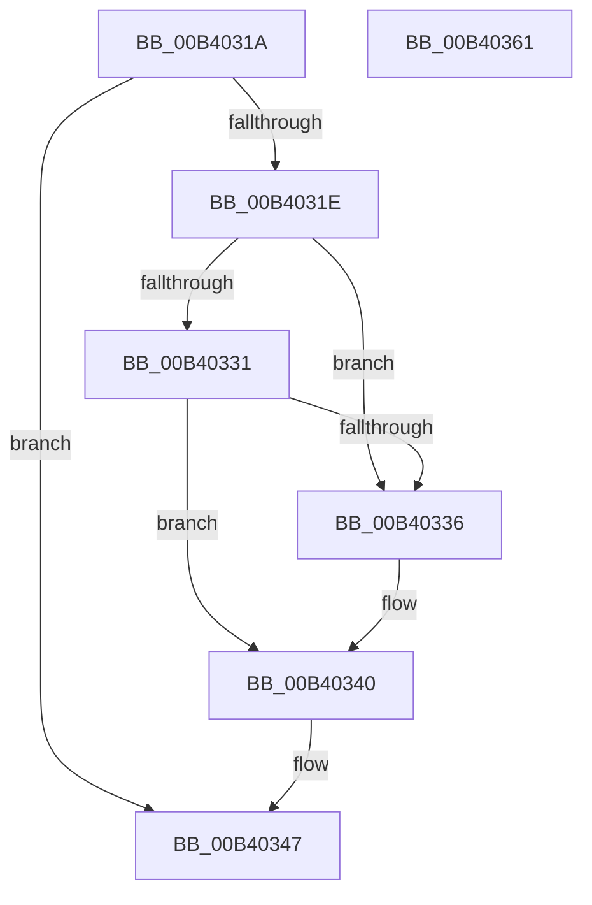

# sub_00B4031A

- RVA: `0x00B4031A`–`0x00B40366` (길이 `76` bytes)
- VA: `0x0000000140B4031A`
- 실행 섹션: `PAGE`
- PDB 이름 있음: `아니요`; PDB Function 태그: `아니요`
- unwind 정보 RVA: `0x000B54B8`
- 디코드: `17`개 명령, `76/76` bytes 표시
- 미해석 바이트: `0` (있으면 어셈블리에 `.byte`로 보존)

> 이 문서는 커널 이미지의 기계어와 PDB 기호를 분석해 생성했습니다. 4번과 5번은 함수 원형과 자료형을 바이너리 사용 방식에서 추정한 C 해석이며 원본 소스 복구 결과는 아닙니다.

## 1. Dependencies

- 직접 호출 지점: **0**; 고유 호출 대상: **0**
- 직접 호출자로 확인된 함수: **0**
- RIP 상대 이미지 참조: **0**

### Outgoing calls
- 직접 디코드된 call 명령이 없습니다.

### Direct callers
- 이 함수 시작 RVA로 연결되는 직접 call은 확인되지 않았습니다. 간접 호출은 완전히 역산할 수 없습니다.

### Static image references
- 디코드된 RIP-relative 메모리 참조가 없습니다.

## 2. Other-region calls and transfers

- 다른 실행 섹션으로 향하는 call: **0**
- call이 아닌 외부 분기/꼬리 이동: **2**
  - `0x00B4035C` → [NtWaitForKeyedEvent + 0x62](../A7/NtWaitForKeyedEvent_function_00A71D50.md) (`tail-transfer`)
  - `0x00B40361` → [NtWaitForKeyedEvent + 0x215](../A7/NtWaitForKeyedEvent_function_00A71D50.md) (`tail-transfer`)

## 3. Assembly (complete function range)

```asm
00B4031A  84 C9                           test cl, cl
00B4031C  74 29                           je 0x140b40347
00B4031E  48 8D 48 08                     lea rcx, [rax + 8]
00B40322  48 BA 00 00 FF FF FF 7F 00 00   movabs rdx, 0x7fffffff0000
00B4032C  48 3B CA                        cmp rcx, rdx
00B4032F  77 05                           ja 0x140b40336
00B40331  48 3B C8                        cmp rcx, rax
00B40334  73 0A                           jae 0x140b40340
00B40336  8A 02                           mov al, byte ptr [rdx]
00B40338  48 8B 84 24 C8 00 00 00         mov rax, qword ptr [rsp + 0xc8]
00B40340  8A 8C 24 B8 00 00 00            mov cl, byte ptr [rsp + 0xb8]
00B40347  48 8B 00                        mov rax, qword ptr [rax]
00B4034A  48 89 44 24 38                  mov qword ptr [rsp + 0x38], rax
00B4034F  48 8D 44 24 38                  lea rax, [rsp + 0x38]
00B40354  48 89 84 24 C8 00 00 00         mov qword ptr [rsp + 0xc8], rax
00B4035C  E9 51 1A F3 FF                  jmp 0x140a71db2
00B40361  E9 FF 1B F3 FF                  jmp 0x140a71f65
```

## 4. C-style interpretation (structured pseudocode)

```c
__int64 __fastcall sub_00B4031A(unsigned __int8 a1, __int64 a2, __int64 a3, __int64 a4, __int64 a5, __int64 a6, __int64 a7, __int64 a8, __int64 a9, __int64 a10, __int64 a11, __int64 a12, __int64 a13, __int64 a14, __int64 a15, __int64 a16, __int64 a17, __int64 a18, __int64 a19, __int64 a20, __int64 a21, __int64 a22, unsigned __int8 a23, __int64 a24, __int64 a25)
{
    __int64 result;
    unsigned __int64 v_stack_p38;
    unsigned __int64 v_stack_pC8;

    if (a1 == 0) goto loc_00B40347;
    if ((result + 8) > a2) goto loc_00B40336;
    if ((result + 8) < result) {
        result = *(unsigned __int8 *)(a2);
        result = a25;
    }
loc_00B40347:
    v_stack_p38 = *(unsigned __int64 *)(result);
    v_stack_pC8 = a7;
}
```

## 5. (Beta) C Style

```c
int64_t sub_00B4031A(uint8_t Arg1, int64_t Arg2, int64_t Arg3, int64_t Arg4, uint64_t Arg5, uint64_t Arg6, int64_t Arg7, uint64_t Arg8, uint64_t Arg9, uint64_t Arg10, uint64_t Arg11, uint64_t Arg12, uint64_t Arg13, uint64_t Arg14, uint64_t Arg15, uint64_t Arg16, uint64_t Arg17, uint64_t Arg18, uint64_t Arg19, uint64_t Arg20, uint64_t Arg21, uint64_t Arg22, uint8_t Arg23, uint64_t Arg24, int64_t Arg25)
{
    int64_t result;
    uint64_t v_stack_p38;
    uint64_t v_stack_pC8;

    if (Arg1 == 0) goto loc_00B40347;
    if ((result + 8) > Arg2) goto loc_00B40336;
    if ((result + 8) < result) {
        result = *(uint8_t *)(Arg2);
        result = Arg25;
    }
loc_00B40347:
    v_stack_p38 = *(uint64_t *)(result);
    v_stack_pC8 = Arg7;
}
```

## 6. Execution-region graph

[열기: 2D/3D 그래프와 함수 탐색 컨트롤 패널](../../../control-panel.html?section=page&rva=0x00B4031A&view=graph)

- 2D 그래프는 위에서 아래로 흐르고, 3D 그래프는 빈 공간을 드래그해 회전합니다. Shift+드래그는 이동, 휠은 확대·축소, 함수 노드 선택은 대상 보고서 이동입니다.

### Static fallback


