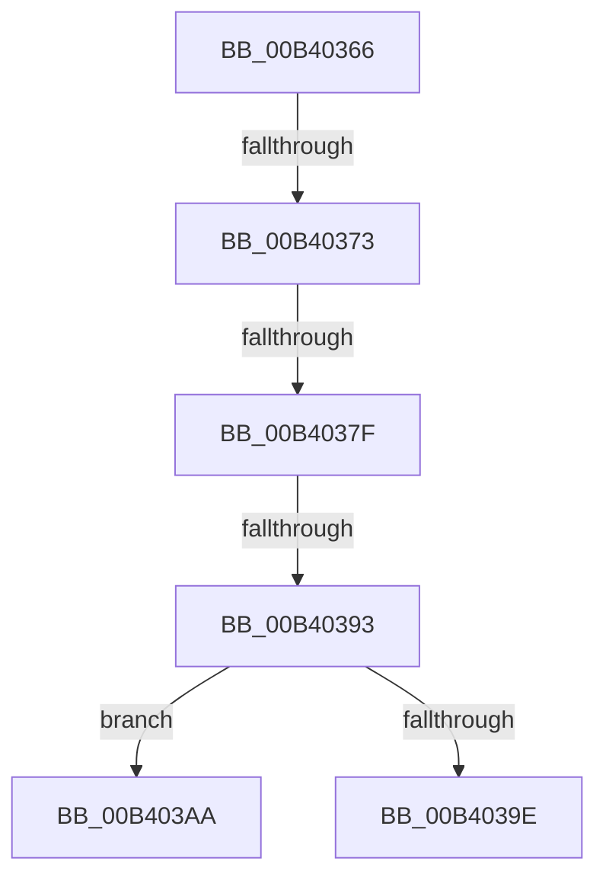

# sub_00B40366

- RVA: `0x00B40366`–`0x00B403B6` (길이 `80` bytes)
- VA: `0x0000000140B40366`
- 실행 섹션: `PAGE`
- PDB 이름 있음: `아니요`; PDB Function 태그: `아니요`
- unwind 정보 RVA: `0x000B54D4`
- 디코드: `15`개 명령, `80/80` bytes 표시
- 미해석 바이트: `0` (있으면 어셈블리에 `.byte`로 보존)

> 이 문서는 커널 이미지의 기계어와 PDB 기호를 분석해 생성했습니다. 4번과 5번은 함수 원형과 자료형을 바이너리 사용 방식에서 추정한 C 해석이며 원본 소스 복구 결과는 아닙니다.

## 1. Dependencies

- 직접 호출 지점: **1**; 고유 호출 대상: **1**
- 직접 호출자로 확인된 함수: **0**
- RIP 상대 이미지 참조: **5**

### Outgoing calls
- `0x00B40395` → [CmpDoQueueSystemHiveHysteresis](../7E/CmpDoQueueSystemHiveHysteresis_function_007E224C.md) (function, `0x007E224C`)

### Direct callers
- 이 함수 시작 RVA로 연결되는 직접 call은 확인되지 않았습니다. 간접 호출은 완전히 역산할 수 없습니다.

### Static image references
- `0x00B40366` → RVA `0x00EEFBCD` (`.data`; read)
- `0x00B40373` → RVA `0x00EEFBAC` (`.data`; read)
- `0x00B4037F` → RVA `0x00EEFBCC` (`.data`; read)
- `0x00B40386` → RVA `0x00EEFBCD` (`.data`; write)
- `0x00B4039E` → RVA `0x00EEFBCC` (`.data`; write)

## 2. Other-region calls and transfers

- 다른 실행 섹션으로 향하는 call: **0**
- call이 아닌 외부 분기/꼬리 이동: **5**
  - `0x00B4036D` → [CmpUpdateSystemHiveHysteresis + 0x10](../A7/CmpUpdateSystemHiveHysteresis_function_00A720C4.md) (`tail-transfer`)
  - `0x00B40379` → [CmpUpdateSystemHiveHysteresis + 0x10](../A7/CmpUpdateSystemHiveHysteresis_function_00A720C4.md) (`tail-transfer`)
  - `0x00B4038D` → [CmpUpdateSystemHiveHysteresis + 0x10](../A7/CmpUpdateSystemHiveHysteresis_function_00A720C4.md) (`tail-transfer`)
  - `0x00B403A5` → [CmpUpdateSystemHiveHysteresis + 0x10](../A7/CmpUpdateSystemHiveHysteresis_function_00A720C4.md) (`tail-transfer`)
  - `0x00B403B1` → [CmpUpdateSystemHiveHysteresis + 0x10](../A7/CmpUpdateSystemHiveHysteresis_function_00A720C4.md) (`tail-transfer`)

## 3. Assembly (complete function range)

```asm
00B40366  80 3D 60 F8 3A 00 00            cmp byte ptr [rip + 0x3af860], 0
00B4036D  0F 85 61 1D F3 FF               jne 0x140a720d4
00B40373  3B 05 33 F8 3A 00               cmp eax, dword ptr [rip + 0x3af833]
00B40379  0F 83 55 1D F3 FF               jae 0x140a720d4
00B4037F  80 3D 46 F8 3A 00 01            cmp byte ptr [rip + 0x3af846], 1
00B40386  C6 05 40 F8 3A 00 01            mov byte ptr [rip + 0x3af840], 1
00B4038D  0F 85 41 1D F3 FF               jne 0x140a720d4
00B40393  8B C8                           mov ecx, eax
00B40395  E8 B2 1E CA FF                  call 0x1407e224c
00B4039A  3C 01                           cmp al, 1
00B4039C  75 0C                           jne 0x140b403aa
00B4039E  C6 05 27 F8 3A 00 00            mov byte ptr [rip + 0x3af827], 0
00B403A5  E9 2A 1D F3 FF                  jmp 0x140a720d4
00B403AA  C6 05 1C F8 3A 00 00            mov byte ptr [rip + 0x3af81c], 0
00B403B1  E9 1E 1D F3 FF                  jmp 0x140a720d4
```

## 4. C-style interpretation (structured pseudocode)

```c
__int64 __fastcall sub_00B40366(void)
{
    __int64 result;

    *(unsigned __int8 *)(v_rip + 3864640) = 1;
    result = CmpDoQueueSystemHiveHysteresis((unsigned int)((unsigned int)(result)), a2, a3, a4);
    if (((unsigned __int8)(result)) != 1) goto loc_00B403AA;
    *(unsigned __int8 *)(v_rip + 3864615) = 0;
loc_00B403AA:
    *(unsigned __int8 *)(v_rip + 3864604) = 0;
}
```

## 5. (Beta) C Style

```c
void sub_00B40366(void)
{
    int64_t result;

    *(uint8_t *)(v_rip + 0x3AF840) = 1;
    result = CmpDoQueueSystemHiveHysteresis((uint32_t)((uint32_t)(result)), a2, a3, a4);
    if (((uint8_t)(result)) != 1) goto loc_00B403AA;
    *(uint8_t *)(v_rip + 0x3AF827) = 0;
loc_00B403AA:
    *(uint8_t *)(v_rip + 0x3AF81C) = 0;
}
```

## 6. Execution-region graph

[열기: 2D/3D 그래프와 함수 탐색 컨트롤 패널](../../../control-panel.html?section=page&rva=0x00B40366&view=graph)

- 2D 그래프는 위에서 아래로 흐르고, 3D 그래프는 빈 공간을 드래그해 회전합니다. Shift+드래그는 이동, 휠은 확대·축소, 함수 노드 선택은 대상 보고서 이동입니다.

### Static fallback


