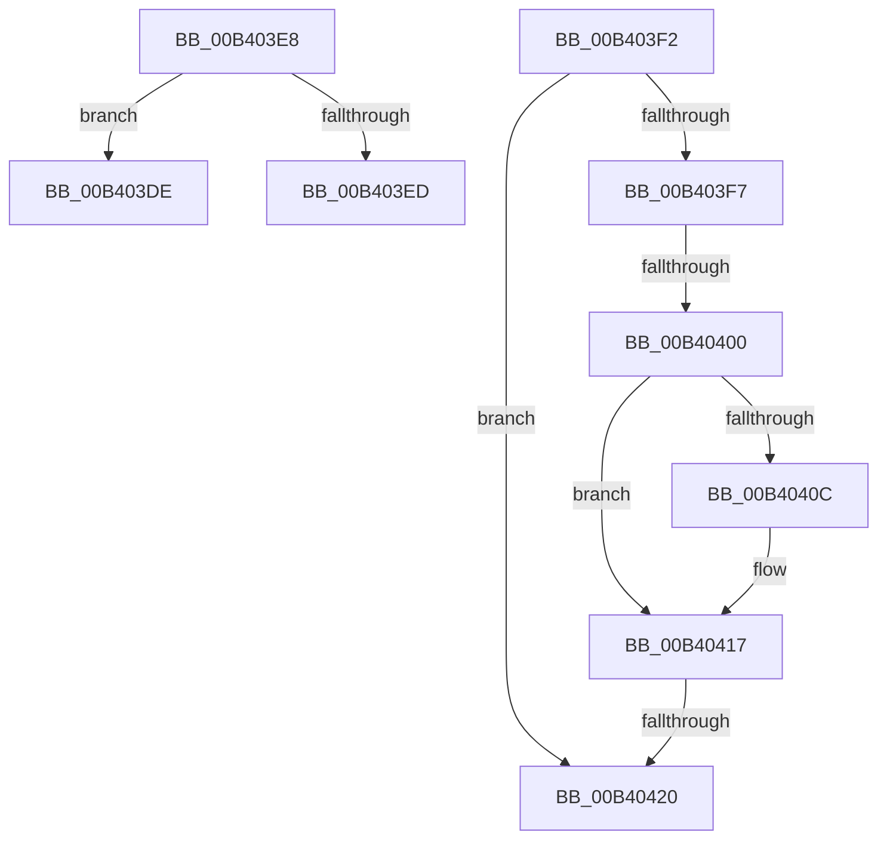

# sub_00B403DE

- RVA: `0x00B403DE`–`0x00B4042A` (길이 `76` bytes)
- VA: `0x0000000140B403DE`
- 실행 섹션: `PAGE`
- PDB 이름 있음: `아니요`; PDB Function 태그: `아니요`
- unwind 정보 RVA: `0x000B55F8`
- 디코드: `18`개 명령, `76/76` bytes 표시
- 미해석 바이트: `0` (있으면 어셈블리에 `.byte`로 보존)

> 이 문서는 커널 이미지의 기계어와 PDB 기호를 분석해 생성했습니다. 4번과 5번은 함수 원형과 자료형을 바이너리 사용 방식에서 추정한 C 해석이며 원본 소스 복구 결과는 아닙니다.

## 1. Dependencies

- 직접 호출 지점: **0**; 고유 호출 대상: **0**
- 직접 호출자로 확인된 함수: **0**
- RIP 상대 이미지 참조: **2**

### Outgoing calls
- 직접 디코드된 call 명령이 없습니다.

### Direct callers
- 이 함수 시작 RVA로 연결되는 직접 call은 확인되지 않았습니다. 간접 호출은 완전히 역산할 수 없습니다.

### Static image references
- `0x00B40403` → RVA `0x000114B8` (`.rdata`; read)
- `0x00B40410` → RVA `0x000114C0` (`.rdata`; read)

## 2. Other-region calls and transfers

- 다른 실행 섹션으로 향하는 call: **0**
- call이 아닌 외부 분기/꼬리 이동: **5**
  - `0x00B403E3` → [_CmSetDeviceInterfaceMappedPropertyFromRegValue + 0x54](../A7/_CmSetDeviceInterfaceMappedPropertyFromRegValue_function_00A729E4.md) (`tail-transfer`)
  - `0x00B403ED` → [_CmSetDeviceInterfaceMappedPropertyFromRegValue + 0xB6](../A7/_CmSetDeviceInterfaceMappedPropertyFromRegValue_function_00A729E4.md) (`tail-transfer`)
  - `0x00B403FA` → [_CmSetDeviceInterfaceMappedPropertyFromRegValue + 0x3B4](../A7/_CmSetDeviceInterfaceMappedPropertyFromRegValue_function_00A729E4.md) (`tail-transfer`)
  - `0x00B4041A` → [_CmSetDeviceInterfaceMappedPropertyFromRegValue + 0x3B4](../A7/_CmSetDeviceInterfaceMappedPropertyFromRegValue_function_00A729E4.md) (`tail-transfer`)
  - `0x00B40425` → [_CmSetDeviceInterfaceMappedPropertyFromRegValue + 0x159](../A7/_CmSetDeviceInterfaceMappedPropertyFromRegValue_function_00A729E4.md) (`tail-transfer`)

## 3. Assembly (complete function range)

```asm
00B403DE  BB 0D 00 00 C0                  mov ebx, 0xc000000d
00B403E3  E9 50 26 F3 FF                  jmp 0x140a72a38
00B403E8  41 3B C5                        cmp eax, r13d
00B403EB  73 F1                           jae 0x140b403de
00B403ED  E9 A8 26 F3 FF                  jmp 0x140a72a9a
00B403F2  48 85 C0                        test rax, rax
00B403F5  74 29                           je 0x140b40420
00B403F7  83 F9 04                        cmp ecx, 4
00B403FA  0F 85 98 29 F3 FF               jne 0x140a72d98
00B40400  48 8B 07                        mov rax, qword ptr [rdi]
00B40403  48 2B 05 AE 10 4D FF            sub rax, qword ptr [rip - 0xb2ef52]
00B4040A  75 0B                           jne 0x140b40417
00B4040C  48 8B 47 08                     mov rax, qword ptr [rdi + 8]
00B40410  48 2B 05 A9 10 4D FF            sub rax, qword ptr [rip - 0xb2ef57]
00B40417  48 85 C0                        test rax, rax
00B4041A  0F 85 78 29 F3 FF               jne 0x140a72d98
00B40420  BB 22 00 00 C0                  mov ebx, 0xc0000022
00B40425  E9 13 27 F3 FF                  jmp 0x140a72b3d
```

## 4. C-style interpretation (structured pseudocode)

```c
__int64 __fastcall sub_00B403DE(int a1)
{
}
```

## 5. (Beta) C Style

```c
int64_t sub_00B403DE(int32_t Arg1)
{
}
```

## 6. Execution-region graph

[열기: 2D/3D 그래프와 함수 탐색 컨트롤 패널](../../../control-panel.html?section=page&rva=0x00B403DE&view=graph)

- 2D 그래프는 위에서 아래로 흐르고, 3D 그래프는 빈 공간을 드래그해 회전합니다. Shift+드래그는 이동, 휠은 확대·축소, 함수 노드 선택은 대상 보고서 이동입니다.

### Static fallback


