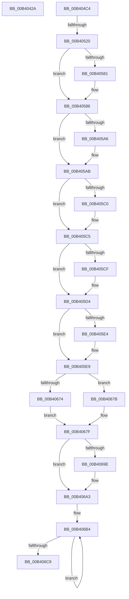

# sub_00B4042A

- RVA: `0x00B4042A`–`0x00B406D5` (길이 `683` bytes)
- VA: `0x0000000140B4042A`
- 실행 섹션: `PAGE`
- PDB 이름 있음: `아니요`; PDB Function 태그: `아니요`
- unwind 정보 RVA: `0x000B5674`
- 디코드: `154`개 명령, `683/683` bytes 표시
- 미해석 바이트: `0` (있으면 어셈블리에 `.byte`로 보존)

> 이 문서는 커널 이미지의 기계어와 PDB 기호를 분석해 생성했습니다. 4번과 5번은 함수 원형과 자료형을 바이너리 사용 방식에서 추정한 C 해석이며 원본 소스 복구 결과는 아닙니다.

## 1. Dependencies

- 직접 호출 지점: **4**; 고유 호출 대상: **3**
- 직접 호출자로 확인된 함수: **0**
- RIP 상대 이미지 참조: **20**

### Outgoing calls
- `0x00B40439` → [PopQpcTimeInMs](../../pagelk/B7/PopQpcTimeInMs_function_00B79780.md) (function, `0x00B79780`)
- `0x00B40450` → [PopQpcTimeInMs](../../pagelk/B7/PopQpcTimeInMs_function_00B79780.md) (function, `0x00B79780`)
- `0x00B4050B` → [EtwWrite](../../text/41/EtwWrite_function_0041C720.md) (function, `0x0041C720`)
- `0x00B4052E` → [PopComputeDerivedHiberStats](../A7/PopComputeDerivedHiberStats_function_00A7376C.md) (function, `0x00A7376C`)

### Direct callers
- 이 함수 시작 RVA로 연결되는 직접 call은 확인되지 않았습니다. 간접 호출은 완전히 역산할 수 없습니다.

### Static image references
- `0x00B4042A` → RVA `0x00F0C348` (`.data`; read)
- `0x00B4043E` → RVA `0x00F0C330` (`.data`; read)
- `0x00B40449` → RVA `0x00F0C328` (`.data`; read)
- `0x00B40459` → RVA `0x00023398` (`.rdata`; read)
- `0x00B4046A` → RVA `0x00F0C528` (`.data`; read)
- `0x00B404C4` → RVA `0x00F0B408` (`.data`; read)
- `0x00B404D3` → RVA `0x00021848` (`.rdata`; read)
- `0x00B40510` → RVA `0x00F0C3D0` (`.data`; read)
- `0x00B40527` → RVA `0x00F0C378` (`.data`; read)
- `0x00B40545` → RVA `0x00F0C558` (`.data`; read)
- `0x00B40569` → RVA `0x00F0C560` (`.data`; read)
- `0x00B40586` → RVA `0x00F0C3E0` (`.data`; read)
- `0x00B40591` → RVA `0x00FC6BE0` (`ALMOSTRO`; read)
- `0x00B405AB` → RVA `0x00F0C4E8` (`.data`; read)
- `0x00B40612` → RVA `0x00F0C478` (`.data`; read)
- `0x00B40619` → RVA `0x00F0C4B0` (`.data`; read)
- `0x00B40659` → RVA `0x00F0C538` (`.data`; read)
- `0x00B4066B` → RVA `0x00F0DDA0` (`.data`; read)
- `0x00B4068A` → RVA `0x00F0C540` (`.data`; read)
- `0x00B406C9` → RVA `0x00021918` (`.rdata`; read)

## 2. Other-region calls and transfers

- 다른 실행 섹션으로 향하는 call: **3**
  - `0x00B40439` → [PopQpcTimeInMs](../../pagelk/B7/PopQpcTimeInMs_function_00B79780.md) (`PAGE` → `PAGELK`)
  - `0x00B40450` → [PopQpcTimeInMs](../../pagelk/B7/PopQpcTimeInMs_function_00B79780.md) (`PAGE` → `PAGELK`)
  - `0x00B4050B` → [EtwWrite](../../text/41/EtwWrite_function_0041C720.md) (`PAGE` → `.text`)
- call이 아닌 외부 분기/꼬리 이동: **3**
  - `0x00B404BF` → [PopDiagTracePerfTrackData + 0x348](../A7/PopDiagTracePerfTrackData_function_00A733CC.md) (`tail-transfer`)
  - `0x00B4051A` → [PopDiagTracePerfTrackData + 0x360](../A7/PopDiagTracePerfTrackData_function_00A733CC.md) (`tail-transfer`)
  - `0x00B406D0` → [PopDiagTracePerfTrackData + 0x348](../A7/PopDiagTracePerfTrackData_function_00A733CC.md) (`tail-transfer`)

## 3. Assembly (complete function range)

```asm
00B4042A  48 8D 15 17 BF 3C 00            lea rdx, [rip + 0x3cbf17]
00B40431  4C 89 7D 8F                     mov qword ptr [rbp - 0x71], r15
00B40435  48 8D 4D 8F                     lea rcx, [rbp - 0x71]
00B40439  E8 42 93 03 00                  call 0x140b79780
00B4043E  48 8D 15 EB BE 3C 00            lea rdx, [rip + 0x3cbeeb]
00B40445  89 44 24 38                     mov dword ptr [rsp + 0x38], eax
00B40449  48 8D 0D D8 BE 3C 00            lea rcx, [rip + 0x3cbed8]
00B40450  E8 2B 93 03 00                  call 0x140b79780
00B40455  03 44 24 38                     add eax, dword ptr [rsp + 0x38]
00B40459  48 8D 15 38 2F 4E FF            lea rdx, [rip - 0xb1d0c8]
00B40460  89 44 24 30                     mov dword ptr [rsp + 0x30], eax
00B40464  41 B9 05 00 00 00               mov r9d, 5
00B4046A  48 8D 05 B7 C0 3C 00            lea rax, [rip + 0x3cc0b7]
00B40471  48 C7 45 DF 04 00 00 00         mov qword ptr [rbp - 0x21], 4
00B40479  48 89 45 D7                     mov qword ptr [rbp - 0x29], rax
00B4047D  48 8D 44 24 30                  lea rax, [rsp + 0x30]
00B40482  48 89 45 E7                     mov qword ptr [rbp - 0x19], rax
00B40486  48 8D 44 24 38                  lea rax, [rsp + 0x38]
00B4048B  48 89 45 F7                     mov qword ptr [rbp - 9], rax
00B4048F  48 8D 45 97                     lea rax, [rbp - 0x69]
00B40493  48 89 45 07                     mov qword ptr [rbp + 7], rax
00B40497  48 8D 45 9B                     lea rax, [rbp - 0x65]
00B4049B  48 89 45 17                     mov qword ptr [rbp + 0x17], rax
00B4049F  48 C7 45 EF 04 00 00 00         mov qword ptr [rbp - 0x11], 4
00B404A7  48 C7 45 FF 04 00 00 00         mov qword ptr [rbp - 1], 4
00B404AF  48 C7 45 0F 04 00 00 00         mov qword ptr [rbp + 0xf], 4
00B404B7  48 C7 45 1F 04 00 00 00         mov qword ptr [rbp + 0x1f], 4
00B404BF  E9 50 32 F3 FF                  jmp 0x140a73714
00B404C4  48 8B 0D 3D AF 3C 00            mov rcx, qword ptr [rip + 0x3caf3d]
00B404CB  48 8D 45 83                     lea rax, [rbp - 0x7d]
00B404CF  48 89 45 D7                     mov qword ptr [rbp - 0x29], rax
00B404D3  48 8D 15 6E 13 4E FF            lea rdx, [rip - 0xb1ec92]
00B404DA  BB 04 00 00 00                  mov ebx, 4
00B404DF  48 8D 45 A3                     lea rax, [rbp - 0x5d]
00B404E3  48 89 45 E7                     mov qword ptr [rbp - 0x19], rax
00B404E7  45 33 C0                        xor r8d, r8d
00B404EA  48 8D 45 87                     lea rax, [rbp - 0x79]
00B404EE  48 89 5D DF                     mov qword ptr [rbp - 0x21], rbx
00B404F2  48 89 45 F7                     mov qword ptr [rbp - 9], rax
00B404F6  48 8D 45 D7                     lea rax, [rbp - 0x29]
00B404FA  44 8D 4B FF                     lea r9d, [rbx - 1]
00B404FE  48 89 44 24 20                  mov qword ptr [rsp + 0x20], rax
00B40503  48 89 5D EF                     mov qword ptr [rbp - 0x11], rbx
00B40507  48 89 5D FF                     mov qword ptr [rbp - 1], rbx
00B4050B  E8 10 C2 8D FF                  call 0x14041c720
00B40510  4C 8B 35 B9 BE 3C 00            mov r14, qword ptr [rip + 0x3cbeb9]
00B40517  45 85 F6                        test r14d, r14d
00B4051A  0F 84 0C 32 F3 FF               je 0x140a7372c
00B40520  4C 8D 45 A7                     lea r8, [rbp - 0x59]
00B40524  48 8B D6                        mov rdx, rsi
00B40527  48 8D 0D 4A BE 3C 00            lea rcx, [rip + 0x3cbe4a]
00B4052E  E8 39 32 F3 FF                  call 0x140a7376c
00B40533  8B 44 24 30                     mov eax, dword ptr [rsp + 0x30]
00B40537  41 BA FF 7F 00 00               mov r10d, 0x7fff
00B4053D  89 45 B7                        mov dword ptr [rbp - 0x49], eax
00B40540  B9 E0 FF 00 00                  mov ecx, 0xffe0
00B40545  48 8B 05 0C C0 3C 00            mov rax, qword ptr [rip + 0x3cc00c]
00B4054C  48 C1 E8 08                     shr rax, 8
00B40550  49 3B C2                        cmp rax, r10
00B40553  44 8D 49 1F                     lea r9d, [rcx + 0x1f]
00B40557  49 0F 47 C2                     cmova rax, r10
00B4055B  66 23 F9                        and di, cx
00B4055E  66 41 23 C2                     and ax, r10w
00B40562  66 C1 E7 0A                     shl di, 0xa
00B40566  66 0B F8                        or di, ax
00B40569  48 8B 05 F0 BF 3C 00            mov rax, qword ptr [rip + 0x3cbff0]
00B40570  48 C1 E8 08                     shr rax, 8
00B40574  66 89 7D BB                     mov word ptr [rbp - 0x45], di
00B40578  66 89 45 BD                     mov word ptr [rbp - 0x43], ax
00B4057C  49 3B C1                        cmp rax, r9
00B4057F  72 05                           jb 0x140b40586
00B40581  66 44 89 4D BD                  mov word ptr [rbp - 0x43], r9w
00B40586  48 69 05 4F BE 3C 00 E8 03 00 00  imul rax, qword ptr [rip + 0x3cbe4f], 0x3e8
00B40591  4C 8B 1D 48 66 48 00            mov r11, qword ptr [rip + 0x486648]
00B40598  33 D2                           xor edx, edx
00B4059A  49 F7 F3                        div r11
00B4059D  66 89 45 BF                     mov word ptr [rbp - 0x41], ax
00B405A1  49 3B C1                        cmp rax, r9
00B405A4  72 05                           jb 0x140b405ab
00B405A6  66 44 89 4D BF                  mov word ptr [rbp - 0x41], r9w
00B405AB  48 8B 05 36 BF 3C 00            mov rax, qword ptr [rip + 0x3cbf36]
00B405B2  33 D2                           xor edx, edx
00B405B4  48 F7 F6                        div rsi
00B405B7  66 89 45 C1                     mov word ptr [rbp - 0x3f], ax
00B405BB  49 3B C1                        cmp rax, r9
00B405BE  72 05                           jb 0x140b405c5
00B405C0  66 44 89 4D C1                  mov word ptr [rbp - 0x3f], r9w
00B405C5  66 44 89 75 C3                  mov word ptr [rbp - 0x3d], r14w
00B405CA  45 3B F1                        cmp r14d, r9d
00B405CD  72 05                           jb 0x140b405d4
00B405CF  66 44 89 4D C3                  mov word ptr [rbp - 0x3d], r9w
00B405D4  48 8B 05 4D BF 3C 00            mov rax, qword ptr [rip + 0x3cbf4d]
00B405DB  66 89 45 C5                     mov word ptr [rbp - 0x3b], ax
00B405DF  41 3B C1                        cmp eax, r9d
00B405E2  72 05                           jb 0x140b405e9
00B405E4  66 44 89 4D C5                  mov word ptr [rbp - 0x3b], r9w
00B405E9  8B 4D AB                        mov ecx, dword ptr [rbp - 0x55]
00B405EC  B8 FF 03 00 00                  mov eax, 0x3ff
00B405F1  44 8B 45 B3                     mov r8d, dword ptr [rbp - 0x4d]
00B405F5  3B C8                           cmp ecx, eax
00B405F7  0F 47 C8                        cmova ecx, eax
00B405FA  23 C8                           and ecx, eax
00B405FC  8B 45 C7                        mov eax, dword ptr [rbp - 0x39]
00B405FF  25 00 FC FF FF                  and eax, 0xfffffc00
00B40604  0B C8                           or ecx, eax
00B40606  B8 FF 01 00 00                  mov eax, 0x1ff
00B4060B  44 3B C0                        cmp r8d, eax
00B4060E  44 0F 47 C0                     cmova r8d, eax
00B40612  48 8B 05 5F BE 3C 00            mov rax, qword ptr [rip + 0x3cbe5f]
00B40619  48 2B 05 90 BE 3C 00            sub rax, qword ptr [rip + 0x3cbe90]
00B40620  33 D2                           xor edx, edx
00B40622  48 69 C0 E8 03 00 00            imul rax, rax, 0x3e8
00B40629  41 C1 E0 0A                     shl r8d, 0xa
00B4062D  49 F7 F3                        div r11
00B40630  44 33 C1                        xor r8d, ecx
00B40633  41 81 E0 00 FC 07 00            and r8d, 0x7fc00
00B4063A  44 33 C1                        xor r8d, ecx
00B4063D  B9 FF 1F 00 00                  mov ecx, 0x1fff
00B40642  48 3B C1                        cmp rax, rcx
00B40645  48 0F 47 C1                     cmova rax, rcx
00B40649  41 81 E0 FF FF 07 00            and r8d, 0x7ffff
00B40650  C1 E0 13                        shl eax, 0x13
00B40653  41 0B C0                        or eax, r8d
00B40656  89 45 C7                        mov dword ptr [rbp - 0x39], eax
00B40659  48 8B 05 D8 BE 3C 00            mov rax, qword ptr [rip + 0x3cbed8]
00B40660  48 C1 E8 08                     shr rax, 8
00B40664  49 3B C2                        cmp rax, r10
00B40667  49 0F 47 C2                     cmova rax, r10
00B4066B  44 39 3D 2E D7 3C 00            cmp dword ptr [rip + 0x3cd72e], r15d
00B40672  74 07                           je 0x140b4067b
00B40674  B9 00 80 00 00                  mov ecx, 0x8000
00B40679  EB 04                           jmp 0x140b4067f
00B4067B  41 0F B7 CF                     movzx ecx, r15w
00B4067F  66 41 23 C2                     and ax, r10w
00B40683  66 0B C1                        or ax, cx
00B40686  66 89 45 CB                     mov word ptr [rbp - 0x35], ax
00B4068A  48 8B 05 AF BE 3C 00            mov rax, qword ptr [rip + 0x3cbeaf]
00B40691  48 C1 E8 08                     shr rax, 8
00B40695  66 89 45 CD                     mov word ptr [rbp - 0x33], ax
00B40699  49 3B C1                        cmp rax, r9
00B4069C  72 05                           jb 0x140b406a3
00B4069E  66 44 89 4D CD                  mov word ptr [rbp - 0x33], r9w
00B406A3  41 B9 06 00 00 00               mov r9d, 6
00B406A9  48 8D 45 E3                     lea rax, [rbp - 0x1d]
00B406AD  41 8B D1                        mov edx, r9d
00B406B0  48 8D 4D B7                     lea rcx, [rbp - 0x49]
00B406B4  48 89 48 F4                     mov qword ptr [rax - 0xc], rcx
00B406B8  48 03 CB                        add rcx, rbx
00B406BB  48 89 58 FC                     mov qword ptr [rax - 4], rbx
00B406BF  48 8D 40 10                     lea rax, [rax + 0x10]
00B406C3  48 83 EA 01                     sub rdx, 1
00B406C7  75 EB                           jne 0x140b406b4
00B406C9  48 8D 15 48 12 4E FF            lea rdx, [rip - 0xb1edb8]
00B406D0  E9 3F 30 F3 FF                  jmp 0x140a73714
```

## 4. C-style interpretation (structured pseudocode)

```c
__int64 __fastcall sub_00B4042A(__int64 a1, __int64 a2, int a3, __int64 a4, __int64 a5, __int64 a6, unsigned int a7)
{
    __int64 result;
    unsigned __int64 v_stack_p20;
    unsigned int v_stack_p30;
    unsigned int v_stack_p38;

    *(unsigned __int64 *)(v_rbp - 113) = v_r15;
    result = PopQpcTimeInMs(v_rbp - 113, v_rip + 3981079, a3, a4);
    v_stack_p38 = (unsigned int)(result);
    result = PopQpcTimeInMs(v_rip + 3981016, v_rip + 3981035, a3, a4);
    result = (unsigned int)((result) + (a7));
    v_stack_p30 = (unsigned int)(result);
    *(unsigned __int64 *)(v_rbp - 33) = 4;
    *(unsigned __int64 *)(v_rbp - 41) = v_rip + 3981495;
    *(unsigned __int64 *)(v_rbp - 25) = a6;
    *(unsigned __int64 *)(v_rbp - 9) = a7;
    *(unsigned __int64 *)(v_rbp + 7) = v_rbp - 105;
    *(unsigned __int64 *)(v_rbp + 23) = v_rbp - 101;
    *(unsigned __int64 *)(v_rbp - 17) = 4;
    *(unsigned __int64 *)(v_rbp - 1) = 4;
    *(unsigned __int64 *)(v_rbp + 15) = 4;
    *(unsigned __int64 *)(v_rbp + 31) = 4;
}
```

## 5. (Beta) C Style

```c
int64_t sub_00B4042A(int64_t Arg1, int64_t Arg2, int32_t Arg3, int64_t Arg4, uint64_t Arg5, int64_t Arg6, uint32_t Arg7)
{
    int64_t result;
    uint64_t v_stack_p20;
    uint32_t v_stack_p30;
    uint32_t v_stack_p38;

    *(uint64_t *)(local_rbp - 0x71) = local_r15;
    result = PopQpcTimeInMs(local_rbp - 113, v_rip + 3981079, Arg3, Arg4);
    v_stack_p38 = (uint32_t)(result);
    result = PopQpcTimeInMs(v_rip + 3981016, v_rip + 3981035, Arg3, Arg4);
    result = (uint32_t)((result) + (Arg7));
    v_stack_p30 = (uint32_t)(result);
    *(uint64_t *)(local_rbp - 0x21) = 4;
    *(uint64_t *)(local_rbp - 0x29) = v_rip + 3981495;
    *(uint64_t *)(local_rbp - 0x19) = Arg6;
    *(uint64_t *)(local_rbp - 0x9) = Arg7;
    *(uint64_t *)(local_rbp + 0x7) = local_rbp - 105;
    *(uint64_t *)(local_rbp + 0x17) = local_rbp - 101;
    *(uint64_t *)(local_rbp - 0x11) = 4;
    *(uint64_t *)(local_rbp - 0x1) = 4;
    *(uint64_t *)(local_rbp + 0xF) = 4;
    *(uint64_t *)(local_rbp + 0x1F) = 4;
}
```

## 6. Execution-region graph

[열기: 2D/3D 그래프와 함수 탐색 컨트롤 패널](../../../control-panel.html?section=page&rva=0x00B4042A&view=graph)

- 2D 그래프는 위에서 아래로 흐르고, 3D 그래프는 빈 공간을 드래그해 회전합니다. Shift+드래그는 이동, 휠은 확대·축소, 함수 노드 선택은 대상 보고서 이동입니다.

### Static fallback


