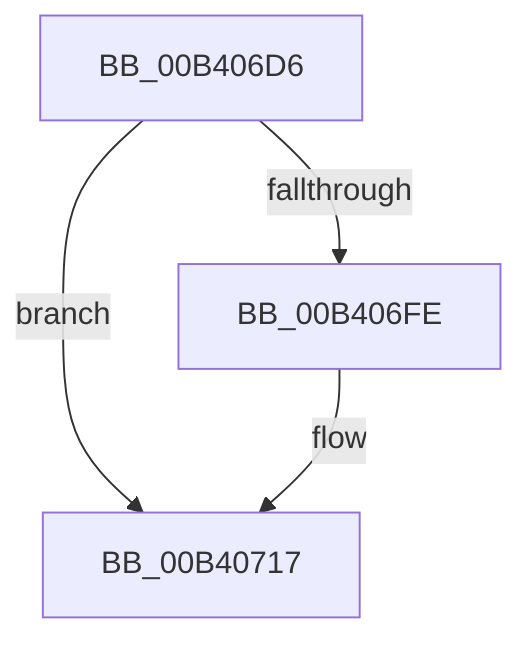

# sub_00B406D6

- RVA: `0x00B406D6`–`0x00B40725` (길이 `79` bytes)
- VA: `0x0000000140B406D6`
- 실행 섹션: `PAGE`
- PDB 이름 있음: `아니요`; PDB Function 태그: `아니요`
- unwind 정보 RVA: `0x000B5744`
- 디코드: `22`개 명령, `79/79` bytes 표시
- 미해석 바이트: `0` (있으면 어셈블리에 `.byte`로 보존)

> 이 문서는 커널 이미지의 기계어와 PDB 기호를 분석해 생성했습니다. 4번과 5번은 함수 원형과 자료형을 바이너리 사용 방식에서 추정한 C 해석이며 원본 소스 복구 결과는 아닙니다.

## 1. Dependencies

- 직접 호출 지점: **2**; 고유 호출 대상: **2**
- 직접 호출자로 확인된 함수: **0**
- RIP 상대 이미지 참조: **0**

### Outgoing calls
- `0x00B406F3` → [IoSynchronousCallDriver](../../text/48/IoSynchronousCallDriver_function_00484050.md) (function, `0x00484050`)
- `0x00B4071A` → [IoFreeIrp](../../text/24/IoFreeIrp_function_0024DF70.md) (function, `0x0024DF70`)

### Direct callers
- 이 함수 시작 RVA로 연결되는 직접 call은 확인되지 않았습니다. 간접 호출은 완전히 역산할 수 없습니다.

### Static image references
- 디코드된 RIP-relative 메모리 참조가 없습니다.

## 2. Other-region calls and transfers

- 다른 실행 섹션으로 향하는 call: **2**
  - `0x00B406F3` → [IoSynchronousCallDriver](../../text/48/IoSynchronousCallDriver_function_00484050.md) (`PAGE` → `.text`)
  - `0x00B4071A` → [IoFreeIrp](../../text/24/IoFreeIrp_function_0024DF70.md) (`PAGE` → `.text`)
- call이 아닌 외부 분기/꼬리 이동: **1**
  - `0x00B40720` → [FsRtlPrepareMdlWriteEx + 0x46](../A7/FsRtlPrepareMdlWriteEx_function_00A74200.md) (`tail-transfer`)

## 3. Assembly (complete function range)

```asm
00B406D6  48 8B 80 B8 00 00 00            mov rax, qword ptr [rax + 0xb8]
00B406DD  48 8B D3                        mov rdx, rbx
00B406E0  48 8B CD                        mov rcx, rbp
00B406E3  48 89 70 E8                     mov qword ptr [rax - 0x18], rsi
00B406E7  C6 40 B9 02                     mov byte ptr [rax - 0x47], 2
00B406EB  44 89 60 C8                     mov dword ptr [rax - 0x38], r12d
00B406EF  83 4B 10 04                     or dword ptr [rbx + 0x10], 4
00B406F3  E8 58 39 94 FF                  call 0x140484050
00B406F8  8B F0                           mov esi, eax
00B406FA  85 C0                           test eax, eax
00B406FC  78 19                           js 0x140b40717
00B406FE  48 8B 4B 08                     mov rcx, qword ptr [rbx + 8]
00B40702  49 89 0E                        mov qword ptr [r14], rcx
00B40705  8B 4B 30                        mov ecx, dword ptr [rbx + 0x30]
00B40708  48 83 63 08 00                  and qword ptr [rbx + 8], 0
00B4070D  89 0F                           mov dword ptr [rdi], ecx
00B4070F  48 8B 4B 38                     mov rcx, qword ptr [rbx + 0x38]
00B40713  48 89 4F 08                     mov qword ptr [rdi + 8], rcx
00B40717  48 8B CB                        mov rcx, rbx
00B4071A  E8 51 D8 70 FF                  call 0x14024df70
00B4071F  90                              nop
00B40720  E9 21 3B F3 FF                  jmp 0x140a74246
```

## 4. C-style interpretation (structured pseudocode)

```c
__int64 __fastcall sub_00B406D6(void)
{
    __int64 result;

    *(unsigned __int64 *)(*(unsigned __int64 *)(result + 184) - 24) = v_rsi;
    *(unsigned __int8 *)(*(unsigned __int64 *)(result + 184) - 71) = 2;
    *(unsigned int *)(*(unsigned __int64 *)(result + 184) - 56) = (unsigned int)(v_r12);
    result = IoSynchronousCallDriver(v_rbp, v_rbx, a3, a4);
    if (!(sign_flag)) {
        a1 = *(unsigned __int64 *)(v_rbx + 8);
        *(unsigned __int64 *)(v_r14) = a1;
        a1 = *(unsigned int *)(v_rbx + 48);
        *(unsigned int *)(v_rdi) = (unsigned int)(a1);
        a1 = *(unsigned __int64 *)(v_rbx + 56);
        *(unsigned __int64 *)(v_rdi + 8) = a1;
    }
    result = IoFreeIrp(v_rbx, v_rbx, a3, a4);
}
```

## 5. (Beta) C Style

```c
void sub_00B406D6(void)
{
    int64_t result;

    *(uint64_t *)(*(uint64_t *)(result + 0xB8) - 0x18) = local_rsi;
    *(uint8_t *)(*(uint64_t *)(result + 0xB8) - 0x47) = 2;
    *(uint32_t *)(*(uint64_t *)(result + 0xB8) - 0x38) = (uint32_t)(local_r12);
    result = IoSynchronousCallDriver(local_rbp, local_rbx, a3, a4);
    if (!(sign_flag)) {
        a1 = *(uint64_t *)(local_rbx + 0x8);
        *(uint64_t *)(local_r14) = a1;
        a1 = *(uint32_t *)(local_rbx + 0x30);
        *(uint32_t *)(local_rdi) = (uint32_t)(a1);
        a1 = *(uint64_t *)(local_rbx + 0x38);
        *(uint64_t *)(local_rdi + 0x8) = a1;
    }
    result = IoFreeIrp(local_rbx, local_rbx, a3, a4);
}
```

## 6. Execution-region graph

[열기: 2D/3D 그래프와 함수 탐색 컨트롤 패널](../../../control-panel.html?section=page&rva=0x00B406D6&view=graph)

- 2D 그래프는 위에서 아래로 흐르고, 3D 그래프는 빈 공간을 드래그해 회전합니다. Shift+드래그는 이동, 휠은 확대·축소, 함수 노드 선택은 대상 보고서 이동입니다.

### Static fallback


