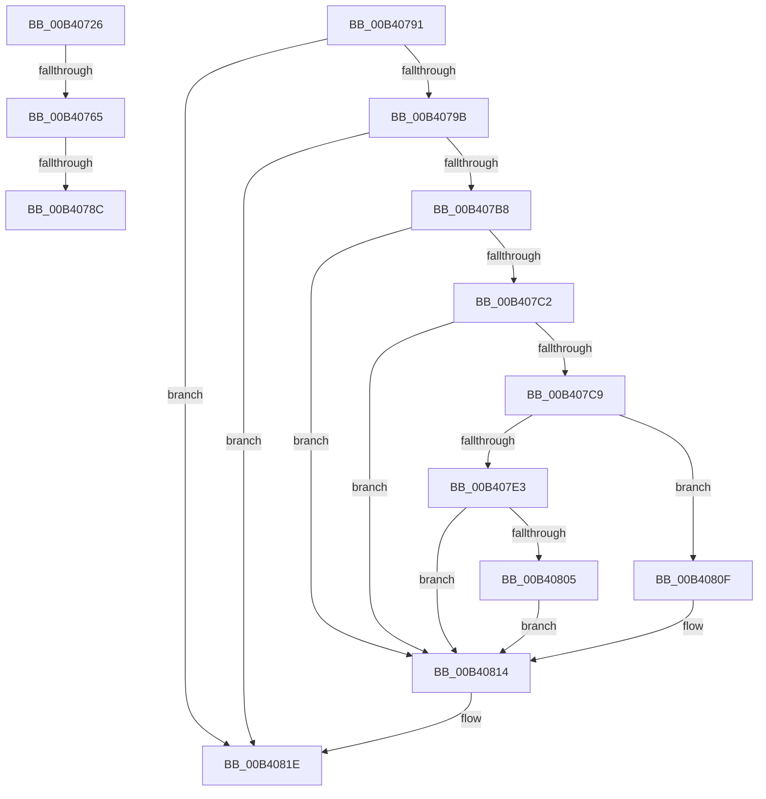

# sub_00B40726

- RVA: `0x00B40726`–`0x00B40827` (길이 `257` bytes)
- VA: `0x0000000140B40726`
- 실행 섹션: `PAGE`
- PDB 이름 있음: `아니요`; PDB Function 태그: `아니요`
- unwind 정보 RVA: `0x000B57E0`
- 디코드: `66`개 명령, `257/257` bytes 표시
- 미해석 바이트: `0` (있으면 어셈블리에 `.byte`로 보존)

> 이 문서는 커널 이미지의 기계어와 PDB 기호를 분석해 생성했습니다. 4번과 5번은 함수 원형과 자료형을 바이너리 사용 방식에서 추정한 C 해석이며 원본 소스 복구 결과는 아닙니다.

## 1. Dependencies

- 직접 호출 지점: **7**; 고유 호출 대상: **7**
- 직접 호출자로 확인된 함수: **0**
- RIP 상대 이미지 참조: **2**

### Outgoing calls
- `0x00B40756` → [_CmOpenDeviceRegKey](../8E/_CmOpenDeviceRegKey_function_008EE540.md) (function, `0x008EE540`)
- `0x00B40774` → [PnpReadDeviceConfiguration](../70/PnpReadDeviceConfiguration_function_00703350.md) (function, `0x00703350`)
- `0x00B4077F` → [ZwClose](../../text/6A/ZwClose_function_006AD2B0.md) (function, `0x006AD2B0`)
- `0x00B407AD` → [IopGetRegistryValue](../99/IopGetRegistryValue_function_009990EC.md) (function, `0x009990EC`)
- `0x00B407D6` → [ExAllocatePool2](../../poolcode/B8/ExAllocatePool2_function_00B820F0.md) (function, `0x00B820F0`)
- `0x00B407F7` → [memcpy](../../text/6C/memcpy_function_006C6840.md) (function, `0x006C6840`)
- `0x00B40819` → [ExFreePoolWithTag](../../poolcode/B8/ExFreePoolWithTag_function_00B82870.md) (function, `0x00B82870`)

### Direct callers
- 이 함수 시작 RVA로 연결되는 직접 call은 확인되지 않았습니다. 간접 호출은 완전히 역산할 수 없습니다.

### Static image references
- `0x00B40731` → RVA `0x00E66398` (`.data`; read)
- `0x00B4079B` → RVA `0x00AFD520` (` ?? ::NNGAKEGL::`string'`; read)

## 2. Other-region calls and transfers

- 다른 실행 섹션으로 향하는 call: **4**
  - `0x00B4077F` → [ZwClose](../../text/6A/ZwClose_function_006AD2B0.md) (`PAGE` → `.text`)
  - `0x00B407D6` → [ExAllocatePool2](../../poolcode/B8/ExAllocatePool2_function_00B820F0.md) (`PAGE` → `POOLCODE`)
  - `0x00B407F7` → [memcpy](../../text/6C/memcpy_function_006C6840.md) (`PAGE` → `.text`)
  - `0x00B40819` → [ExFreePoolWithTag](../../poolcode/B8/ExFreePoolWithTag_function_00B82870.md) (`PAGE` → `POOLCODE`)
- call이 아닌 외부 분기/꼬리 이동: **4**
  - `0x00B4075F` → [PnpGetDeviceResourcesFromRegistry + 0xB5](../A7/PnpGetDeviceResourcesFromRegistry_function_00A74344.md) (`tail-transfer`)
  - `0x00B40786` → [PnpGetDeviceResourcesFromRegistry + 0x8F](../A7/PnpGetDeviceResourcesFromRegistry_function_00A74344.md) (`tail-transfer`)
  - `0x00B4078C` → [PnpGetDeviceResourcesFromRegistry + 0xB5](../A7/PnpGetDeviceResourcesFromRegistry_function_00A74344.md) (`tail-transfer`)
  - `0x00B40822` → [PnpGetDeviceResourcesFromRegistry + 0x1AC](../A7/PnpGetDeviceResourcesFromRegistry_function_00A74344.md) (`tail-transfer`)

## 3. Assembly (complete function range)

```asm
00B40726  49 8B D5                        mov rdx, r13
00B40729  48 8B 52 30                     mov rdx, qword ptr [rdx + 0x30]
00B4072D  48 8D 45 48                     lea rax, [rbp + 0x48]
00B40731  48 8B 0D 60 5C 32 00            mov rcx, qword ptr [rip + 0x325c60]
00B40738  45 33 C9                        xor r9d, r9d
00B4073B  4C 89 6C 24 38                  mov qword ptr [rsp + 0x38], r13
00B40740  48 89 44 24 30                  mov qword ptr [rsp + 0x30], rax
00B40745  44 88 6C 24 28                  mov byte ptr [rsp + 0x28], r13b
00B4074A  45 8D 41 13                     lea r8d, [r9 + 0x13]
00B4074E  C7 44 24 20 19 00 02 00         mov dword ptr [rsp + 0x20], 0x20019
00B40756  E8 E5 DD DA FF                  call 0x1408ee540
00B4075B  8B D8                           mov ebx, eax
00B4075D  85 C0                           test eax, eax
00B4075F  0F 88 94 3C F3 FF               js 0x140a743f9
00B40765  48 8B 4D 48                     mov rcx, qword ptr [rbp + 0x48]
00B40769  4D 8B CC                        mov r9, r12
00B4076C  4D 8B C6                        mov r8, r14
00B4076F  BA 01 00 00 00                  mov edx, 1
00B40774  E8 D7 2B BC FF                  call 0x140703350
00B40779  48 8B 4D 48                     mov rcx, qword ptr [rbp + 0x48]
00B4077D  8B D8                           mov ebx, eax
00B4077F  E8 2C CB B6 FF                  call 0x1406ad2b0
00B40784  85 DB                           test ebx, ebx
00B40786  0F 89 47 3C F3 FF               jns 0x140a743d3
00B4078C  E9 68 3C F3 FF                  jmp 0x140a743f9
00B40791  40 F6 C6 02                     test sil, 2
00B40795  0F 84 83 00 00 00               je 0x140b4081e
00B4079B  48 8D 15 7E CD FB FF            lea rdx, [rip - 0x43282]
00B407A2  48 8B 4D 48                     mov rcx, qword ptr [rbp + 0x48]
00B407A6  4C 8D 4D F0                     lea r9, [rbp - 0x10]
00B407AA  45 33 C0                        xor r8d, r8d
00B407AD  E8 3A 89 E5 FF                  call 0x1409990ec
00B407B2  8B D8                           mov ebx, eax
00B407B4  85 C0                           test eax, eax
00B407B6  78 66                           js 0x140b4081e
00B407B8  48 8B 7D F0                     mov rdi, qword ptr [rbp - 0x10]
00B407BC  83 7F 04 0A                     cmp dword ptr [rdi + 4], 0xa
00B407C0  75 52                           jne 0x140b40814
00B407C2  8B 47 0C                        mov eax, dword ptr [rdi + 0xc]
00B407C5  85 C0                           test eax, eax
00B407C7  74 4B                           je 0x140b40814
00B407C9  8B D0                           mov edx, eax
00B407CB  B9 00 01 00 00                  mov ecx, 0x100
00B407D0  41 B8 50 6E 70 36               mov r8d, 0x36706e50
00B407D6  E8 15 19 04 00                  call 0x140b820f0
00B407DB  49 89 06                        mov qword ptr [r14], rax
00B407DE  48 85 C0                        test rax, rax
00B407E1  74 2C                           je 0x140b4080f
00B407E3  8B 47 0C                        mov eax, dword ptr [rdi + 0xc]
00B407E6  41 89 04 24                     mov dword ptr [r12], eax
00B407EA  8B 57 08                        mov edx, dword ptr [rdi + 8]
00B407ED  44 8B 47 0C                     mov r8d, dword ptr [rdi + 0xc]
00B407F1  48 03 D7                        add rdx, rdi
00B407F4  49 8B 0E                        mov rcx, qword ptr [r14]
00B407F7  E8 44 60 B8 FF                  call 0x1406c6840
00B407FC  49 8B 06                        mov rax, qword ptr [r14]
00B407FF  83 78 04 FF                     cmp dword ptr [rax + 4], -1
00B40803  75 0F                           jne 0x140b40814
00B40805  48 C7 40 04 01 00 00 00         mov qword ptr [rax + 4], 1
00B4080D  EB 05                           jmp 0x140b40814
00B4080F  BB F0 00 00 C0                  mov ebx, 0xc00000f0
00B40814  33 D2                           xor edx, edx
00B40816  48 8B CF                        mov rcx, rdi
00B40819  E8 52 20 04 00                  call 0x140b82870
00B4081E  48 8B 4D 48                     mov rcx, qword ptr [rbp + 0x48]
00B40822  E9 C9 3C F3 FF                  jmp 0x140a744f0
```

## 4. C-style interpretation (structured pseudocode)

```c
__int64 __fastcall sub_00B40726(__int64 a1, __int64 a2, __int64 a3, int a4)
{
    __int64 result;
    unsigned int v_stack_p20;
    unsigned __int8 v_stack_p28;
    unsigned __int64 v_stack_p30;
    unsigned __int64 v_stack_p38;

    a4 = 0;
    v_stack_p38 = v_r13;
    v_stack_p30 = v_rbp + 72;
    v_stack_p28 = (unsigned __int8)(v_r13);
    v_stack_p20 = 0x20019ULL;
    result = _CmOpenDeviceRegKey(*(unsigned __int64 *)(v_rip + 3300448), *(unsigned __int64 *)(v_r13 + 48), a4 + 19, a4);
    result = PnpReadDeviceConfiguration(*(unsigned __int64 *)(v_rbp + 72), 1, v_r14, v_r12);
    result = ZwClose(*(unsigned __int64 *)(v_rbp + 72), 1, v_r14, v_r12);
}
```

## 5. (Beta) C Style

```c
int64_t sub_00B40726(int64_t Arg1, int64_t Arg2, int64_t Arg3, int32_t Arg4)
{
    int64_t result;
    uint32_t v_stack_p20;
    uint8_t v_stack_p28;
    uint64_t v_stack_p30;
    uint64_t v_stack_p38;

    Arg4 = 0;
    v_stack_p38 = local_r13;
    v_stack_p30 = local_rbp + 72;
    v_stack_p28 = (uint8_t)(local_r13);
    v_stack_p20 = 0x20019ULL;
    result = _CmOpenDeviceRegKey(*(uint64_t *)(v_rip + 0x325C60), *(uint64_t *)(local_r13 + 0x30), Arg4 + 19, Arg4);
    result = PnpReadDeviceConfiguration(*(uint64_t *)(local_rbp + 0x48), 1, local_r14, local_r12);
    result = ZwClose(*(uint64_t *)(local_rbp + 0x48), 1, local_r14, local_r12);
}
```

## 6. Execution-region graph

[열기: 2D/3D 그래프와 함수 탐색 컨트롤 패널](../../../control-panel.html?section=page&rva=0x00B40726&view=graph)

- 2D 그래프는 위에서 아래로 흐르고, 3D 그래프는 빈 공간을 드래그해 회전합니다. Shift+드래그는 이동, 휠은 확대·축소, 함수 노드 선택은 대상 보고서 이동입니다.

### Static fallback


