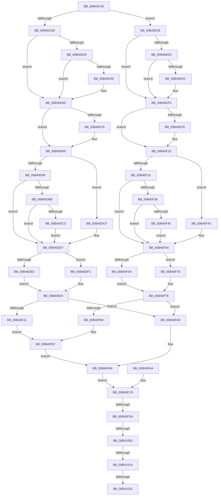

# sub_00B40C48

- RVA: `0x00B40C48`–`0x00B4102A` (길이 `994` bytes)
- VA: `0x0000000140B40C48`
- 실행 섹션: `PAGE`
- PDB 이름 있음: `아니요`; PDB Function 태그: `아니요`
- unwind 정보 RVA: `0x000B597C`
- 디코드: `191`개 명령, `994/994` bytes 표시
- 미해석 바이트: `0` (있으면 어셈블리에 `.byte`로 보존)

> 이 문서는 커널 이미지의 기계어와 PDB 기호를 분석해 생성했습니다. 4번과 5번은 함수 원형과 자료형을 바이너리 사용 방식에서 추정한 C 해석이며 원본 소스 복구 결과는 아닙니다.

## 1. Dependencies

- 직접 호출 지점: **4**; 고유 호출 대상: **4**
- 직접 호출자로 확인된 함수: **0**
- RIP 상대 이미지 참조: **0**

### Outgoing calls
- `0x00B40C54` → [RtlImageNtHeader](../../text/44/RtlImageNtHeader_function_00443B60.md) (function, `0x00443B60`)
- `0x00B40FCD` → [MiUnmapImageInSystemSpace](../94/MiUnmapImageInSystemSpace_function_0094206C.md) (function, `0x0094206C`)
- `0x00B40FF6` → [MiRelocateImage](../98/MiRelocateImage_function_00988E14.md) (function, `0x00988E14`)
- `0x00B4100B` → [MiImageSuitableForSystem](../AA/MiImageSuitableForSystem_function_00AAC408.md) (function, `0x00AAC408`)

### Direct callers
- 이 함수 시작 RVA로 연결되는 직접 call은 확인되지 않았습니다. 간접 호출은 완전히 역산할 수 없습니다.

### Static image references
- 디코드된 RIP-relative 메모리 참조가 없습니다.

## 2. Other-region calls and transfers

- 다른 실행 섹션으로 향하는 call: **1**
  - `0x00B40C54` → [RtlImageNtHeader](../../text/44/RtlImageNtHeader_function_00443B60.md) (`PAGE` → `.text`)
- call이 아닌 외부 분기/꼬리 이동: **5**
  - `0x00B40FD4` → [MiGetSystemAddressForImage + 0x10C](../A7/MiGetSystemAddressForImage_function_00A74EEC.md) (`tail-transfer`)
  - `0x00B40FFD` → [MiGetSystemAddressForImage + 0x10C](../A7/MiGetSystemAddressForImage_function_00A74EEC.md) (`tail-transfer`)
  - `0x00B41014` → [MiGetSystemAddressForImage + 0x148](../A7/MiGetSystemAddressForImage_function_00A74EEC.md) (`tail-transfer`)
  - `0x00B4101F` → [MiGetSystemAddressForImage + 0x10C](../A7/MiGetSystemAddressForImage_function_00A74EEC.md) (`tail-transfer`)
  - `0x00B41025` → [MiGetSystemAddressForImage + 0x148](../A7/MiGetSystemAddressForImage_function_00A74EEC.md) (`tail-transfer`)

## 3. Assembly (complete function range)

```asm
00B40C48  4C 8B 6C 24 50                  mov r13, qword ptr [rsp + 0x50]
00B40C4D  89 5C 24 34                     mov dword ptr [rsp + 0x34], ebx
00B40C51  49 8B CD                        mov rcx, r13
00B40C54  E8 07 2F 90 FF                  call 0x140443b60
00B40C59  48 8B C8                        mov rcx, rax
00B40C5C  45 8B 6D 3C                     mov r13d, dword ptr [r13 + 0x3c]
00B40C60  44 89 6C 24 34                  mov dword ptr [rsp + 0x34], r13d
00B40C65  0F B7 40 18                     movzx eax, word ptr [rax + 0x18]
00B40C69  BA 0B 02 00 00                  mov edx, 0x20b
00B40C6E  66 89 84 24 D0 00 00 00         mov word ptr [rsp + 0xd0], ax
00B40C76  66 3B C2                        cmp ax, dx
00B40C79  8B 41 3C                        mov eax, dword ptr [rcx + 0x3c]
00B40C7C  89 84 24 A8 00 00 00            mov dword ptr [rsp + 0xa8], eax
00B40C83  8B 41 38                        mov eax, dword ptr [rcx + 0x38]
00B40C86  89 84 24 AC 00 00 00            mov dword ptr [rsp + 0xac], eax
00B40C8D  8B 41 50                        mov eax, dword ptr [rcx + 0x50]
00B40C90  89 84 24 B0 00 00 00            mov dword ptr [rsp + 0xb0], eax
00B40C97  0F 85 8C 01 00 00               jne 0x140b40e29
00B40C9D  8B 91 80 00 00 00               mov edx, dword ptr [rcx + 0x80]
00B40CA3  89 94 24 B4 00 00 00            mov dword ptr [rsp + 0xb4], edx
00B40CAA  48 8B 41 30                     mov rax, qword ptr [rcx + 0x30]
00B40CAE  48 89 84 24 A0 00 00 00         mov qword ptr [rsp + 0xa0], rax
00B40CB6  8B 41 54                        mov eax, dword ptr [rcx + 0x54]
00B40CB9  89 84 24 B8 00 00 00            mov dword ptr [rsp + 0xb8], eax
00B40CC0  8B 41 28                        mov eax, dword ptr [rcx + 0x28]
00B40CC3  89 84 24 BC 00 00 00            mov dword ptr [rsp + 0xbc], eax
00B40CCA  48 8B 41 60                     mov rax, qword ptr [rcx + 0x60]
00B40CCE  48 89 84 24 C0 00 00 00         mov qword ptr [rsp + 0xc0], rax
00B40CD6  48 8B 41 68                     mov rax, qword ptr [rcx + 0x68]
00B40CDA  48 89 84 24 C8 00 00 00         mov qword ptr [rsp + 0xc8], rax
00B40CE2  0F B7 41 5C                     movzx eax, word ptr [rcx + 0x5c]
00B40CE6  66 89 84 24 D2 00 00 00         mov word ptr [rsp + 0xd2], ax
00B40CEE  0F B7 41 48                     movzx eax, word ptr [rcx + 0x48]
00B40CF2  66 89 84 24 D4 00 00 00         mov word ptr [rsp + 0xd4], ax
00B40CFA  0F B7 41 4A                     movzx eax, word ptr [rcx + 0x4a]
00B40CFE  66 89 84 24 D6 00 00 00         mov word ptr [rsp + 0xd6], ax
00B40D06  0F B7 41 40                     movzx eax, word ptr [rcx + 0x40]
00B40D0A  66 89 84 24 D8 00 00 00         mov word ptr [rsp + 0xd8], ax
00B40D12  0F B7 41 42                     movzx eax, word ptr [rcx + 0x42]
00B40D16  66 89 84 24 DA 00 00 00         mov word ptr [rsp + 0xda], ax
00B40D1E  0F B7 41 5E                     movzx eax, word ptr [rcx + 0x5e]
00B40D22  66 89 84 24 DC 00 00 00         mov word ptr [rsp + 0xdc], ax
00B40D2A  8B 41 58                        mov eax, dword ptr [rcx + 0x58]
00B40D2D  89 84 24 E0 00 00 00            mov dword ptr [rsp + 0xe0], eax
00B40D34  8B 41 1C                        mov eax, dword ptr [rcx + 0x1c]
00B40D37  89 84 24 E4 00 00 00            mov dword ptr [rsp + 0xe4], eax
00B40D3E  48 89 9C 24 08 01 00 00         mov qword ptr [rsp + 0x108], rbx
00B40D46  83 B9 84 00 00 00 06            cmp dword ptr [rcx + 0x84], 6
00B40D4D  76 1E                           jbe 0x140b40d6d
00B40D4F  8B 81 B8 00 00 00               mov eax, dword ptr [rcx + 0xb8]
00B40D55  85 C0                           test eax, eax
00B40D57  74 14                           je 0x140b40d6d
00B40D59  89 84 24 08 01 00 00            mov dword ptr [rsp + 0x108], eax
00B40D60  8B 81 BC 00 00 00               mov eax, dword ptr [rcx + 0xbc]
00B40D66  89 84 24 0C 01 00 00            mov dword ptr [rsp + 0x10c], eax
00B40D6D  83 B9 84 00 00 00 0C            cmp dword ptr [rcx + 0x84], 0xc
00B40D74  76 1A                           jbe 0x140b40d90
00B40D76  8B 81 E8 00 00 00               mov eax, dword ptr [rcx + 0xe8]
00B40D7C  89 84 24 E8 00 00 00            mov dword ptr [rsp + 0xe8], eax
00B40D83  8B 81 EC 00 00 00               mov eax, dword ptr [rcx + 0xec]
00B40D89  89 84 24 EC 00 00 00            mov dword ptr [rsp + 0xec], eax
00B40D90  83 B9 84 00 00 00 0E            cmp dword ptr [rcx + 0x84], 0xe
00B40D97  76 36                           jbe 0x140b40dcf
00B40D99  8B 81 F8 00 00 00               mov eax, dword ptr [rcx + 0xf8]
00B40D9F  89 84 24 F0 00 00 00            mov dword ptr [rsp + 0xf0], eax
00B40DA6  8B 81 FC 00 00 00               mov eax, dword ptr [rcx + 0xfc]
00B40DAC  89 84 24 F4 00 00 00            mov dword ptr [rsp + 0xf4], eax
00B40DB3  39 99 F8 00 00 00               cmp dword ptr [rcx + 0xf8], ebx
00B40DB9  74 1C                           je 0x140b40dd7
00B40DBB  39 99 FC 00 00 00               cmp dword ptr [rcx + 0xfc], ebx
00B40DC1  74 14                           je 0x140b40dd7
00B40DC3  41 0B D7                        or edx, r15d
00B40DC6  89 94 24 B4 00 00 00            mov dword ptr [rsp + 0xb4], edx
00B40DCD  EB 08                           jmp 0x140b40dd7
00B40DCF  48 89 9C 24 F0 00 00 00         mov qword ptr [rsp + 0xf0], rbx
00B40DD7  83 B9 84 00 00 00 05            cmp dword ptr [rcx + 0x84], 5
00B40DDE  76 1C                           jbe 0x140b40dfc
00B40DE0  8B 81 B0 00 00 00               mov eax, dword ptr [rcx + 0xb0]
00B40DE6  89 84 24 F8 00 00 00            mov dword ptr [rsp + 0xf8], eax
00B40DED  8B 81 B4 00 00 00               mov eax, dword ptr [rcx + 0xb4]
00B40DF3  89 84 24 FC 00 00 00            mov dword ptr [rsp + 0xfc], eax
00B40DFA  EB 08                           jmp 0x140b40e04
00B40DFC  48 89 9C 24 F8 00 00 00         mov qword ptr [rsp + 0xf8], rbx
00B40E04  83 B9 84 00 00 00 0A            cmp dword ptr [rcx + 0x84], 0xa
00B40E0B  0F 86 8F 01 00 00               jbe 0x140b40fa0
00B40E11  8B 81 D8 00 00 00               mov eax, dword ptr [rcx + 0xd8]
00B40E17  89 84 24 00 01 00 00            mov dword ptr [rsp + 0x100], eax
00B40E1E  8B 81 DC 00 00 00               mov eax, dword ptr [rcx + 0xdc]
00B40E24  E9 6E 01 00 00                  jmp 0x140b40f97
00B40E29  8B 51 70                        mov edx, dword ptr [rcx + 0x70]
00B40E2C  89 94 24 B4 00 00 00            mov dword ptr [rsp + 0xb4], edx
00B40E33  8B 41 34                        mov eax, dword ptr [rcx + 0x34]
00B40E36  48 89 84 24 A0 00 00 00         mov qword ptr [rsp + 0xa0], rax
00B40E3E  8B 41 54                        mov eax, dword ptr [rcx + 0x54]
00B40E41  89 84 24 B8 00 00 00            mov dword ptr [rsp + 0xb8], eax
00B40E48  8B 41 28                        mov eax, dword ptr [rcx + 0x28]
00B40E4B  89 84 24 BC 00 00 00            mov dword ptr [rsp + 0xbc], eax
00B40E52  8B 41 60                        mov eax, dword ptr [rcx + 0x60]
00B40E55  48 89 84 24 C0 00 00 00         mov qword ptr [rsp + 0xc0], rax
00B40E5D  8B 41 64                        mov eax, dword ptr [rcx + 0x64]
00B40E60  48 89 84 24 C8 00 00 00         mov qword ptr [rsp + 0xc8], rax
00B40E68  0F B7 41 5C                     movzx eax, word ptr [rcx + 0x5c]
00B40E6C  66 89 84 24 D2 00 00 00         mov word ptr [rsp + 0xd2], ax
00B40E74  0F B7 41 48                     movzx eax, word ptr [rcx + 0x48]
00B40E78  66 89 84 24 D4 00 00 00         mov word ptr [rsp + 0xd4], ax
00B40E80  0F B7 41 4A                     movzx eax, word ptr [rcx + 0x4a]
00B40E84  66 89 84 24 D6 00 00 00         mov word ptr [rsp + 0xd6], ax
00B40E8C  0F B7 41 40                     movzx eax, word ptr [rcx + 0x40]
00B40E90  66 89 84 24 D8 00 00 00         mov word ptr [rsp + 0xd8], ax
00B40E98  0F B7 41 42                     movzx eax, word ptr [rcx + 0x42]
00B40E9C  66 89 84 24 DA 00 00 00         mov word ptr [rsp + 0xda], ax
00B40EA4  0F B7 41 5E                     movzx eax, word ptr [rcx + 0x5e]
00B40EA8  66 89 84 24 DC 00 00 00         mov word ptr [rsp + 0xdc], ax
00B40EB0  8B 41 58                        mov eax, dword ptr [rcx + 0x58]
00B40EB3  89 84 24 E0 00 00 00            mov dword ptr [rsp + 0xe0], eax
00B40EBA  8B 41 1C                        mov eax, dword ptr [rcx + 0x1c]
00B40EBD  89 84 24 E4 00 00 00            mov dword ptr [rsp + 0xe4], eax
00B40EC4  48 89 9C 24 08 01 00 00         mov qword ptr [rsp + 0x108], rbx
00B40ECC  83 79 74 06                     cmp dword ptr [rcx + 0x74], 6
00B40ED0  76 1E                           jbe 0x140b40ef0
00B40ED2  8B 81 A8 00 00 00               mov eax, dword ptr [rcx + 0xa8]
00B40ED8  85 C0                           test eax, eax
00B40EDA  74 14                           je 0x140b40ef0
00B40EDC  89 84 24 08 01 00 00            mov dword ptr [rsp + 0x108], eax
00B40EE3  8B 81 AC 00 00 00               mov eax, dword ptr [rcx + 0xac]
00B40EE9  89 84 24 0C 01 00 00            mov dword ptr [rsp + 0x10c], eax
00B40EF0  83 79 74 0C                     cmp dword ptr [rcx + 0x74], 0xc
00B40EF4  76 1A                           jbe 0x140b40f10
00B40EF6  8B 81 D8 00 00 00               mov eax, dword ptr [rcx + 0xd8]
00B40EFC  89 84 24 E8 00 00 00            mov dword ptr [rsp + 0xe8], eax
00B40F03  8B 81 DC 00 00 00               mov eax, dword ptr [rcx + 0xdc]
00B40F09  89 84 24 EC 00 00 00            mov dword ptr [rsp + 0xec], eax
00B40F10  83 79 74 0E                     cmp dword ptr [rcx + 0x74], 0xe
00B40F14  76 36                           jbe 0x140b40f4c
00B40F16  8B 81 E8 00 00 00               mov eax, dword ptr [rcx + 0xe8]
00B40F1C  89 84 24 F0 00 00 00            mov dword ptr [rsp + 0xf0], eax
00B40F23  8B 81 EC 00 00 00               mov eax, dword ptr [rcx + 0xec]
00B40F29  89 84 24 F4 00 00 00            mov dword ptr [rsp + 0xf4], eax
00B40F30  39 99 E8 00 00 00               cmp dword ptr [rcx + 0xe8], ebx
00B40F36  74 1C                           je 0x140b40f54
00B40F38  39 99 EC 00 00 00               cmp dword ptr [rcx + 0xec], ebx
00B40F3E  74 14                           je 0x140b40f54
00B40F40  41 0B D7                        or edx, r15d
00B40F43  89 94 24 B4 00 00 00            mov dword ptr [rsp + 0xb4], edx
00B40F4A  EB 08                           jmp 0x140b40f54
00B40F4C  48 89 9C 24 F0 00 00 00         mov qword ptr [rsp + 0xf0], rbx
00B40F54  83 79 74 05                     cmp dword ptr [rcx + 0x74], 5
00B40F58  76 1C                           jbe 0x140b40f76
00B40F5A  8B 81 A0 00 00 00               mov eax, dword ptr [rcx + 0xa0]
00B40F60  89 84 24 F8 00 00 00            mov dword ptr [rsp + 0xf8], eax
00B40F67  8B 81 A4 00 00 00               mov eax, dword ptr [rcx + 0xa4]
00B40F6D  89 84 24 FC 00 00 00            mov dword ptr [rsp + 0xfc], eax
00B40F74  EB 08                           jmp 0x140b40f7e
00B40F76  48 89 9C 24 F8 00 00 00         mov qword ptr [rsp + 0xf8], rbx
00B40F7E  83 79 74 0A                     cmp dword ptr [rcx + 0x74], 0xa
00B40F82  76 1C                           jbe 0x140b40fa0
00B40F84  8B 81 C8 00 00 00               mov eax, dword ptr [rcx + 0xc8]
00B40F8A  89 84 24 00 01 00 00            mov dword ptr [rsp + 0x100], eax
00B40F91  8B 81 CC 00 00 00               mov eax, dword ptr [rcx + 0xcc]
00B40F97  89 84 24 04 01 00 00            mov dword ptr [rsp + 0x104], eax
00B40F9E  EB 08                           jmp 0x140b40fa8
00B40FA0  48 89 9C 24 00 01 00 00         mov qword ptr [rsp + 0x100], rbx
00B40FA8  EB 1E                           jmp 0x140b40fc8
00B40FAA  BE 01 00 00 C0                  mov esi, 0xc0000001
00B40FAF  33 DB                           xor ebx, ebx
00B40FB1  44 8D 7B 01                     lea r15d, [rbx + 1]
00B40FB5  44 8B 6C 24 34                  mov r13d, dword ptr [rsp + 0x34]
00B40FBA  8B 7C 24 38                     mov edi, dword ptr [rsp + 0x38]
00B40FBE  4C 8B 74 24 48                  mov r14, qword ptr [rsp + 0x48]
00B40FC3  44 8B 64 24 40                  mov r12d, dword ptr [rsp + 0x40]
00B40FC8  48 8D 4C 24 50                  lea rcx, [rsp + 0x50]
00B40FCD  E8 9A 10 E0 FF                  call 0x14094206c
00B40FD2  85 F6                           test esi, esi
00B40FD4  0F 88 1E 40 F3 FF               js 0x140a74ff8
00B40FDA  44 89 7C 24 28                  mov dword ptr [rsp + 0x28], r15d
00B40FDF  48 83 4C 24 20 FF               or qword ptr [rsp + 0x20], 0xffffffffffffffff
00B40FE5  45 8B CF                        mov r9d, r15d
00B40FE8  45 8B C5                        mov r8d, r13d
00B40FEB  48 8D 94 24 A0 00 00 00         lea rdx, [rsp + 0xa0]
00B40FF3  49 8B 0E                        mov rcx, qword ptr [r14]
00B40FF6  E8 19 7E E4 FF                  call 0x140988e14
00B40FFB  85 C0                           test eax, eax
00B40FFD  0F 88 F5 3F F3 FF               js 0x140a74ff8
00B41003  48 8D 54 24 30                  lea rdx, [rsp + 0x30]
00B41008  49 8B CE                        mov rcx, r14
00B4100B  E8 F8 B3 F6 FF                  call 0x140aac408
00B41010  39 5C 24 30                     cmp dword ptr [rsp + 0x30], ebx
00B41014  0F 85 1A 40 F3 FF               jne 0x140a75034
00B4101A  41 F6 46 3E 0C                  test byte ptr [r14 + 0x3e], 0xc
00B4101F  0F 84 D3 3F F3 FF               je 0x140a74ff8
00B41025  E9 0A 40 F3 FF                  jmp 0x140a75034
```

## 4. C-style interpretation (structured pseudocode)

```c
__int64 __fastcall sub_00B40C48(__int64 a1, __int64 a2, __int64 a3, __int64 a4, __int64 a5, unsigned int a6, __int64 a7, __int64 a8, __int64 a9, __int64 a10, __int64 a11, __int64 a12, __int64 a13, __int64 a14, __int64 a15, __int64 a16, __int64 a17, __int64 a18, __int64 a19, __int64 a20)
{
    __int64 result;
    unsigned int v_stack_p100;
    unsigned int v_stack_p104;
    unsigned __int64 v_stack_p108;
    unsigned int v_stack_p10C;
    unsigned __int64 v_stack_p20;
    unsigned int v_stack_p28;
    unsigned int v_stack_p34;
    unsigned int v_stack_p38;
    unsigned int v_stack_p40;
    unsigned __int64 v_stack_p48;
    unsigned __int64 v_stack_pA0;
    unsigned int v_stack_pA8;
    unsigned int v_stack_pAC;
    unsigned int v_stack_pB0;
    unsigned int v_stack_pB4;
    unsigned int v_stack_pB8;
    unsigned int v_stack_pBC;
    unsigned __int64 v_stack_pC0;
    unsigned __int64 v_stack_pC8;
    unsigned __int16 v_stack_pD0;
    unsigned __int16 v_stack_pD2;
    unsigned __int16 v_stack_pD4;
    unsigned __int16 v_stack_pD6;
    unsigned __int16 v_stack_pD8;
    unsigned __int16 v_stack_pDA;
    unsigned __int16 v_stack_pDC;
    unsigned int v_stack_pE0;
    unsigned int v_stack_pE4;
    unsigned int v_stack_pE8;
    unsigned int v_stack_pEC;
    unsigned int v_stack_pF0;
    unsigned int v_stack_pF4;
    unsigned int v_stack_pF8;
    unsigned int v_stack_pFC;

    v_stack_p34 = (unsigned int)(v_rbx);
    result = RtlImageNtHeader(a10, a2, a3, a4);
    v_stack_p34 = (unsigned int)((unsigned int)(*(unsigned int *)(a10 + 60)));
    v_stack_pD0 = (unsigned __int16)(*(unsigned __int16 *)(result + 24));
    v_stack_pA8 = (unsigned int)((unsigned int)(*(unsigned int *)(result + 60)));
    v_stack_pAC = (unsigned int)((unsigned int)(*(unsigned int *)(result + 56)));
    v_stack_pB0 = (unsigned int)((unsigned int)(*(unsigned int *)(result + 80)));
    if (((unsigned __int16)(*(unsigned __int16 *)(result + 24))) != 523) goto loc_00B40E29;
    v_stack_pB4 = (unsigned int)((unsigned int)(*(unsigned int *)(result + 128)));
    v_stack_pA0 = *(unsigned __int64 *)(result + 48);
    v_stack_pB8 = (unsigned int)((unsigned int)(*(unsigned int *)(result + 84)));
    v_stack_pBC = (unsigned int)((unsigned int)(*(unsigned int *)(result + 40)));
    v_stack_pC0 = *(unsigned __int64 *)(result + 96);
    v_stack_pC8 = *(unsigned __int64 *)(result + 104);
    v_stack_pD2 = (unsigned __int16)(*(unsigned __int16 *)(result + 92));
    v_stack_pD4 = (unsigned __int16)(*(unsigned __int16 *)(result + 72));
    v_stack_pD6 = (unsigned __int16)(*(unsigned __int16 *)(result + 74));
    v_stack_pD8 = (unsigned __int16)(*(unsigned __int16 *)(result + 64));
    v_stack_pDA = (unsigned __int16)(*(unsigned __int16 *)(result + 66));
    v_stack_pDC = (unsigned __int16)(*(unsigned __int16 *)(result + 94));
    v_stack_pE0 = (unsigned int)((unsigned int)(*(unsigned int *)(result + 88)));
    v_stack_pE4 = (unsigned int)((unsigned int)(*(unsigned int *)(result + 28)));
    v_stack_p108 = v_rbx;
    if ((*(unsigned int *)(result + 132)) <= 6) goto loc_00B40D6D;
    result = (unsigned int)(*(unsigned int *)(result + 184));
    if ((unsigned int)((unsigned int)(*(unsigned int *)(result + 184))) != 0) {
        v_stack_p108 = (unsigned int)((unsigned int)(*(unsigned int *)(result + 184)));
        result = *(unsigned int *)(result + 188);
        v_stack_p10C = (unsigned int)(result);
    }
    if ((*(unsigned int *)(result + 132)) >= = 12) {
        result = *(unsigned int *)(result + 232);
        v_stack_pE8 = (unsigned int)(result);
        result = *(unsigned int *)(result + 236);
        v_stack_pEC = (unsigned int)(result);
    }
    if ((*(unsigned int *)(result + 132)) <= 14) goto loc_00B40DCF;
    v_stack_pF0 = (unsigned int)((unsigned int)(*(unsigned int *)(result + 248)));
    v_stack_pF4 = (unsigned int)((unsigned int)(*(unsigned int *)(result + 252)));
    if ((*(unsigned int *)(result + 248)) == ((unsigned int)(v_rbx))) goto loc_00B40DD7;
    if ((*(unsigned int *)(result + 252)) == ((unsigned int)(v_rbx))) goto loc_00B40DD7;
    a2 = (unsigned int)(((unsigned int)(*(unsigned int *)(result + 128))) | ((unsigned int)(v_r15)));
    v_stack_pB4 = (unsigned int)(a2);
    goto loc_00B40DD7;
loc_00B40DCF:
    v_stack_pF0 = v_rbx;
loc_00B40DD7:
    if ((*(unsigned int *)(result + 132)) <= 5) goto loc_00B40DFC;
    v_stack_pF8 = (unsigned int)((unsigned int)(*(unsigned int *)(result + 176)));
    v_stack_pFC = (unsigned int)((unsigned int)(*(unsigned int *)(result + 180)));
    goto loc_00B40E04;
loc_00B40DFC:
    v_stack_pF8 = v_rbx;
loc_00B40E04:
    if ((*(unsigned int *)(result + 132)) <= 10) goto loc_00B40FA0;
    v_stack_p100 = (unsigned int)((unsigned int)(*(unsigned int *)(result + 216)));
    goto loc_00B40F97;
loc_00B40E29:
    v_stack_pB4 = (unsigned int)((unsigned int)(*(unsigned int *)(result + 112)));
    v_stack_pA0 = (unsigned int)(*(unsigned int *)(result + 52));
    v_stack_pB8 = (unsigned int)((unsigned int)(*(unsigned int *)(result + 84)));
    v_stack_pBC = (unsigned int)((unsigned int)(*(unsigned int *)(result + 40)));
    v_stack_pC0 = (unsigned int)(*(unsigned int *)(result + 96));
    v_stack_pC8 = (unsigned int)(*(unsigned int *)(result + 100));
    v_stack_pD2 = (unsigned __int16)(*(unsigned __int16 *)(result + 92));
    v_stack_pD4 = (unsigned __int16)(*(unsigned __int16 *)(result + 72));
    v_stack_pD6 = (unsigned __int16)(*(unsigned __int16 *)(result + 74));
    v_stack_pD8 = (unsigned __int16)(*(unsigned __int16 *)(result + 64));
    v_stack_pDA = (unsigned __int16)(*(unsigned __int16 *)(result + 66));
    v_stack_pDC = (unsigned __int16)(*(unsigned __int16 *)(result + 94));
    v_stack_pE0 = (unsigned int)((unsigned int)(*(unsigned int *)(result + 88)));
    v_stack_pE4 = (unsigned int)((unsigned int)(*(unsigned int *)(result + 28)));
    v_stack_p108 = v_rbx;
    if ((*(unsigned int *)(result + 116)) <= 6) goto loc_00B40EF0;
    result = (unsigned int)(*(unsigned int *)(result + 168));
    if ((unsigned int)((unsigned int)(*(unsigned int *)(result + 168))) != 0) {
        v_stack_p108 = (unsigned int)((unsigned int)(*(unsigned int *)(result + 168)));
        result = *(unsigned int *)(result + 172);
        v_stack_p10C = (unsigned int)(result);
    }
    if ((*(unsigned int *)(result + 116)) >= = 12) {
        result = *(unsigned int *)(result + 216);
        v_stack_pE8 = (unsigned int)(result);
        result = *(unsigned int *)(result + 220);
        v_stack_pEC = (unsigned int)(result);
    }
    if ((*(unsigned int *)(result + 116)) <= 14) goto loc_00B40F4C;
    v_stack_pF0 = (unsigned int)((unsigned int)(*(unsigned int *)(result + 232)));
    v_stack_pF4 = (unsigned int)((unsigned int)(*(unsigned int *)(result + 236)));
    if ((*(unsigned int *)(result + 232)) == ((unsigned int)(v_rbx))) goto loc_00B40F54;
    if ((*(unsigned int *)(result + 236)) == ((unsigned int)(v_rbx))) goto loc_00B40F54;
    a2 = (unsigned int)(((unsigned int)(*(unsigned int *)(result + 112))) | ((unsigned int)(v_r15)));
    v_stack_pB4 = (unsigned int)(a2);
    goto loc_00B40F54;
loc_00B40F4C:
    v_stack_pF0 = v_rbx;
loc_00B40F54:
    if ((*(unsigned int *)(result + 116)) <= 5) goto loc_00B40F76;
    v_stack_pF8 = (unsigned int)((unsigned int)(*(unsigned int *)(result + 160)));
    v_stack_pFC = (unsigned int)((unsigned int)(*(unsigned int *)(result + 164)));
    goto loc_00B40F7E;
loc_00B40F76:
    v_stack_pF8 = v_rbx;
loc_00B40F7E:
    if ((*(unsigned int *)(result + 116)) <= 10) goto loc_00B40FA0;
    v_stack_p100 = (unsigned int)((unsigned int)(*(unsigned int *)(result + 200)));
loc_00B40F97:
    v_stack_p104 = (unsigned int)((unsigned int)(*(unsigned int *)(result + 204)));
    goto loc_00B40FA8;
loc_00B40FA0:
    v_stack_p100 = v_rbx;
loc_00B40FA8:
    goto loc_00B40FC8;
loc_00B40FC8:
    result = MiUnmapImageInSystemSpace(a10, a2, a3, a4);
    v_stack_p28 = (unsigned int)(v_r15);
    result = MiRelocateImage(*(unsigned __int64 *)(v_r14), a20, (unsigned int)((unsigned int)((unsigned int)(*(unsigned int *)(a10 + 60)))), (unsigned int)((unsigned int)(v_r15)));
    result = MiImageSuitableForSystem(v_r14, a6, (unsigned int)((unsigned int)((unsigned int)(*(unsigned int *)(a10 + 60)))), (unsigned int)((unsigned int)(v_r15)));
}
```

## 5. (Beta) C Style

```c
int64_t sub_00B40C48(int64_t Arg1, int64_t Arg2, int64_t Arg3, int64_t Arg4, uint64_t Arg5, uint32_t Arg6, uint64_t Arg7, uint64_t Arg8, uint64_t Arg9, void *Arg10, uint64_t Arg11, uint64_t Arg12, uint64_t Arg13, uint64_t Arg14, uint64_t Arg15, uint64_t Arg16, uint64_t Arg17, uint64_t Arg18, uint64_t Arg19, int64_t Arg20)
{
    uint8_t *arg10 = (uint8_t *)Arg10;

    int64_t result;
    uint32_t v_stack_p100;
    uint32_t v_stack_p104;
    uint64_t v_stack_p108;
    uint32_t v_stack_p10C;
    uint64_t v_stack_p20;
    uint32_t v_stack_p28;
    uint32_t v_stack_p34;
    uint32_t v_stack_p38;
    uint32_t v_stack_p40;
    uint64_t v_stack_p48;
    uint64_t v_stack_pA0;
    uint32_t v_stack_pA8;
    uint32_t v_stack_pAC;
    uint32_t v_stack_pB0;
    uint32_t v_stack_pB4;
    uint32_t v_stack_pB8;
    uint32_t v_stack_pBC;
    uint64_t v_stack_pC0;
    uint64_t v_stack_pC8;
    uint16_t v_stack_pD0;
    uint16_t v_stack_pD2;
    uint16_t v_stack_pD4;
    uint16_t v_stack_pD6;
    uint16_t v_stack_pD8;
    uint16_t v_stack_pDA;
    uint16_t v_stack_pDC;
    uint32_t v_stack_pE0;
    uint32_t v_stack_pE4;
    uint32_t v_stack_pE8;
    uint32_t v_stack_pEC;
    uint32_t v_stack_pF0;
    uint32_t v_stack_pF4;
    uint32_t v_stack_pF8;
    uint32_t v_stack_pFC;

    v_stack_p34 = (uint32_t)(local_rbx);
    result = RtlImageNtHeader(Arg10, Arg2, Arg3, Arg4);
    v_stack_p34 = (uint32_t)((uint32_t)(*(uint32_t *)(arg10 + 0x3C)));
    v_stack_pD0 = (uint16_t)(*(uint16_t *)(result + 0x18));
    v_stack_pA8 = (uint32_t)((uint32_t)(*(uint32_t *)(result + 0x3C)));
    v_stack_pAC = (uint32_t)((uint32_t)(*(uint32_t *)(result + 0x38)));
    v_stack_pB0 = (uint32_t)((uint32_t)(*(uint32_t *)(result + 0x50)));
    if (((uint16_t)(*(uint16_t *)(result + 0x18))) != 523) goto loc_00B40E29;
    v_stack_pB4 = (uint32_t)((uint32_t)(*(uint32_t *)(result + 0x80)));
    v_stack_pA0 = *(uint64_t *)(result + 0x30);
    v_stack_pB8 = (uint32_t)((uint32_t)(*(uint32_t *)(result + 0x54)));
    v_stack_pBC = (uint32_t)((uint32_t)(*(uint32_t *)(result + 0x28)));
    v_stack_pC0 = *(uint64_t *)(result + 0x60);
    v_stack_pC8 = *(uint64_t *)(result + 0x68);
    v_stack_pD2 = (uint16_t)(*(uint16_t *)(result + 0x5C));
    v_stack_pD4 = (uint16_t)(*(uint16_t *)(result + 0x48));
    v_stack_pD6 = (uint16_t)(*(uint16_t *)(result + 0x4A));
    v_stack_pD8 = (uint16_t)(*(uint16_t *)(result + 0x40));
    v_stack_pDA = (uint16_t)(*(uint16_t *)(result + 0x42));
    v_stack_pDC = (uint16_t)(*(uint16_t *)(result + 0x5E));
    v_stack_pE0 = (uint32_t)((uint32_t)(*(uint32_t *)(result + 0x58)));
    v_stack_pE4 = (uint32_t)((uint32_t)(*(uint32_t *)(result + 0x1C)));
    v_stack_p108 = local_rbx;
    if ((*(uint32_t *)(result + 0x84)) <= 6) goto loc_00B40D6D;
    result = (uint32_t)(*(uint32_t *)(result + 0xB8));
    if ((uint32_t)((uint32_t)(*(uint32_t *)(result + 0xB8))) != 0) {
        v_stack_p108 = (uint32_t)((uint32_t)(*(uint32_t *)(result + 0xB8)));
        result = *(uint32_t *)(result + 0xBC);
        v_stack_p10C = (uint32_t)(result);
    }
    if ((*(uint32_t *)(result + 0x84)) >= = 12) {
        result = *(uint32_t *)(result + 0xE8);
        v_stack_pE8 = (uint32_t)(result);
        result = *(uint32_t *)(result + 0xEC);
        v_stack_pEC = (uint32_t)(result);
    }
    if ((*(uint32_t *)(result + 0x84)) <= 14) goto loc_00B40DCF;
    v_stack_pF0 = (uint32_t)((uint32_t)(*(uint32_t *)(result + 0xF8)));
    v_stack_pF4 = (uint32_t)((uint32_t)(*(uint32_t *)(result + 0xFC)));
    if ((*(uint32_t *)(result + 0xF8)) == ((uint32_t)(local_rbx))) goto loc_00B40DD7;
    if ((*(uint32_t *)(result + 0xFC)) == ((uint32_t)(local_rbx))) goto loc_00B40DD7;
    Arg2 = (uint32_t)(((uint32_t)(*(uint32_t *)(result + 0x80))) | ((uint32_t)(local_r15)));
    v_stack_pB4 = (uint32_t)(Arg2);
    goto loc_00B40DD7;
loc_00B40DCF:
    v_stack_pF0 = local_rbx;
loc_00B40DD7:
    if ((*(uint32_t *)(result + 0x84)) <= 5) goto loc_00B40DFC;
    v_stack_pF8 = (uint32_t)((uint32_t)(*(uint32_t *)(result + 0xB0)));
    v_stack_pFC = (uint32_t)((uint32_t)(*(uint32_t *)(result + 0xB4)));
    goto loc_00B40E04;
loc_00B40DFC:
    v_stack_pF8 = local_rbx;
loc_00B40E04:
    if ((*(uint32_t *)(result + 0x84)) <= 10) goto loc_00B40FA0;
    v_stack_p100 = (uint32_t)((uint32_t)(*(uint32_t *)(result + 0xD8)));
    goto loc_00B40F97;
loc_00B40E29:
    v_stack_pB4 = (uint32_t)((uint32_t)(*(uint32_t *)(result + 0x70)));
    v_stack_pA0 = (uint32_t)(*(uint32_t *)(result + 0x34));
    v_stack_pB8 = (uint32_t)((uint32_t)(*(uint32_t *)(result + 0x54)));
    v_stack_pBC = (uint32_t)((uint32_t)(*(uint32_t *)(result + 0x28)));
    v_stack_pC0 = (uint32_t)(*(uint32_t *)(result + 0x60));
    v_stack_pC8 = (uint32_t)(*(uint32_t *)(result + 0x64));
    v_stack_pD2 = (uint16_t)(*(uint16_t *)(result + 0x5C));
    v_stack_pD4 = (uint16_t)(*(uint16_t *)(result + 0x48));
    v_stack_pD6 = (uint16_t)(*(uint16_t *)(result + 0x4A));
    v_stack_pD8 = (uint16_t)(*(uint16_t *)(result + 0x40));
    v_stack_pDA = (uint16_t)(*(uint16_t *)(result + 0x42));
    v_stack_pDC = (uint16_t)(*(uint16_t *)(result + 0x5E));
    v_stack_pE0 = (uint32_t)((uint32_t)(*(uint32_t *)(result + 0x58)));
    v_stack_pE4 = (uint32_t)((uint32_t)(*(uint32_t *)(result + 0x1C)));
    v_stack_p108 = local_rbx;
    if ((*(uint32_t *)(result + 0x74)) <= 6) goto loc_00B40EF0;
    result = (uint32_t)(*(uint32_t *)(result + 0xA8));
    if ((uint32_t)((uint32_t)(*(uint32_t *)(result + 0xA8))) != 0) {
        v_stack_p108 = (uint32_t)((uint32_t)(*(uint32_t *)(result + 0xA8)));
        result = *(uint32_t *)(result + 0xAC);
        v_stack_p10C = (uint32_t)(result);
    }
    if ((*(uint32_t *)(result + 0x74)) >= = 12) {
        result = *(uint32_t *)(result + 0xD8);
        v_stack_pE8 = (uint32_t)(result);
        result = *(uint32_t *)(result + 0xDC);
        v_stack_pEC = (uint32_t)(result);
    }
    if ((*(uint32_t *)(result + 0x74)) <= 14) goto loc_00B40F4C;
    v_stack_pF0 = (uint32_t)((uint32_t)(*(uint32_t *)(result + 0xE8)));
    v_stack_pF4 = (uint32_t)((uint32_t)(*(uint32_t *)(result + 0xEC)));
    if ((*(uint32_t *)(result + 0xE8)) == ((uint32_t)(local_rbx))) goto loc_00B40F54;
    if ((*(uint32_t *)(result + 0xEC)) == ((uint32_t)(local_rbx))) goto loc_00B40F54;
    Arg2 = (uint32_t)(((uint32_t)(*(uint32_t *)(result + 0x70))) | ((uint32_t)(local_r15)));
    v_stack_pB4 = (uint32_t)(Arg2);
    goto loc_00B40F54;
loc_00B40F4C:
    v_stack_pF0 = local_rbx;
loc_00B40F54:
    if ((*(uint32_t *)(result + 0x74)) <= 5) goto loc_00B40F76;
    v_stack_pF8 = (uint32_t)((uint32_t)(*(uint32_t *)(result + 0xA0)));
    v_stack_pFC = (uint32_t)((uint32_t)(*(uint32_t *)(result + 0xA4)));
    goto loc_00B40F7E;
loc_00B40F76:
    v_stack_pF8 = local_rbx;
loc_00B40F7E:
    if ((*(uint32_t *)(result + 0x74)) <= 10) goto loc_00B40FA0;
    v_stack_p100 = (uint32_t)((uint32_t)(*(uint32_t *)(result + 0xC8)));
loc_00B40F97:
    v_stack_p104 = (uint32_t)((uint32_t)(*(uint32_t *)(result + 0xCC)));
    goto loc_00B40FA8;
loc_00B40FA0:
    v_stack_p100 = local_rbx;
loc_00B40FA8:
    goto loc_00B40FC8;
loc_00B40FC8:
    result = MiUnmapImageInSystemSpace(Arg10, Arg2, Arg3, Arg4);
    v_stack_p28 = (uint32_t)(local_r15);
    result = MiRelocateImage(*(uint64_t *)(local_r14), Arg20, (uint32_t)((uint32_t)((uint32_t)(*(uint32_t *)(arg10 + 0x3C)))), (uint32_t)((uint32_t)(local_r15)));
    result = MiImageSuitableForSystem(local_r14, Arg6, (uint32_t)((uint32_t)((uint32_t)(*(uint32_t *)(arg10 + 0x3C)))), (uint32_t)((uint32_t)(local_r15)));
}
```

### 관측된 메모리 오프셋

구조체 형식이 확인되지 않은 접근은 인자 기준의 오프셋으로만 기록했습니다.

| 기준 인자 | 오프셋 표현 | 폭 (bit) | 접근 |
|---|---:|---:|---|
| `Arg10` | `+ 0x3C` | `32` | `R` |

## 6. Execution-region graph

[열기: 2D/3D 그래프와 함수 탐색 컨트롤 패널](../../../control-panel.html?section=page&rva=0x00B40C48&view=graph)

- 2D 그래프는 위에서 아래로 흐르고, 3D 그래프는 빈 공간을 드래그해 회전합니다. Shift+드래그는 이동, 휠은 확대·축소, 함수 노드 선택은 대상 보고서 이동입니다.

### Static fallback


