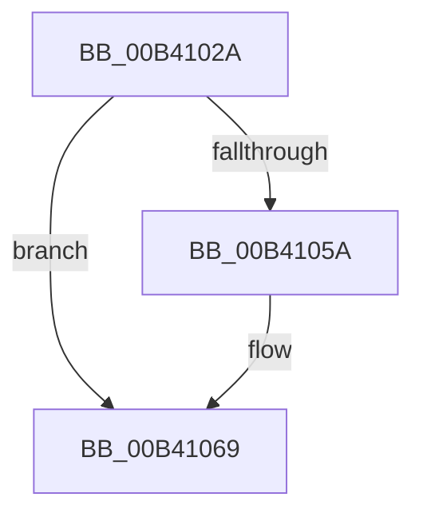

# sub_00B4102A

- RVA: `0x00B4102A`–`0x00B4107A` (길이 `80` bytes)
- VA: `0x0000000140B4102A`
- 실행 섹션: `PAGE`
- PDB 이름 있음: `아니요`; PDB Function 태그: `아니요`
- unwind 정보 RVA: `0x000B59A0`
- 디코드: `22`개 명령, `80/80` bytes 표시
- 미해석 바이트: `0` (있으면 어셈블리에 `.byte`로 보존)

> 이 문서는 커널 이미지의 기계어와 PDB 기호를 분석해 생성했습니다. 4번과 5번은 함수 원형과 자료형을 바이너리 사용 방식에서 추정한 C 해석이며 원본 소스 복구 결과는 아닙니다.

## 1. Dependencies

- 직접 호출 지점: **3**; 고유 호출 대상: **3**
- 직접 호출자로 확인된 함수: **0**
- RIP 상대 이미지 참조: **1**

### Outgoing calls
- `0x00B41031` → [EtwTelemetryCoverageReport](../../text/46/EtwTelemetryCoverageReport_function_00460430.md) (function, `0x00460430`)
- `0x00B41045` → [PspLockProcessExclusive](../../text/46/PspLockProcessExclusive_function_00460164.md) (function, `0x00460164`)
- `0x00B4106F` → [PspUnlockProcessExclusive](../../text/46/PspUnlockProcessExclusive_function_004601C0.md) (function, `0x004601C0`)

### Direct callers
- 이 함수 시작 RVA로 연결되는 직접 call은 확인되지 않았습니다. 간접 호출은 완전히 역산할 수 없습니다.

### Static image references
- `0x00B4102A` → RVA `0x00E08690` (`.data`; read)

## 2. Other-region calls and transfers

- 다른 실행 섹션으로 향하는 call: **3**
  - `0x00B41031` → [EtwTelemetryCoverageReport](../../text/46/EtwTelemetryCoverageReport_function_00460430.md) (`PAGE` → `.text`)
  - `0x00B41045` → [PspLockProcessExclusive](../../text/46/PspLockProcessExclusive_function_00460164.md) (`PAGE` → `.text`)
  - `0x00B4106F` → [PspUnlockProcessExclusive](../../text/46/PspUnlockProcessExclusive_function_004601C0.md) (`PAGE` → `.text`)
- call이 아닌 외부 분기/꼬리 이동: **1**
  - `0x00B41075` → [PsSetProcessFaultInformation + 0x2F](../A7/PsSetProcessFaultInformation_function_00A75400.md) (`tail-transfer`)

## 3. Assembly (complete function range)

```asm
00B4102A  48 8D 0D 5F 76 2C 00            lea rcx, [rip + 0x2c765f]
00B41031  E8 FA F3 91 FF                  call 0x140460430
00B41036  65 48 8B 1C 25 88 01 00 00      mov rbx, qword ptr gs:[0x188]
00B4103F  48 8B CF                        mov rcx, rdi
00B41042  48 8B D3                        mov rdx, rbx
00B41045  E8 1A F1 91 FF                  call 0x140460164
00B4104A  8A 8F FB 05 00 00               mov cl, byte ptr [rdi + 0x5fb]
00B41050  B2 07                           mov dl, 7
00B41052  8A C1                           mov al, cl
00B41054  22 C2                           and al, dl
00B41056  3A C2                           cmp al, dl
00B41058  73 0F                           jae 0x140b41069
00B4105A  8D 41 01                        lea eax, [rcx + 1]
00B4105D  32 C1                           xor al, cl
00B4105F  22 C2                           and al, dl
00B41061  32 C1                           xor al, cl
00B41063  88 87 FB 05 00 00               mov byte ptr [rdi + 0x5fb], al
00B41069  48 8B D3                        mov rdx, rbx
00B4106C  48 8B CF                        mov rcx, rdi
00B4106F  E8 4C F1 91 FF                  call 0x1404601c0
00B41074  90                              nop
00B41075  E9 B5 43 F3 FF                  jmp 0x140a7542f
```

## 4. C-style interpretation (structured pseudocode)

```c
__int64 __fastcall sub_00B4102A(void)
{
    __int64 result;

    result = EtwTelemetryCoverageReport(v_rip + 2913887, a2, a3, a4);
    result = PspLockProcessExclusive(v_rdi, *(unsigned __int64 *)(gs_base + (0 + 392)), a3, a4);
    result = (unsigned __int8)(((unsigned __int8)(*(unsigned __int8 *)(v_rdi + 1531))) & (7));
    if (((unsigned __int8)(result)) < 7) {
        result = *(unsigned __int8 *)(v_rdi + 1531) + 1;
        result = (unsigned __int8)((result) ^ ((unsigned __int8)(*(unsigned __int8 *)(v_rdi + 1531))));
        result = (unsigned __int8)((result) & (7));
        result = (unsigned __int8)((result) ^ ((unsigned __int8)(*(unsigned __int8 *)(v_rdi + 1531))));
        *(unsigned __int8 *)(v_rdi + 1531) = (unsigned __int8)(result);
    }
    result = PspUnlockProcessExclusive(v_rdi, *(unsigned __int64 *)(gs_base + (0 + 392)), a3, a4);
}
```

## 5. (Beta) C Style

```c
void sub_00B4102A(void)
{
    int64_t result;

    result = EtwTelemetryCoverageReport(v_rip + 2913887, a2, a3, a4);
    result = PspLockProcessExclusive(local_rdi, *(uint64_t *)(gs_base + (0 + 0x188)), a3, a4);
    result = (uint8_t)(((uint8_t)(*(uint8_t *)(local_rdi + 0x5FB))) & (7));
    if (((uint8_t)(result)) < 7) {
        result = *(uint8_t *)(local_rdi + 0x5FB) + 1;
        result = (uint8_t)((result) ^ ((uint8_t)(*(uint8_t *)(local_rdi + 0x5FB))));
        result = (uint8_t)((result) & (7));
        result = (uint8_t)((result) ^ ((uint8_t)(*(uint8_t *)(local_rdi + 0x5FB))));
        *(uint8_t *)(local_rdi + 0x5FB) = (uint8_t)(result);
    }
    result = PspUnlockProcessExclusive(local_rdi, *(uint64_t *)(gs_base + (0 + 0x188)), a3, a4);
}
```

## 6. Execution-region graph

[열기: 2D/3D 그래프와 함수 탐색 컨트롤 패널](../../../control-panel.html?section=page&rva=0x00B4102A&view=graph)

- 2D 그래프는 위에서 아래로 흐르고, 3D 그래프는 빈 공간을 드래그해 회전합니다. Shift+드래그는 이동, 휠은 확대·축소, 함수 노드 선택은 대상 보고서 이동입니다.

### Static fallback


