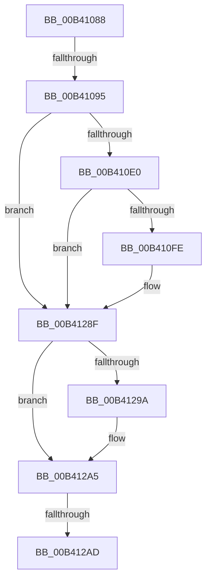

# sub_00B41088

- RVA: `0x00B41088`–`0x00B412BE` (길이 `566` bytes)
- VA: `0x0000000140B41088`
- 실행 섹션: `PAGE`
- PDB 이름 있음: `아니요`; PDB Function 태그: `아니요`
- unwind 정보 RVA: `0x000B5A04`
- 디코드: `107`개 명령, `566/566` bytes 표시
- 미해석 바이트: `0` (있으면 어셈블리에 `.byte`로 보존)

> 이 문서는 커널 이미지의 기계어와 PDB 기호를 분석해 생성했습니다. 4번과 5번은 함수 원형과 자료형을 바이너리 사용 방식에서 추정한 C 해석이며 원본 소스 복구 결과는 아닙니다.

## 1. Dependencies

- 직접 호출 지점: **6**; 고유 호출 대상: **4**
- 직접 호출자로 확인된 함수: **0**
- RIP 상대 이미지 참조: **4**

### Outgoing calls
- `0x00B410A8` → [PopDiagQueryDevicePropertyString](../AA/PopDiagQueryDevicePropertyString_function_00AA2014.md) (function, `0x00AA2014`)
- `0x00B410BF` → [PopDiagQueryDevicePropertyString](../AA/PopDiagQueryDevicePropertyString_function_00AA2014.md) (function, `0x00AA2014`)
- `0x00B410F1` → [tlgKeywordOn](../../text/42/tlgKeywordOn_function_0042EAA0.md) (function, `0x0042EAA0`)
- `0x00B4128A` → [tlgWriteTransfer_EtwWriteTransfer](../../text/42/tlgWriteTransfer_EtwWriteTransfer_function_004260E0.md) (function, `0x004260E0`)
- `0x00B412A0` → [ExFreePoolWithTag](../../poolcode/B8/ExFreePoolWithTag_function_00B82870.md) (function, `0x00B82870`)
- `0x00B412B3` → [ExFreePoolWithTag](../../poolcode/B8/ExFreePoolWithTag_function_00B82870.md) (function, `0x00B82870`)

### Direct callers
- 이 함수 시작 RVA로 연결되는 직접 call은 확인되지 않았습니다. 간접 호출은 완전히 역산할 수 없습니다.

### Static image references
- `0x00B41088` → RVA `0x00E67868` (`.data`; read)
- `0x00B410D3` → RVA `0x00E076D8` (`.data`; read)
- `0x00B410FE` → RVA `0x00F0B6B0` (`.data`; read)
- `0x00B411ED` → RVA `0x0004A929` (`.rdata`; read)

## 2. Other-region calls and transfers

- 다른 실행 섹션으로 향하는 call: **4**
  - `0x00B410F1` → [tlgKeywordOn](../../text/42/tlgKeywordOn_function_0042EAA0.md) (`PAGE` → `.text`)
  - `0x00B4128A` → [tlgWriteTransfer_EtwWriteTransfer](../../text/42/tlgWriteTransfer_EtwWriteTransfer_function_004260E0.md) (`PAGE` → `.text`)
  - `0x00B412A0` → [ExFreePoolWithTag](../../poolcode/B8/ExFreePoolWithTag_function_00B82870.md) (`PAGE` → `POOLCODE`)
  - `0x00B412B3` → [ExFreePoolWithTag](../../poolcode/B8/ExFreePoolWithTag_function_00B82870.md) (`PAGE` → `POOLCODE`)
- call이 아닌 외부 분기/꼬리 이동: **3**
  - `0x00B4108F` → [PopDiagTraceFxComponentAccounting + 0x135](../A7/PopDiagTraceFxComponentAccounting_function_00A758D4.md) (`tail-transfer`)
  - `0x00B412A7` → [PopDiagTraceFxComponentAccounting + 0x135](../A7/PopDiagTraceFxComponentAccounting_function_00A758D4.md) (`tail-transfer`)
  - `0x00B412B9` → [PopDiagTraceFxComponentAccounting + 0x135](../A7/PopDiagTraceFxComponentAccounting_function_00A758D4.md) (`tail-transfer`)

## 3. Assembly (complete function range)

```asm
00B41088  44 39 25 D9 67 32 00            cmp dword ptr [rip + 0x3267d9], r12d
00B4108F  0F 85 74 49 F3 FF               jne 0x140a75a09
00B41095  48 8B 44 24 38                  mov rax, qword ptr [rsp + 0x38]
00B4109A  4C 8D 44 24 40                  lea r8, [rsp + 0x40]
00B4109F  8B D7                           mov edx, edi
00B410A1  48 8B 58 20                     mov rbx, qword ptr [rax + 0x20]
00B410A5  48 8B CB                        mov rcx, rbx
00B410A8  E8 67 0F F6 FF                  call 0x140aa2014
00B410AD  8B F8                           mov edi, eax
00B410AF  4C 8D 44 24 50                  lea r8, [rsp + 0x50]
00B410B4  BA 06 00 00 00                  mov edx, 6
00B410B9  C1 EF 1F                        shr edi, 0x1f
00B410BC  48 8B CB                        mov rcx, rbx
00B410BF  E8 50 0F F6 FF                  call 0x140aa2014
00B410C4  4C 8B 74 24 48                  mov r14, qword ptr [rsp + 0x48]
00B410C9  8B D8                           mov ebx, eax
00B410CB  48 8B 74 24 58                  mov rsi, qword ptr [rsp + 0x58]
00B410D0  C1 EB 1F                        shr ebx, 0x1f
00B410D3  83 3D FE 65 2C 00 05            cmp dword ptr [rip + 0x2c65fe], 5
00B410DA  0F 86 AF 01 00 00               jbe 0x140b4128f
00B410E0  48 BA 00 00 00 00 00 40 00 00   movabs rdx, 0x400000000000
00B410EA  48 8D 0D E7 65 2C 00            lea rcx, [rip + 0x2c65e7]
00B410F1  E8 AA D9 8E FF                  call 0x14042eaa0
00B410F6  84 C0                           test al, al
00B410F8  0F 84 91 01 00 00               je 0x140b4128f
00B410FE  48 8B 05 AB A5 3C 00            mov rax, qword ptr [rip + 0x3ca5ab]
00B41105  45 33 C9                        xor r9d, r9d
00B41108  48 89 44 24 60                  mov qword ptr [rsp + 0x60], rax
00B4110D  45 33 C0                        xor r8d, r8d
00B41110  48 C7 45 F8 08 00 00 00         mov qword ptr [rbp - 8], 8
00B41118  48 8D 44 24 60                  lea rax, [rsp + 0x60]
00B4111D  48 89 45 F0                     mov qword ptr [rbp - 0x10], rax
00B41121  48 8B 44 24 38                  mov rax, qword ptr [rsp + 0x38]
00B41126  0F B7 50 28                     movzx edx, word ptr [rax + 0x28]
00B4112A  48 8B 48 30                     mov rcx, qword ptr [rax + 0x30]
00B4112E  48 8D 45 18                     lea rax, [rbp + 0x18]
00B41132  48 89 45 00                     mov qword ptr [rbp], rax
00B41136  8B 85 38 01 00 00               mov eax, dword ptr [rbp + 0x138]
00B4113C  89 44 24 34                     mov dword ptr [rsp + 0x34], eax
00B41140  48 8D 44 24 34                  lea rax, [rsp + 0x34]
00B41145  48 89 45 20                     mov qword ptr [rbp + 0x20], rax
00B41149  49 8B 07                        mov rax, qword ptr [r15]
00B4114C  48 89 44 24 68                  mov qword ptr [rsp + 0x68], rax
00B41151  48 8D 44 24 68                  lea rax, [rsp + 0x68]
00B41156  48 89 45 30                     mov qword ptr [rbp + 0x30], rax
00B4115A  49 8D 47 10                     lea rax, [r15 + 0x10]
00B4115E  48 89 45 40                     mov qword ptr [rbp + 0x40], rax
00B41162  49 8D 47 38                     lea rax, [r15 + 0x38]
00B41166  48 89 45 50                     mov qword ptr [rbp + 0x50], rax
00B4116A  49 8B 47 08                     mov rax, qword ptr [r15 + 8]
00B4116E  48 89 44 24 70                  mov qword ptr [rsp + 0x70], rax
00B41173  48 8D 44 24 70                  lea rax, [rsp + 0x70]
00B41178  48 89 45 60                     mov qword ptr [rbp + 0x60], rax
00B4117C  48 8D 85 88 00 00 00            lea rax, [rbp + 0x88]
00B41183  48 89 45 70                     mov qword ptr [rbp + 0x70], rax
00B41187  0F B7 44 24 40                  movzx eax, word ptr [rsp + 0x40]
00B4118C  89 85 88 00 00 00               mov dword ptr [rbp + 0x88], eax
00B41192  48 8D 85 A8 00 00 00            lea rax, [rbp + 0xa8]
00B41199  48 89 85 90 00 00 00            mov qword ptr [rbp + 0x90], rax
00B411A0  0F B7 44 24 50                  movzx eax, word ptr [rsp + 0x50]
00B411A5  89 85 A8 00 00 00               mov dword ptr [rbp + 0xa8], eax
00B411AB  48 8D 85 C8 00 00 00            lea rax, [rbp + 0xc8]
00B411B2  48 89 85 B0 00 00 00            mov qword ptr [rbp + 0xb0], rax
00B411B9  49 8B 45 08                     mov rax, qword ptr [r13 + 8]
00B411BD  48 89 85 C0 00 00 00            mov qword ptr [rbp + 0xc0], rax
00B411C4  41 0F B7 45 00                  movzx eax, word ptr [r13]
00B411C9  89 85 C8 00 00 00               mov dword ptr [rbp + 0xc8], eax
00B411CF  48 8D 44 24 40                  lea rax, [rsp + 0x40]
00B411D4  48 89 85 D0 00 00 00            mov qword ptr [rbp + 0xd0], rax
00B411DB  48 8D 45 D0                     lea rax, [rbp - 0x30]
00B411DF  48 89 4D 10                     mov qword ptr [rbp + 0x10], rcx
00B411E3  48 8D 0D EE 64 2C 00            lea rcx, [rip + 0x2c64ee]
00B411EA  89 55 18                        mov dword ptr [rbp + 0x18], edx
00B411ED  48 8D 15 35 97 50 FF            lea rdx, [rip - 0xaf68cb]
00B411F4  48 89 44 24 28                  mov qword ptr [rsp + 0x28], rax
00B411F9  C7 44 24 20 11 00 00 00         mov dword ptr [rsp + 0x20], 0x11
00B41201  48 C7 45 08 02 00 00 00         mov qword ptr [rbp + 8], 2
00B41209  44 89 65 1C                     mov dword ptr [rbp + 0x1c], r12d
00B4120D  48 C7 45 28 04 00 00 00         mov qword ptr [rbp + 0x28], 4
00B41215  48 C7 45 38 08 00 00 00         mov qword ptr [rbp + 0x38], 8
00B4121D  48 C7 45 48 28 00 00 00         mov qword ptr [rbp + 0x48], 0x28
00B41225  48 C7 45 58 28 00 00 00         mov qword ptr [rbp + 0x58], 0x28
00B4122D  48 C7 45 68 08 00 00 00         mov qword ptr [rbp + 0x68], 8
00B41235  48 C7 45 78 02 00 00 00         mov qword ptr [rbp + 0x78], 2
00B4123D  4C 89 B5 80 00 00 00            mov qword ptr [rbp + 0x80], r14
00B41244  44 89 A5 8C 00 00 00            mov dword ptr [rbp + 0x8c], r12d
00B4124B  48 C7 85 98 00 00 00 02 00 00 00  mov qword ptr [rbp + 0x98], 2
00B41256  48 89 B5 A0 00 00 00            mov qword ptr [rbp + 0xa0], rsi
00B4125D  44 89 A5 AC 00 00 00            mov dword ptr [rbp + 0xac], r12d
00B41264  48 C7 85 B8 00 00 00 02 00 00 00  mov qword ptr [rbp + 0xb8], 2
00B4126F  44 89 A5 CC 00 00 00            mov dword ptr [rbp + 0xcc], r12d
00B41276  48 C7 44 24 40 00 00 00 01      mov qword ptr [rsp + 0x40], 0x1000000
00B4127F  48 C7 85 D8 00 00 00 08 00 00 00  mov qword ptr [rbp + 0xd8], 8
00B4128A  E8 51 4E 8E FF                  call 0x1404260e0
00B4128F  41 BF 50 64 69 67               mov r15d, 0x67696450
00B41295  40 84 FF                        test dil, dil
00B41298  75 0B                           jne 0x140b412a5
00B4129A  41 8B D7                        mov edx, r15d
00B4129D  49 8B CE                        mov rcx, r14
00B412A0  E8 CB 15 04 00                  call 0x140b82870
00B412A5  84 DB                           test bl, bl
00B412A7  0F 85 5C 47 F3 FF               jne 0x140a75a09
00B412AD  41 8B D7                        mov edx, r15d
00B412B0  48 8B CE                        mov rcx, rsi
00B412B3  E8 B8 15 04 00                  call 0x140b82870
00B412B8  90                              nop
00B412B9  E9 4B 47 F3 FF                  jmp 0x140a75a09
```

## 4. C-style interpretation (structured pseudocode)

```c
__int64 __fastcall sub_00B41088(__int64 a1, __int64 a2, __int64 a3, int a4, __int64 a5, __int64 a6, __int64 a7, unsigned __int16 a8, __int64 a9, unsigned __int16 a10, __int64 a11, __int64 a12, __int64 a13, __int64 a14)
{
    __int64 result;
    __int64 v_rbx;
    __int64 v_rdi;
    unsigned int v_stack_p20;
    unsigned __int64 v_stack_p28;
    unsigned int v_stack_p34;
    unsigned __int64 v_stack_p40;
    unsigned __int64 v_stack_p60;
    unsigned __int64 v_stack_p68;
    unsigned __int64 v_stack_p70;

    result = PopDiagQueryDevicePropertyString(*(unsigned __int64 *)(a7 + 32), (unsigned int)((unsigned int)(v_rdi)), a8, a4);
    v_rdi = (unsigned int)(((unsigned int)((unsigned int)(result))) >> (31));
    result = PopDiagQueryDevicePropertyString(*(unsigned __int64 *)(a7 + 32), 6, a10, a4);
    v_rbx = (unsigned int)(((unsigned int)((unsigned int)(result))) >> (31));
    if ((*(unsigned int *)(v_rip + 2909694)) <= 5) goto loc_00B4128F;
    result = tlgKeywordOn(v_rip + 2909671, 6, a10, a4);
    if ((unsigned __int8)(result) != 0) {
        result = *(unsigned __int64 *)(v_rip + 3974571);
        a4 = 0;
        v_stack_p60 = result;
        a3 = 0;
        *(unsigned __int64 *)(v_rbp - 8) = 8;
        result = a12;
        *(unsigned __int64 *)(v_rbp - 16) = result;
        result = a7;
        a2 = *(unsigned __int16 *)(result + 40);
        a1 = *(unsigned __int64 *)(result + 48);
        result = v_rbp + 24;
        *(unsigned __int64 *)(v_rbp) = result;
        result = *(unsigned int *)(v_rbp + 312);
        v_stack_p34 = (unsigned int)(result);
        result = v_stack_p34;
        *(unsigned __int64 *)(v_rbp + 32) = result;
        result = *(unsigned __int64 *)(v_r15);
        v_stack_p68 = result;
        result = a13;
        *(unsigned __int64 *)(v_rbp + 48) = result;
        result = v_r15 + 16;
        *(unsigned __int64 *)(v_rbp + 64) = result;
        result = v_r15 + 56;
        *(unsigned __int64 *)(v_rbp + 80) = result;
        result = *(unsigned __int64 *)(v_r15 + 8);
        v_stack_p70 = result;
        result = a14;
        *(unsigned __int64 *)(v_rbp + 96) = result;
        result = v_rbp + 136;
        *(unsigned __int64 *)(v_rbp + 112) = result;
        result = a8;
        *(unsigned int *)(v_rbp + 136) = (unsigned int)(result);
        result = v_rbp + 168;
        *(unsigned __int64 *)(v_rbp + 144) = result;
        result = a10;
        *(unsigned int *)(v_rbp + 168) = (unsigned int)(result);
        result = v_rbp + 200;
        *(unsigned __int64 *)(v_rbp + 176) = result;
        result = *(unsigned __int64 *)(v_r13 + 8);
        *(unsigned __int64 *)(v_rbp + 192) = result;
        result = *(unsigned __int16 *)(v_r13);
        *(unsigned int *)(v_rbp + 200) = (unsigned int)(result);
        result = a8;
        *(unsigned __int64 *)(v_rbp + 208) = result;
        result = v_rbp - 48;
        *(unsigned __int64 *)(v_rbp + 16) = a1;
        a1 = v_rip + 2909422;
        *(unsigned int *)(v_rbp + 24) = (unsigned int)(a2);
        a2 = v_rip - 11495627;
        v_stack_p28 = result;
        v_stack_p20 = 17;
        *(unsigned __int64 *)(v_rbp + 8) = 2;
        *(unsigned int *)(v_rbp + 28) = (unsigned int)(v_r12);
        *(unsigned __int64 *)(v_rbp + 40) = 4;
        *(unsigned __int64 *)(v_rbp + 56) = 8;
        *(unsigned __int64 *)(v_rbp + 72) = 40;
        *(unsigned __int64 *)(v_rbp + 88) = 40;
        *(unsigned __int64 *)(v_rbp + 104) = 8;
        *(unsigned __int64 *)(v_rbp + 120) = 2;
        *(unsigned __int64 *)(v_rbp + 128) = a9;
        *(unsigned int *)(v_rbp + 140) = (unsigned int)(v_r12);
        *(unsigned __int64 *)(v_rbp + 152) = 2;
        *(unsigned __int64 *)(v_rbp + 160) = a11;
        *(unsigned int *)(v_rbp + 172) = (unsigned int)(v_r12);
        *(unsigned __int64 *)(v_rbp + 184) = 2;
        *(unsigned int *)(v_rbp + 204) = (unsigned int)(v_r12);
        v_stack_p40 = 0x1000000ULL;
        *(unsigned __int64 *)(v_rbp + 216) = 8;
        result = tlgWriteTransfer_EtwWriteTransfer(a1, a2, a3, a4);
    }
    if ((unsigned __int8)(v_rdi) == 0) {
        a2 = (unsigned int)((unsigned int)(0x67696450ULL));
        a1 = a9;
        result = ExFreePoolWithTag(a1, a2, a3, a4);
    }
    result = ExFreePoolWithTag(a11, (unsigned int)((unsigned int)((unsigned int)(0x67696450ULL))), a3, a4);
}
```

## 5. (Beta) C Style

```c
int64_t sub_00B41088(int64_t Arg1, int64_t Arg2, int64_t Arg3, int32_t Arg4, uint64_t Arg5, uint64_t Arg6, void *Arg7, uint16_t Arg8, int64_t Arg9, uint16_t Arg10, int64_t Arg11, int64_t Arg12, int64_t Arg13, int64_t Arg14)
{
    uint8_t *arg7 = (uint8_t *)Arg7;

    int64_t result;
    int64_t local_rbx;
    int64_t local_rdi;
    uint32_t v_stack_p20;
    uint64_t v_stack_p28;
    uint32_t v_stack_p34;
    uint64_t v_stack_p40;
    uint64_t v_stack_p60;
    uint64_t v_stack_p68;
    uint64_t v_stack_p70;

    result = PopDiagQueryDevicePropertyString(*(uint64_t *)(arg7 + 0x20), (uint32_t)((uint32_t)(local_rdi)), Arg8, Arg4);
    local_rdi = (uint32_t)(((uint32_t)((uint32_t)(result))) >> (31));
    result = PopDiagQueryDevicePropertyString(*(uint64_t *)(arg7 + 0x20), 6, Arg10, Arg4);
    local_rbx = (uint32_t)(((uint32_t)((uint32_t)(result))) >> (31));
    if ((*(uint32_t *)(v_rip + 0x2C65FE)) <= 5) goto loc_00B4128F;
    result = tlgKeywordOn(v_rip + 2909671, 6, Arg10, Arg4);
    if ((uint8_t)(result) != 0) {
        result = *(uint64_t *)(v_rip + 0x3CA5AB);
        Arg4 = 0;
        v_stack_p60 = result;
        Arg3 = 0;
        *(uint64_t *)(local_rbp - 0x8) = 8;
        result = Arg12;
        *(uint64_t *)(local_rbp - 0x10) = result;
        result = Arg7;
        Arg2 = *(uint16_t *)(result + 0x28);
        Arg1 = *(uint64_t *)(result + 0x30);
        result = local_rbp + 24;
        *(uint64_t *)(local_rbp) = result;
        result = *(uint32_t *)(local_rbp + 0x138);
        v_stack_p34 = (uint32_t)(result);
        result = v_stack_p34;
        *(uint64_t *)(local_rbp + 0x20) = result;
        result = *(uint64_t *)(local_r15);
        v_stack_p68 = result;
        result = Arg13;
        *(uint64_t *)(local_rbp + 0x30) = result;
        result = local_r15 + 16;
        *(uint64_t *)(local_rbp + 0x40) = result;
        result = local_r15 + 56;
        *(uint64_t *)(local_rbp + 0x50) = result;
        result = *(uint64_t *)(local_r15 + 0x8);
        v_stack_p70 = result;
        result = Arg14;
        *(uint64_t *)(local_rbp + 0x60) = result;
        result = local_rbp + 136;
        *(uint64_t *)(local_rbp + 0x70) = result;
        result = Arg8;
        *(uint32_t *)(local_rbp + 0x88) = (uint32_t)(result);
        result = local_rbp + 168;
        *(uint64_t *)(local_rbp + 0x90) = result;
        result = Arg10;
        *(uint32_t *)(local_rbp + 0xA8) = (uint32_t)(result);
        result = local_rbp + 200;
        *(uint64_t *)(local_rbp + 0xB0) = result;
        result = *(uint64_t *)(local_r13 + 0x8);
        *(uint64_t *)(local_rbp + 0xC0) = result;
        result = *(uint16_t *)(local_r13);
        *(uint32_t *)(local_rbp + 0xC8) = (uint32_t)(result);
        result = Arg8;
        *(uint64_t *)(local_rbp + 0xD0) = result;
        result = local_rbp - 48;
        *(uint64_t *)(local_rbp + 0x10) = Arg1;
        Arg1 = v_rip + 2909422;
        *(uint32_t *)(local_rbp + 0x18) = (uint32_t)(Arg2);
        Arg2 = v_rip - 11495627;
        v_stack_p28 = result;
        v_stack_p20 = 17;
        *(uint64_t *)(local_rbp + 0x8) = 2;
        *(uint32_t *)(local_rbp + 0x1C) = (uint32_t)(local_r12);
        *(uint64_t *)(local_rbp + 0x28) = 4;
        *(uint64_t *)(local_rbp + 0x38) = 8;
        *(uint64_t *)(local_rbp + 0x48) = 40;
        *(uint64_t *)(local_rbp + 0x58) = 40;
        *(uint64_t *)(local_rbp + 0x68) = 8;
        *(uint64_t *)(local_rbp + 0x78) = 2;
        *(uint64_t *)(local_rbp + 0x80) = Arg9;
        *(uint32_t *)(local_rbp + 0x8C) = (uint32_t)(local_r12);
        *(uint64_t *)(local_rbp + 0x98) = 2;
        *(uint64_t *)(local_rbp + 0xA0) = Arg11;
        *(uint32_t *)(local_rbp + 0xAC) = (uint32_t)(local_r12);
        *(uint64_t *)(local_rbp + 0xB8) = 2;
        *(uint32_t *)(local_rbp + 0xCC) = (uint32_t)(local_r12);
        v_stack_p40 = 0x1000000ULL;
        *(uint64_t *)(local_rbp + 0xD8) = 8;
        result = tlgWriteTransfer_EtwWriteTransfer(Arg1, Arg2, Arg3, Arg4);
    }
    if ((uint8_t)(local_rdi) == 0) {
        Arg2 = (uint32_t)((uint32_t)(0x67696450ULL));
        Arg1 = Arg9;
        result = ExFreePoolWithTag(Arg1, Arg2, Arg3, Arg4);
    }
    result = ExFreePoolWithTag(Arg11, (uint32_t)((uint32_t)((uint32_t)(0x67696450ULL))), Arg3, Arg4);
}
```

### 관측된 메모리 오프셋

구조체 형식이 확인되지 않은 접근은 인자 기준의 오프셋으로만 기록했습니다.

| 기준 인자 | 오프셋 표현 | 폭 (bit) | 접근 |
|---|---:|---:|---|
| `Arg7` | `+ 0x20` | `64` | `R` |
| `Arg7` | `+ 0x28` | `16` | `R` |
| `Arg7` | `+ 0x30` | `64` | `R` |

## 6. Execution-region graph

[열기: 2D/3D 그래프와 함수 탐색 컨트롤 패널](../../../control-panel.html?section=page&rva=0x00B41088&view=graph)

- 2D 그래프는 위에서 아래로 흐르고, 3D 그래프는 빈 공간을 드래그해 회전합니다. Shift+드래그는 이동, 휠은 확대·축소, 함수 노드 선택은 대상 보고서 이동입니다.

### Static fallback


