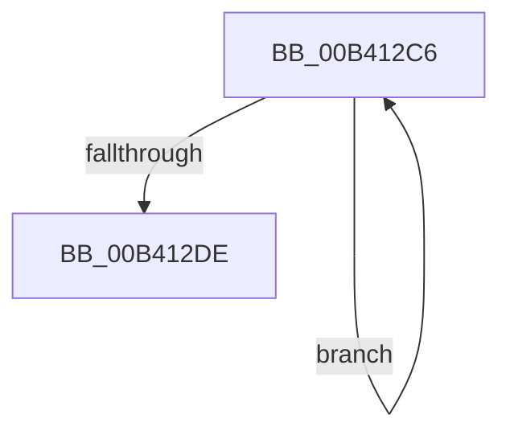

# sub_00B412C6

- RVA: `0x00B412C6`–`0x00B412E3` (길이 `29` bytes)
- VA: `0x0000000140B412C6`
- 실행 섹션: `PAGE`
- PDB 이름 있음: `아니요`; PDB Function 태그: `아니요`
- unwind 정보 RVA: `0x000B5A58`
- 디코드: `9`개 명령, `29/29` bytes 표시
- 미해석 바이트: `0` (있으면 어셈블리에 `.byte`로 보존)

> 이 문서는 커널 이미지의 기계어와 PDB 기호를 분석해 생성했습니다. 4번과 5번은 함수 원형과 자료형을 바이너리 사용 방식에서 추정한 C 해석이며 원본 소스 복구 결과는 아닙니다.

## 1. Dependencies

- 직접 호출 지점: **0**; 고유 호출 대상: **0**
- 직접 호출자로 확인된 함수: **0**
- RIP 상대 이미지 참조: **0**

### Outgoing calls
- 직접 디코드된 call 명령이 없습니다.

### Direct callers
- 이 함수 시작 RVA로 연결되는 직접 call은 확인되지 않았습니다. 간접 호출은 완전히 역산할 수 없습니다.

### Static image references
- 디코드된 RIP-relative 메모리 참조가 없습니다.

## 2. Other-region calls and transfers

- 다른 실행 섹션으로 향하는 call: **0**
- call이 아닌 외부 분기/꼬리 이동: **1**
  - `0x00B412DE` → [RtlDeleteAce + 0x84](../A7/RtlDeleteAce_function_00A76040.md) (`tail-transfer`)

## 3. Assembly (complete function range)

```asm
00B412C6  41 8A 03                        mov al, byte ptr [r11]
00B412C9  41 8B CA                        mov ecx, r10d
00B412CC  41 2B C8                        sub ecx, r8d
00B412CF  44 03 D6                        add r10d, esi
00B412D2  4C 03 DE                        add r11, rsi
00B412D5  42 88 04 09                     mov byte ptr [rcx + r9], al
00B412D9  44 3B D2                        cmp r10d, edx
00B412DC  72 E8                           jb 0x140b412c6
00B412DE  E9 E1 4D F3 FF                  jmp 0x140a760c4
```

## 4. C-style interpretation (structured pseudocode)

```c
__int64 __fastcall sub_00B412C6(__int64 a1, int a2, int a3, __int64 a4)
{
    __int64 v_r10;
    __int64 v_r11;

    a1 = (unsigned int)(((unsigned int)((unsigned int)(v_r10))) - (a3));
    v_r10 = (unsigned int)((v_r10) + ((unsigned int)(v_rsi)));
    v_r11 = (v_r11) + (v_rsi);
    *(unsigned __int8 *)(a1 + a4 * 1) = (unsigned __int8)(*(unsigned __int8 *)(v_r11));
    if (((unsigned int)(v_r10)) < a2) goto loc_00B412C6;
}
```

## 5. (Beta) C Style

```c
int64_t sub_00B412C6(int64_t Arg1, int32_t Arg2, int32_t Arg3, int64_t Arg4)
{
    int64_t local_r10;
    int64_t local_r11;

    Arg1 = (uint32_t)(((uint32_t)((uint32_t)(local_r10))) - (Arg3));
    local_r10 = (uint32_t)((local_r10) + ((uint32_t)(local_rsi)));
    local_r11 = (local_r11) + (local_rsi);
    *(uint8_t *)(Arg1 + Arg4 * 1) = (uint8_t)(*(uint8_t *)(local_r11));
    if (((uint32_t)(local_r10)) < Arg2) goto loc_00B412C6;
}
```

## 6. Execution-region graph

[열기: 2D/3D 그래프와 함수 탐색 컨트롤 패널](../../../control-panel.html?section=page&rva=0x00B412C6&view=graph)

- 2D 그래프는 위에서 아래로 흐르고, 3D 그래프는 빈 공간을 드래그해 회전합니다. Shift+드래그는 이동, 휠은 확대·축소, 함수 노드 선택은 대상 보고서 이동입니다.

### Static fallback


