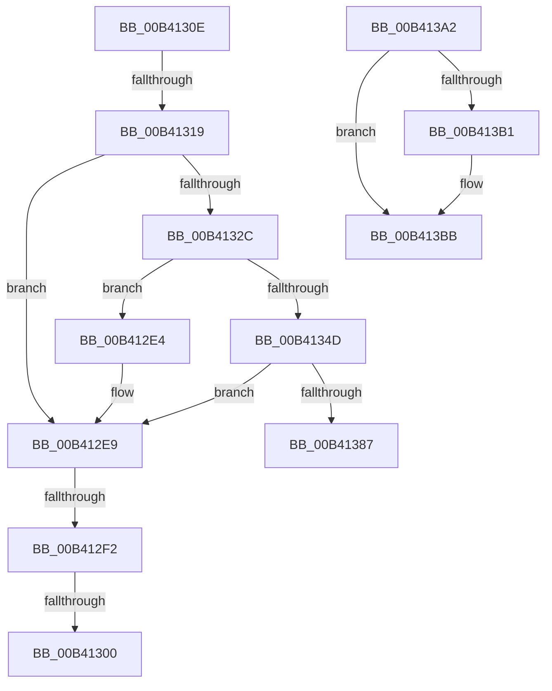

# sub_00B412E4

- RVA: `0x00B412E4`–`0x00B413CB` (길이 `231` bytes)
- VA: `0x0000000140B412E4`
- 실행 섹션: `PAGE`
- PDB 이름 있음: `아니요`; PDB Function 태그: `아니요`
- unwind 정보 RVA: `0x000B5AA4`
- 디코드: `59`개 명령, `231/231` bytes 표시
- 미해석 바이트: `0` (있으면 어셈블리에 `.byte`로 보존)

> 이 문서는 커널 이미지의 기계어와 PDB 기호를 분석해 생성했습니다. 4번과 5번은 함수 원형과 자료형을 바이너리 사용 방식에서 추정한 C 해석이며 원본 소스 복구 결과는 아닙니다.

## 1. Dependencies

- 직접 호출 지점: **8**; 고유 호출 대상: **6**
- 직접 호출자로 확인된 함수: **0**
- RIP 상대 이미지 참조: **0**

### Outgoing calls
- `0x00B41303` → [AuthzBasepFreeSecurityAttributesList](../../text/30/AuthzBasepFreeSecurityAttributesList_function_00301230.md) (function, `0x00301230`)
- `0x00B41321` → [SepLengthSidAndAttributesArray](../9C/SepLengthSidAndAttributesArray_function_009C9CB8.md) (function, `0x009C9CB8`)
- `0x00B41340` → [ExAllocatePool2](../../poolcode/B8/ExAllocatePool2_function_00B820F0.md) (function, `0x00B820F0`)
- `0x00B41378` → [SeCaptureSidAndAttributesArray](../9C/SeCaptureSidAndAttributesArray_function_009C9D70.md) (function, `0x009C9D70`)
- `0x00B41397` → [RtlSidHashInitialize](../../text/41/RtlSidHashInitialize_function_00416EA0.md) (function, `0x00416EA0`)
- `0x00B413A7` → [ExFreePoolWithTag](../../poolcode/B8/ExFreePoolWithTag_function_00B82870.md) (function, `0x00B82870`)
- `0x00B413B6` → [ExFreePoolWithTag](../../poolcode/B8/ExFreePoolWithTag_function_00B82870.md) (function, `0x00B82870`)
- `0x00B413C0` → [ExFreePoolWithTag](../../poolcode/B8/ExFreePoolWithTag_function_00B82870.md) (function, `0x00B82870`)

### Direct callers
- 이 함수 시작 RVA로 연결되는 직접 call은 확인되지 않았습니다. 간접 호출은 완전히 역산할 수 없습니다.

### Static image references
- 디코드된 RIP-relative 메모리 참조가 없습니다.

## 2. Other-region calls and transfers

- 다른 실행 섹션으로 향하는 call: **6**
  - `0x00B41303` → [AuthzBasepFreeSecurityAttributesList](../../text/30/AuthzBasepFreeSecurityAttributesList_function_00301230.md) (`PAGE` → `.text`)
  - `0x00B41340` → [ExAllocatePool2](../../poolcode/B8/ExAllocatePool2_function_00B820F0.md) (`PAGE` → `POOLCODE`)
  - `0x00B41397` → [RtlSidHashInitialize](../../text/41/RtlSidHashInitialize_function_00416EA0.md) (`PAGE` → `.text`)
  - `0x00B413A7` → [ExFreePoolWithTag](../../poolcode/B8/ExFreePoolWithTag_function_00B82870.md) (`PAGE` → `POOLCODE`)
  - `0x00B413B6` → [ExFreePoolWithTag](../../poolcode/B8/ExFreePoolWithTag_function_00B82870.md) (`PAGE` → `POOLCODE`)
  - `0x00B413C0` → [ExFreePoolWithTag](../../poolcode/B8/ExFreePoolWithTag_function_00B82870.md) (`PAGE` → `POOLCODE`)
- call이 아닌 외부 분기/꼬리 이동: **6**
  - `0x00B412EC` → [SepDuplicateClaimAttributes + 0xDB](../A7/SepDuplicateClaimAttributes_function_00A76334.md) (`tail-transfer`)
  - `0x00B412FA` → [SepDuplicateClaimAttributes + 0xD1](../A7/SepDuplicateClaimAttributes_function_00A76334.md) (`tail-transfer`)
  - `0x00B41309` → [SepDuplicateClaimAttributes + 0xD1](../A7/SepDuplicateClaimAttributes_function_00A76334.md) (`tail-transfer`)
  - `0x00B41313` → [SepDuplicateClaimAttributes + 0xB2](../A7/SepDuplicateClaimAttributes_function_00A76334.md) (`tail-transfer`)
  - `0x00B4139D` → [SepDuplicateClaimAttributes + 0xB2](../A7/SepDuplicateClaimAttributes_function_00A76334.md) (`tail-transfer`)
  - `0x00B413C6` → [SepDuplicateClaimAttributes + 0xB6](../A7/SepDuplicateClaimAttributes_function_00A76334.md) (`tail-transfer`)

## 3. Assembly (complete function range)

```asm
00B412E4  BB 9A 00 00 C0                  mov ebx, 0xc000009a
00B412E9  4D 85 FF                        test r15, r15
00B412EC  0F 84 1D 51 F3 FF               je 0x140a7640f
00B412F2  80 BC 24 A8 00 00 00 00         cmp byte ptr [rsp + 0xa8], 0
00B412FA  0F 84 05 51 F3 FF               je 0x140a76405
00B41300  49 8B CF                        mov rcx, r15
00B41303  E8 28 FF 7B FF                  call 0x140301230
00B41308  90                              nop
00B41309  E9 F7 50 F3 FF                  jmp 0x140a76405
00B4130E  41 8B 16                        mov edx, dword ptr [r14]
00B41311  85 D2                           test edx, edx
00B41313  0F 84 CD 50 F3 FF               je 0x140a763e6
00B41319  4C 8D 84 24 B0 00 00 00         lea r8, [rsp + 0xb0]
00B41321  E8 92 89 E8 FF                  call 0x1409c9cb8
00B41326  8B D8                           mov ebx, eax
00B41328  85 C0                           test eax, eax
00B4132A  78 BD                           js 0x140b412e9
00B4132C  8B 9C 24 B0 00 00 00            mov ebx, dword ptr [rsp + 0xb0]
00B41333  B9 00 01 00 00                  mov ecx, 0x100
00B41338  8B D3                           mov edx, ebx
00B4133A  41 B8 53 65 54 64               mov r8d, 0x64546553
00B41340  E8 AB 0D 04 00                  call 0x140b820f0
00B41345  48 8B E8                        mov rbp, rax
00B41348  48 85 C0                        test rax, rax
00B4134B  74 97                           je 0x140b412e4
00B4134D  41 8B 16                        mov edx, dword ptr [r14]
00B41350  48 8D 84 24 B0 00 00 00         lea rax, [rsp + 0xb0]
00B41358  49 8B 4E 08                     mov rcx, qword ptr [r14 + 8]
00B4135C  4C 8B CD                        mov r9, rbp
00B4135F  48 89 44 24 40                  mov qword ptr [rsp + 0x40], rax
00B41364  45 33 C0                        xor r8d, r8d
00B41367  48 8D 84 24 B8 00 00 00         lea rax, [rsp + 0xb8]
00B4136F  48 89 44 24 38                  mov qword ptr [rsp + 0x38], rax
00B41374  89 5C 24 20                     mov dword ptr [rsp + 0x20], ebx
00B41378  E8 F3 89 E8 FF                  call 0x1409c9d70
00B4137D  8B D8                           mov ebx, eax
00B4137F  85 C0                           test eax, eax
00B41381  0F 88 62 FF FF FF               js 0x140b412e9
00B41387  41 8B 16                        mov edx, dword ptr [r14]
00B4138A  4C 8D 46 20                     lea r8, [rsi + 0x20]
00B4138E  48 8B CD                        mov rcx, rbp
00B41391  89 16                           mov dword ptr [rsi], edx
00B41393  48 89 6E 08                     mov qword ptr [rsi + 8], rbp
00B41397  E8 04 5B 8D FF                  call 0x140416ea0
00B4139C  90                              nop
00B4139D  E9 44 50 F3 FF                  jmp 0x140a763e6
00B413A2  33 D2                           xor edx, edx
00B413A4  48 8B CF                        mov rcx, rdi
00B413A7  E8 C4 14 04 00                  call 0x140b82870
00B413AC  48 85 ED                        test rbp, rbp
00B413AF  74 0A                           je 0x140b413bb
00B413B1  33 D2                           xor edx, edx
00B413B3  48 8B CD                        mov rcx, rbp
00B413B6  E8 B5 14 04 00                  call 0x140b82870
00B413BB  33 D2                           xor edx, edx
00B413BD  48 8B CE                        mov rcx, rsi
00B413C0  E8 AB 14 04 00                  call 0x140b82870
00B413C5  90                              nop
00B413C6  E9 1F 50 F3 FF                  jmp 0x140a763ea
```

## 4. C-style interpretation (structured pseudocode)

```c
__int64 __fastcall sub_00B412E4(__int64 a1, __int64 a2, __int64 a3, __int64 a4, __int64 a5, __int64 a6, __int64 a7, __int64 a8, __int64 a9, __int64 a10, __int64 a11, __int64 a12, __int64 a13, __int64 a14, __int64 a15, __int64 a16, __int64 a17, __int64 a18, __int64 a19, __int64 a20, unsigned __int8 a21)
{
    __int64 result;
    unsigned int v_stack_p20;
    unsigned __int64 v_stack_p38;
    unsigned __int64 v_stack_p40;
    unsigned __int64 v_stack_pB0;
    unsigned __int64 v_stack_pB8;

loc_00B412E9:
    result = AuthzBasepFreeSecurityAttributesList(v_r15, a2, a3, a4);
}
```

## 5. (Beta) C Style

```c
int64_t sub_00B412E4(int64_t Arg1, int64_t Arg2, int64_t Arg3, int64_t Arg4, uint64_t Arg5, uint64_t Arg6, uint64_t Arg7, uint64_t Arg8, uint64_t Arg9, uint64_t Arg10, uint64_t Arg11, uint64_t Arg12, uint64_t Arg13, uint64_t Arg14, uint64_t Arg15, uint64_t Arg16, uint64_t Arg17, uint64_t Arg18, uint64_t Arg19, uint64_t Arg20, uint8_t Arg21)
{
    int64_t result;
    uint32_t v_stack_p20;
    uint64_t v_stack_p38;
    uint64_t v_stack_p40;
    uint64_t v_stack_pB0;
    uint64_t v_stack_pB8;

loc_00B412E9:
    result = AuthzBasepFreeSecurityAttributesList(local_r15, Arg2, Arg3, Arg4);
}
```

## 6. Execution-region graph

[열기: 2D/3D 그래프와 함수 탐색 컨트롤 패널](../../../control-panel.html?section=page&rva=0x00B412E4&view=graph)

- 2D 그래프는 위에서 아래로 흐르고, 3D 그래프는 빈 공간을 드래그해 회전합니다. Shift+드래그는 이동, 휠은 확대·축소, 함수 노드 선택은 대상 보고서 이동입니다.

### Static fallback


