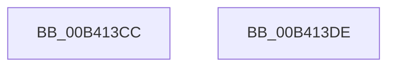

# sub_00B413CC

- RVA: `0x00B413CC`–`0x00B413EC` (길이 `32` bytes)
- VA: `0x0000000140B413CC`
- 실행 섹션: `PAGE`
- PDB 이름 있음: `아니요`; PDB Function 태그: `아니요`
- unwind 정보 RVA: `0x000B5AD0`
- 디코드: `9`개 명령, `32/32` bytes 표시
- 미해석 바이트: `0` (있으면 어셈블리에 `.byte`로 보존)

> 이 문서는 커널 이미지의 기계어와 PDB 기호를 분석해 생성했습니다. 4번과 5번은 함수 원형과 자료형을 바이너리 사용 방식에서 추정한 C 해석이며 원본 소스 복구 결과는 아닙니다.

## 1. Dependencies

- 직접 호출 지점: **2**; 고유 호출 대상: **2**
- 직접 호출자로 확인된 함수: **0**
- RIP 상대 이미지 참조: **0**

### Outgoing calls
- `0x00B413D3` → [PiUEventBroadcastHardwareProfilesChangedEvent](../72/PiUEventBroadcastHardwareProfilesChangedEvent_function_0072DD18.md) (function, `0x0072DD18`)
- `0x00B413E1` → [PiUEventBroadcastVolumesChangedEvent](../72/PiUEventBroadcastVolumesChangedEvent_function_0072DF04.md) (function, `0x0072DF04`)

### Direct callers
- 이 함수 시작 RVA로 연결되는 직접 call은 확인되지 않았습니다. 간접 호출은 완전히 역산할 수 없습니다.

### Static image references
- 디코드된 RIP-relative 메모리 참조가 없습니다.

## 2. Other-region calls and transfers

- 다른 실행 섹션으로 향하는 call: **0**
- call이 아닌 외부 분기/꼬리 이동: **2**
  - `0x00B413D9` → [PiUEventBroadcastEventWorker + 0x50](../A7/PiUEventBroadcastEventWorker_function_00A764D0.md) (`tail-transfer`)
  - `0x00B413E7` → [PiUEventBroadcastEventWorker + 0x50](../A7/PiUEventBroadcastEventWorker_function_00A764D0.md) (`tail-transfer`)

## 3. Assembly (complete function range)

```asm
00B413CC  8B 4F 18                        mov ecx, dword ptr [rdi + 0x18]
00B413CF  48 8D 57 1C                     lea rdx, [rdi + 0x1c]
00B413D3  E8 40 C9 BE FF                  call 0x14072dd18
00B413D8  90                              nop
00B413D9  E9 42 51 F3 FF                  jmp 0x140a76520
00B413DE  8B 4F 18                        mov ecx, dword ptr [rdi + 0x18]
00B413E1  E8 1E CB BE FF                  call 0x14072df04
00B413E6  90                              nop
00B413E7  E9 34 51 F3 FF                  jmp 0x140a76520
```

## 4. C-style interpretation (structured pseudocode)

```c
__int64 __fastcall sub_00B413CC(void)
{
    __int64 result;

    result = PiUEventBroadcastHardwareProfilesChangedEvent((unsigned int)(*(unsigned int *)(v_rdi + 24)), v_rdi + 28, a3, a4);
}
```

## 5. (Beta) C Style

```c
void sub_00B413CC(void)
{
    int64_t result;

    result = PiUEventBroadcastHardwareProfilesChangedEvent((uint32_t)(*(uint32_t *)(local_rdi + 0x18)), local_rdi + 28, a3, a4);
}
```

## 6. Execution-region graph

[열기: 2D/3D 그래프와 함수 탐색 컨트롤 패널](../../../control-panel.html?section=page&rva=0x00B413CC&view=graph)

- 2D 그래프는 위에서 아래로 흐르고, 3D 그래프는 빈 공간을 드래그해 회전합니다. Shift+드래그는 이동, 휠은 확대·축소, 함수 노드 선택은 대상 보고서 이동입니다.

### Static fallback


