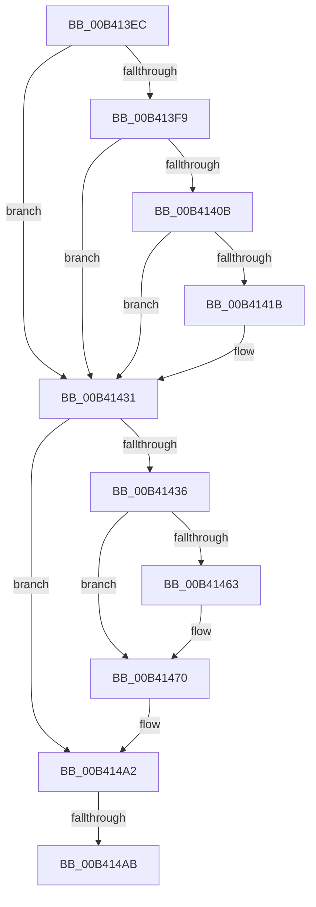

# sub_00B413EC

- RVA: `0x00B413EC`–`0x00B414C9` (길이 `221` bytes)
- VA: `0x0000000140B413EC`
- 실행 섹션: `PAGE`
- PDB 이름 있음: `아니요`; PDB Function 태그: `아니요`
- unwind 정보 RVA: `0x000B5B10`
- 디코드: `51`개 명령, `221/221` bytes 표시
- 미해석 바이트: `0` (있으면 어셈블리에 `.byte`로 보존)

> 이 문서는 커널 이미지의 기계어와 PDB 기호를 분석해 생성했습니다. 4번과 5번은 함수 원형과 자료형을 바이너리 사용 방식에서 추정한 C 해석이며 원본 소스 복구 결과는 아닙니다.

## 1. Dependencies

- 직접 호출 지점: **9**; 고유 호출 대상: **9**
- 직접 호출자로 확인된 함수: **0**
- RIP 상대 이미지 참조: **1**

### Outgoing calls
- `0x00B41412` → [ExAcquireRundownProtection](../../text/21/ExAcquireRundownProtection_function_00216620.md) (function, `0x00216620`)
- `0x00B41425` → [KiStackAttachProcess](../../text/21/KiStackAttachProcess_function_00216820.md) (function, `0x00216820`)
- `0x00B4143E` → [PsReferencePrimaryTokenWithTag](../../text/20/PsReferencePrimaryTokenWithTag_function_0020FF80.md) (function, `0x0020FF80`)
- `0x00B41458` → [EtwpQueryTokenPackageInfo](../8A/EtwpQueryTokenPackageInfo_function_008A5878.md) (function, `0x008A5878`)
- `0x00B4146B` → [EtwpQueryProcessOtherInfo](../8A/EtwpQueryProcessOtherInfo_function_008A5BB0.md) (function, `0x008A5BB0`)
- `0x00B41480` → [ObFastDereferenceObject](../../text/3E/ObFastDereferenceObject_function_003ED5F0.md) (function, `0x003ED5F0`)
- `0x00B4149D` → [EtwpPsProvTraceProcess](../8A/EtwpPsProvTraceProcess_function_008A3954.md) (function, `0x008A3954`)
- `0x00B414B2` → [KiUnstackDetachProcess](../../text/21/KiUnstackDetachProcess_function_00217D30.md) (function, `0x00217D30`)
- `0x00B414BE` → [ExReleaseRundownProtection](../../text/34/ExReleaseRundownProtection_function_00349E80.md) (function, `0x00349E80`)

### Direct callers
- 이 함수 시작 RVA로 연결되는 직접 call은 확인되지 않았습니다. 간접 호출은 완전히 역산할 수 없습니다.

### Static image references
- `0x00B413EC` → RVA `0x00FC6B70` (`ALMOSTRO`; read)

## 2. Other-region calls and transfers

- 다른 실행 섹션으로 향하는 call: **6**
  - `0x00B41412` → [ExAcquireRundownProtection](../../text/21/ExAcquireRundownProtection_function_00216620.md) (`PAGE` → `.text`)
  - `0x00B41425` → [KiStackAttachProcess](../../text/21/KiStackAttachProcess_function_00216820.md) (`PAGE` → `.text`)
  - `0x00B4143E` → [PsReferencePrimaryTokenWithTag](../../text/20/PsReferencePrimaryTokenWithTag_function_0020FF80.md) (`PAGE` → `.text`)
  - `0x00B41480` → [ObFastDereferenceObject](../../text/3E/ObFastDereferenceObject_function_003ED5F0.md) (`PAGE` → `.text`)
  - `0x00B414B2` → [KiUnstackDetachProcess](../../text/21/KiUnstackDetachProcess_function_00217D30.md) (`PAGE` → `.text`)
  - `0x00B414BE` → [ExReleaseRundownProtection](../../text/34/ExReleaseRundownProtection_function_00349E80.md) (`PAGE` → `.text`)
- call이 아닌 외부 분기/꼬리 이동: **2**
  - `0x00B414A5` → [EtwpPsProvProcessEnumCallback + 0x6D](../A7/EtwpPsProvProcessEnumCallback_function_00A76690.md) (`tail-transfer`)
  - `0x00B414C4` → [EtwpPsProvProcessEnumCallback + 0x6D](../A7/EtwpPsProvProcessEnumCallback_function_00A76690.md) (`tail-transfer`)

## 3. Assembly (complete function range)

```asm
00B413EC  48 3B 1D 7D 57 48 00            cmp rbx, qword ptr [rip + 0x48577d]
00B413F3  40 88 77 08                     mov byte ptr [rdi + 8], sil
00B413F7  74 38                           je 0x140b41431
00B413F9  65 48 8B 04 25 88 01 00 00      mov rax, qword ptr gs:[0x188]
00B41402  48 39 98 B8 00 00 00            cmp qword ptr [rax + 0xb8], rbx
00B41409  74 26                           je 0x140b41431
00B4140B  48 8D 8B E8 01 00 00            lea rcx, [rbx + 0x1e8]
00B41412  E8 09 52 6D FF                  call 0x140216620
00B41417  84 C0                           test al, al
00B41419  74 16                           je 0x140b41431
00B4141B  4C 8D 44 24 40                  lea r8, [rsp + 0x40]
00B41420  33 D2                           xor edx, edx
00B41422  48 8B CB                        mov rcx, rbx
00B41425  E8 F6 53 6D FF                  call 0x140216820
00B4142A  40 B6 01                        mov sil, 1
00B4142D  40 88 77 08                     mov byte ptr [rdi + 8], sil
00B41431  F6 07 10                        test byte ptr [rdi], 0x10
00B41434  74 6C                           je 0x140b414a2
00B41436  BA 44 66 6C 74                  mov edx, 0x746c6644
00B4143B  48 8B CB                        mov rcx, rbx
00B4143E  E8 3D EB 6C FF                  call 0x14020ff80
00B41443  83 64 24 30 00                  and dword ptr [rsp + 0x30], 0
00B41448  4C 8D 44 24 30                  lea r8, [rsp + 0x30]
00B4144D  48 8D 54 24 70                  lea rdx, [rsp + 0x70]
00B41452  48 8B C8                        mov rcx, rax
00B41455  4C 8B F0                        mov r14, rax
00B41458  E8 1B 44 D6 FF                  call 0x1408a5878
00B4145D  80 7F 08 00                     cmp byte ptr [rdi + 8], 0
00B41461  74 0D                           je 0x140b41470
00B41463  48 8D 54 24 38                  lea rdx, [rsp + 0x38]
00B41468  48 8B CB                        mov rcx, rbx
00B4146B  E8 40 47 D6 FF                  call 0x1408a5bb0
00B41470  48 8D 8B 48 02 00 00            lea rcx, [rbx + 0x248]
00B41477  41 B8 44 66 6C 74               mov r8d, 0x746c6644
00B4147D  49 8B D6                        mov rdx, r14
00B41480  E8 6B C1 8A FF                  call 0x1403ed5f0
00B41485  8B 54 24 30                     mov edx, dword ptr [rsp + 0x30]
00B41489  4C 8D 4C 24 38                  lea r9, [rsp + 0x38]
00B4148E  4C 8D 44 24 70                  lea r8, [rsp + 0x70]
00B41493  66 C7 44 24 20 03 03            mov word ptr [rsp + 0x20], 0x303
00B4149A  48 8B CB                        mov rcx, rbx
00B4149D  E8 B2 24 D6 FF                  call 0x1408a3954
00B414A2  40 84 F6                        test sil, sil
00B414A5  0F 84 52 52 F3 FF               je 0x140a766fd
00B414AB  33 D2                           xor edx, edx
00B414AD  48 8D 4C 24 40                  lea rcx, [rsp + 0x40]
00B414B2  E8 79 68 6D FF                  call 0x140217d30
00B414B7  48 8D 8B E8 01 00 00            lea rcx, [rbx + 0x1e8]
00B414BE  E8 BD 89 80 FF                  call 0x140349e80
00B414C3  90                              nop
00B414C4  E9 34 52 F3 FF                  jmp 0x140a766fd
```

## 4. C-style interpretation (structured pseudocode)

```c
__int64 __fastcall sub_00B413EC(__int64 a1, int a2, __int64 a3, __int64 a4, __int64 a5, unsigned int a6, __int64 a7, __int64 a8, __int64 a9, __int64 a10, __int64 a11, __int64 a12, __int64 a13, __int64 a14)
{
    __int64 result;
    __int64 v_rsi;
    unsigned __int16 v_stack_p20;

    *(unsigned __int8 *)(v_rdi + 8) = (unsigned __int8)(v_rsi);
    if (v_rbx == (*(unsigned __int64 *)(v_rip + 4740989))) goto loc_00B41431;
    if ((*(unsigned __int64 *)(*(unsigned __int64 *)(gs_base + (0 + 392)) + 184)) == v_rbx) goto loc_00B41431;
    result = ExAcquireRundownProtection(v_rbx + 488, a2, a3, a4);
    if ((unsigned __int8)(result) != 0) {
        a3 = a8;
        a2 = 0;
        a1 = v_rbx;
        result = KiStackAttachProcess(a1, a2, a3, a4);
        v_rsi = 1;
        *(unsigned __int8 *)(v_rdi + 8) = (unsigned __int8)(v_rsi);
    }
    if (((*(unsigned __int8 *)(v_rdi)) & (16)) == 0) goto loc_00B414A2;
    result = PsReferencePrimaryTokenWithTag(v_rbx, (unsigned int)(0x746C6644ULL), a3, a4);
    result = EtwpQueryTokenPackageInfo(result, a14, a6, a4);
    if ((*(unsigned __int8 *)(v_rdi + 8)) != 0) {
        a2 = a7;
        a1 = v_rbx;
        result = EtwpQueryProcessOtherInfo(a1, a2, a6, a4);
    }
    result = ObFastDereferenceObject(v_rbx + 584, result, (unsigned int)(0x746C6644ULL), a4);
    v_stack_p20 = 771;
    result = EtwpPsProvTraceProcess(v_rbx, (unsigned int)(a6), a14, a7);
loc_00B414A2:
    a2 = 0;
    result = KiUnstackDetachProcess(a8, a2, a14, a7);
    result = ExReleaseRundownProtection(v_rbx + 488, a2, a14, a7);
}
```

## 5. (Beta) C Style

```c
int64_t sub_00B413EC(int64_t Arg1, int32_t Arg2, int64_t Arg3, int64_t Arg4, uint64_t Arg5, uint32_t Arg6, int64_t Arg7, int64_t Arg8, uint64_t Arg9, uint64_t Arg10, uint64_t Arg11, uint64_t Arg12, uint64_t Arg13, int64_t Arg14)
{
    int64_t result;
    int64_t local_rsi;
    uint16_t v_stack_p20;

    *(uint8_t *)(local_rdi + 0x8) = (uint8_t)(local_rsi);
    if (local_rbx == (*(uint64_t *)(v_rip + 0x48577D))) goto loc_00B41431;
    if ((*(uint64_t *)(*(uint64_t *)(gs_base + (0 + 0x188)) + 0xB8)) == local_rbx) goto loc_00B41431;
    result = ExAcquireRundownProtection(local_rbx + 488, Arg2, Arg3, Arg4);
    if ((uint8_t)(result) != 0) {
        Arg3 = Arg8;
        Arg2 = 0;
        Arg1 = local_rbx;
        result = KiStackAttachProcess(Arg1, Arg2, Arg3, Arg4);
        local_rsi = 1;
        *(uint8_t *)(local_rdi + 0x8) = (uint8_t)(local_rsi);
    }
    if (((*(uint8_t *)(local_rdi)) & (16)) == 0) goto loc_00B414A2;
    result = PsReferencePrimaryTokenWithTag(local_rbx, (uint32_t)(0x746C6644ULL), Arg3, Arg4);
    result = EtwpQueryTokenPackageInfo(result, Arg14, Arg6, Arg4);
    if ((*(uint8_t *)(local_rdi + 0x8)) != 0) {
        Arg2 = Arg7;
        Arg1 = local_rbx;
        result = EtwpQueryProcessOtherInfo(Arg1, Arg2, Arg6, Arg4);
    }
    result = ObFastDereferenceObject(local_rbx + 584, result, (uint32_t)(0x746C6644ULL), Arg4);
    v_stack_p20 = 771;
    result = EtwpPsProvTraceProcess(local_rbx, (uint32_t)(Arg6), Arg14, Arg7);
loc_00B414A2:
    Arg2 = 0;
    result = KiUnstackDetachProcess(Arg8, Arg2, Arg14, Arg7);
    result = ExReleaseRundownProtection(local_rbx + 488, Arg2, Arg14, Arg7);
}
```

## 6. Execution-region graph

[열기: 2D/3D 그래프와 함수 탐색 컨트롤 패널](../../../control-panel.html?section=page&rva=0x00B413EC&view=graph)

- 2D 그래프는 위에서 아래로 흐르고, 3D 그래프는 빈 공간을 드래그해 회전합니다. Shift+드래그는 이동, 휠은 확대·축소, 함수 노드 선택은 대상 보고서 이동입니다.

### Static fallback


