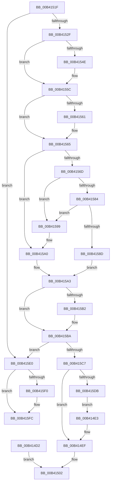

# sub_00B414D2

- RVA: `0x00B414D2`–`0x00B4160E` (길이 `316` bytes)
- VA: `0x0000000140B414D2`
- 실행 섹션: `PAGE`
- PDB 이름 있음: `아니요`; PDB Function 태그: `아니요`
- unwind 정보 RVA: `0x000B5C74`
- 디코드: `76`개 명령, `316/316` bytes 표시
- 미해석 바이트: `0` (있으면 어셈블리에 `.byte`로 보존)

> 이 문서는 커널 이미지의 기계어와 PDB 기호를 분석해 생성했습니다. 4번과 5번은 함수 원형과 자료형을 바이너리 사용 방식에서 추정한 C 해석이며 원본 소스 복구 결과는 아닙니다.

## 1. Dependencies

- 직접 호출 지점: **10**; 고유 호출 대상: **6**
- 직접 호출자로 확인된 함수: **0**
- RIP 상대 이미지 참조: **0**

### Outgoing calls
- `0x00B414D5` → [KeAbPostRelease](../../text/2E/KeAbPostRelease_function_002E1600.md) (function, `0x002E1600`)
- `0x00B414EA` → [ExfReleasePushLockShared](../../text/26/ExfReleasePushLockShared_function_00263440.md) (function, `0x00263440`)
- `0x00B414F6` → [KeAbPostRelease](../../text/2E/KeAbPostRelease_function_002E1600.md) (function, `0x002E1600`)
- `0x00B41514` → [KeReleaseSemaphoreEx](../../text/34/KeReleaseSemaphoreEx_function_003468C0.md) (function, `0x003468C0`)
- `0x00B4153E` → [KeAbPreAcquire](../../text/21/KeAbPreAcquire_function_00210230.md) (function, `0x00210230`)
- `0x00B41557` → [ExfAcquirePushLockExclusiveEx](../../text/20/ExfAcquirePushLockExclusiveEx_function_0020FC90.md) (function, `0x0020FC90`)
- `0x00B415B5` → [ExfTryToWakePushLock](../../text/26/ExfTryToWakePushLock_function_00265DD0.md) (function, `0x00265DD0`)
- `0x00B415BD` → [KeAbPostRelease](../../text/2E/KeAbPostRelease_function_002E1600.md) (function, `0x002E1600`)
- `0x00B415F7` → [ExfReleasePushLockShared](../../text/26/ExfReleasePushLockShared_function_00263440.md) (function, `0x00263440`)
- `0x00B41603` → [KeAbPostRelease](../../text/2E/KeAbPostRelease_function_002E1600.md) (function, `0x002E1600`)

### Direct callers
- 이 함수 시작 RVA로 연결되는 직접 call은 확인되지 않았습니다. 간접 호출은 완전히 역산할 수 없습니다.

### Static image references
- 디코드된 RIP-relative 메모리 참조가 없습니다.

## 2. Other-region calls and transfers

- 다른 실행 섹션으로 향하는 call: **10**
  - `0x00B414D5` → [KeAbPostRelease](../../text/2E/KeAbPostRelease_function_002E1600.md) (`PAGE` → `.text`)
  - `0x00B414EA` → [ExfReleasePushLockShared](../../text/26/ExfReleasePushLockShared_function_00263440.md) (`PAGE` → `.text`)
  - `0x00B414F6` → [KeAbPostRelease](../../text/2E/KeAbPostRelease_function_002E1600.md) (`PAGE` → `.text`)
  - `0x00B41514` → [KeReleaseSemaphoreEx](../../text/34/KeReleaseSemaphoreEx_function_003468C0.md) (`PAGE` → `.text`)
  - `0x00B4153E` → [KeAbPreAcquire](../../text/21/KeAbPreAcquire_function_00210230.md) (`PAGE` → `.text`)
  - `0x00B41557` → [ExfAcquirePushLockExclusiveEx](../../text/20/ExfAcquirePushLockExclusiveEx_function_0020FC90.md) (`PAGE` → `.text`)
  - `0x00B415B5` → [ExfTryToWakePushLock](../../text/26/ExfTryToWakePushLock_function_00265DD0.md) (`PAGE` → `.text`)
  - `0x00B415BD` → [KeAbPostRelease](../../text/2E/KeAbPostRelease_function_002E1600.md) (`PAGE` → `.text`)
  - `0x00B415F7` → [ExfReleasePushLockShared](../../text/26/ExfReleasePushLockShared_function_00263440.md) (`PAGE` → `.text`)
  - `0x00B41603` → [KeAbPostRelease](../../text/2E/KeAbPostRelease_function_002E1600.md) (`PAGE` → `.text`)
- call이 아닌 외부 분기/꼬리 이동: **2**
  - `0x00B4151A` → [AlpcpSignalPortAndUnlock + 0x30](../A7/AlpcpSignalPortAndUnlock_function_00A76910.md) (`tail-transfer`)
  - `0x00B41609` → [AlpcpSignalPortAndUnlock + 0x30](../A7/AlpcpSignalPortAndUnlock_function_00A76910.md) (`tail-transfer`)

## 3. Assembly (complete function range)

```asm
00B414D2  48 8B CF                        mov rcx, rdi
00B414D5  E8 26 01 7A FF                  call 0x1402e1600
00B414DA  48 8B 8B F8 00 00 00            mov rcx, qword ptr [rbx + 0xf8]
00B414E1  EB 1F                           jmp 0x140b41502
00B414E3  48 8D 8B 60 01 00 00            lea rcx, [rbx + 0x160]
00B414EA  E8 51 1F 72 FF                  call 0x140263440
00B414EF  48 8D 8B 60 01 00 00            lea rcx, [rbx + 0x160]
00B414F6  E8 05 01 7A FF                  call 0x1402e1600
00B414FB  48 8D 8E 18 05 00 00            lea rcx, [rsi + 0x518]
00B41502  BA 01 00 00 00                  mov edx, 1
00B41507  4C 89 74 24 28                  mov qword ptr [rsp + 0x28], r14
00B4150C  44 8B C2                        mov r8d, edx
00B4150F  44 89 74 24 20                  mov dword ptr [rsp + 0x20], r14d
00B41514  E8 A7 53 80 FF                  call 0x1403468c0
00B41519  90                              nop
00B4151A  E9 21 54 F3 FF                  jmp 0x140a76940
00B4151F  48 8D B1 E8 00 00 00            lea rsi, [rcx + 0xe8]
00B41526  48 39 36                        cmp qword ptr [rsi], rsi
00B41529  0F 84 B1 00 00 00               je 0x140b415e0
00B4152F  48 8D B9 E0 00 00 00            lea rdi, [rcx + 0xe0]
00B41536  45 33 C0                        xor r8d, r8d
00B41539  48 8B CF                        mov rcx, rdi
00B4153C  33 D2                           xor edx, edx
00B4153E  E8 ED EC 6C FF                  call 0x140210230
00B41543  F0 48 0F BA 2F 00               lock bts qword ptr [rdi], 0
00B41549  48 8B E8                        mov rbp, rax
00B4154C  73 0E                           jae 0x140b4155c
00B4154E  4C 8B C7                        mov r8, rdi
00B41551  48 8B D0                        mov rdx, rax
00B41554  48 8B CF                        mov rcx, rdi
00B41557  E8 34 E7 6C FF                  call 0x14020fc90
00B4155C  48 85 ED                        test rbp, rbp
00B4155F  74 04                           je 0x140b41565
00B41561  C6 45 0A 01                     mov byte ptr [rbp + 0xa], 1
00B41565  48 8B 06                        mov rax, qword ptr [rsi]
00B41568  48 3B C6                        cmp rax, rsi
00B4156B  74 33                           je 0x140b415a0
00B4156D  48 8D B0 38 FA FF FF            lea rsi, [rax - 0x5c8]
00B41574  4C 89 B6 C0 05 00 00            mov qword ptr [rsi + 0x5c0], r14
00B4157B  48 8B 10                        mov rdx, qword ptr [rax]
00B4157E  48 39 42 08                     cmp qword ptr [rdx + 8], rax
00B41582  75 15                           jne 0x140b41599
00B41584  48 8B 48 08                     mov rcx, qword ptr [rax + 8]
00B41588  48 39 01                        cmp qword ptr [rcx], rax
00B4158B  75 0C                           jne 0x140b41599
00B4158D  48 89 11                        mov qword ptr [rcx], rdx
00B41590  48 89 4A 08                     mov qword ptr [rdx + 8], rcx
00B41594  4C 89 30                        mov qword ptr [rax], r14
00B41597  EB 0A                           jmp 0x140b415a3
00B41599  B9 03 00 00 00                  mov ecx, 3
00B4159E  CD 29                           int 0x29
00B415A0  49 8B F6                        mov rsi, r14
00B415A3  48 83 C8 FF                     or rax, 0xffffffffffffffff
00B415A7  F0 48 0F C1 07                  lock xadd qword ptr [rdi], rax
00B415AC  24 06                           and al, 6
00B415AE  3C 02                           cmp al, 2
00B415B0  75 08                           jne 0x140b415ba
00B415B2  48 8B CF                        mov rcx, rdi
00B415B5  E8 16 48 72 FF                  call 0x140265dd0
00B415BA  48 8B CF                        mov rcx, rdi
00B415BD  E8 3E 00 7A FF                  call 0x1402e1600
00B415C2  48 85 F6                        test rsi, rsi
00B415C5  74 19                           je 0x140b415e0
00B415C7  B8 11 00 00 00                  mov eax, 0x11
00B415CC  F0 4C 0F B1 B3 60 01 00 00      lock cmpxchg qword ptr [rbx + 0x160], r14
00B415D5  0F 84 14 FF FF FF               je 0x140b414ef
00B415DB  E9 03 FF FF FF                  jmp 0x140b414e3
00B415E0  B8 11 00 00 00                  mov eax, 0x11
00B415E5  F0 4C 0F B1 B3 60 01 00 00      lock cmpxchg qword ptr [rbx + 0x160], r14
00B415EE  74 0C                           je 0x140b415fc
00B415F0  48 8D 8B 60 01 00 00            lea rcx, [rbx + 0x160]
00B415F7  E8 44 1E 72 FF                  call 0x140263440
00B415FC  48 8D 8B 60 01 00 00            lea rcx, [rbx + 0x160]
00B41603  E8 F8 FF 79 FF                  call 0x1402e1600
00B41608  90                              nop
00B41609  E9 32 53 F3 FF                  jmp 0x140a76940
```

## 4. C-style interpretation (structured pseudocode)

```c
__int64 __fastcall sub_00B414D2(void)
{
    __int64 result;
    unsigned int v_stack_p20;
    unsigned __int64 v_stack_p28;

    result = KeAbPostRelease(v_rdi, a2, a3, a4);
    goto loc_00B41502;
loc_00B41502:
    v_stack_p28 = v_r14;
    v_stack_p20 = (unsigned int)(v_r14);
    result = KeReleaseSemaphoreEx(*(unsigned __int64 *)(v_rbx + 248), 1, 1, a4);
}
```

## 5. (Beta) C Style

```c
void sub_00B414D2(void)
{
    int64_t result;
    uint32_t v_stack_p20;
    uint64_t v_stack_p28;

    result = KeAbPostRelease(local_rdi, a2, a3, a4);
    goto loc_00B41502;
loc_00B41502:
    v_stack_p28 = local_r14;
    v_stack_p20 = (uint32_t)(local_r14);
    result = KeReleaseSemaphoreEx(*(uint64_t *)(local_rbx + 0xF8), 1, 1, a4);
}
```

## 6. Execution-region graph

[열기: 2D/3D 그래프와 함수 탐색 컨트롤 패널](../../../control-panel.html?section=page&rva=0x00B414D2&view=graph)

- 2D 그래프는 위에서 아래로 흐르고, 3D 그래프는 빈 공간을 드래그해 회전합니다. Shift+드래그는 이동, 휠은 확대·축소, 함수 노드 선택은 대상 보고서 이동입니다.

### Static fallback


