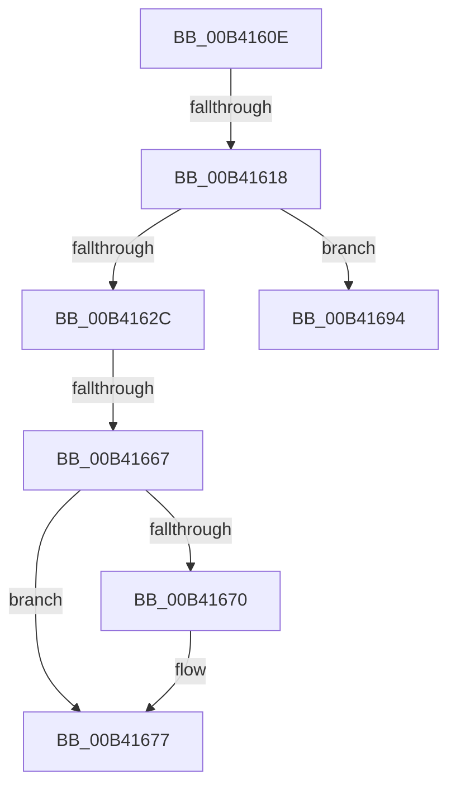

# sub_00B4160E

- RVA: `0x00B4160E`–`0x00B4169D` (길이 `143` bytes)
- VA: `0x0000000140B4160E`
- 실행 섹션: `PAGE`
- PDB 이름 있음: `아니요`; PDB Function 태그: `아니요`
- unwind 정보 RVA: `0x000B5D0C`
- 디코드: `39`개 명령, `143/143` bytes 표시
- 미해석 바이트: `0` (있으면 어셈블리에 `.byte`로 보존)

> 이 문서는 커널 이미지의 기계어와 PDB 기호를 분석해 생성했습니다. 4번과 5번은 함수 원형과 자료형을 바이너리 사용 방식에서 추정한 C 해석이며 원본 소스 복구 결과는 아닙니다.

## 1. Dependencies

- 직접 호출 지점: **5**; 고유 호출 대상: **5**
- 직접 호출자로 확인된 함수: **0**
- RIP 상대 이미지 참조: **0**

### Outgoing calls
- `0x00B41621` → [CmpBlockHiveWrites](../84/CmpBlockHiveWrites_function_0084CF94.md) (function, `0x0084CF94`)
- `0x00B4164A` → [CmpFindPathByNameEx](../84/CmpFindPathByNameEx_function_0084BAAC.md) (function, `0x0084BAAC`)
- `0x00B4165A` → [CmpUnblockHiveWrites](../A5/CmpUnblockHiveWrites_function_00A5E4B0.md) (function, `0x00A5E4B0`)
- `0x00B41672` → [ExFreePoolWithTag](../../poolcode/B8/ExFreePoolWithTag_function_00B82870.md) (function, `0x00B82870`)
- `0x00B41685` → [RtlInitUnicodeString](../../text/42/RtlInitUnicodeString_function_0042A780.md) (function, `0x0042A780`)

### Direct callers
- 이 함수 시작 RVA로 연결되는 직접 call은 확인되지 않았습니다. 간접 호출은 완전히 역산할 수 없습니다.

### Static image references
- 디코드된 RIP-relative 메모리 참조가 없습니다.

## 2. Other-region calls and transfers

- 다른 실행 섹션으로 향하는 call: **2**
  - `0x00B41672` → [ExFreePoolWithTag](../../poolcode/B8/ExFreePoolWithTag_function_00B82870.md) (`PAGE` → `POOLCODE`)
  - `0x00B41685` → [RtlInitUnicodeString](../../text/42/RtlInitUnicodeString_function_0042A780.md) (`PAGE` → `.text`)
- call이 아닌 외부 분기/꼬리 이동: **4**
  - `0x00B41612` → [CmpVEExecuteVirtualStoreParseLogic + 0x121](../A7/CmpVEExecuteVirtualStoreParseLogic_function_00A76A20.md) (`tail-transfer`)
  - `0x00B41661` → [CmpVEExecuteVirtualStoreParseLogic + 0x18C](../A7/CmpVEExecuteVirtualStoreParseLogic_function_00A76A20.md) (`tail-transfer`)
  - `0x00B4168F` → [CmpVEExecuteVirtualStoreParseLogic + 0x157](../A7/CmpVEExecuteVirtualStoreParseLogic_function_00A76A20.md) (`tail-transfer`)
  - `0x00B41698` → [CmpVEExecuteVirtualStoreParseLogic + 0x152](../A7/CmpVEExecuteVirtualStoreParseLogic_function_00A76A20.md) (`tail-transfer`)

## 3. Assembly (complete function range)

```asm
00B4160E  40 38 75 40                     cmp byte ptr [rbp + 0x40], sil
00B41612  0F 84 29 55 F3 FF               je 0x140a76b41
00B41618  4C 8D 45 C8                     lea r8, [rbp - 0x38]
00B4161C  41 8B D7                        mov edx, r15d
00B4161F  33 C9                           xor ecx, ecx
00B41621  E8 6E B9 D0 FF                  call 0x14084cf94
00B41626  8B D8                           mov ebx, eax
00B41628  85 C0                           test eax, eax
00B4162A  78 68                           js 0x140b41694
00B4162C  48 8D 45 D0                     lea rax, [rbp - 0x30]
00B41630  45 8B CF                        mov r9d, r15d
00B41633  48 89 44 24 28                  mov qword ptr [rsp + 0x28], rax
00B41638  48 8D 55 D8                     lea rdx, [rbp - 0x28]
00B4163C  48 8D 45 C0                     lea rax, [rbp - 0x40]
00B41640  45 33 C0                        xor r8d, r8d
00B41643  33 C9                           xor ecx, ecx
00B41645  48 89 44 24 20                  mov qword ptr [rsp + 0x20], rax
00B4164A  E8 5D A4 D0 FF                  call 0x14084baac
00B4164F  4C 8B 45 C8                     mov r8, qword ptr [rbp - 0x38]
00B41653  41 8B D7                        mov edx, r15d
00B41656  33 C9                           xor ecx, ecx
00B41658  8A D8                           mov bl, al
00B4165A  E8 51 CE F1 FF                  call 0x140a5e4b0
00B4165F  84 DB                           test bl, bl
00B41661  0F 84 45 55 F3 FF               je 0x140a76bac
00B41667  48 8B 4F 08                     mov rcx, qword ptr [rdi + 8]
00B4166B  48 85 C9                        test rcx, rcx
00B4166E  74 07                           je 0x140b41677
00B41670  33 D2                           xor edx, edx
00B41672  E8 F9 11 04 00                  call 0x140b82870
00B41677  0F 10 45 D8                     movups xmm0, xmmword ptr [rbp - 0x28]
00B4167B  33 D2                           xor edx, edx
00B4167D  48 8D 4D D8                     lea rcx, [rbp - 0x28]
00B41681  F3 0F 7F 07                     movdqu xmmword ptr [rdi], xmm0
00B41685  E8 F6 90 8E FF                  call 0x14042a780
00B4168A  BB 04 01 00 00                  mov ebx, 0x104
00B4168F  E9 E3 54 F3 FF                  jmp 0x140a76b77
00B41694  48 8B 75 C8                     mov rsi, qword ptr [rbp - 0x38]
00B41698  E9 D5 54 F3 FF                  jmp 0x140a76b72
```

## 4. C-style interpretation (structured pseudocode)

```c
__int64 __fastcall sub_00B4160E(int a1)
{
    __int64 result;
    unsigned __int64 v_stack_p20;
    unsigned __int64 v_stack_p28;

    a1 = 0;
    result = CmpBlockHiveWrites(a1, (unsigned int)((unsigned int)(v_r15)), v_rbp - 56, a4);
    if (sign_flag) goto loc_00B41694;
    v_stack_p28 = v_rbp - 48;
    a3 = 0;
    a1 = 0;
    v_stack_p20 = v_rbp - 64;
    result = CmpFindPathByNameEx(a1, v_rbp - 40, a3, (unsigned int)((unsigned int)(v_r15)));
    a1 = 0;
    result = CmpUnblockHiveWrites(a1, (unsigned int)((unsigned int)(v_r15)), *(unsigned __int64 *)(v_rbp - 56), (unsigned int)((unsigned int)(v_r15)));
    if (*(unsigned __int64 *)(v_rdi + 8) != 0) {
        a2 = 0;
        result = ExFreePoolWithTag(*(unsigned __int64 *)(v_rdi + 8), a2, *(unsigned __int64 *)(v_rbp - 56), (unsigned int)((unsigned int)(v_r15)));
    }
    a2 = 0;
    *(unsigned __int64 *)(v_rdi) = v_xmm0;
    result = RtlInitUnicodeString(v_rbp - 40, a2, *(unsigned __int64 *)(v_rbp - 56), (unsigned int)((unsigned int)(v_r15)));
loc_00B41694:
}
```

## 5. (Beta) C Style

```c
int64_t sub_00B4160E(int32_t Arg1)
{
    int64_t result;
    uint64_t v_stack_p20;
    uint64_t v_stack_p28;

    Arg1 = 0;
    result = CmpBlockHiveWrites(Arg1, (uint32_t)((uint32_t)(local_r15)), local_rbp - 56, a4);
    if (sign_flag) goto loc_00B41694;
    v_stack_p28 = local_rbp - 48;
    a3 = 0;
    Arg1 = 0;
    v_stack_p20 = local_rbp - 64;
    result = CmpFindPathByNameEx(Arg1, local_rbp - 40, a3, (uint32_t)((uint32_t)(local_r15)));
    Arg1 = 0;
    result = CmpUnblockHiveWrites(Arg1, (uint32_t)((uint32_t)(local_r15)), *(uint64_t *)(local_rbp - 0x38), (uint32_t)((uint32_t)(local_r15)));
    if (*(uint64_t *)(local_rdi + 0x8) != 0) {
        a2 = 0;
        result = ExFreePoolWithTag(*(uint64_t *)(local_rdi + 0x8), a2, *(uint64_t *)(local_rbp - 0x38), (uint32_t)((uint32_t)(local_r15)));
    }
    a2 = 0;
    *(uint64_t *)(local_rdi) = v_xmm0;
    result = RtlInitUnicodeString(local_rbp - 40, a2, *(uint64_t *)(local_rbp - 0x38), (uint32_t)((uint32_t)(local_r15)));
loc_00B41694:
}
```

## 6. Execution-region graph

[열기: 2D/3D 그래프와 함수 탐색 컨트롤 패널](../../../control-panel.html?section=page&rva=0x00B4160E&view=graph)

- 2D 그래프는 위에서 아래로 흐르고, 3D 그래프는 빈 공간을 드래그해 회전합니다. Shift+드래그는 이동, 휠은 확대·축소, 함수 노드 선택은 대상 보고서 이동입니다.

### Static fallback


