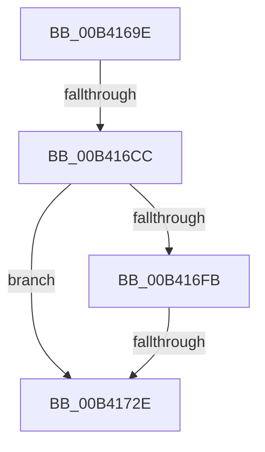

# sub_00B4169E

- RVA: `0x00B4169E`–`0x00B4173C` (길이 `158` bytes)
- VA: `0x0000000140B4169E`
- 실행 섹션: `PAGE`
- PDB 이름 있음: `아니요`; PDB Function 태그: `아니요`
- unwind 정보 RVA: `0x000B5D3C`
- 디코드: `40`개 명령, `158/158` bytes 표시
- 미해석 바이트: `0` (있으면 어셈블리에 `.byte`로 보존)

> 이 문서는 커널 이미지의 기계어와 PDB 기호를 분석해 생성했습니다. 4번과 5번은 함수 원형과 자료형을 바이너리 사용 방식에서 추정한 C 해석이며 원본 소스 복구 결과는 아닙니다.

## 1. Dependencies

- 직접 호출 지점: **4**; 고유 호출 대상: **3**
- 직접 호출자로 확인된 함수: **0**
- RIP 상대 이미지 참조: **0**

### Outgoing calls
- `0x00B416BA` → [ExAllocatePool2](../../poolcode/B8/ExAllocatePool2_function_00B820F0.md) (function, `0x00B820F0`)
- `0x00B416F0` → [RtlAppendUnicodeStringToString](../../text/40/RtlAppendUnicodeStringToString_function_0040FA50.md) (function, `0x0040FA50`)
- `0x00B4171F` → [RtlAppendUnicodeStringToString](../../text/40/RtlAppendUnicodeStringToString_function_0040FA50.md) (function, `0x0040FA50`)
- `0x00B41731` → [RtlFreeAnsiString](../9C/RtlFreeAnsiString_function_009C0800.md) (function, `0x009C0800`)

### Direct callers
- 이 함수 시작 RVA로 연결되는 직접 call은 확인되지 않았습니다. 간접 호출은 완전히 역산할 수 없습니다.

### Static image references
- 디코드된 RIP-relative 메모리 참조가 없습니다.

## 2. Other-region calls and transfers

- 다른 실행 섹션으로 향하는 call: **3**
  - `0x00B416BA` → [ExAllocatePool2](../../poolcode/B8/ExAllocatePool2_function_00B820F0.md) (`PAGE` → `POOLCODE`)
  - `0x00B416F0` → [RtlAppendUnicodeStringToString](../../text/40/RtlAppendUnicodeStringToString_function_0040FA50.md) (`PAGE` → `.text`)
  - `0x00B4171F` → [RtlAppendUnicodeStringToString](../../text/40/RtlAppendUnicodeStringToString_function_0040FA50.md) (`PAGE` → `.text`)
- call이 아닌 외부 분기/꼬리 이동: **3**
  - `0x00B416C6` → [CmVirtualKCBToRealPath + 0x91](../A7/CmVirtualKCBToRealPath_function_00A76BE8.md) (`tail-transfer`)
  - `0x00B41728` → [CmVirtualKCBToRealPath + 0x91](../A7/CmVirtualKCBToRealPath_function_00A76BE8.md) (`tail-transfer`)
  - `0x00B41737` → [CmVirtualKCBToRealPath + 0x91](../A7/CmVirtualKCBToRealPath_function_00A76BE8.md) (`tail-transfer`)

## 3. Assembly (complete function range)

```asm
00B4169E  0F B7 06                        movzx eax, word ptr [rsi]
00B416A1  B9 09 00 00 00                  mov ecx, 9
00B416A6  2B CF                           sub ecx, edi
00B416A8  41 B8 43 4D 4E 62               mov r8d, 0x624e4d43
00B416AE  44 8D 3C 48                     lea r15d, [rax + rcx*2]
00B416B2  B9 00 01 00 00                  mov ecx, 0x100
00B416B7  41 8B D7                        mov edx, r15d
00B416BA  E8 31 0A 04 00                  call 0x140b820f0
00B416BF  49 89 46 08                     mov qword ptr [r14 + 8], rax
00B416C3  48 85 C0                        test rax, rax
00B416C6  0F 84 AD 55 F3 FF               je 0x140a76c79
00B416CC  66 45 89 7E 02                  mov word ptr [r14 + 2], r15w
00B416D1  48 8D 54 24 20                  lea rdx, [rsp + 0x20]
00B416D6  66 45 89 26                     mov word ptr [r14], r12w
00B416DA  B8 12 00 00 00                  mov eax, 0x12
00B416DF  0F 10 06                        movups xmm0, xmmword ptr [rsi]
00B416E2  49 8B CE                        mov rcx, r14
00B416E5  F3 0F 7F 44 24 20               movdqu xmmword ptr [rsp + 0x20], xmm0
00B416EB  66 89 44 24 20                  mov word ptr [rsp + 0x20], ax
00B416F0  E8 5B E3 8C FF                  call 0x14040fa50
00B416F5  8B D8                           mov ebx, eax
00B416F7  85 C0                           test eax, eax
00B416F9  78 33                           js 0x140b4172e
00B416FB  0F B7 06                        movzx eax, word ptr [rsi]
00B416FE  48 8D 54 24 20                  lea rdx, [rsp + 0x20]
00B41703  66 03 FF                        add di, di
00B41706  66 2B C7                        sub ax, di
00B41709  66 89 44 24 20                  mov word ptr [rsp + 0x20], ax
00B4170E  48 8B 44 24 28                  mov rax, qword ptr [rsp + 0x28]
00B41713  48 8D 0C 68                     lea rcx, [rax + rbp*2]
00B41717  48 89 4C 24 28                  mov qword ptr [rsp + 0x28], rcx
00B4171C  49 8B CE                        mov rcx, r14
00B4171F  E8 2C E3 8C FF                  call 0x14040fa50
00B41724  8B D8                           mov ebx, eax
00B41726  85 C0                           test eax, eax
00B41728  0F 89 4B 55 F3 FF               jns 0x140a76c79
00B4172E  49 8B CE                        mov rcx, r14
00B41731  E8 CA F0 E7 FF                  call 0x1409c0800
00B41736  90                              nop
00B41737  E9 3D 55 F3 FF                  jmp 0x140a76c79
```

## 4. C-style interpretation (structured pseudocode)

```c
__int64 __fastcall sub_00B4169E(__int64 a1, __int64 a2, __int64 a3, __int64 a4, __int64 a5)
{
    __int64 result;
    __int64 v_rdi;
    unsigned __int64 v_stack_p20;
    unsigned __int64 v_stack_p28;

    a1 = (unsigned int)((9) - ((unsigned int)(v_rdi)));
    result = ExAllocatePool2(256, (unsigned int)((unsigned int)(*(unsigned __int16 *)(v_rsi) + a1 * 2)), (unsigned int)(0x624E4D43ULL), a4);
    *(unsigned __int64 *)(v_r14 + 8) = result;
    *(unsigned __int16 *)(v_r14 + 2) = (unsigned __int16)(*(unsigned __int16 *)(v_rsi) + a1 * 2);
    *(unsigned __int16 *)(v_r14) = (unsigned __int16)(v_r12);
    v_stack_p20 = v_xmm0;
    v_stack_p20 = 18;
    result = RtlAppendUnicodeStringToString(v_r14, v_stack_p20, (unsigned int)(0x624E4D43ULL), a4);
    if (sign_flag) goto loc_00B4172E;
    v_rdi = (unsigned __int16)((v_rdi) + ((unsigned __int16)(v_rdi)));
    result = (unsigned __int16)((*(unsigned __int16 *)(v_rsi)) - ((unsigned __int16)(v_rdi)));
    v_stack_p20 = (unsigned __int16)(result);
    v_stack_p28 = a5 + v_rbp * 2;
    result = RtlAppendUnicodeStringToString(v_r14, v_stack_p20, (unsigned int)(0x624E4D43ULL), a4);
loc_00B4172E:
    result = RtlFreeAnsiString(v_r14, v_stack_p20, (unsigned int)(0x624E4D43ULL), a4);
}
```

## 5. (Beta) C Style

```c
int64_t sub_00B4169E(int64_t Arg1, int64_t Arg2, int64_t Arg3, int64_t Arg4, void *Arg5)
{
    uint8_t *arg5 = (uint8_t *)Arg5;

    int64_t result;
    int64_t local_rdi;
    uint64_t v_stack_p20;
    uint64_t v_stack_p28;

    Arg1 = (uint32_t)((9) - ((uint32_t)(local_rdi)));
    result = ExAllocatePool2(256, (uint32_t)((uint32_t)(*(uint16_t *)(local_rsi) + Arg1 * 2)), (uint32_t)(0x624E4D43ULL), Arg4);
    *(uint64_t *)(local_r14 + 0x8) = result;
    *(uint16_t *)(local_r14 + 0x2) = (uint16_t)(*(uint16_t *)(local_rsi) + Arg1 * 2);
    *(uint16_t *)(local_r14) = (uint16_t)(local_r12);
    v_stack_p20 = v_xmm0;
    v_stack_p20 = 18;
    result = RtlAppendUnicodeStringToString(local_r14, v_stack_p20, (uint32_t)(0x624E4D43ULL), Arg4);
    if (sign_flag) goto loc_00B4172E;
    local_rdi = (uint16_t)((local_rdi) + ((uint16_t)(local_rdi)));
    result = (uint16_t)((*(uint16_t *)(local_rsi)) - ((uint16_t)(local_rdi)));
    v_stack_p20 = (uint16_t)(result);
    v_stack_p28 = Arg5 + local_rbp * 2;
    result = RtlAppendUnicodeStringToString(local_r14, v_stack_p20, (uint32_t)(0x624E4D43ULL), Arg4);
loc_00B4172E:
    result = RtlFreeAnsiString(local_r14, v_stack_p20, (uint32_t)(0x624E4D43ULL), Arg4);
}
```

### 관측된 메모리 오프셋

구조체 형식이 확인되지 않은 접근은 인자 기준의 오프셋으로만 기록했습니다.

| 기준 인자 | 오프셋 표현 | 폭 (bit) | 접근 |
|---|---:|---:|---|
| `Arg5` | `+ 0x0 + rbp*2` | `64` | `R` |

## 6. Execution-region graph

[열기: 2D/3D 그래프와 함수 탐색 컨트롤 패널](../../../control-panel.html?section=page&rva=0x00B4169E&view=graph)

- 2D 그래프는 위에서 아래로 흐르고, 3D 그래프는 빈 공간을 드래그해 회전합니다. Shift+드래그는 이동, 휠은 확대·축소, 함수 노드 선택은 대상 보고서 이동입니다.

### Static fallback


