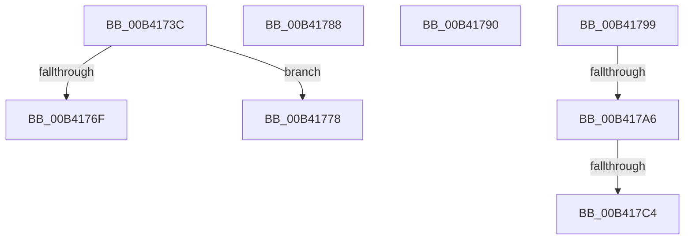

# sub_00B4173C

- RVA: `0x00B4173C`–`0x00B41876` (길이 `314` bytes)
- VA: `0x0000000140B4173C`
- 실행 섹션: `PAGE`
- PDB 이름 있음: `아니요`; PDB Function 태그: `아니요`
- unwind 정보 RVA: `0x000B5DB4`
- 디코드: `66`개 명령, `314/314` bytes 표시
- 미해석 바이트: `0` (있으면 어셈블리에 `.byte`로 보존)

> 이 문서는 커널 이미지의 기계어와 PDB 기호를 분석해 생성했습니다. 4번과 5번은 함수 원형과 자료형을 바이너리 사용 방식에서 추정한 C 해석이며 원본 소스 복구 결과는 아닙니다.

## 1. Dependencies

- 직접 호출 지점: **4**; 고유 호출 대상: **4**
- 직접 호출자로 확인된 함수: **0**
- RIP 상대 이미지 참조: **3**

### Outgoing calls
- `0x00B41740` → [SshpSessionManagerNormalizeLogHeader](../AB/SshpSessionManagerNormalizeLogHeader_function_00ABDD44.md) (function, `0x00ABDD44`)
- `0x00B41758` → [SshpSessionManagerWriteBytes](../A7/SshpSessionManagerWriteBytes_function_00A770AC.md) (function, `0x00A770AC`)
- `0x00B417B7` → [tlgKeywordOn](../../text/42/tlgKeywordOn_function_0042EAA0.md) (function, `0x0042EAA0`)
- `0x00B4186B` → [tlgWriteTransfer_EtwWriteTransfer](../../text/42/tlgWriteTransfer_EtwWriteTransfer_function_004260E0.md) (function, `0x004260E0`)

### Direct callers
- 이 함수 시작 RVA로 연결되는 직접 call은 확인되지 않았습니다. 간접 호출은 완전히 역산할 수 없습니다.

### Static image references
- `0x00B41745` → RVA `0x00F06BA8` (`.data`; read)
- `0x00B41799` → RVA `0x00E083C8` (`.data`; read)
- `0x00B417DA` → RVA `0x00051102` (`.rdata`; read)

## 2. Other-region calls and transfers

- 다른 실행 섹션으로 향하는 call: **2**
  - `0x00B417B7` → [tlgKeywordOn](../../text/42/tlgKeywordOn_function_0042EAA0.md) (`PAGE` → `.text`)
  - `0x00B4186B` → [tlgWriteTransfer_EtwWriteTransfer](../../text/42/tlgWriteTransfer_EtwWriteTransfer_function_004260E0.md) (`PAGE` → `.text`)
- call이 아닌 외부 분기/꼬리 이동: **7**
  - `0x00B41773` → [SshpSessionManagerFlushControlEventBufferWorker + 0x125](../A7/SshpSessionManagerFlushControlEventBufferWorker_function_00A76CC0.md) (`tail-transfer`)
  - `0x00B41783` → [SshpSessionManagerFlushControlEventBufferWorker + 0x125](../A7/SshpSessionManagerFlushControlEventBufferWorker_function_00A76CC0.md) (`tail-transfer`)
  - `0x00B4178B` → [SshpSessionManagerFlushControlEventBufferWorker + 0x2E9](../A7/SshpSessionManagerFlushControlEventBufferWorker_function_00A76CC0.md) (`tail-transfer`)
  - `0x00B41794` → [SshpSessionManagerFlushControlEventBufferWorker + 0x146](../A7/SshpSessionManagerFlushControlEventBufferWorker_function_00A76CC0.md) (`tail-transfer`)
  - `0x00B417A0` → [SshpSessionManagerFlushControlEventBufferWorker + 0x20D](../A7/SshpSessionManagerFlushControlEventBufferWorker_function_00A76CC0.md) (`tail-transfer`)
  - `0x00B417BE` → [SshpSessionManagerFlushControlEventBufferWorker + 0x20D](../A7/SshpSessionManagerFlushControlEventBufferWorker_function_00A76CC0.md) (`tail-transfer`)
  - `0x00B41871` → [SshpSessionManagerFlushControlEventBufferWorker + 0x20D](../A7/SshpSessionManagerFlushControlEventBufferWorker_function_00A76CC0.md) (`tail-transfer`)

## 3. Assembly (complete function range)

```asm
00B4173C  48 8D 4D B0                     lea rcx, [rbp - 0x50]
00B41740  E8 FF C5 F7 FF                  call 0x140abdd44
00B41745  48 8B 0D 5C 54 3C 00            mov rcx, qword ptr [rip + 0x3c545c]
00B4174C  4C 8D 45 B0                     lea r8, [rbp - 0x50]
00B41750  41 B9 18 00 00 00               mov r9d, 0x18
00B41756  33 D2                           xor edx, edx
00B41758  E8 4F 59 F3 FF                  call 0x140a770ac
00B4175D  44 8B 55 C4                     mov r10d, dword ptr [rbp - 0x3c]
00B41761  8B F0                           mov esi, eax
00B41763  44 8B 45 C0                     mov r8d, dword ptr [rbp - 0x40]
00B41767  44 8B 4D BC                     mov r9d, dword ptr [rbp - 0x44]
00B4176B  85 C0                           test eax, eax
00B4176D  78 09                           js 0x140b41778
00B4176F  48 83 C7 18                     add rdi, 0x18
00B41773  E9 6D 56 F3 FF                  jmp 0x140a76de5
00B41778  41 FF C6                        inc r14d
00B4177B  44 8B F8                        mov r15d, eax
00B4177E  44 89 74 24 50                  mov dword ptr [rsp + 0x50], r14d
00B41783  E9 5D 56 F3 FF                  jmp 0x140a76de5
00B41788  44 8B FA                        mov r15d, edx
00B4178B  E9 19 58 F3 FF                  jmp 0x140a76fa9
00B41790  48 83 C7 18                     add rdi, 0x18
00B41794  E9 6D 56 F3 FF                  jmp 0x140a76e06
00B41799  83 3D 28 6C 2C 00 05            cmp dword ptr [rip + 0x2c6c28], 5
00B417A0  0F 86 27 57 F3 FF               jbe 0x140a76ecd
00B417A6  48 BA 00 00 00 00 00 40 00 00   movabs rdx, 0x400000000000
00B417B0  48 8D 0D 11 6C 2C 00            lea rcx, [rip + 0x2c6c11]
00B417B7  E8 E4 D2 8E FF                  call 0x14042eaa0
00B417BC  84 C0                           test al, al
00B417BE  0F 84 09 57 F3 FF               je 0x140a76ecd
00B417C4  41 B8 08 00 00 00               mov r8d, 8
00B417CA  48 89 7D 80                     mov qword ptr [rbp - 0x80], rdi
00B417CE  48 8D 45 80                     lea rax, [rbp - 0x80]
00B417D2  4C 89 45 F8                     mov qword ptr [rbp - 8], r8
00B417D6  48 89 45 F0                     mov qword ptr [rbp - 0x10], rax
00B417DA  48 8D 15 21 F9 50 FF            lea rdx, [rip - 0xaf06df]
00B417E1  48 8D 44 24 60                  lea rax, [rsp + 0x60]
00B417E6  4C 89 45 48                     mov qword ptr [rbp + 0x48], r8
00B417EA  48 89 45 00                     mov qword ptr [rbp], rax
00B417EE  48 8D 0D D3 6B 2C 00            lea rcx, [rip + 0x2c6bd3]
00B417F5  48 8D 44 24 64                  lea rax, [rsp + 0x64]
00B417FA  44 89 74 24 60                  mov dword ptr [rsp + 0x60], r14d
00B417FF  48 89 45 10                     mov qword ptr [rbp + 0x10], rax
00B41803  45 33 C9                        xor r9d, r9d
00B41806  48 8D 44 24 68                  lea rax, [rsp + 0x68]
00B4180B  48 C7 45 08 04 00 00 00         mov qword ptr [rbp + 8], 4
00B41813  48 89 45 20                     mov qword ptr [rbp + 0x20], rax
00B41817  8B 44 24 54                     mov eax, dword ptr [rsp + 0x54]
00B4181B  89 44 24 6C                     mov dword ptr [rsp + 0x6c], eax
00B4181F  48 8D 44 24 6C                  lea rax, [rsp + 0x6c]
00B41824  48 89 45 30                     mov qword ptr [rbp + 0x30], rax
00B41828  48 8D 45 88                     lea rax, [rbp - 0x78]
00B4182C  48 89 45 40                     mov qword ptr [rbp + 0x40], rax
00B41830  48 8D 45 D0                     lea rax, [rbp - 0x30]
00B41834  48 89 44 24 28                  mov qword ptr [rsp + 0x28], rax
00B41839  44 89 44 24 20                  mov dword ptr [rsp + 0x20], r8d
00B4183E  45 33 C0                        xor r8d, r8d
00B41841  44 89 6C 24 64                  mov dword ptr [rsp + 0x64], r13d
00B41846  48 C7 45 18 04 00 00 00         mov qword ptr [rbp + 0x18], 4
00B4184E  44 89 7C 24 68                  mov dword ptr [rsp + 0x68], r15d
00B41853  48 C7 45 28 04 00 00 00         mov qword ptr [rbp + 0x28], 4
00B4185B  48 C7 45 38 04 00 00 00         mov qword ptr [rbp + 0x38], 4
00B41863  48 C7 45 88 00 00 00 01         mov qword ptr [rbp - 0x78], 0x1000000
00B4186B  E8 70 48 8E FF                  call 0x1404260e0
00B41870  90                              nop
00B41871  E9 57 56 F3 FF                  jmp 0x140a76ecd
```

## 4. C-style interpretation (structured pseudocode)

```c
__int64 __fastcall sub_00B4173C(__int64 a1, int a2)
{
    __int64 result;
    __int64 v_r14;
    __int64 v_rdi;
    unsigned int v_stack_p20;
    unsigned __int64 v_stack_p28;
    unsigned int v_stack_p50;
    unsigned int v_stack_p54;
    unsigned __int64 v_stack_p60;
    unsigned __int64 v_stack_p64;
    unsigned __int64 v_stack_p68;
    unsigned int v_stack_p6C;

    result = SshpSessionManagerNormalizeLogHeader(v_rbp - 80, a2, a3, a4);
    a2 = 0;
    result = SshpSessionManagerWriteBytes(*(unsigned __int64 *)(v_rip + 3953756), a2, v_rbp - 80, 24);
    if (sign_flag) goto loc_00B41778;
    v_rdi = (v_rdi) + (24);
loc_00B41778:
    v_r14 = (unsigned int)((v_r14) + 1);
    v_stack_p50 = (unsigned int)(v_r14);
}
```

## 5. (Beta) C Style

```c
int64_t sub_00B4173C(int64_t Arg1, int32_t Arg2)
{
    int64_t result;
    int64_t local_r14;
    int64_t local_rdi;
    uint32_t v_stack_p20;
    uint64_t v_stack_p28;
    uint32_t v_stack_p50;
    uint32_t v_stack_p54;
    uint64_t v_stack_p60;
    uint64_t v_stack_p64;
    uint64_t v_stack_p68;
    uint32_t v_stack_p6C;

    result = SshpSessionManagerNormalizeLogHeader(local_rbp - 80, Arg2, a3, a4);
    Arg2 = 0;
    result = SshpSessionManagerWriteBytes(*(uint64_t *)(v_rip + 0x3C545C), Arg2, local_rbp - 80, 24);
    if (sign_flag) goto loc_00B41778;
    local_rdi = (local_rdi) + (24);
loc_00B41778:
    local_r14 = (uint32_t)((local_r14) + 1);
    v_stack_p50 = (uint32_t)(local_r14);
}
```

## 6. Execution-region graph

[열기: 2D/3D 그래프와 함수 탐색 컨트롤 패널](../../../control-panel.html?section=page&rva=0x00B4173C&view=graph)

- 2D 그래프는 위에서 아래로 흐르고, 3D 그래프는 빈 공간을 드래그해 회전합니다. Shift+드래그는 이동, 휠은 확대·축소, 함수 노드 선택은 대상 보고서 이동입니다.

### Static fallback


