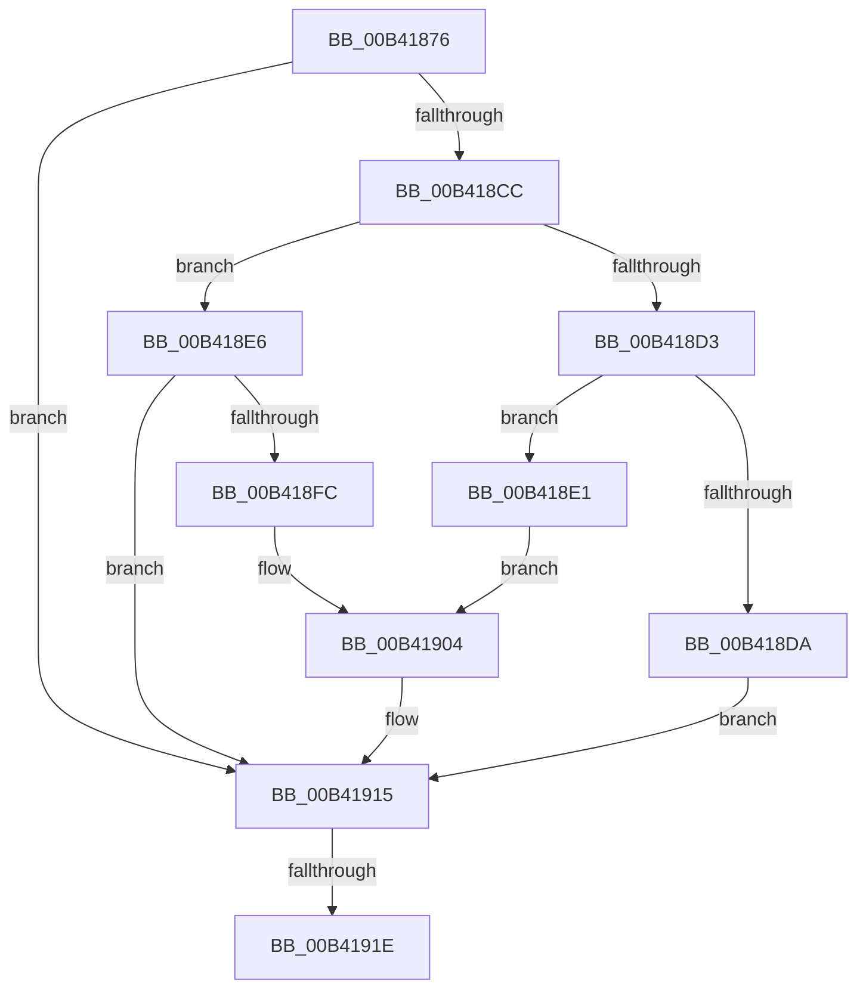

# sub_00B41876

- RVA: `0x00B41876`–`0x00B4192E` (길이 `184` bytes)
- VA: `0x0000000140B41876`
- 실행 섹션: `PAGE`
- PDB 이름 있음: `아니요`; PDB Function 태그: `아니요`
- unwind 정보 RVA: `0x000B5E8C`
- 디코드: `46`개 명령, `184/184` bytes 표시
- 미해석 바이트: `0` (있으면 어셈블리에 `.byte`로 보존)

> 이 문서는 커널 이미지의 기계어와 PDB 기호를 분석해 생성했습니다. 4번과 5번은 함수 원형과 자료형을 바이너리 사용 방식에서 추정한 C 해석이며 원본 소스 복구 결과는 아닙니다.

## 1. Dependencies

- 직접 호출 지점: **4**; 고유 호출 대상: **4**
- 직접 호출자로 확인된 함수: **0**
- RIP 상대 이미지 참조: **0**

### Outgoing calls
- `0x00B418BC` → [PnpGetObjectProperty](../8E/PnpGetObjectProperty_function_008E1110.md) (function, `0x008E1110`)
- `0x00B418F1` → [PnpStringFromGuid](../8F/PnpStringFromGuid_function_008F5A2C.md) (function, `0x008F5A2C`)
- `0x00B4190E` → [PiDmGetObject](../8D/PiDmGetObject_function_008DFAE0.md) (function, `0x008DFAE0`)
- `0x00B41923` → [ExFreePoolWithTag](../../poolcode/B8/ExFreePoolWithTag_function_00B82870.md) (function, `0x00B82870`)

### Direct callers
- 이 함수 시작 RVA로 연결되는 직접 call은 확인되지 않았습니다. 간접 호출은 완전히 역산할 수 없습니다.

### Static image references
- 디코드된 RIP-relative 메모리 참조가 없습니다.

## 2. Other-region calls and transfers

- 다른 실행 섹션으로 향하는 call: **1**
  - `0x00B41923` → [ExFreePoolWithTag](../../poolcode/B8/ExFreePoolWithTag_function_00B82870.md) (`PAGE` → `POOLCODE`)
- call이 아닌 외부 분기/꼬리 이동: **2**
  - `0x00B41918` → [PiDmGetReferencedObjectFromProperty + 0x66](../A7/PiDmGetReferencedObjectFromProperty_function_00A776F0.md) (`tail-transfer`)
  - `0x00B41929` → [PiDmGetReferencedObjectFromProperty + 0x66](../A7/PiDmGetReferencedObjectFromProperty_function_00A776F0.md) (`tail-transfer`)

## 3. Assembly (complete function range)

```asm
00B41876  83 64 24 50 00                  and dword ptr [rsp + 0x50], 0
00B4187B  48 8D 44 24 70                  lea rax, [rsp + 0x70]
00B41880  48 89 44 24 48                  mov qword ptr [rsp + 0x48], rax
00B41885  4C 8B C5                        mov r8, rbp
00B41888  48 8D 44 24 68                  lea rax, [rsp + 0x68]
00B4188D  BD 50 6E 70 5A                  mov ebp, 0x5a706e50
00B41892  48 89 44 24 40                  mov qword ptr [rsp + 0x40], rax
00B41897  44 8B CF                        mov r9d, edi
00B4189A  48 8D 44 24 60                  lea rax, [rsp + 0x60]
00B4189F  BA 10 00 00 00                  mov edx, 0x10
00B418A4  48 89 44 24 38                  mov qword ptr [rsp + 0x38], rax
00B418A9  8B CD                           mov ecx, ebp
00B418AB  4C 89 74 24 30                  mov qword ptr [rsp + 0x30], r14
00B418B0  48 83 64 24 28 00               and qword ptr [rsp + 0x28], 0
00B418B6  48 83 64 24 20 00               and qword ptr [rsp + 0x20], 0
00B418BC  E8 4F F8 D9 FF                  call 0x1408e1110
00B418C1  48 8B 7C 24 68                  mov rdi, qword ptr [rsp + 0x68]
00B418C6  8B D8                           mov ebx, eax
00B418C8  85 C0                           test eax, eax
00B418CA  78 49                           js 0x140b41915
00B418CC  83 7C 24 60 0D                  cmp dword ptr [rsp + 0x60], 0xd
00B418D1  74 13                           je 0x140b418e6
00B418D3  83 7C 24 60 12                  cmp dword ptr [rsp + 0x60], 0x12
00B418D8  74 07                           je 0x140b418e1
00B418DA  BB 34 00 00 C0                  mov ebx, 0xc0000034
00B418DF  EB 34                           jmp 0x140b41915
00B418E1  48 8B D7                        mov rdx, rdi
00B418E4  EB 1E                           jmp 0x140b41904
00B418E6  48 8D 94 24 80 00 00 00         lea rdx, [rsp + 0x80]
00B418EE  48 8B CF                        mov rcx, rdi
00B418F1  E8 36 41 DB FF                  call 0x1408f5a2c
00B418F6  8B D8                           mov ebx, eax
00B418F8  85 C0                           test eax, eax
00B418FA  78 19                           js 0x140b41915
00B418FC  48 8D 94 24 80 00 00 00         lea rdx, [rsp + 0x80]
00B41904  8B 8C 24 38 01 00 00            mov ecx, dword ptr [rsp + 0x138]
00B4190B  4C 8B C6                        mov r8, rsi
00B4190E  E8 CD E1 D9 FF                  call 0x1408dfae0
00B41913  8B D8                           mov ebx, eax
00B41915  48 85 FF                        test rdi, rdi
00B41918  0F 84 38 5E F3 FF               je 0x140a77756
00B4191E  8B D5                           mov edx, ebp
00B41920  48 8B CF                        mov rcx, rdi
00B41923  E8 48 0F 04 00                  call 0x140b82870
00B41928  90                              nop
00B41929  E9 28 5E F3 FF                  jmp 0x140a77756
```

## 4. C-style interpretation (structured pseudocode)

```c
__int64 __fastcall sub_00B41876(__int64 a1, __int64 a2, __int64 a3, __int64 a4, __int64 a5, __int64 a6, __int64 a7, __int64 a8, __int64 a9, unsigned int a10, __int64 a11, unsigned int a12, __int64 a13, __int64 a14, __int64 a15, __int64 a16, __int64 a17, __int64 a18, __int64 a19, __int64 a20, __int64 a21, __int64 a22, __int64 a23, __int64 a24, __int64 a25, __int64 a26, __int64 a27, __int64 a28, __int64 a29, __int64 a30, __int64 a31, __int64 a32, __int64 a33, __int64 a34, __int64 a35, __int64 a36, __int64 a37, __int64 a38, unsigned int a39)
{
    __int64 result;
    unsigned __int64 v_stack_p20;
    unsigned __int64 v_stack_p30;
    unsigned __int64 v_stack_p38;
    unsigned __int64 v_stack_p40;
    unsigned __int64 v_stack_p48;

    v_stack_p48 = a14;
    v_stack_p40 = a13;
    v_stack_p38 = a12;
    v_stack_p30 = v_r14;
    result = PnpGetObjectProperty((unsigned int)((unsigned int)((unsigned int)(0x5A706E50ULL))), 16, v_rbp, (unsigned int)((unsigned int)(v_rdi)));
    if (sign_flag) goto loc_00B41915;
    if (a12 == 13) goto loc_00B418E6;
    if (a12 == 18) goto loc_00B418E1;
    goto loc_00B41915;
loc_00B418E1:
    goto loc_00B41904;
loc_00B418E6:
    result = PnpStringFromGuid(a13, a16, v_rbp, (unsigned int)((unsigned int)(v_rdi)));
    if (sign_flag) goto loc_00B41915;
loc_00B41904:
    result = PiDmGetObject((unsigned int)(a39), a16, v_rsi, (unsigned int)((unsigned int)(v_rdi)));
loc_00B41915:
    result = ExFreePoolWithTag(a13, (unsigned int)((unsigned int)((unsigned int)(0x5A706E50ULL))), v_rsi, (unsigned int)((unsigned int)(v_rdi)));
}
```

## 5. (Beta) C Style

```c
int64_t sub_00B41876(int64_t Arg1, int64_t Arg2, int64_t Arg3, int64_t Arg4, int64_t Arg5, uint64_t Arg6, uint64_t Arg7, uint64_t Arg8, uint64_t Arg9, uint32_t Arg10, uint64_t Arg11, uint32_t Arg12, int64_t Arg13, int64_t Arg14, uint64_t Arg15, int64_t Arg16, uint64_t Arg17, uint64_t Arg18, uint64_t Arg19, uint64_t Arg20, uint64_t Arg21, uint64_t Arg22, uint64_t Arg23, uint64_t Arg24, uint64_t Arg25, uint64_t Arg26, uint64_t Arg27, uint64_t Arg28, uint64_t Arg29, uint64_t Arg30, uint64_t Arg31, uint64_t Arg32, uint64_t Arg33, uint64_t Arg34, uint64_t Arg35, uint64_t Arg36, uint64_t Arg37, uint64_t Arg38, uint32_t Arg39)
{
    int64_t result;
    uint64_t v_stack_p20;
    uint64_t v_stack_p30;
    uint64_t v_stack_p38;
    uint64_t v_stack_p40;
    uint64_t v_stack_p48;

    v_stack_p48 = Arg14;
    v_stack_p40 = Arg13;
    v_stack_p38 = Arg12;
    v_stack_p30 = local_r14;
    result = PnpGetObjectProperty((uint32_t)((uint32_t)((uint32_t)(0x5A706E50ULL))), 16, local_rbp, (uint32_t)((uint32_t)(local_rdi)));
    if (sign_flag) goto loc_00B41915;
    if (Arg12 == 13) goto loc_00B418E6;
    if (Arg12 == 18) goto loc_00B418E1;
    goto loc_00B41915;
loc_00B418E1:
    goto loc_00B41904;
loc_00B418E6:
    result = PnpStringFromGuid(Arg13, Arg16, local_rbp, (uint32_t)((uint32_t)(local_rdi)));
    if (sign_flag) goto loc_00B41915;
loc_00B41904:
    result = PiDmGetObject((uint32_t)(Arg39), Arg16, local_rsi, (uint32_t)((uint32_t)(local_rdi)));
loc_00B41915:
    result = ExFreePoolWithTag(Arg13, (uint32_t)((uint32_t)((uint32_t)(0x5A706E50ULL))), local_rsi, (uint32_t)((uint32_t)(local_rdi)));
}
```

## 6. Execution-region graph

[열기: 2D/3D 그래프와 함수 탐색 컨트롤 패널](../../../control-panel.html?section=page&rva=0x00B41876&view=graph)

- 2D 그래프는 위에서 아래로 흐르고, 3D 그래프는 빈 공간을 드래그해 회전합니다. Shift+드래그는 이동, 휠은 확대·축소, 함수 노드 선택은 대상 보고서 이동입니다.

### Static fallback


