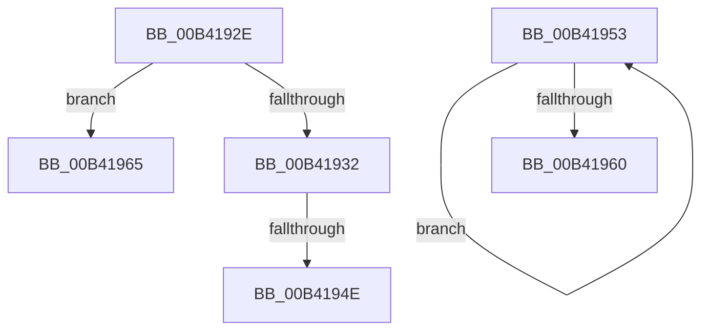

# sub_00B4192E

- RVA: `0x00B4192E`–`0x00B4196F` (길이 `65` bytes)
- VA: `0x0000000140B4192E`
- 실행 섹션: `PAGE`
- PDB 이름 있음: `아니요`; PDB Function 태그: `아니요`
- unwind 정보 RVA: `0x000B5EBC`
- 디코드: `17`개 명령, `65/65` bytes 표시
- 미해석 바이트: `0` (있으면 어셈블리에 `.byte`로 보존)

> 이 문서는 커널 이미지의 기계어와 PDB 기호를 분석해 생성했습니다. 4번과 5번은 함수 원형과 자료형을 바이너리 사용 방식에서 추정한 C 해석이며 원본 소스 복구 결과는 아닙니다.

## 1. Dependencies

- 직접 호출 지점: **1**; 고유 호출 대상: **1**
- 직접 호출자로 확인된 함수: **0**
- RIP 상대 이미지 참조: **0**

### Outgoing calls
- `0x00B41941` → [ultow_s](../../text/50/ultow_s_function_00504F30.md) (function, `0x00504F30`)

### Direct callers
- 이 함수 시작 RVA로 연결되는 직접 call은 확인되지 않았습니다. 간접 호출은 완전히 역산할 수 없습니다.

### Static image references
- 디코드된 RIP-relative 메모리 참조가 없습니다.

## 2. Other-region calls and transfers

- 다른 실행 섹션으로 향하는 call: **1**
  - `0x00B41941` → [ultow_s](../../text/50/ultow_s_function_00504F30.md) (`PAGE` → `.text`)
- call이 아닌 외부 분기/꼬리 이동: **4**
  - `0x00B41948` → [_CmCreateOrdinalInstanceKey + 0x26C](../A7/_CmCreateOrdinalInstanceKey_function_00A77838.md) (`tail-transfer`)
  - `0x00B4194E` → [_CmCreateOrdinalInstanceKey + 0xAC](../A7/_CmCreateOrdinalInstanceKey_function_00A77838.md) (`tail-transfer`)
  - `0x00B41960` → [_CmCreateOrdinalInstanceKey + 0x192](../A7/_CmCreateOrdinalInstanceKey_function_00A77838.md) (`tail-transfer`)
  - `0x00B4196A` → [_CmCreateOrdinalInstanceKey + 0x24E](../A7/_CmCreateOrdinalInstanceKey_function_00A77838.md) (`tail-transfer`)

## 3. Assembly (complete function range)

```asm
00B4192E  3B F1                           cmp esi, ecx
00B41930  77 33                           ja 0x140b41965
00B41932  41 B9 24 00 00 00               mov r9d, 0x24
00B41938  49 8B D7                        mov rdx, r15
00B4193B  8B CE                           mov ecx, esi
00B4193D  45 8D 41 E1                     lea r8d, [r9 - 0x1f]
00B41941  E8 EA 35 9C FF                  call 0x140504f30
00B41946  85 C0                           test eax, eax
00B41948  0F 85 56 61 F3 FF               jne 0x140a77aa4
00B4194E  E9 91 5F F3 FF                  jmp 0x140a778e4
00B41953  47 8D 34 F6                     lea r14d, [r14 + r14*8]
00B41957  41 C1 E6 02                     shl r14d, 2
00B4195B  83 C0 FF                        add eax, -1
00B4195E  75 F3                           jne 0x140b41953
00B41960  E9 65 60 F3 FF                  jmp 0x140a779ca
00B41965  BB 1A 00 00 80                  mov ebx, 0x8000001a
00B4196A  E9 17 61 F3 FF                  jmp 0x140a77a86
```

## 4. C-style interpretation (structured pseudocode)

```c
__int64 __fastcall sub_00B4192E(int a1)
{
    __int64 result;

    if (((unsigned int)(v_rsi)) > a1) goto loc_00B41965;
    result = ultow_s((unsigned int)((unsigned int)(v_rsi)), v_r15, 36 - 31, 36);
loc_00B41965:
}
```

## 5. (Beta) C Style

```c
int64_t sub_00B4192E(int32_t Arg1)
{
    int64_t result;

    if (((uint32_t)(local_rsi)) > Arg1) goto loc_00B41965;
    result = ultow_s((uint32_t)((uint32_t)(local_rsi)), local_r15, 36 - 31, 36);
loc_00B41965:
}
```

## 6. Execution-region graph

[열기: 2D/3D 그래프와 함수 탐색 컨트롤 패널](../../../control-panel.html?section=page&rva=0x00B4192E&view=graph)

- 2D 그래프는 위에서 아래로 흐르고, 3D 그래프는 빈 공간을 드래그해 회전합니다. Shift+드래그는 이동, 휠은 확대·축소, 함수 노드 선택은 대상 보고서 이동입니다.

### Static fallback


