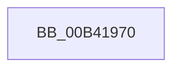

# sub_00B41970

- RVA: `0x00B41970`–`0x00B419D6` (길이 `102` bytes)
- VA: `0x0000000140B41970`
- 실행 섹션: `PAGE`
- PDB 이름 있음: `아니요`; PDB Function 태그: `아니요`
- unwind 정보 RVA: `0x000B5F78`
- 디코드: `20`개 명령, `102/102` bytes 표시
- 미해석 바이트: `0` (있으면 어셈블리에 `.byte`로 보존)

> 이 문서는 커널 이미지의 기계어와 PDB 기호를 분석해 생성했습니다. 4번과 5번은 함수 원형과 자료형을 바이너리 사용 방식에서 추정한 C 해석이며 원본 소스 복구 결과는 아닙니다.

## 1. Dependencies

- 직접 호출 지점: **3**; 고유 호출 대상: **3**
- 직접 호출자로 확인된 함수: **0**
- RIP 상대 이미지 참조: **3**

### Outgoing calls
- `0x00B41983` → [RtlStringCbPrintfW](../../text/40/RtlStringCbPrintfW_function_0040FB40.md) (function, `0x0040FB40`)
- `0x00B41994` → [RtlInitUnicodeString](../../text/42/RtlInitUnicodeString_function_0042A780.md) (function, `0x0042A780`)
- `0x00B419CB` → [PcwAddInstance](../A0/PcwAddInstance_function_00A0E530.md) (function, `0x00A0E530`)

### Direct callers
- 이 함수 시작 RVA로 연결되는 직접 call은 확인되지 않았습니다. 간접 호출은 완전히 역산할 수 없습니다.

### Static image references
- `0x00B41970` → RVA `0x00B006A0` (` ?? ::NNGAKEGL::`string'`; read)
- `0x00B41999` → RVA `0x00FC5000` (`ALMOSTRO`; read)
- `0x00B419A5` → RVA `0x00FC6AE8` (`ALMOSTRO`; read)

## 2. Other-region calls and transfers

- 다른 실행 섹션으로 향하는 call: **2**
  - `0x00B41983` → [RtlStringCbPrintfW](../../text/40/RtlStringCbPrintfW_function_0040FB40.md) (`PAGE` → `.text`)
  - `0x00B41994` → [RtlInitUnicodeString](../../text/42/RtlInitUnicodeString_function_0042A780.md) (`PAGE` → `.text`)
- call이 아닌 외부 분기/꼬리 이동: **1**
  - `0x00B419D1` → [KiSynchNumaCounterSetCallback + 0x9C](../A7/KiSynchNumaCounterSetCallback_function_00A77BE0.md) (`tail-transfer`)

## 3. Assembly (complete function range)

```asm
00B41970  4C 8D 05 29 ED FB FF            lea r8, [rip - 0x412d7]
00B41977  BA 16 00 00 00                  mov edx, 0x16
00B4197C  48 8D 8D 28 01 00 00            lea rcx, [rbp + 0x128]
00B41983  E8 B8 E1 8C FF                  call 0x14040fb40
00B41988  48 8D 95 28 01 00 00            lea rdx, [rbp + 0x128]
00B4198F  48 8D 4C 24 38                  lea rcx, [rsp + 0x38]
00B41994  E8 E7 8D 8E FF                  call 0x14042a780
00B41999  44 0F B7 05 5F 36 48 00         movzx r8d, word ptr [rip + 0x48365f]
00B419A1  48 8D 45 50                     lea rax, [rbp + 0x50]
00B419A5  44 03 05 3C 51 48 00            add r8d, dword ptr [rip + 0x48513c]
00B419AC  48 8D 54 24 38                  lea rdx, [rsp + 0x38]
00B419B1  48 89 45 80                     mov qword ptr [rbp - 0x80], rax
00B419B5  44 8B CE                        mov r9d, esi
00B419B8  48 8D 45 80                     lea rax, [rbp - 0x80]
00B419BC  C7 45 88 B8 00 00 00            mov dword ptr [rbp - 0x78], 0xb8
00B419C3  49 8B CC                        mov rcx, r12
00B419C6  48 89 44 24 20                  mov qword ptr [rsp + 0x20], rax
00B419CB  E8 60 CB EC FF                  call 0x140a0e530
00B419D0  90                              nop
00B419D1  E9 A6 62 F3 FF                  jmp 0x140a77c7c
```

## 4. C-style interpretation (structured pseudocode)

```c
__int64 __fastcall sub_00B41970(__int64 a1, __int64 a2, __int64 a3, __int64 a4, __int64 a5, __int64 a6, __int64 a7)
{
    __int64 result;
    unsigned __int64 v_stack_p20;

    result = RtlStringCbPrintfW(v_rbp + 296, 22, v_rip - 266967, a4);
    result = RtlInitUnicodeString(a7, v_rbp + 296, v_rip - 266967, a4);
    a3 = (unsigned int)((*(unsigned __int16 *)(v_rip + 4732511)) + (*(unsigned int *)(v_rip + 4739388)));
    *(unsigned __int64 *)(v_rbp - 128) = v_rbp + 80;
    *(unsigned int *)(v_rbp - 120) = 184;
    v_stack_p20 = v_rbp - 128;
    result = PcwAddInstance(v_r12, a7, a3, (unsigned int)((unsigned int)(v_rsi)));
}
```

## 5. (Beta) C Style

```c
int64_t sub_00B41970(int64_t Arg1, int64_t Arg2, int64_t Arg3, int64_t Arg4, uint64_t Arg5, uint64_t Arg6, int64_t Arg7)
{
    int64_t result;
    uint64_t v_stack_p20;

    result = RtlStringCbPrintfW(local_rbp + 296, 22, v_rip - 266967, Arg4);
    result = RtlInitUnicodeString(Arg7, local_rbp + 296, v_rip - 266967, Arg4);
    Arg3 = (uint32_t)((*(uint16_t *)(v_rip + 0x48365F)) + (*(uint32_t *)(v_rip + 0x48513C)));
    *(uint64_t *)(local_rbp - 0x80) = local_rbp + 80;
    *(uint32_t *)(local_rbp - 0x78) = 184;
    v_stack_p20 = local_rbp - 128;
    result = PcwAddInstance(local_r12, Arg7, Arg3, (uint32_t)((uint32_t)(local_rsi)));
}
```

## 6. Execution-region graph

[열기: 2D/3D 그래프와 함수 탐색 컨트롤 패널](../../../control-panel.html?section=page&rva=0x00B41970&view=graph)

- 2D 그래프는 위에서 아래로 흐르고, 3D 그래프는 빈 공간을 드래그해 회전합니다. Shift+드래그는 이동, 휠은 확대·축소, 함수 노드 선택은 대상 보고서 이동입니다.

### Static fallback


