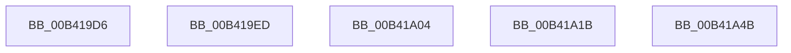

# sub_00B419D6

- RVA: `0x00B419D6`–`0x00B41A62` (길이 `140` bytes)
- VA: `0x0000000140B419D6`
- 실행 섹션: `PAGE`
- PDB 이름 있음: `아니요`; PDB Function 태그: `아니요`
- unwind 정보 RVA: `0x000B5FAC`
- 디코드: `34`개 명령, `140/140` bytes 표시
- 미해석 바이트: `0` (있으면 어셈블리에 `.byte`로 보존)

> 이 문서는 커널 이미지의 기계어와 PDB 기호를 분석해 생성했습니다. 4번과 5번은 함수 원형과 자료형을 바이너리 사용 방식에서 추정한 C 해석이며 원본 소스 복구 결과는 아닙니다.

## 1. Dependencies

- 직접 호출 지점: **6**; 고유 호출 대상: **6**
- 직접 호출자로 확인된 함수: **0**
- RIP 상대 이미지 참조: **0**

### Outgoing calls
- `0x00B419E2` → [SmcProcessDeleteRequest](../7A/SmcProcessDeleteRequest_function_007A7900.md) (function, `0x007A7900`)
- `0x00B419F9` → [SmcProcessCreateRequest](../7A/SmcProcessCreateRequest_function_007A764C.md) (function, `0x007A764C`)
- `0x00B41A10` → [SmProcessDeleteRequest](../7A/SmProcessDeleteRequest_function_007A6728.md) (function, `0x007A6728`)
- `0x00B41A2B` → [SmpGetProcessPartition](../../text/4A/SmpGetProcessPartition_function_004A3CCC.md) (function, `0x004A3CCC`)
- `0x00B41A40` → [SmProcessCreateRequest](../A5/SmProcessCreateRequest_function_00A50DD0.md) (function, `0x00A50DD0`)
- `0x00B41A57` → [SmcProcessStoreDeleteRequest](../7A/SmcProcessStoreDeleteRequest_function_007A7F80.md) (function, `0x007A7F80`)

### Direct callers
- 이 함수 시작 RVA로 연결되는 직접 call은 확인되지 않았습니다. 간접 호출은 완전히 역산할 수 없습니다.

### Static image references
- 디코드된 RIP-relative 메모리 참조가 없습니다.

## 2. Other-region calls and transfers

- 다른 실행 섹션으로 향하는 call: **1**
  - `0x00B41A2B` → [SmpGetProcessPartition](../../text/4A/SmpGetProcessPartition_function_004A3CCC.md) (`PAGE` → `.text`)
- call이 아닌 외부 분기/꼬리 이동: **5**
  - `0x00B419E8` → [SmSetStoreInformation + 0x83](../A7/SmSetStoreInformation_function_00A781B8.md) (`tail-transfer`)
  - `0x00B419FF` → [SmSetStoreInformation + 0x83](../A7/SmSetStoreInformation_function_00A781B8.md) (`tail-transfer`)
  - `0x00B41A16` → [SmSetStoreInformation + 0x83](../A7/SmSetStoreInformation_function_00A781B8.md) (`tail-transfer`)
  - `0x00B41A46` → [SmSetStoreInformation + 0x83](../A7/SmSetStoreInformation_function_00A781B8.md) (`tail-transfer`)
  - `0x00B41A5D` → [SmSetStoreInformation + 0x83](../A7/SmSetStoreInformation_function_00A781B8.md) (`tail-transfer`)

## 3. Assembly (complete function range)

```asm
00B419D6  44 8A C3                        mov r8b, bl
00B419D9  8B 54 24 30                     mov edx, dword ptr [rsp + 0x30]
00B419DD  48 8B 4C 24 28                  mov rcx, qword ptr [rsp + 0x28]
00B419E2  E8 19 5F C6 FF                  call 0x1407a7900
00B419E7  90                              nop
00B419E8  E9 4E 68 F3 FF                  jmp 0x140a7823b
00B419ED  44 8A C3                        mov r8b, bl
00B419F0  8B 54 24 30                     mov edx, dword ptr [rsp + 0x30]
00B419F4  48 8B 4C 24 28                  mov rcx, qword ptr [rsp + 0x28]
00B419F9  E8 4E 5C C6 FF                  call 0x1407a764c
00B419FE  90                              nop
00B419FF  E9 37 68 F3 FF                  jmp 0x140a7823b
00B41A04  44 8A C3                        mov r8b, bl
00B41A07  8B 54 24 30                     mov edx, dword ptr [rsp + 0x30]
00B41A0B  48 8B 4C 24 28                  mov rcx, qword ptr [rsp + 0x28]
00B41A10  E8 13 4D C6 FF                  call 0x1407a6728
00B41A15  90                              nop
00B41A16  E9 20 68 F3 FF                  jmp 0x140a7823b
00B41A1B  65 48 8B 04 25 88 01 00 00      mov rax, qword ptr gs:[0x188]
00B41A24  48 8B 88 B8 00 00 00            mov rcx, qword ptr [rax + 0xb8]
00B41A2B  E8 9C 22 96 FF                  call 0x1404a3ccc
00B41A30  48 8B C8                        mov rcx, rax
00B41A33  44 8A CB                        mov r9b, bl
00B41A36  44 8B 44 24 30                  mov r8d, dword ptr [rsp + 0x30]
00B41A3B  48 8B 54 24 28                  mov rdx, qword ptr [rsp + 0x28]
00B41A40  E8 8B F3 F0 FF                  call 0x140a50dd0
00B41A45  90                              nop
00B41A46  E9 F0 67 F3 FF                  jmp 0x140a7823b
00B41A4B  44 8A C3                        mov r8b, bl
00B41A4E  8B 54 24 30                     mov edx, dword ptr [rsp + 0x30]
00B41A52  48 8B 4C 24 28                  mov rcx, qword ptr [rsp + 0x28]
00B41A57  E8 24 65 C6 FF                  call 0x1407a7f80
00B41A5C  90                              nop
00B41A5D  E9 D9 67 F3 FF                  jmp 0x140a7823b
```

## 4. C-style interpretation (structured pseudocode)

```c
__int64 __fastcall sub_00B419D6(__int64 a1, __int64 a2, __int64 a3, __int64 a4, __int64 a5, unsigned int a6)
{
    __int64 result;
    unsigned __int64 v_stack_p28;
    unsigned int v_stack_p30;

    result = SmcProcessDeleteRequest(a5, (unsigned int)(a6), (unsigned __int8)(v_rbx), a4);
}
```

## 5. (Beta) C Style

```c
int64_t sub_00B419D6(int64_t Arg1, int64_t Arg2, int64_t Arg3, int64_t Arg4, int64_t Arg5, uint32_t Arg6)
{
    int64_t result;
    uint64_t v_stack_p28;
    uint32_t v_stack_p30;

    result = SmcProcessDeleteRequest(Arg5, (uint32_t)(Arg6), (uint8_t)(local_rbx), Arg4);
}
```

## 6. Execution-region graph

[열기: 2D/3D 그래프와 함수 탐색 컨트롤 패널](../../../control-panel.html?section=page&rva=0x00B419D6&view=graph)

- 2D 그래프는 위에서 아래로 흐르고, 3D 그래프는 빈 공간을 드래그해 회전합니다. Shift+드래그는 이동, 휠은 확대·축소, 함수 노드 선택은 대상 보고서 이동입니다.

### Static fallback


