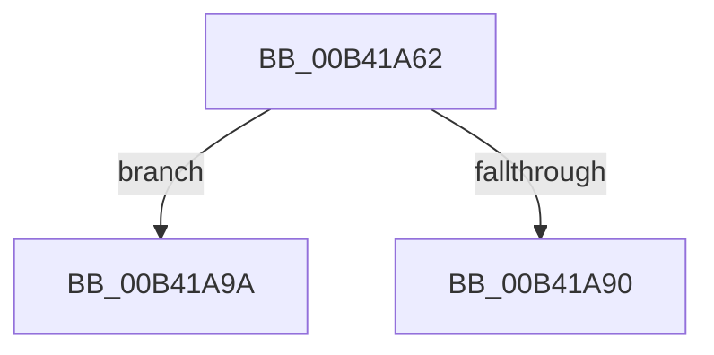

# sub_00B41A62

- RVA: `0x00B41A62`–`0x00B41AB2` (길이 `80` bytes)
- VA: `0x0000000140B41A62`
- 실행 섹션: `PAGE`
- PDB 이름 있음: `아니요`; PDB Function 태그: `아니요`
- unwind 정보 RVA: `0x000B5FF4`
- 디코드: `18`개 명령, `80/80` bytes 표시
- 미해석 바이트: `0` (있으면 어셈블리에 `.byte`로 보존)

> 이 문서는 커널 이미지의 기계어와 PDB 기호를 분석해 생성했습니다. 4번과 5번은 함수 원형과 자료형을 바이너리 사용 방식에서 추정한 C 해석이며 원본 소스 복구 결과는 아닙니다.

## 1. Dependencies

- 직접 호출 지점: **3**; 고유 호출 대상: **3**
- 직접 호출자로 확인된 함수: **0**
- RIP 상대 이미지 참조: **0**

### Outgoing calls
- `0x00B41A67` → [SmpGetProcessPartition](../../text/4A/SmpGetProcessPartition_function_004A3CCC.md) (function, `0x004A3CCC`)
- `0x00B41A86` → [SmpKeyedStoreEntryGet](../../text/34/SmpKeyedStoreEntryGet_function_00349FB0.md) (function, `0x00349FB0`)
- `0x00B41AA1` → [SmKmStoreGet](../../text/34/SmKmStoreGet_function_00349F24.md) (function, `0x00349F24`)

### Direct callers
- 이 함수 시작 RVA로 연결되는 직접 call은 확인되지 않았습니다. 간접 호출은 완전히 역산할 수 없습니다.

### Static image references
- 디코드된 RIP-relative 메모리 참조가 없습니다.

## 2. Other-region calls and transfers

- 다른 실행 섹션으로 향하는 call: **3**
  - `0x00B41A67` → [SmpGetProcessPartition](../../text/4A/SmpGetProcessPartition_function_004A3CCC.md) (`PAGE` → `.text`)
  - `0x00B41A86` → [SmpKeyedStoreEntryGet](../../text/34/SmpKeyedStoreEntryGet_function_00349FB0.md) (`PAGE` → `.text`)
  - `0x00B41AA1` → [SmKmStoreGet](../../text/34/SmKmStoreGet_function_00349F24.md) (`PAGE` → `.text`)
- call이 아닌 외부 분기/꼬리 이동: **2**
  - `0x00B41A95` → [SmProcessStoreMemoryPriorityRequest + 0x11C](../A7/SmProcessStoreMemoryPriorityRequest_function_00A7830C.md) (`tail-transfer`)
  - `0x00B41AAD` → [SmProcessStoreMemoryPriorityRequest + 0x11C](../A7/SmProcessStoreMemoryPriorityRequest_function_00A7830C.md) (`tail-transfer`)

## 3. Assembly (complete function range)

```asm
00B41A62  48 8B 4C 24 30                  mov rcx, qword ptr [rsp + 0x30]
00B41A67  E8 60 22 96 FF                  call 0x1404a3ccc
00B41A6C  4C 8B F0                        mov r14, rax
00B41A6F  48 89 4C 24 38                  mov qword ptr [rsp + 0x38], rcx
00B41A74  48 8D 88 B8 08 00 00            lea rcx, [rax + 0x8b8]
00B41A7B  45 33 C9                        xor r9d, r9d
00B41A7E  45 33 C0                        xor r8d, r8d
00B41A81  48 8D 54 24 38                  lea rdx, [rsp + 0x38]
00B41A86  E8 25 85 80 FF                  call 0x140349fb0
00B41A8B  48 85 C0                        test rax, rax
00B41A8E  75 0A                           jne 0x140b41a9a
00B41A90  BB C0 00 00 C0                  mov ebx, 0xc00000c0
00B41A95  E9 8E 69 F3 FF                  jmp 0x140a78428
00B41A9A  0F B7 50 10                     movzx edx, word ptr [rax + 0x10]
00B41A9E  49 8B CE                        mov rcx, r14
00B41AA1  E8 7E 84 80 FF                  call 0x140349f24
00B41AA6  C6 80 97 1A 00 00 01            mov byte ptr [rax + 0x1a97], 1
00B41AAD  E9 76 69 F3 FF                  jmp 0x140a78428
```

## 4. C-style interpretation (structured pseudocode)

```c
__int64 __fastcall sub_00B41A62(__int64 a1, __int64 a2, int a3, int a4, __int64 a5, __int64 a6, __int64 a7)
{
    __int64 result;
    unsigned __int64 v_stack_p38;

    result = SmpGetProcessPartition(a6, a2, a3, a4);
    v_stack_p38 = a6;
    a4 = 0;
    a3 = 0;
    result = SmpKeyedStoreEntryGet(result + 2232, a7, a3, a4);
    if (result != 0) goto loc_00B41A9A;
loc_00B41A9A:
    result = SmKmStoreGet(result, *(unsigned __int16 *)(result + 16), a3, a4);
    *(unsigned __int8 *)(result + 6807) = 1;
}
```

## 5. (Beta) C Style

```c
int64_t sub_00B41A62(int64_t Arg1, int64_t Arg2, int32_t Arg3, int32_t Arg4, uint64_t Arg5, int64_t Arg6, int64_t Arg7)
{
    int64_t result;
    uint64_t v_stack_p38;

    result = SmpGetProcessPartition(Arg6, Arg2, Arg3, Arg4);
    v_stack_p38 = Arg6;
    Arg4 = 0;
    Arg3 = 0;
    result = SmpKeyedStoreEntryGet(result + 2232, Arg7, Arg3, Arg4);
    if (result != 0) goto loc_00B41A9A;
loc_00B41A9A:
    result = SmKmStoreGet(result, *(uint16_t *)(result + 0x10), Arg3, Arg4);
    *(uint8_t *)(result + 0x1A97) = 1;
}
```

## 6. Execution-region graph

[열기: 2D/3D 그래프와 함수 탐색 컨트롤 패널](../../../control-panel.html?section=page&rva=0x00B41A62&view=graph)

- 2D 그래프는 위에서 아래로 흐르고, 3D 그래프는 빈 공간을 드래그해 회전합니다. Shift+드래그는 이동, 휠은 확대·축소, 함수 노드 선택은 대상 보고서 이동입니다.

### Static fallback


