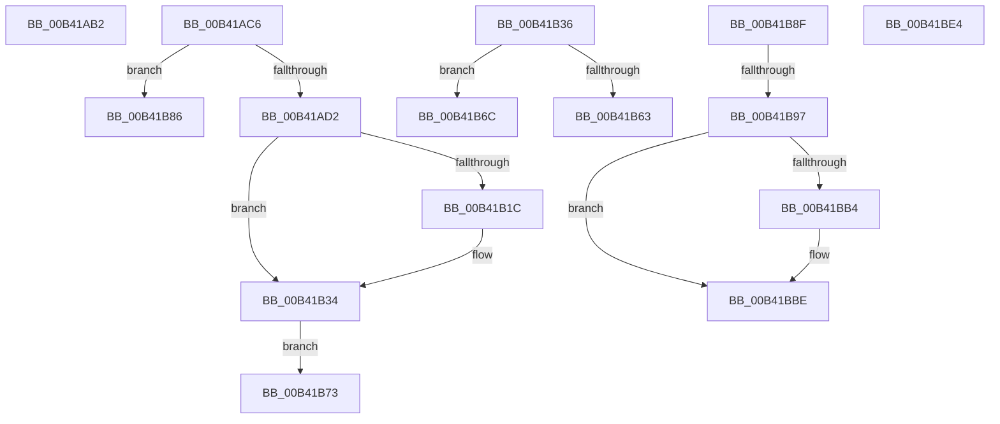

# sub_00B41AB2

- RVA: `0x00B41AB2`–`0x00B41C11` (길이 `351` bytes)
- VA: `0x0000000140B41AB2`
- 실행 섹션: `PAGE`
- PDB 이름 있음: `아니요`; PDB Function 태그: `아니요`
- unwind 정보 RVA: `0x000B60D4`
- 디코드: `90`개 명령, `351/351` bytes 표시
- 미해석 바이트: `0` (있으면 어셈블리에 `.byte`로 보존)

> 이 문서는 커널 이미지의 기계어와 PDB 기호를 분석해 생성했습니다. 4번과 5번은 함수 원형과 자료형을 바이너리 사용 방식에서 추정한 C 해석이며 원본 소스 복구 결과는 아닙니다.

## 1. Dependencies

- 직접 호출 지점: **10**; 고유 호출 대상: **8**
- 직접 호출자로 확인된 함수: **0**
- RIP 상대 이미지 참조: **0**

### Outgoing calls
- `0x00B41AB7` → [IopAllocateIrpCleanup](../A1/IopAllocateIrpCleanup_function_00A1E2D4.md) (function, `0x00A1E2D4`)
- `0x00B41AE4` → [ExAllocatePool2](../../poolcode/B8/ExAllocatePool2_function_00B820F0.md) (function, `0x00B820F0`)
- `0x00B41AF9` → [memcpy](../../text/6C/memcpy_function_006C6840.md) (function, `0x006C6840`)
- `0x00B41B0F` → [IoCheckEaBufferValidity](../A2/IoCheckEaBufferValidity_function_00A2B9F0.md) (function, `0x00A2B9F0`)
- `0x00B41B2F` → [RtlRaiseStatus](../../text/2F/RtlRaiseStatus_function_002F6A50.md) (function, `0x002F6A50`)
- `0x00B41B57` → [IopExceptionCleanupEx](../8A/IopExceptionCleanupEx_function_008AE5C8.md) (function, `0x008AE5C8`)
- `0x00B41BA7` → [IoAllocateMdl](../../text/29/IoAllocateMdl_function_0029EBF0.md) (function, `0x0029EBF0`)
- `0x00B41BB9` → [RtlRaiseStatus](../../text/2F/RtlRaiseStatus_function_002F6A50.md) (function, `0x002F6A50`)
- `0x00B41BD5` → [IopProbeAndLockPages](../../text/45/IopProbeAndLockPages_function_0045641C.md) (function, `0x0045641C`)
- `0x00B41C05` → [IopExceptionCleanupEx](../8A/IopExceptionCleanupEx_function_008AE5C8.md) (function, `0x008AE5C8`)

### Direct callers
- 이 함수 시작 RVA로 연결되는 직접 call은 확인되지 않았습니다. 간접 호출은 완전히 역산할 수 없습니다.

### Static image references
- 디코드된 RIP-relative 메모리 참조가 없습니다.

## 2. Other-region calls and transfers

- 다른 실행 섹션으로 향하는 call: **6**
  - `0x00B41AE4` → [ExAllocatePool2](../../poolcode/B8/ExAllocatePool2_function_00B820F0.md) (`PAGE` → `POOLCODE`)
  - `0x00B41AF9` → [memcpy](../../text/6C/memcpy_function_006C6840.md) (`PAGE` → `.text`)
  - `0x00B41B2F` → [RtlRaiseStatus](../../text/2F/RtlRaiseStatus_function_002F6A50.md) (`PAGE` → `.text`)
  - `0x00B41BA7` → [IoAllocateMdl](../../text/29/IoAllocateMdl_function_0029EBF0.md) (`PAGE` → `.text`)
  - `0x00B41BB9` → [RtlRaiseStatus](../../text/2F/RtlRaiseStatus_function_002F6A50.md) (`PAGE` → `.text`)
  - `0x00B41BD5` → [IopProbeAndLockPages](../../text/45/IopProbeAndLockPages_function_0045641C.md) (`PAGE` → `.text`)
- call이 아닌 외부 분기/꼬리 이동: **8**
  - `0x00B41AC1` → [NtSetEaFile + 0x22B](../A7/NtSetEaFile_function_00A788A0.md) (`tail-transfer`)
  - `0x00B41B67` → [NtSetEaFile + 0x22B](../A7/NtSetEaFile_function_00A788A0.md) (`tail-transfer`)
  - `0x00B41B6E` → [NtSetEaFile + 0x22B](../A7/NtSetEaFile_function_00A788A0.md) (`tail-transfer`)
  - `0x00B41B81` → [NtSetEaFile + 0x1F8](../A7/NtSetEaFile_function_00A788A0.md) (`tail-transfer`)
  - `0x00B41B8A` → [NtSetEaFile + 0x1F8](../A7/NtSetEaFile_function_00A788A0.md) (`tail-transfer`)
  - `0x00B41B91` → [NtSetEaFile + 0x1F8](../A7/NtSetEaFile_function_00A788A0.md) (`tail-transfer`)
  - `0x00B41BDF` → [NtSetEaFile + 0x1F8](../A7/NtSetEaFile_function_00A788A0.md) (`tail-transfer`)
  - `0x00B41C0C` → [NtSetEaFile + 0x22B](../A7/NtSetEaFile_function_00A788A0.md) (`tail-transfer`)

## 3. Assembly (complete function range)

```asm
00B41AB2  33 D2                           xor edx, edx
00B41AB4  49 8B CE                        mov rcx, r14
00B41AB7  E8 18 C8 ED FF                  call 0x140a1e2d4
00B41ABC  B8 9A 00 00 C0                  mov eax, 0xc000009a
00B41AC1  E9 05 70 F3 FF                  jmp 0x140a78acb
00B41AC6  89 54 24 50                     mov dword ptr [rsp + 0x50], edx
00B41ACA  85 DB                           test ebx, ebx
00B41ACC  0F 84 B4 00 00 00               je 0x140b41b86
00B41AD2  88 54 24 42                     mov byte ptr [rsp + 0x42], dl
00B41AD6  41 B8 49 6F 53 42               mov r8d, 0x42536f49
00B41ADC  48 8B D3                        mov rdx, rbx
00B41ADF  B9 61 00 00 00                  mov ecx, 0x61
00B41AE4  E8 07 06 04 00                  call 0x140b820f0
00B41AE9  48 8B F8                        mov rdi, rax
00B41AEC  48 89 46 18                     mov qword ptr [rsi + 0x18], rax
00B41AF0  4C 8B C3                        mov r8, rbx
00B41AF3  49 8B D4                        mov rdx, r12
00B41AF6  48 8B C8                        mov rcx, rax
00B41AF9  E8 42 4D B8 FF                  call 0x1406c6840
00B41AFE  4C 8D 44 24 50                  lea r8, [rsp + 0x50]
00B41B03  8B 9C 24 D8 00 00 00            mov ebx, dword ptr [rsp + 0xd8]
00B41B0A  8B D3                           mov edx, ebx
00B41B0C  48 8B CF                        mov rcx, rdi
00B41B0F  E8 DC 9E EE FF                  call 0x140a2b9f0
00B41B14  89 44 24 44                     mov dword ptr [rsp + 0x44], eax
00B41B18  85 C0                           test eax, eax
00B41B1A  79 18                           jns 0x140b41b34
00B41B1C  C6 44 24 42 01                  mov byte ptr [rsp + 0x42], 1
00B41B21  41 89 45 00                     mov dword ptr [r13], eax
00B41B25  8B 4C 24 50                     mov ecx, dword ptr [rsp + 0x50]
00B41B29  49 89 4D 08                     mov qword ptr [r13 + 8], rcx
00B41B2D  8B C8                           mov ecx, eax
00B41B2F  E8 1C 4F 7B FF                  call 0x1402f6a50
00B41B34  EB 3D                           jmp 0x140b41b73
00B41B36  8B D8                           mov ebx, eax
00B41B38  48 8B 4C 24 48                  mov rcx, qword ptr [rsp + 0x48]
00B41B3D  0F B6 51 50                     movzx edx, byte ptr [rcx + 0x50]
00B41B41  D1 EA                           shr edx, 1
00B41B43  83 E2 01                        and edx, 1
00B41B46  88 54 24 20                     mov byte ptr [rsp + 0x20], dl
00B41B4A  4C 8B 4C 24 60                  mov r9, qword ptr [rsp + 0x60]
00B41B4F  45 33 C0                        xor r8d, r8d
00B41B52  48 8B 54 24 70                  mov rdx, qword ptr [rsp + 0x70]
00B41B57  E8 6C CA D6 FF                  call 0x1408ae5c8
00B41B5C  80 7C 24 42 00                  cmp byte ptr [rsp + 0x42], 0
00B41B61  74 09                           je 0x140b41b6c
00B41B63  8B 44 24 44                     mov eax, dword ptr [rsp + 0x44]
00B41B67  E9 5F 6F F3 FF                  jmp 0x140a78acb
00B41B6C  8B C3                           mov eax, ebx
00B41B6E  E9 58 6F F3 FF                  jmp 0x140a78acb
00B41B73  83 4E 10 30                     or dword ptr [rsi + 0x10], 0x30
00B41B77  40 8A 7C 24 41                  mov dil, byte ptr [rsp + 0x41]
00B41B7C  48 8B 44 24 58                  mov rax, qword ptr [rsp + 0x58]
00B41B81  E9 12 6F F3 FF                  jmp 0x140a78a98
00B41B86  48 89 56 18                     mov qword ptr [rsi + 0x18], rdx
00B41B8A  E9 09 6F F3 FF                  jmp 0x140a78a98
00B41B8F  85 DB                           test ebx, ebx
00B41B91  0F 84 01 6F F3 FF               je 0x140a78a98
00B41B97  48 89 74 24 20                  mov qword ptr [rsp + 0x20], rsi
00B41B9C  41 B1 01                        mov r9b, 1
00B41B9F  45 33 C0                        xor r8d, r8d
00B41BA2  8B D3                           mov edx, ebx
00B41BA4  49 8B CC                        mov rcx, r12
00B41BA7  E8 44 D0 75 FF                  call 0x14029ebf0
00B41BAC  48 8B C8                        mov rcx, rax
00B41BAF  48 85 C0                        test rax, rax
00B41BB2  75 0A                           jne 0x140b41bbe
00B41BB4  B9 9A 00 00 C0                  mov ecx, 0xc000009a
00B41BB9  E8 92 4E 7B FF                  call 0x1402f6a50
00B41BBE  48 8B 44 24 58                  mov rax, qword ptr [rsp + 0x58]
00B41BC3  0F B6 00                        movzx eax, byte ptr [rax]
00B41BC6  89 44 24 20                     mov dword ptr [rsp + 0x20], eax
00B41BCA  4C 8B 4C 24 68                  mov r9, qword ptr [rsp + 0x68]
00B41BCF  45 33 C0                        xor r8d, r8d
00B41BD2  40 8A D7                        mov dl, dil
00B41BD5  E8 42 48 91 FF                  call 0x14045641c
00B41BDA  48 8B 44 24 58                  mov rax, qword ptr [rsp + 0x58]
00B41BDF  E9 B4 6E F3 FF                  jmp 0x140a78a98
00B41BE4  8B D8                           mov ebx, eax
00B41BE6  48 8B 4C 24 48                  mov rcx, qword ptr [rsp + 0x48]
00B41BEB  0F B6 51 50                     movzx edx, byte ptr [rcx + 0x50]
00B41BEF  D1 EA                           shr edx, 1
00B41BF1  83 E2 01                        and edx, 1
00B41BF4  88 54 24 20                     mov byte ptr [rsp + 0x20], dl
00B41BF8  4C 8B 4C 24 60                  mov r9, qword ptr [rsp + 0x60]
00B41BFD  45 33 C0                        xor r8d, r8d
00B41C00  48 8B 54 24 70                  mov rdx, qword ptr [rsp + 0x70]
00B41C05  E8 BE C9 D6 FF                  call 0x1408ae5c8
00B41C0A  8B C3                           mov eax, ebx
00B41C0C  E9 BA 6E F3 FF                  jmp 0x140a78acb
```

## 4. C-style interpretation (structured pseudocode)

```c
__int64 __fastcall sub_00B41AB2(__int64 a1, int a2)
{
    __int64 result;
    unsigned __int8 v_stack_p20;
    unsigned __int8 v_stack_p41;
    unsigned __int8 v_stack_p42;
    unsigned int v_stack_p44;
    unsigned __int64 v_stack_p48;
    unsigned int v_stack_p50;
    unsigned __int64 v_stack_p58;
    unsigned __int64 v_stack_p60;
    unsigned __int64 v_stack_p68;
    unsigned __int64 v_stack_p70;
    unsigned int v_stack_pD8;

    a2 = 0;
    result = IopAllocateIrpCleanup(v_r14, a2, a3, a4);
}
```

## 5. (Beta) C Style

```c
int64_t sub_00B41AB2(int64_t Arg1, int32_t Arg2)
{
    int64_t result;
    uint8_t v_stack_p20;
    uint8_t v_stack_p41;
    uint8_t v_stack_p42;
    uint32_t v_stack_p44;
    uint64_t v_stack_p48;
    uint32_t v_stack_p50;
    uint64_t v_stack_p58;
    uint64_t v_stack_p60;
    uint64_t v_stack_p68;
    uint64_t v_stack_p70;
    uint32_t v_stack_pD8;

    Arg2 = 0;
    result = IopAllocateIrpCleanup(local_r14, Arg2, a3, a4);
}
```

## 6. Execution-region graph

[열기: 2D/3D 그래프와 함수 탐색 컨트롤 패널](../../../control-panel.html?section=page&rva=0x00B41AB2&view=graph)

- 2D 그래프는 위에서 아래로 흐르고, 3D 그래프는 빈 공간을 드래그해 회전합니다. Shift+드래그는 이동, 휠은 확대·축소, 함수 노드 선택은 대상 보고서 이동입니다.

### Static fallback


