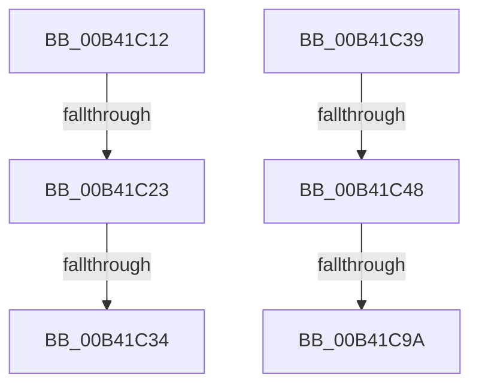

# sub_00B41C12

- RVA: `0x00B41C12`–`0x00B41CEA` (길이 `216` bytes)
- VA: `0x0000000140B41C12`
- 실행 섹션: `PAGE`
- PDB 이름 있음: `아니요`; PDB Function 태그: `아니요`
- unwind 정보 RVA: `0x000B6140`
- 디코드: `51`개 명령, `216/216` bytes 표시
- 미해석 바이트: `0` (있으면 어셈블리에 `.byte`로 보존)

> 이 문서는 커널 이미지의 기계어와 PDB 기호를 분석해 생성했습니다. 4번과 5번은 함수 원형과 자료형을 바이너리 사용 방식에서 추정한 C 해석이며 원본 소스 복구 결과는 아닙니다.

## 1. Dependencies

- 직접 호출 지점: **4**; 고유 호출 대상: **4**
- 직접 호출자로 확인된 함수: **0**
- RIP 상대 이미지 참조: **0**

### Outgoing calls
- `0x00B41C15` → [MiGetPteAddress](../../text/43/MiGetPteAddress_function_0043E130.md) (function, `0x0043E130`)
- `0x00B41C26` → [MI_READ_PTE_LOCK_FREE](../../text/28/MI_READ_PTE_LOCK_FREE_function_002828A0.md) (function, `0x002828A0`)
- `0x00B41C86` → [MiCheckSecuredVad](../88/MiCheckSecuredVad_function_00881FB4.md) (function, `0x00881FB4`)
- `0x00B41CDF` → [MiDeleteVirtualAddresses](../../text/2A/MiDeleteVirtualAddresses_function_002A9640.md) (function, `0x002A9640`)

### Direct callers
- 이 함수 시작 RVA로 연결되는 직접 call은 확인되지 않았습니다. 간접 호출은 완전히 역산할 수 없습니다.

### Static image references
- 디코드된 RIP-relative 메모리 참조가 없습니다.

## 2. Other-region calls and transfers

- 다른 실행 섹션으로 향하는 call: **3**
  - `0x00B41C15` → [MiGetPteAddress](../../text/43/MiGetPteAddress_function_0043E130.md) (`PAGE` → `.text`)
  - `0x00B41C26` → [MI_READ_PTE_LOCK_FREE](../../text/28/MI_READ_PTE_LOCK_FREE_function_002828A0.md) (`PAGE` → `.text`)
  - `0x00B41CDF` → [MiDeleteVirtualAddresses](../../text/2A/MiDeleteVirtualAddresses_function_002A9640.md) (`PAGE` → `.text`)
- call이 아닌 외부 분기/꼬리 이동: **6**
  - `0x00B41C1D` → [MiUnmapLockedPagesInUserSpace + 0xC4](../A7/MiUnmapLockedPagesInUserSpace_function_00A78E54.md) (`tail-transfer`)
  - `0x00B41C2E` → [MiUnmapLockedPagesInUserSpace + 0x11E](../A7/MiUnmapLockedPagesInUserSpace_function_00A78E54.md) (`tail-transfer`)
  - `0x00B41C34` → [MiUnmapLockedPagesInUserSpace + 0xC4](../A7/MiUnmapLockedPagesInUserSpace_function_00A78E54.md) (`tail-transfer`)
  - `0x00B41C42` → [MiUnmapLockedPagesInUserSpace + 0xEB](../A7/MiUnmapLockedPagesInUserSpace_function_00A78E54.md) (`tail-transfer`)
  - `0x00B41C94` → [MiUnmapLockedPagesInUserSpace + 0xEB](../A7/MiUnmapLockedPagesInUserSpace_function_00A78E54.md) (`tail-transfer`)
  - `0x00B41CE5` → [MiUnmapLockedPagesInUserSpace + 0x182](../A7/MiUnmapLockedPagesInUserSpace_function_00A78E54.md) (`tail-transfer`)

## 3. Assembly (complete function range)

```asm
00B41C12  49 8B CF                        mov rcx, r15
00B41C15  E8 16 C5 8F FF                  call 0x14043e130
00B41C1A  49 85 C2                        test r10, rax
00B41C1D  0F 84 F5 72 F3 FF               je 0x140a78f18
00B41C23  48 8B C8                        mov rcx, rax
00B41C26  E8 75 0C 74 FF                  call 0x1402828a0
00B41C2B  48 85 C0                        test rax, rax
00B41C2E  0F 85 3E 73 F3 FF               jne 0x140a78f72
00B41C34  E9 DF 72 F3 FF                  jmp 0x140a78f18
00B41C39  41 8B 85 F4 01 00 00            mov eax, dword ptr [r13 + 0x1f4]
00B41C40  A8 20                           test al, 0x20
00B41C42  0F 85 F7 72 F3 FF               jne 0x140a78f3f
00B41C48  8B 43 1C                        mov eax, dword ptr [rbx + 0x1c]
00B41C4B  41 B9 55 00 00 00               mov r9d, 0x55
00B41C51  44 0F B6 43 21                  movzx r8d, byte ptr [rbx + 0x21]
00B41C56  48 8B D5                        mov rdx, rbp
00B41C59  0F B6 4B 20                     movzx ecx, byte ptr [rbx + 0x20]
00B41C5D  48 83 64 24 28 00               and qword ptr [rsp + 0x28], 0
00B41C63  49 C1 E0 20                     shl r8, 0x20
00B41C67  4C 0B C0                        or r8, rax
00B41C6A  48 C1 E1 20                     shl rcx, 0x20
00B41C6E  8B 43 18                        mov eax, dword ptr [rbx + 0x18]
00B41C71  48 0B C8                        or rcx, rax
00B41C74  C6 44 24 20 00                  mov byte ptr [rsp + 0x20], 0
00B41C79  4C 2B C1                        sub r8, rcx
00B41C7C  48 8B CB                        mov rcx, rbx
00B41C7F  49 FF C0                        inc r8
00B41C82  49 C1 E0 0C                     shl r8, 0xc
00B41C86  E8 29 03 D4 FF                  call 0x140881fb4
00B41C8B  89 84 24 B0 00 00 00            mov dword ptr [rsp + 0xb0], eax
00B41C92  85 C0                           test eax, eax
00B41C94  0F 89 A5 72 F3 FF               jns 0x140a78f3f
00B41C9A  0F B6 53 21                     movzx edx, byte ptr [rbx + 0x21]
00B41C9E  4C 8D 4C 24 30                  lea r9, [rsp + 0x30]
00B41CA3  48 C1 E2 20                     shl rdx, 0x20
00B41CA7  0F 57 C0                        xorps xmm0, xmm0
00B41CAA  33 C0                           xor eax, eax
00B41CAC  41 B8 40 00 00 00               mov r8d, 0x40
00B41CB2  48 89 44 24 60                  mov qword ptr [rsp + 0x60], rax
00B41CB7  48 8B CD                        mov rcx, rbp
00B41CBA  8B 43 1C                        mov eax, dword ptr [rbx + 0x1c]
00B41CBD  48 0B D0                        or rdx, rax
00B41CC0  48 C1 E2 0C                     shl rdx, 0xc
00B41CC4  0F 11 44 24 50                  movups xmmword ptr [rsp + 0x50], xmm0
00B41CC9  48 81 CA FF 0F 00 00            or rdx, 0xfff
00B41CD0  48 89 5C 24 50                  mov qword ptr [rsp + 0x50], rbx
00B41CD5  0F 11 44 24 30                  movups xmmword ptr [rsp + 0x30], xmm0
00B41CDA  0F 11 44 24 40                  movups xmmword ptr [rsp + 0x40], xmm0
00B41CDF  E8 5C 79 76 FF                  call 0x1402a9640
00B41CE4  90                              nop
00B41CE5  E9 EC 72 F3 FF                  jmp 0x140a78fd6
```

## 4. C-style interpretation (structured pseudocode)

```c
__int64 __fastcall sub_00B41C12(void)
{
    __int64 result;
    unsigned __int8 v_stack_p20;
    unsigned __int64 v_stack_p28;
    unsigned __int64 v_stack_p30;
    unsigned __int64 v_stack_p40;
    unsigned __int64 v_stack_p50;
    unsigned __int64 v_stack_p60;
    unsigned int v_stack_pB0;

    result = MiGetPteAddress(v_r15, a2, a3, a4);
    result = MI_READ_PTE_LOCK_FREE(result, a2, a3, a4);
}
```

## 5. (Beta) C Style

```c
void sub_00B41C12(void)
{
    int64_t result;
    uint8_t v_stack_p20;
    uint64_t v_stack_p28;
    uint64_t v_stack_p30;
    uint64_t v_stack_p40;
    uint64_t v_stack_p50;
    uint64_t v_stack_p60;
    uint32_t v_stack_pB0;

    result = MiGetPteAddress(local_r15, a2, a3, a4);
    result = MI_READ_PTE_LOCK_FREE(result, a2, a3, a4);
}
```

## 6. Execution-region graph

[열기: 2D/3D 그래프와 함수 탐색 컨트롤 패널](../../../control-panel.html?section=page&rva=0x00B41C12&view=graph)

- 2D 그래프는 위에서 아래로 흐르고, 3D 그래프는 빈 공간을 드래그해 회전합니다. Shift+드래그는 이동, 휠은 확대·축소, 함수 노드 선택은 대상 보고서 이동입니다.

### Static fallback


