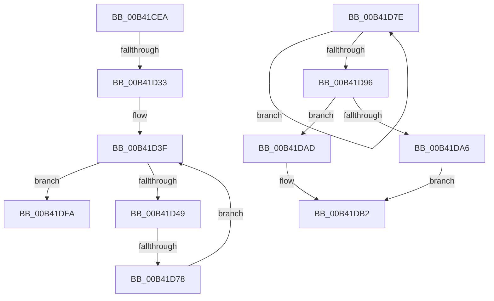

# sub_00B41CEA

- RVA: `0x00B41CEA`–`0x00B41E05` (길이 `283` bytes)
- VA: `0x0000000140B41CEA`
- 실행 섹션: `PAGE`
- PDB 이름 있음: `아니요`; PDB Function 태그: `아니요`
- unwind 정보 RVA: `0x000B61D4`
- 디코드: `72`개 명령, `283/283` bytes 표시
- 미해석 바이트: `0` (있으면 어셈블리에 `.byte`로 보존)

> 이 문서는 커널 이미지의 기계어와 PDB 기호를 분석해 생성했습니다. 4번과 5번은 함수 원형과 자료형을 바이너리 사용 방식에서 추정한 C 해석이며 원본 소스 복구 결과는 아닙니다.

## 1. Dependencies

- 직접 호출 지점: **7**; 고유 호출 대상: **5**
- 직접 호출자로 확인된 함수: **0**
- RIP 상대 이미지 참조: **0**

### Outgoing calls
- `0x00B41CEA` → [HvpReleaseCellPaged](../85/HvpReleaseCellPaged_function_00855F40.md) (function, `0x00855F40`)
- `0x00B41D20` → [HvReallocateCell](../85/HvReallocateCell_function_0085B5D0.md) (function, `0x0085B5D0`)
- `0x00B41D69` → [HvAllocateCell](../85/HvAllocateCell_function_00859C94.md) (function, `0x00859C94`)
- `0x00B41D87` → [HvFreeCell](../85/HvFreeCell_function_0085A72C.md) (function, `0x0085A72C`)
- `0x00B41DA6` → [HvpReleaseCellFlat](../85/HvpReleaseCellFlat_function_0085CC20.md) (function, `0x0085CC20`)
- `0x00B41DAD` → [HvpReleaseCellPaged](../85/HvpReleaseCellPaged_function_00855F40.md) (function, `0x00855F40`)
- `0x00B41DE5` → [HvReallocateCell](../85/HvReallocateCell_function_0085B5D0.md) (function, `0x0085B5D0`)

### Direct callers
- 이 함수 시작 RVA로 연결되는 직접 call은 확인되지 않았습니다. 간접 호출은 완전히 역산할 수 없습니다.

### Static image references
- 디코드된 RIP-relative 메모리 참조가 없습니다.

## 2. Other-region calls and transfers

- 다른 실행 섹션으로 향하는 call: **0**
- call이 아닌 외부 분기/꼬리 이동: **4**
  - `0x00B41D2D` → [CmpSetValueDataExisting + 0x13E](../A7/CmpSetValueDataExisting_function_00A79260.md) (`tail-transfer`)
  - `0x00B41D72` → [CmpSetValueDataExisting + 0x13E](../A7/CmpSetValueDataExisting_function_00A79260.md) (`tail-transfer`)
  - `0x00B41DF5` → [CmpSetValueDataExisting + 0xC1](../A7/CmpSetValueDataExisting_function_00A79260.md) (`tail-transfer`)
  - `0x00B41E00` → [CmpSetValueDataExisting + 0xC1](../A7/CmpSetValueDataExisting_function_00A79260.md) (`tail-transfer`)

## 3. Assembly (complete function range)

```asm
00B41CEA  E8 51 42 D1 FF                  call 0x140855f40
00B41CEF  41 8B 56 04                     mov edx, dword ptr [r14 + 4]
00B41CF3  48 8D 45 E0                     lea rax, [rbp - 0x20]
00B41CF7  48 89 44 24 30                  mov qword ptr [rsp + 0x30], rax
00B41CFC  41 B1 01                        mov r9b, 1
00B41CFF  48 8D 45 E8                     lea rax, [rbp - 0x18]
00B41D03  45 0F B7 C7                     movzx r8d, r15w
00B41D07  48 89 44 24 28                  mov qword ptr [rsp + 0x28], rax
00B41D0C  48 8B CB                        mov rcx, rbx
00B41D0F  48 8D 45 40                     lea rax, [rbp + 0x40]
00B41D13  41 C1 E0 02                     shl r8d, 2
00B41D17  48 89 44 24 20                  mov qword ptr [rsp + 0x20], rax
00B41D1C  48 89 7D E8                     mov qword ptr [rbp - 0x18], rdi
00B41D20  E8 AB 98 D1 FF                  call 0x14085b5d0
00B41D25  48 8B 75 E8                     mov rsi, qword ptr [rbp - 0x18]
00B41D29  8B F8                           mov edi, eax
00B41D2B  85 C0                           test eax, eax
00B41D2D  0F 88 6B 76 F3 FF               js 0x140a7939e
00B41D33  8B 45 40                        mov eax, dword ptr [rbp + 0x40]
00B41D36  45 0F B7 66 02                  movzx r12d, word ptr [r14 + 2]
00B41D3B  41 89 46 04                     mov dword ptr [r14 + 4], eax
00B41D3F  66 45 3B E7                     cmp r12w, r15w
00B41D43  0F 83 B1 00 00 00               jae 0x140b41dfa
00B41D49  44 8B 45 58                     mov r8d, dword ptr [rbp + 0x58]
00B41D4D  BA D8 3F 00 00                  mov edx, 0x3fd8
00B41D52  41 0F B7 C4                     movzx eax, r12w
00B41D56  48 8B CB                        mov rcx, rbx
00B41D59  4C 8D 0C 86                     lea r9, [rsi + rax*4]
00B41D5D  33 C0                           xor eax, eax
00B41D5F  48 89 44 24 28                  mov qword ptr [rsp + 0x28], rax
00B41D64  48 89 44 24 20                  mov qword ptr [rsp + 0x20], rax
00B41D69  E8 26 7F D1 FF                  call 0x140859c94
00B41D6E  8B F8                           mov edi, eax
00B41D70  85 C0                           test eax, eax
00B41D72  0F 88 26 76 F3 FF               js 0x140a7939e
00B41D78  66 41 FF C4                     inc r12w
00B41D7C  EB C1                           jmp 0x140b41d3f
00B41D7E  0F B7 D7                        movzx edx, di
00B41D81  48 8B CB                        mov rcx, rbx
00B41D84  8B 14 96                        mov edx, dword ptr [rsi + rdx*4]
00B41D87  E8 A0 89 D1 FF                  call 0x14085a72c
00B41D8C  66 FF C7                        inc di
00B41D8F  66 41 3B 7E 02                  cmp di, word ptr [r14 + 2]
00B41D94  72 E8                           jb 0x140b41d7e
00B41D96  F6 83 8C 00 00 00 01            test byte ptr [rbx + 0x8c], 1
00B41D9D  48 8D 55 E0                     lea rdx, [rbp - 0x20]
00B41DA1  48 8B CB                        mov rcx, rbx
00B41DA4  74 07                           je 0x140b41dad
00B41DA6  E8 75 AE D1 FF                  call 0x14085cc20
00B41DAB  EB 05                           jmp 0x140b41db2
00B41DAD  E8 8E 41 D1 FF                  call 0x140855f40
00B41DB2  41 8B 56 04                     mov edx, dword ptr [r14 + 4]
00B41DB6  48 8D 45 E0                     lea rax, [rbp - 0x20]
00B41DBA  48 89 44 24 30                  mov qword ptr [rsp + 0x30], rax
00B41DBF  33 FF                           xor edi, edi
00B41DC1  48 8D 45 E8                     lea rax, [rbp - 0x18]
00B41DC5  45 0F B7 C7                     movzx r8d, r15w
00B41DC9  48 89 44 24 28                  mov qword ptr [rsp + 0x28], rax
00B41DCE  41 B1 01                        mov r9b, 1
00B41DD1  48 8D 45 40                     lea rax, [rbp + 0x40]
00B41DD5  41 C1 E0 02                     shl r8d, 2
00B41DD9  48 8B CB                        mov rcx, rbx
00B41DDC  48 89 44 24 20                  mov qword ptr [rsp + 0x20], rax
00B41DE1  48 89 7D E8                     mov qword ptr [rbp - 0x18], rdi
00B41DE5  E8 E6 97 D1 FF                  call 0x14085b5d0
00B41DEA  8B 45 40                        mov eax, dword ptr [rbp + 0x40]
00B41DED  48 8B 75 E8                     mov rsi, qword ptr [rbp - 0x18]
00B41DF1  41 89 46 04                     mov dword ptr [r14 + 4], eax
00B41DF5  E9 27 75 F3 FF                  jmp 0x140a79321
00B41DFA  4C 8B 65 48                     mov r12, qword ptr [rbp + 0x48]
00B41DFE  33 FF                           xor edi, edi
00B41E00  E9 1C 75 F3 FF                  jmp 0x140a79321
```

## 4. C-style interpretation (structured pseudocode)

```c
__int64 __fastcall sub_00B41CEA(void)
{
    __int64 result;
    __int64 v_r12;
    __int64 v_rdi;
    unsigned __int64 v_stack_p20;
    unsigned __int64 v_stack_p28;
    unsigned __int64 v_stack_p30;

    result = HvpReleaseCellPaged(a1, a2, a3, a4);
    v_stack_p30 = v_rbp - 32;
    v_stack_p28 = v_rbp - 24;
    a3 = (unsigned int)(((unsigned __int16)(v_r15)) << (2));
    v_stack_p20 = v_rbp + 64;
    *(unsigned __int64 *)(v_rbp - 24) = v_rdi;
    result = HvReallocateCell(v_rbx, (unsigned int)(*(unsigned int *)(v_r14 + 4)), a3, 1);
    *(unsigned int *)(v_r14 + 4) = (unsigned int)((unsigned int)(*(unsigned int *)(v_rbp + 64)));
loc_00B41D3F:
    if (((unsigned __int16)(*(unsigned __int16 *)(v_r14 + 2))) >= ((unsigned __int16)(v_r15))) goto loc_00B41DFA;
    result = 0;
    v_stack_p28 = 0;
    v_stack_p20 = 0;
    result = HvAllocateCell(v_rbx, (unsigned int)(0x3FD8ULL), (unsigned int)(*(unsigned int *)(v_rbp + 88)), *(unsigned __int64 *)(v_rbp - 24) + (unsigned __int16)(*(unsigned __int16 *)(v_r14 + 2)) * 4);
    v_r12 = (unsigned __int16)((*(unsigned __int16 *)(v_r14 + 2)) + 1);
    goto loc_00B41D3F;
loc_00B41DFA:
    v_rdi = 0;
}
```

## 5. (Beta) C Style

```c
void sub_00B41CEA(void)
{
    int64_t result;
    int64_t local_r12;
    int64_t local_rdi;
    uint64_t v_stack_p20;
    uint64_t v_stack_p28;
    uint64_t v_stack_p30;

    result = HvpReleaseCellPaged(a1, a2, a3, a4);
    v_stack_p30 = local_rbp - 32;
    v_stack_p28 = local_rbp - 24;
    a3 = (uint32_t)(((uint16_t)(local_r15)) << (2));
    v_stack_p20 = local_rbp + 64;
    *(uint64_t *)(local_rbp - 0x18) = local_rdi;
    result = HvReallocateCell(local_rbx, (uint32_t)(*(uint32_t *)(local_r14 + 0x4)), a3, 1);
    *(uint32_t *)(local_r14 + 0x4) = (uint32_t)((uint32_t)(*(uint32_t *)(local_rbp + 0x40)));
loc_00B41D3F:
    if (((uint16_t)(*(uint16_t *)(local_r14 + 0x2))) >= ((uint16_t)(local_r15))) goto loc_00B41DFA;
    result = 0;
    v_stack_p28 = 0;
    v_stack_p20 = 0;
    result = HvAllocateCell(local_rbx, (uint32_t)(0x3FD8ULL), (uint32_t)(*(uint32_t *)(local_rbp + 0x58)), *(uint64_t *)(local_rbp - 0x18) + (uint16_t)(*(uint16_t *)(local_r14 + 0x2)) * 4);
    local_r12 = (uint16_t)((*(uint16_t *)(local_r14 + 0x2)) + 1);
    goto loc_00B41D3F;
loc_00B41DFA:
    local_rdi = 0;
}
```

## 6. Execution-region graph

[열기: 2D/3D 그래프와 함수 탐색 컨트롤 패널](../../../control-panel.html?section=page&rva=0x00B41CEA&view=graph)

- 2D 그래프는 위에서 아래로 흐르고, 3D 그래프는 빈 공간을 드래그해 회전합니다. Shift+드래그는 이동, 휠은 확대·축소, 함수 노드 선택은 대상 보고서 이동입니다.

### Static fallback


