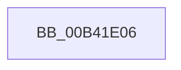

# sub_00B41E06

- RVA: `0x00B41E06`–`0x00B41E91` (길이 `139` bytes)
- VA: `0x0000000140B41E06`
- 실행 섹션: `PAGE`
- PDB 이름 있음: `아니요`; PDB Function 태그: `아니요`
- unwind 정보 RVA: `0x000B6224`
- 디코드: `32`개 명령, `139/139` bytes 표시
- 미해석 바이트: `0` (있으면 어셈블리에 `.byte`로 보존)

> 이 문서는 커널 이미지의 기계어와 PDB 기호를 분석해 생성했습니다. 4번과 5번은 함수 원형과 자료형을 바이너리 사용 방식에서 추정한 C 해석이며 원본 소스 복구 결과는 아닙니다.

## 1. Dependencies

- 직접 호출 지점: **4**; 고유 호출 대상: **3**
- 직접 호출자로 확인된 함수: **0**
- RIP 상대 이미지 참조: **1**

### Outgoing calls
- `0x00B41E2D` → [EtwpTiFillProcessIdentity](../../text/3B/EtwpTiFillProcessIdentity_function_003B8F30.md) (function, `0x003B8F30`)
- `0x00B41E48` → [EtwpTiFillThreadIdentity](../../text/47/EtwpTiFillThreadIdentity_function_00471C1C.md) (function, `0x00471C1C`)
- `0x00B41E67` → [EtwpTiFillProcessIdentity](../../text/3B/EtwpTiFillProcessIdentity_function_003B8F30.md) (function, `0x003B8F30`)
- `0x00B41E86` → [EtwWrite](../../text/41/EtwWrite_function_0041C720.md) (function, `0x0041C720`)

### Direct callers
- 이 함수 시작 RVA로 연결되는 직접 call은 확인되지 않았습니다. 간접 호출은 완전히 역산할 수 없습니다.

### Static image references
- `0x00B41E6C` → RVA `0x00EFFA30` (`.data`; read)

## 2. Other-region calls and transfers

- 다른 실행 섹션으로 향하는 call: **4**
  - `0x00B41E2D` → [EtwpTiFillProcessIdentity](../../text/3B/EtwpTiFillProcessIdentity_function_003B8F30.md) (`PAGE` → `.text`)
  - `0x00B41E48` → [EtwpTiFillThreadIdentity](../../text/47/EtwpTiFillThreadIdentity_function_00471C1C.md) (`PAGE` → `.text`)
  - `0x00B41E67` → [EtwpTiFillProcessIdentity](../../text/3B/EtwpTiFillProcessIdentity_function_003B8F30.md) (`PAGE` → `.text`)
  - `0x00B41E86` → [EtwWrite](../../text/41/EtwWrite_function_0041C720.md) (`PAGE` → `.text`)
- call이 아닌 외부 분기/꼬리 이동: **1**
  - `0x00B41E8C` → [EtwTiLogSuspendResumeProcess + 0x44](../A7/EtwTiLogSuspendResumeProcess_function_00A7956C.md) (`tail-transfer`)

## 3. Assembly (complete function range)

```asm
00B41E06  83 64 24 4C 00                  and dword ptr [rsp + 0x4c], 0
00B41E0B  48 8D 84 24 60 01 00 00         lea rax, [rsp + 0x160]
00B41E13  4C 8D 44 24 30                  lea r8, [rsp + 0x30]
00B41E18  48 89 44 24 40                  mov qword ptr [rsp + 0x40], rax
00B41E1D  48 8B D6                        mov rdx, rsi
00B41E20  C7 44 24 48 04 00 00 00         mov dword ptr [rsp + 0x48], 4
00B41E28  48 8D 4C 24 50                  lea rcx, [rsp + 0x50]
00B41E2D  E8 FE 70 87 FF                  call 0x1403b8f30
00B41E32  48 8D 4C 24 40                  lea rcx, [rsp + 0x40]
00B41E37  48 8B D7                        mov rdx, rdi
00B41E3A  44 8D 48 01                     lea r9d, [rax + 1]
00B41E3E  41 8B C1                        mov eax, r9d
00B41E41  48 C1 E0 04                     shl rax, 4
00B41E45  48 03 C8                        add rcx, rax
00B41E48  E8 CF FD 92 FF                  call 0x140471c1c
00B41E4D  44 03 C8                        add r9d, eax
00B41E50  48 8D 4C 24 40                  lea rcx, [rsp + 0x40]
00B41E55  41 8B C1                        mov eax, r9d
00B41E58  4C 8D 44 24 38                  lea r8, [rsp + 0x38]
00B41E5D  48 C1 E0 04                     shl rax, 4
00B41E61  48 8B D5                        mov rdx, rbp
00B41E64  48 03 C8                        add rcx, rax
00B41E67  E8 C4 70 87 FF                  call 0x1403b8f30
00B41E6C  48 8B 0D BD DB 3B 00            mov rcx, qword ptr [rip + 0x3bdbbd]
00B41E73  44 03 C8                        add r9d, eax
00B41E76  48 8D 44 24 40                  lea rax, [rsp + 0x40]
00B41E7B  45 33 C0                        xor r8d, r8d
00B41E7E  48 8B D3                        mov rdx, rbx
00B41E81  48 89 44 24 20                  mov qword ptr [rsp + 0x20], rax
00B41E86  E8 95 A8 8D FF                  call 0x14041c720
00B41E8B  90                              nop
00B41E8C  E9 1F 77 F3 FF                  jmp 0x140a795b0
```

## 4. C-style interpretation (structured pseudocode)

```c
__int64 __fastcall sub_00B41E06(__int64 a1, __int64 a2, __int64 a3, __int64 a4, __int64 a5, __int64 a6, __int64 a7, __int64 a8, __int64 a9, __int64 a10, __int64 a11, __int64 a12, __int64 a13, __int64 a14, __int64 a15, __int64 a16, __int64 a17, __int64 a18, __int64 a19, __int64 a20, __int64 a21, __int64 a22, __int64 a23, __int64 a24, __int64 a25, __int64 a26, __int64 a27, __int64 a28, __int64 a29, __int64 a30, __int64 a31, __int64 a32, __int64 a33, __int64 a34, __int64 a35, __int64 a36, __int64 a37, __int64 a38, __int64 a39, __int64 a40, __int64 a41, __int64 a42, __int64 a43, __int64 a44)
{
    __int64 result;
    unsigned __int64 v_stack_p20;
    unsigned __int64 v_stack_p40;
    unsigned int v_stack_p48;
    unsigned int v_stack_p4C;

    v_stack_p40 = a44;
    v_stack_p48 = 4;
    result = EtwpTiFillProcessIdentity(a10, v_rsi, a6, a4);
    result = ((unsigned int)((unsigned int)(result + 1))) << (4);
    a1 = (a8) + (result);
    result = EtwpTiFillThreadIdentity(a1, v_rdi, a6, result + 1);
    a4 = (unsigned int)((result + 1) + ((unsigned int)(result)));
    result = ((unsigned int)((unsigned int)(a4))) << (4);
    a1 = (a8) + (result);
    result = EtwpTiFillProcessIdentity(a1, v_rbp, a7, a4);
    a4 = (unsigned int)((a4) + ((unsigned int)(result)));
    a3 = 0;
    v_stack_p20 = a8;
    result = EtwWrite(*(unsigned __int64 *)(v_rip + 3922877), v_rbx, a3, a4);
}
```

## 5. (Beta) C Style

```c
int64_t sub_00B41E06(int64_t Arg1, int64_t Arg2, int64_t Arg3, int64_t Arg4, uint64_t Arg5, int64_t Arg6, int64_t Arg7, int64_t Arg8, uint64_t Arg9, int64_t Arg10, uint64_t Arg11, uint64_t Arg12, uint64_t Arg13, uint64_t Arg14, uint64_t Arg15, uint64_t Arg16, uint64_t Arg17, uint64_t Arg18, uint64_t Arg19, uint64_t Arg20, uint64_t Arg21, uint64_t Arg22, uint64_t Arg23, uint64_t Arg24, uint64_t Arg25, uint64_t Arg26, uint64_t Arg27, uint64_t Arg28, uint64_t Arg29, uint64_t Arg30, uint64_t Arg31, uint64_t Arg32, uint64_t Arg33, uint64_t Arg34, uint64_t Arg35, uint64_t Arg36, uint64_t Arg37, uint64_t Arg38, uint64_t Arg39, uint64_t Arg40, uint64_t Arg41, uint64_t Arg42, uint64_t Arg43, int64_t Arg44)
{
    int64_t result;
    uint64_t v_stack_p20;
    uint64_t v_stack_p40;
    uint32_t v_stack_p48;
    uint32_t v_stack_p4C;

    v_stack_p40 = Arg44;
    v_stack_p48 = 4;
    result = EtwpTiFillProcessIdentity(Arg10, local_rsi, Arg6, Arg4);
    result = ((uint32_t)((uint32_t)(result + 1))) << (4);
    Arg1 = (Arg8) + (result);
    result = EtwpTiFillThreadIdentity(Arg1, local_rdi, Arg6, result + 1);
    Arg4 = (uint32_t)((result + 1) + ((uint32_t)(result)));
    result = ((uint32_t)((uint32_t)(Arg4))) << (4);
    Arg1 = (Arg8) + (result);
    result = EtwpTiFillProcessIdentity(Arg1, local_rbp, Arg7, Arg4);
    Arg4 = (uint32_t)((Arg4) + ((uint32_t)(result)));
    Arg3 = 0;
    v_stack_p20 = Arg8;
    result = EtwWrite(*(uint64_t *)(v_rip + 0x3BDBBD), local_rbx, Arg3, Arg4);
}
```

## 6. Execution-region graph

[열기: 2D/3D 그래프와 함수 탐색 컨트롤 패널](../../../control-panel.html?section=page&rva=0x00B41E06&view=graph)

- 2D 그래프는 위에서 아래로 흐르고, 3D 그래프는 빈 공간을 드래그해 회전합니다. Shift+드래그는 이동, 휠은 확대·축소, 함수 노드 선택은 대상 보고서 이동입니다.

### Static fallback


