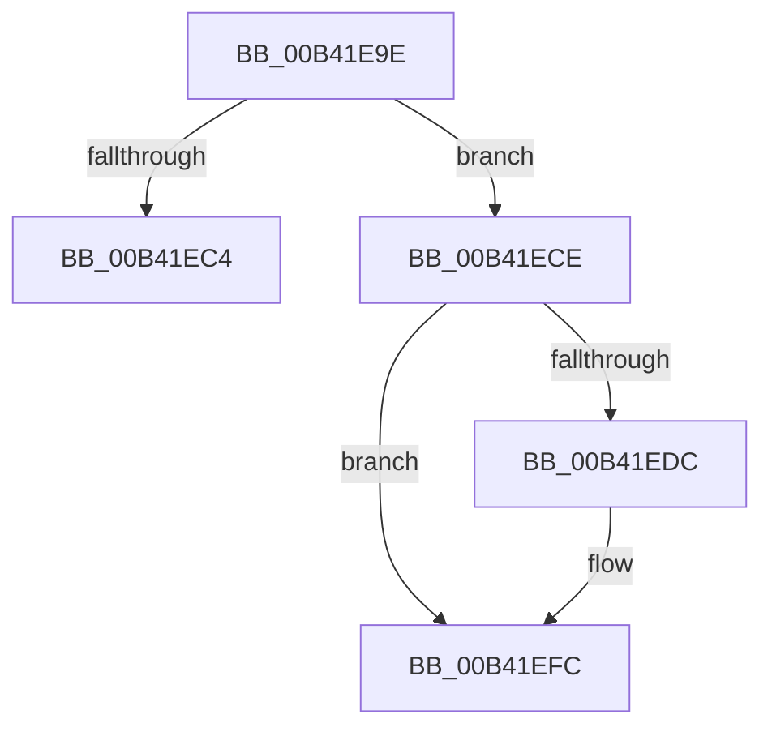

# sub_00B41E9E

- RVA: `0x00B41E9E`–`0x00B41F0A` (길이 `108` bytes)
- VA: `0x0000000140B41E9E`
- 실행 섹션: `PAGE`
- PDB 이름 있음: `아니요`; PDB Function 태그: `아니요`
- unwind 정보 RVA: `0x000B6280`
- 디코드: `28`개 명령, `108/108` bytes 표시
- 미해석 바이트: `0` (있으면 어셈블리에 `.byte`로 보존)

> 이 문서는 커널 이미지의 기계어와 PDB 기호를 분석해 생성했습니다. 4번과 5번은 함수 원형과 자료형을 바이너리 사용 방식에서 추정한 C 해석이며 원본 소스 복구 결과는 아닙니다.

## 1. Dependencies

- 직접 호출 지점: **3**; 고유 호출 대상: **3**
- 직접 호출자로 확인된 함수: **0**
- RIP 상대 이미지 참조: **0**

### Outgoing calls
- `0x00B41EB7` → [ExAllocatePool2](../../poolcode/B8/ExAllocatePool2_function_00B820F0.md) (function, `0x00B820F0`)
- `0x00B41EEA` → [memcpy](../../text/6C/memcpy_function_006C6840.md) (function, `0x006C6840`)
- `0x00B41EF4` → [ExFreePoolWithTag](../../poolcode/B8/ExFreePoolWithTag_function_00B82870.md) (function, `0x00B82870`)

### Direct callers
- 이 함수 시작 RVA로 연결되는 직접 call은 확인되지 않았습니다. 간접 호출은 완전히 역산할 수 없습니다.

### Static image references
- 디코드된 RIP-relative 메모리 참조가 없습니다.

## 2. Other-region calls and transfers

- 다른 실행 섹션으로 향하는 call: **3**
  - `0x00B41EB7` → [ExAllocatePool2](../../poolcode/B8/ExAllocatePool2_function_00B820F0.md) (`PAGE` → `POOLCODE`)
  - `0x00B41EEA` → [memcpy](../../text/6C/memcpy_function_006C6840.md) (`PAGE` → `.text`)
  - `0x00B41EF4` → [ExFreePoolWithTag](../../poolcode/B8/ExFreePoolWithTag_function_00B82870.md) (`PAGE` → `POOLCODE`)
- call이 아닌 외부 분기/꼬리 이동: **2**
  - `0x00B41EC9` → [PiPnpAddDeviceToPdoDeviceListEnumContext + 0x3E](../A7/PiPnpAddDeviceToPdoDeviceListEnumContext_function_00A79874.md) (`tail-transfer`)
  - `0x00B41F05` → [PiPnpAddDeviceToPdoDeviceListEnumContext + 0x30](../A7/PiPnpAddDeviceToPdoDeviceListEnumContext_function_00A79874.md) (`tail-transfer`)

## 3. Assembly (complete function range)

```asm
00B41E9E  44 8B 31                        mov r14d, dword ptr [rcx]
00B41EA1  41 B8 50 70 20 20               mov r8d, 0x20207050
00B41EA7  B9 00 01 00 00                  mov ecx, 0x100
00B41EAC  44 03 F1                        add r14d, ecx
00B41EAF  4A 8D 14 F5 08 00 00 00         lea rdx, [r14*8 + 8]
00B41EB7  E8 34 02 04 00                  call 0x140b820f0
00B41EBC  48 8B D8                        mov rbx, rax
00B41EBF  48 85 C0                        test rax, rax
00B41EC2  75 0A                           jne 0x140b41ece
00B41EC4  B8 9A 00 00 C0                  mov eax, 0xc000009a
00B41EC9  E9 E4 79 F3 FF                  jmp 0x140a798b2
00B41ECE  83 20 00                        and dword ptr [rax], 0
00B41ED1  48 8B C7                        mov rax, rdi
00B41ED4  48 8B 17                        mov rdx, qword ptr [rdi]
00B41ED7  48 85 D2                        test rdx, rdx
00B41EDA  74 20                           je 0x140b41efc
00B41EDC  44 8B 06                        mov r8d, dword ptr [rsi]
00B41EDF  48 8B CB                        mov rcx, rbx
00B41EE2  4E 8D 04 C5 08 00 00 00         lea r8, [r8*8 + 8]
00B41EEA  E8 51 49 B8 FF                  call 0x1406c6840
00B41EEF  48 8B 0F                        mov rcx, qword ptr [rdi]
00B41EF2  33 D2                           xor edx, edx
00B41EF4  E8 77 09 04 00                  call 0x140b82870
00B41EF9  48 8B C5                        mov rax, rbp
00B41EFC  48 89 1F                        mov qword ptr [rdi], rbx
00B41EFF  48 8B F8                        mov rdi, rax
00B41F02  44 89 36                        mov dword ptr [rsi], r14d
00B41F05  E9 9A 79 F3 FF                  jmp 0x140a798a4
```

## 4. C-style interpretation (structured pseudocode)

```c
__int64 __fastcall sub_00B41E9E(__int64 a1)
{
    __int64 result;
    __int64 v_r14;

    v_r14 = (unsigned int)(((unsigned int)(*(unsigned int *)(a1))) + (256));
    result = ExAllocatePool2(256, v_r14 * 8 + 8, (unsigned int)(0x20207050ULL), a4);
    if (result != 0) goto loc_00B41ECE;
loc_00B41ECE:
    result = v_rdi;
    if (*(unsigned __int64 *)(v_rdi) != 0) {
        a3 = *(unsigned int *)(v_rsi);
        a1 = result;
        a3 = a3 * 8 + 8;
        result = memcpy(a1, *(unsigned __int64 *)(v_rdi), a3, a4);
        a1 = *(unsigned __int64 *)(v_rdi);
        a2 = 0;
        result = ExFreePoolWithTag(a1, a2, a3, a4);
        result = v_rbp;
    }
    *(unsigned __int64 *)(v_rdi) = result;
    *(unsigned int *)(v_rsi) = (unsigned int)(v_r14);
}
```

## 5. (Beta) C Style

```c
int64_t sub_00B41E9E(void *Arg1)
{
    uint8_t *arg1 = (uint8_t *)Arg1;

    int64_t result;
    int64_t local_r14;

    local_r14 = (uint32_t)(((uint32_t)(*(uint32_t *)(arg1))) + (256));
    result = ExAllocatePool2(256, local_r14 * 8 + 8, (uint32_t)(0x20207050ULL), a4);
    if (result != 0) goto loc_00B41ECE;
loc_00B41ECE:
    result = local_rdi;
    if (*(uint64_t *)(local_rdi) != 0) {
        a3 = *(uint32_t *)(local_rsi);
        Arg1 = result;
        a3 = a3 * 8 + 8;
        result = memcpy(Arg1, *(uint64_t *)(local_rdi), a3, a4);
        Arg1 = *(uint64_t *)(local_rdi);
        a2 = 0;
        result = ExFreePoolWithTag(Arg1, a2, a3, a4);
        result = local_rbp;
    }
    *(uint64_t *)(local_rdi) = result;
    *(uint32_t *)(local_rsi) = (uint32_t)(local_r14);
}
```

### 관측된 메모리 오프셋

구조체 형식이 확인되지 않은 접근은 인자 기준의 오프셋으로만 기록했습니다.

| 기준 인자 | 오프셋 표현 | 폭 (bit) | 접근 |
|---|---:|---:|---|
| `Arg1` | `+ 0x0` | `32` | `R` |

## 6. Execution-region graph

[열기: 2D/3D 그래프와 함수 탐색 컨트롤 패널](../../../control-panel.html?section=page&rva=0x00B41E9E&view=graph)

- 2D 그래프는 위에서 아래로 흐르고, 3D 그래프는 빈 공간을 드래그해 회전합니다. Shift+드래그는 이동, 휠은 확대·축소, 함수 노드 선택은 대상 보고서 이동입니다.

### Static fallback


