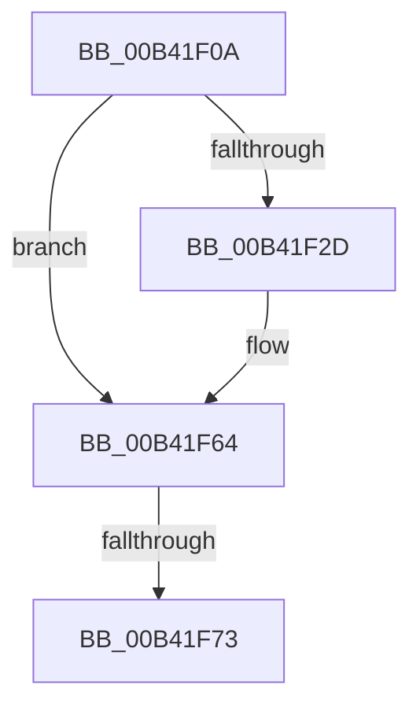

# sub_00B41F0A

- RVA: `0x00B41F0A`–`0x00B41F78` (길이 `110` bytes)
- VA: `0x0000000140B41F0A`
- 실행 섹션: `PAGE`
- PDB 이름 있음: `아니요`; PDB Function 태그: `아니요`
- unwind 정보 RVA: `0x000B62AC`
- 디코드: `25`개 명령, `110/110` bytes 표시
- 미해석 바이트: `0` (있으면 어셈블리에 `.byte`로 보존)

> 이 문서는 커널 이미지의 기계어와 PDB 기호를 분석해 생성했습니다. 4번과 5번은 함수 원형과 자료형을 바이너리 사용 방식에서 추정한 C 해석이며 원본 소스 복구 결과는 아닙니다.

## 1. Dependencies

- 직접 호출 지점: **1**; 고유 호출 대상: **1**
- 직접 호출자로 확인된 함수: **0**
- RIP 상대 이미지 참조: **0**

### Outgoing calls
- `0x00B41F54` → [memcpy](../../text/6C/memcpy_function_006C6840.md) (function, `0x006C6840`)

### Direct callers
- 이 함수 시작 RVA로 연결되는 직접 call은 확인되지 않았습니다. 간접 호출은 완전히 역산할 수 없습니다.

### Static image references
- 디코드된 RIP-relative 메모리 참조가 없습니다.

## 2. Other-region calls and transfers

- 다른 실행 섹션으로 향하는 call: **1**
  - `0x00B41F54` → [memcpy](../../text/6C/memcpy_function_006C6840.md) (`PAGE` → `.text`)
- call이 아닌 외부 분기/꼬리 이동: **2**
  - `0x00B41F6D` → [PpmIdleGetConcurrencyStats + 0x142](../A7/PpmIdleGetConcurrencyStats_function_00A798E4.md) (`tail-transfer`)
  - `0x00B41F73` → [PpmIdleGetConcurrencyStats + 0x14B](../A7/PpmIdleGetConcurrencyStats_function_00A798E4.md) (`tail-transfer`)

## 3. Assembly (complete function range)

```asm
00B41F0A  48 8B 86 08 05 00 00            mov rax, qword ptr [rsi + 0x508]
00B41F11  48 8D 0C AD 00 00 00 00         lea rcx, [rbp*4]
00B41F19  48 03 CD                        add rcx, rbp
00B41F1C  48 C1 E1 07                     shl rcx, 7
00B41F20  4C 8B AC 01 38 02 00 00         mov r13, qword ptr [rcx + rax + 0x238]
00B41F28  4D 85 ED                        test r13, r13
00B41F2B  74 37                           je 0x140b41f64
00B41F2D  41 8B 5D 08                     mov ebx, dword ptr [r13 + 8]
00B41F31  49 8D 95 48 01 00 00            lea rdx, [r13 + 0x148]
00B41F38  8B 44 24 20                     mov eax, dword ptr [rsp + 0x20]
00B41F3C  FF C3                           inc ebx
00B41F3E  48 FF C0                        inc rax
00B41F41  44 8B C3                        mov r8d, ebx
00B41F44  49 C1 E0 03                     shl r8, 3
00B41F48  C7 44 24 24 01 00 00 00         mov dword ptr [rsp + 0x24], 1
00B41F50  48 8D 0C C7                     lea rcx, [rdi + rax*8]
00B41F54  E8 E7 48 B8 FF                  call 0x1406c6840
00B41F59  41 8B 45 08                     mov eax, dword ptr [r13 + 8]
00B41F5D  01 5C 24 20                     add dword ptr [rsp + 0x20], ebx
00B41F61  89 04 AF                        mov dword ptr [rdi + rbp*4], eax
00B41F64  43 0F B6 04 37                  movzx eax, byte ptr [r15 + r14]
00B41F69  FF C5                           inc ebp
00B41F6B  3B E8                           cmp ebp, eax
00B41F6D  0F 82 B3 7A F3 FF               jb 0x140a79a26
00B41F73  E9 B7 7A F3 FF                  jmp 0x140a79a2f
```

## 4. C-style interpretation (structured pseudocode)

```c
__int64 __fastcall sub_00B41F0A(void)
{
    __int64 result;
    __int64 v_rbp;
    __int64 v_rbx;
    unsigned int v_stack_p20;
    unsigned int v_stack_p24;

    a1 = (v_rbp * 4) + (v_rbp);
    a1 = (a1) << (7);
    result = *(unsigned __int64 *)(v_rsi + 1288);
    if (*(unsigned __int64 *)(a1 + *(unsigned __int64 *)(v_rsi + 1288) * 1 + 568) != 0) {
        v_rbx = *(unsigned int *)(*(unsigned __int64 *)(a1 + *(unsigned __int64 *)(v_rsi + 1288) * 1 + 568) + 8);
        a2 = *(unsigned __int64 *)(a1 + *(unsigned __int64 *)(v_rsi + 1288) * 1 + 568) + 328;
        result = v_stack_p20;
        v_rbx = (unsigned int)((v_rbx) + 1);
        result = (result) + 1;
        a3 = (unsigned int)(v_rbx);
        a3 = (a3) << (3);
        v_stack_p24 = 1;
        a1 = v_rdi + result * 8;
        result = memcpy(a1, a2, a3, a4);
        result = *(unsigned int *)(*(unsigned __int64 *)(a1 + *(unsigned __int64 *)(v_rsi + 1288) * 1 + 568) + 8);
        *(unsigned int *)(v_rdi + v_rbp * 4) = (unsigned int)(result);
    }
    v_rbp = (unsigned int)((v_rbp) + 1);
}
```

## 5. (Beta) C Style

```c
void sub_00B41F0A(void)
{
    int64_t result;
    int64_t local_rbp;
    int64_t local_rbx;
    uint32_t v_stack_p20;
    uint32_t v_stack_p24;

    a1 = (local_rbp * 4) + (local_rbp);
    a1 = (a1) << (7);
    result = *(uint64_t *)(local_rsi + 0x508);
    if (*(uint64_t *)(a1 + *(uint64_t *)(local_rsi + 0x508) * 1 + 0x238) != 0) {
        local_rbx = *(uint32_t *)(*(uint64_t *)(a1 + *(uint64_t *)(local_rsi + 0x508) * 1 + 0x238) + 0x8);
        a2 = *(uint64_t *)(a1 + *(uint64_t *)(local_rsi + 0x508) * 1 + 0x238) + 328;
        result = v_stack_p20;
        local_rbx = (uint32_t)((local_rbx) + 1);
        result = (result) + 1;
        a3 = (uint32_t)(local_rbx);
        a3 = (a3) << (3);
        v_stack_p24 = 1;
        a1 = local_rdi + result * 8;
        result = memcpy(a1, a2, a3, a4);
        result = *(uint32_t *)(*(uint64_t *)(a1 + *(uint64_t *)(local_rsi + 0x508) * 1 + 0x238) + 0x8);
        *(uint32_t *)(local_rdi + local_rbp * 4) = (uint32_t)(result);
    }
    local_rbp = (uint32_t)((local_rbp) + 1);
}
```

## 6. Execution-region graph

[열기: 2D/3D 그래프와 함수 탐색 컨트롤 패널](../../../control-panel.html?section=page&rva=0x00B41F0A&view=graph)

- 2D 그래프는 위에서 아래로 흐르고, 3D 그래프는 빈 공간을 드래그해 회전합니다. Shift+드래그는 이동, 휠은 확대·축소, 함수 노드 선택은 대상 보고서 이동입니다.

### Static fallback


