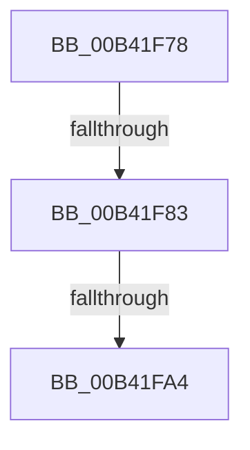

# sub_00B41F78

- RVA: `0x00B41F78`–`0x00B41FE2` (길이 `106` bytes)
- VA: `0x0000000140B41F78`
- 실행 섹션: `PAGE`
- PDB 이름 있음: `아니요`; PDB Function 태그: `아니요`
- unwind 정보 RVA: `0x000B62D4`
- 디코드: `22`개 명령, `106/106` bytes 표시
- 미해석 바이트: `0` (있으면 어셈블리에 `.byte`로 보존)

> 이 문서는 커널 이미지의 기계어와 PDB 기호를 분석해 생성했습니다. 4번과 5번은 함수 원형과 자료형을 바이너리 사용 방식에서 추정한 C 해석이며 원본 소스 복구 결과는 아닙니다.

## 1. Dependencies

- 직접 호출 지점: **1**; 고유 호출 대상: **1**
- 직접 호출자로 확인된 함수: **0**
- RIP 상대 이미지 참조: **0**

### Outgoing calls
- `0x00B41F93` → [ExAllocatePool2](../../poolcode/B8/ExAllocatePool2_function_00B820F0.md) (function, `0x00B820F0`)

### Direct callers
- 이 함수 시작 RVA로 연결되는 직접 call은 확인되지 않았습니다. 간접 호출은 완전히 역산할 수 없습니다.

### Static image references
- 디코드된 RIP-relative 메모리 참조가 없습니다.

## 2. Other-region calls and transfers

- 다른 실행 섹션으로 향하는 call: **1**
  - `0x00B41F93` → [ExAllocatePool2](../../poolcode/B8/ExAllocatePool2_function_00B820F0.md) (`PAGE` → `POOLCODE`)
- call이 아닌 외부 분기/꼬리 이동: **3**
  - `0x00B41F7D` → [EtwpTrackDecodeGuidForSession + 0xAE](../A7/EtwpTrackDecodeGuidForSession_function_00A79B24.md) (`tail-transfer`)
  - `0x00B41F9E` → [EtwpTrackDecodeGuidForSession + 0xAE](../A7/EtwpTrackDecodeGuidForSession_function_00A79B24.md) (`tail-transfer`)
  - `0x00B41FDD` → [EtwpTrackDecodeGuidForSession + 0xAE](../A7/EtwpTrackDecodeGuidForSession_function_00A79B24.md) (`tail-transfer`)

## 3. Assembly (complete function range)

```asm
00B41F78  3D 00 00 01 00                  cmp eax, 0x10000
00B41F7D  0F 87 4F 7C F3 FF               ja 0x140a79bd2
00B41F83  BA 30 00 00 00                  mov edx, 0x30
00B41F88  B9 00 01 00 00                  mov ecx, 0x100
00B41F8D  41 B8 45 74 77 62               mov r8d, 0x62777445
00B41F93  E8 58 01 04 00                  call 0x140b820f0
00B41F98  48 8B C8                        mov rcx, rax
00B41F9B  48 85 C0                        test rax, rax
00B41F9E  0F 84 2E 7C F3 FF               je 0x140a79bd2
00B41FA4  48 8B 47 70                     mov rax, qword ptr [rdi + 0x70]
00B41FA8  48 89 01                        mov qword ptr [rcx], rax
00B41FAB  41 0F 10 47 22                  movups xmm0, xmmword ptr [r15 + 0x22]
00B41FB0  F3 0F 7F 41 08                  movdqu xmmword ptr [rcx + 8], xmm0
00B41FB5  41 0F 10 4E 28                  movups xmm1, xmmword ptr [r14 + 0x28]
00B41FBA  88 59 28                        mov byte ptr [rcx + 0x28], bl
00B41FBD  F3 0F 7F 49 18                  movdqu xmmword ptr [rcx + 0x18], xmm1
00B41FC2  FF 47 78                        inc dword ptr [rdi + 0x78]
00B41FC5  83 87 44 01 00 00 20            add dword ptr [rdi + 0x144], 0x20
00B41FCC  48 89 4F 70                     mov qword ptr [rdi + 0x70], rcx
00B41FD0  F0 81 8F 38 03 00 00 C0 08 00 00  lock or dword ptr [rdi + 0x338], 0x8c0
00B41FDB  B3 01                           mov bl, 1
00B41FDD  E9 F0 7B F3 FF                  jmp 0x140a79bd2
```

## 4. C-style interpretation (structured pseudocode)

```c
__int64 __fastcall sub_00B41F78(void)
{
    __int64 result;

    result = ExAllocatePool2(256, 48, (unsigned int)(0x62777445ULL), a4);
    *(unsigned __int64 *)(result) = *(unsigned __int64 *)(v_rdi + 112);
    *(unsigned __int64 *)(result + 8) = v_xmm0;
    *(unsigned __int8 *)(result + 40) = (unsigned __int8)(v_rbx);
    *(unsigned __int64 *)(result + 24) = v_xmm1;
    *(unsigned __int64 *)(v_rdi + 112) = result;
}
```

## 5. (Beta) C Style

```c
void sub_00B41F78(void)
{
    int64_t result;

    result = ExAllocatePool2(256, 48, (uint32_t)(0x62777445ULL), a4);
    *(uint64_t *)(result) = *(uint64_t *)(local_rdi + 0x70);
    *(uint64_t *)(result + 0x8) = v_xmm0;
    *(uint8_t *)(result + 0x28) = (uint8_t)(local_rbx);
    *(uint64_t *)(result + 0x18) = v_xmm1;
    *(uint64_t *)(local_rdi + 0x70) = result;
}
```

## 6. Execution-region graph

[열기: 2D/3D 그래프와 함수 탐색 컨트롤 패널](../../../control-panel.html?section=page&rva=0x00B41F78&view=graph)

- 2D 그래프는 위에서 아래로 흐르고, 3D 그래프는 빈 공간을 드래그해 회전합니다. Shift+드래그는 이동, 휠은 확대·축소, 함수 노드 선택은 대상 보고서 이동입니다.

### Static fallback


