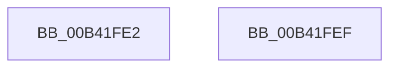

# sub_00B41FE2

- RVA: `0x00B41FE2`–`0x00B4200D` (길이 `43` bytes)
- VA: `0x0000000140B41FE2`
- 실행 섹션: `PAGE`
- PDB 이름 있음: `아니요`; PDB Function 태그: `아니요`
- unwind 정보 RVA: `0x000B6300`
- 디코드: `9`개 명령, `43/43` bytes 표시
- 미해석 바이트: `0` (있으면 어셈블리에 `.byte`로 보존)

> 이 문서는 커널 이미지의 기계어와 PDB 기호를 분석해 생성했습니다. 4번과 5번은 함수 원형과 자료형을 바이너리 사용 방식에서 추정한 C 해석이며 원본 소스 복구 결과는 아닙니다.

## 1. Dependencies

- 직접 호출 지점: **1**; 고유 호출 대상: **1**
- 직접 호출자로 확인된 함수: **0**
- RIP 상대 이미지 참조: **1**

### Outgoing calls
- `0x00B42002` → [KeInsertQueueDpc](../../text/20/KeInsertQueueDpc_function_00207C50.md) (function, `0x00207C50`)

### Direct callers
- 이 함수 시작 RVA로 연결되는 직접 call은 확인되지 않았습니다. 간접 호출은 완전히 역산할 수 없습니다.

### Static image references
- `0x00B41FF2` → RVA `0x00E62578` (`.data`; write)

## 2. Other-region calls and transfers

- 다른 실행 섹션으로 향하는 call: **1**
  - `0x00B42002` → [KeInsertQueueDpc](../../text/20/KeInsertQueueDpc_function_00207C50.md) (`PAGE` → `.text`)
- call이 아닌 외부 분기/꼬리 이동: **2**
  - `0x00B41FEA` → [PspThreadDelete + 0xA2](../A7/PspThreadDelete_function_00A79C20.md) (`tail-transfer`)
  - `0x00B42008` → [PspThreadDelete + 0x324](../A7/PspThreadDelete_function_00A79C20.md) (`tail-transfer`)

## 3. Assembly (complete function range)

```asm
00B41FE2  F0 83 A7 A0 05 00 00 F7         lock and dword ptr [rdi + 0x5a0], 0xfffffff7
00B41FEA  E9 D3 7C F3 FF                  jmp 0x140a79cc2
00B41FEF  45 33 C0                        xor r8d, r8d
00B41FF2  48 C7 05 7B 05 32 00 80 2A 1C 00  mov qword ptr [rip + 0x32057b], 0x1c2a80
00B41FFD  33 D2                           xor edx, edx
00B41FFF  48 8B CE                        mov rcx, rsi
00B42002  E8 49 5C 6C FF                  call 0x140207c50
00B42007  90                              nop
00B42008  E9 37 7F F3 FF                  jmp 0x140a79f44
```

## 4. C-style interpretation (structured pseudocode)

```c
__int64 __fastcall sub_00B41FE2(__int64 a1, int a2, int a3)
{
}
```

## 5. (Beta) C Style

```c
int64_t sub_00B41FE2(int64_t Arg1, int32_t Arg2, int32_t Arg3)
{
}
```

## 6. Execution-region graph

[열기: 2D/3D 그래프와 함수 탐색 컨트롤 패널](../../../control-panel.html?section=page&rva=0x00B41FE2&view=graph)

- 2D 그래프는 위에서 아래로 흐르고, 3D 그래프는 빈 공간을 드래그해 회전합니다. Shift+드래그는 이동, 휠은 확대·축소, 함수 노드 선택은 대상 보고서 이동입니다.

### Static fallback


