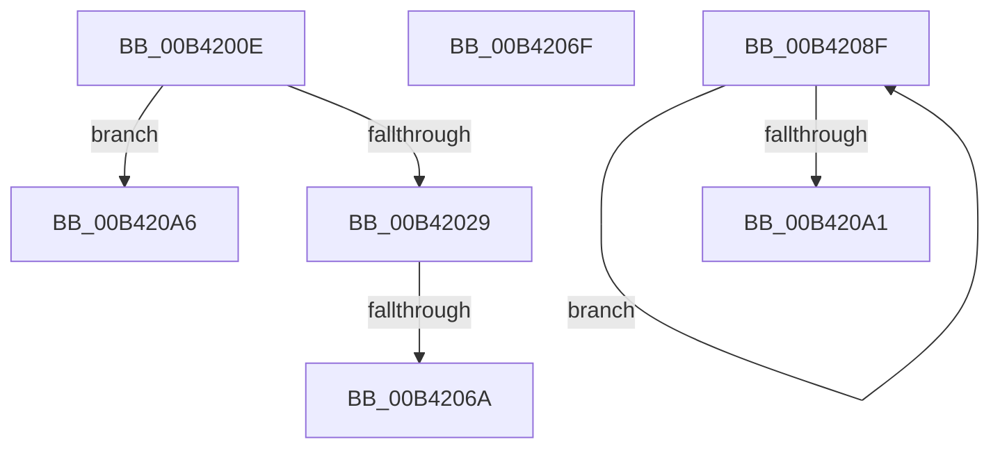

# sub_00B4200E

- RVA: `0x00B4200E`–`0x00B420B0` (길이 `162` bytes)
- VA: `0x0000000140B4200E`
- 실행 섹션: `PAGE`
- PDB 이름 있음: `아니요`; PDB Function 태그: `아니요`
- unwind 정보 RVA: `0x000B6378`
- 디코드: `39`개 명령, `162/162` bytes 표시
- 미해석 바이트: `0` (있으면 어셈블리에 `.byte`로 보존)

> 이 문서는 커널 이미지의 기계어와 PDB 기호를 분석해 생성했습니다. 4번과 5번은 함수 원형과 자료형을 바이너리 사용 방식에서 추정한 C 해석이며 원본 소스 복구 결과는 아닙니다.

## 1. Dependencies

- 직접 호출 지점: **4**; 고유 호출 대상: **4**
- 직접 호출자로 확인된 함수: **0**
- RIP 상대 이미지 참조: **2**

### Outgoing calls
- `0x00B4201C` → [ExAllocatePool2](../../poolcode/B8/ExAllocatePool2_function_00B820F0.md) (function, `0x00B820F0`)
- `0x00B42058` → [CmGetMatchingFilteredDeviceList](../A2/CmGetMatchingFilteredDeviceList_function_00A2C11C.md) (function, `0x00A2C11C`)
- `0x00B42081` → [memcpy](../../text/6C/memcpy_function_006C6840.md) (function, `0x006C6840`)
- `0x00B42092` → [ObfDereferenceObject](../../text/2F/ObfDereferenceObject_function_002F9350.md) (function, `0x002F9350`)

### Direct callers
- 이 함수 시작 RVA로 연결되는 직접 call은 확인되지 않았습니다. 간접 호출은 완전히 역산할 수 없습니다.

### Static image references
- `0x00B42029` → RVA `0x00E66398` (`.data`; read)
- `0x00B42039` → RVA `0x00AFE210` (` ?? ::NNGAKEGL::`string'`; read)

## 2. Other-region calls and transfers

- 다른 실행 섹션으로 향하는 call: **3**
  - `0x00B4201C` → [ExAllocatePool2](../../poolcode/B8/ExAllocatePool2_function_00B820F0.md) (`PAGE` → `POOLCODE`)
  - `0x00B42081` → [memcpy](../../text/6C/memcpy_function_006C6840.md) (`PAGE` → `.text`)
  - `0x00B42092` → [ObfDereferenceObject](../../text/2F/ObfDereferenceObject_function_002F9350.md) (`PAGE` → `.text`)
- call이 아닌 외부 분기/꼬리 이동: **5**
  - `0x00B42064` → [IopGetRootDevices + 0x9C](../A7/IopGetRootDevices_function_00A7A4BC.md) (`tail-transfer`)
  - `0x00B4206A` → [IopGetRootDevices + 0x10E](../A7/IopGetRootDevices_function_00A7A4BC.md) (`tail-transfer`)
  - `0x00B4208A` → [IopGetRootDevices + 0x16D](../A7/IopGetRootDevices_function_00A7A4BC.md) (`tail-transfer`)
  - `0x00B420A1` → [IopGetRootDevices + 0x16D](../A7/IopGetRootDevices_function_00A7A4BC.md) (`tail-transfer`)
  - `0x00B420AB` → [IopGetRootDevices + 0x16D](../A7/IopGetRootDevices_function_00A7A4BC.md) (`tail-transfer`)

## 3. Assembly (complete function range)

```asm
00B4200E  8B 55 40                        mov edx, dword ptr [rbp + 0x40]
00B42011  45 8B C7                        mov r8d, r15d
00B42014  48 03 D2                        add rdx, rdx
00B42017  B9 00 01 00 00                  mov ecx, 0x100
00B4201C  E8 CF 00 04 00                  call 0x140b820f0
00B42021  48 8B F0                        mov rsi, rax
00B42024  48 85 C0                        test rax, rax
00B42027  74 7D                           je 0x140b420a6
00B42029  48 8B 0D 68 43 32 00            mov rcx, qword ptr [rip + 0x324368]
00B42030  48 8D 45 40                     lea rax, [rbp + 0x40]
00B42034  48 89 44 24 38                  mov qword ptr [rsp + 0x38], rax
00B42039  48 8D 15 D0 C1 FB FF            lea rdx, [rip - 0x43e30]
00B42040  8B 45 40                        mov eax, dword ptr [rbp + 0x40]
00B42043  45 33 C9                        xor r9d, r9d
00B42046  89 44 24 30                     mov dword ptr [rsp + 0x30], eax
00B4204A  48 89 74 24 28                  mov qword ptr [rsp + 0x28], rsi
00B4204F  4C 89 6C 24 20                  mov qword ptr [rsp + 0x20], r13
00B42054  45 8D 41 01                     lea r8d, [r9 + 1]
00B42058  E8 BF A0 EE FF                  call 0x140a2c11c
00B4205D  FF C7                           inc edi
00B4205F  8B D8                           mov ebx, eax
00B42061  41 3B C6                        cmp eax, r14d
00B42064  0F 84 EE 84 F3 FF               je 0x140a7a558
00B4206A  E9 5B 85 F3 FF                  jmp 0x140a7a5ca
00B4206F  48 8B 55 F0                     mov rdx, qword ptr [rbp - 0x10]
00B42073  4C 8D 04 FD 00 00 00 00         lea r8, [rdi*8]
00B4207B  48 8D 48 08                     lea rcx, [rax + 8]
00B4207F  89 38                           mov dword ptr [rax], edi
00B42081  E8 BA 47 B8 FF                  call 0x1406c6840
00B42086  4D 89 34 24                     mov qword ptr [r12], r14
00B4208A  E9 9A 85 F3 FF                  jmp 0x140a7a629
00B4208F  49 8B 0E                        mov rcx, qword ptr [r14]
00B42092  E8 B9 72 7B FF                  call 0x1402f9350
00B42097  4D 8D 76 08                     lea r14, [r14 + 8]
00B4209B  48 83 EF 01                     sub rdi, 1
00B4209F  75 EE                           jne 0x140b4208f
00B420A1  E9 83 85 F3 FF                  jmp 0x140a7a629
00B420A6  BB 9A 00 00 C0                  mov ebx, 0xc000009a
00B420AB  E9 79 85 F3 FF                  jmp 0x140a7a629
```

## 4. C-style interpretation (structured pseudocode)

```c
__int64 __fastcall sub_00B4200E(__int64 a1, __int64 a2, __int64 a3, int a4)
{
    __int64 result;
    __int64 v_rdi;
    unsigned __int64 v_stack_p20;
    unsigned __int64 v_stack_p28;
    unsigned int v_stack_p30;
    unsigned __int64 v_stack_p38;

    a2 = ((unsigned int)(*(unsigned int *)(v_rbp + 64))) + ((unsigned int)(*(unsigned int *)(v_rbp + 64)));
    result = ExAllocatePool2(256, a2, (unsigned int)((unsigned int)(v_r15)), a4);
    if (result == 0) goto loc_00B420A6;
    v_stack_p38 = v_rbp + 64;
    a4 = 0;
    v_stack_p30 = (unsigned int)((unsigned int)(*(unsigned int *)(v_rbp + 64)));
    v_stack_p28 = result;
    v_stack_p20 = v_r13;
    result = CmGetMatchingFilteredDeviceList(*(unsigned __int64 *)(v_rip + 3294056), v_rip - 278064, a4 + 1, a4);
    v_rdi = (unsigned int)((v_rdi) + 1);
loc_00B420A6:
}
```

## 5. (Beta) C Style

```c
int64_t sub_00B4200E(int64_t Arg1, int64_t Arg2, int64_t Arg3, int32_t Arg4)
{
    int64_t result;
    int64_t local_rdi;
    uint64_t v_stack_p20;
    uint64_t v_stack_p28;
    uint32_t v_stack_p30;
    uint64_t v_stack_p38;

    Arg2 = ((uint32_t)(*(uint32_t *)(local_rbp + 0x40))) + ((uint32_t)(*(uint32_t *)(local_rbp + 0x40)));
    result = ExAllocatePool2(256, Arg2, (uint32_t)((uint32_t)(local_r15)), Arg4);
    if (result == 0) goto loc_00B420A6;
    v_stack_p38 = local_rbp + 64;
    Arg4 = 0;
    v_stack_p30 = (uint32_t)((uint32_t)(*(uint32_t *)(local_rbp + 0x40)));
    v_stack_p28 = result;
    v_stack_p20 = local_r13;
    result = CmGetMatchingFilteredDeviceList(*(uint64_t *)(v_rip + 0x324368), v_rip - 278064, Arg4 + 1, Arg4);
    local_rdi = (uint32_t)((local_rdi) + 1);
loc_00B420A6:
}
```

## 6. Execution-region graph

[열기: 2D/3D 그래프와 함수 탐색 컨트롤 패널](../../../control-panel.html?section=page&rva=0x00B4200E&view=graph)

- 2D 그래프는 위에서 아래로 흐르고, 3D 그래프는 빈 공간을 드래그해 회전합니다. Shift+드래그는 이동, 휠은 확대·축소, 함수 노드 선택은 대상 보고서 이동입니다.

### Static fallback


