# sub_00B420B0

- RVA: `0x00B420B0`–`0x00B42432` (길이 `898` bytes)
- VA: `0x0000000140B420B0`
- 실행 섹션: `PAGE`
- PDB 이름 있음: `아니요`; PDB Function 태그: `아니요`
- unwind 정보 RVA: `0x000B63A4`
- 디코드: `225`개 명령, `898/898` bytes 표시
- 미해석 바이트: `0` (있으면 어셈블리에 `.byte`로 보존)

> 이 문서는 커널 이미지의 기계어와 PDB 기호를 분석해 생성했습니다. 4번과 5번은 함수 원형과 자료형을 바이너리 사용 방식에서 추정한 C 해석이며 원본 소스 복구 결과는 아닙니다.

## 1. Dependencies

- 직접 호출 지점: **34**; 고유 호출 대상: **25**
- 직접 호출자로 확인된 함수: **0**
- RIP 상대 이미지 참조: **5**

### Outgoing calls
- `0x00B420B4` → [ExFreePoolWithTag](../../poolcode/B8/ExFreePoolWithTag_function_00B82870.md) (function, `0x00B82870`)
- `0x00B420C3` → [ObfDereferenceObject](../../text/2F/ObfDereferenceObject_function_002F9350.md) (function, `0x002F9350`)
- `0x00B420DA` → [PipSetDevNodeFlags](../8F/PipSetDevNodeFlags_function_008FC048.md) (function, `0x008FC048`)
- `0x00B420E4` → [ExFreePoolWithTag](../../poolcode/B8/ExFreePoolWithTag_function_00B82870.md) (function, `0x00B82870`)
- `0x00B420EC` → [ObfReferenceObject](../../text/20/ObfReferenceObject_function_0020FA20.md) (function, `0x0020FA20`)
- `0x00B4210C` → [IopCreateRootEnumeratedDeviceObject](../73/IopCreateRootEnumeratedDeviceObject_function_00737D1C.md) (function, `0x00737D1C`)
- `0x00B42138` → [PipAllocateDeviceNode](../A9/PipAllocateDeviceNode_function_00A9C8F8.md) (function, `0x00A9C8F8`)
- `0x00B42160` → [PnpAllocateDeviceInstancePath](../72/PnpAllocateDeviceInstancePath_function_0072DC30.md) (function, `0x0072DC30`)
- `0x00B42177` → [RtlCopyUnicodeString](../../text/3F/RtlCopyUnicodeString_function_003FEF30.md) (function, `0x003FEF30`)
- `0x00B42184` → [PipSetDevNodeFlags](../8F/PipSetDevNodeFlags_function_008FC048.md) (function, `0x008FC048`)
- `0x00B42191` → [PipSetDevNodeState](../../text/47/PipSetDevNodeState_function_00470708.md) (function, `0x00470708`)
- `0x00B421A0` → [PpDevNodeInsertIntoTree](../../text/4C/PpDevNodeInsertIntoTree_function_004CA274.md) (function, `0x004CA274`)
- `0x00B421A8` → [ObfReferenceObject](../../text/20/ObfReferenceObject_function_0020FA20.md) (function, `0x0020FA20`)
- `0x00B421EA` → [CmGetDeviceRegProp](../8E/CmGetDeviceRegProp_function_008ED870.md) (function, `0x008ED870`)
- `0x00B42236` → [PiDevCfgGetFailedInstallProblemStatus](../73/PiDevCfgGetFailedInstallProblemStatus_function_00733730.md) (function, `0x00733730`)
- `0x00B42256` → [PipSetDevNodeProblem](../8F/PipSetDevNodeProblem_function_008FDE0C.md) (function, `0x008FDE0C`)
- `0x00B4226C` → [IopGetRegistryValue](../99/IopGetRegistryValue_function_009990EC.md) (function, `0x009990EC`)
- `0x00B4229C` → [PipSetDevNodeFlags](../8F/PipSetDevNodeFlags_function_008FC048.md) (function, `0x008FC048`)
- `0x00B422A6` → [ExFreePoolWithTag](../../poolcode/B8/ExFreePoolWithTag_function_00B82870.md) (function, `0x00B82870`)
- `0x00B422AE` → [PnpQueryAndSaveDeviceNodeCapabilities](../8F/PnpQueryAndSaveDeviceNodeCapabilities_function_008FBCE8.md) (function, `0x008FBCE8`)
- `0x00B422D7` → [PipClearDevNodeProblem](../A2/PipClearDevNodeProblem_function_00A27C8C.md) (function, `0x00A27C8C`)
- `0x00B422E6` → [PipSetDevNodeProblem](../8F/PipSetDevNodeProblem_function_008FDE0C.md) (function, `0x008FDE0C`)
- `0x00B42318` → [PnpClearDeviceTemporaryProperties](../A8/PnpClearDeviceTemporaryProperties_function_00A8F4DC.md) (function, `0x00A8F4DC`)
- `0x00B42344` → [PpDevCfgProcessDevice](../AB/PpDevCfgProcessDevice_function_00AB6DB0.md) (function, `0x00AB6DB0`)
- `0x00B4234B` → [PpDevCfgProcessDeviceOperations](../A9/PpDevCfgProcessDeviceOperations_function_00A97CFC.md) (function, `0x00A97CFC`)
- `0x00B42376` → [PnpIsDeviceInstanceEnabled](../A7/PnpIsDeviceInstanceEnabled_function_00A75A3C.md) (function, `0x00A75A3C`)
- `0x00B42382` → [PipClearDevNodeProblem](../A2/PipClearDevNodeProblem_function_00A27C8C.md) (function, `0x00A27C8C`)
- `0x00B42391` → [PipSetDevNodeProblem](../8F/PipSetDevNodeProblem_function_008FDE0C.md) (function, `0x008FDE0C`)
- `0x00B423A4` → [PpDeviceRegistration](../A0/PpDeviceRegistration_function_00A079D4.md) (function, `0x00A079D4`)
- `0x00B423B1` → [PnpMapDeviceObjectToDeviceInstance](../A9/PnpMapDeviceObjectToDeviceInstance_function_00A9D884.md) (function, `0x00A9D884`)
- `0x00B423D5` → [PnpGetDeviceResourcesFromRegistry](../A7/PnpGetDeviceResourcesFromRegistry_function_00A74344.md) (function, `0x00A74344`)
- `0x00B42400` → [guard_dispatch_icall](../../text/6B/guard_dispatch_icall_function_006BAAD0.md) (function, `0x006BAAD0`)
- `0x00B42415` → [IoDeleteDevice](../../text/26/IoDeleteDevice_function_0026FE90.md) (function, `0x0026FE90`)
- `0x00B4241F` → [IoDeleteDevice](../../text/26/IoDeleteDevice_function_0026FE90.md) (function, `0x0026FE90`)

### Direct callers
- 이 함수 시작 RVA로 연결되는 직접 call은 확인되지 않았습니다. 간접 호출은 완전히 역산할 수 없습니다.

### Static image references
- `0x00B42196` → RVA `0x00F8C438` (`.data`; read)
- `0x00B421AD` → RVA `0x00E66398` (`.data`; read)
- `0x00B42262` → RVA `0x00AFD590` (` ?? ::NNGAKEGL::`string'`; read)
- `0x00B422F9` → RVA `0x00E0A9E0` (`.data`; read)
- `0x00B423EF` → RVA `0x00F8C138` (`.data`; read)

## 2. Other-region calls and transfers

- 다른 실행 섹션으로 향하는 call: **12**
  - `0x00B420B4` → [ExFreePoolWithTag](../../poolcode/B8/ExFreePoolWithTag_function_00B82870.md) (`PAGE` → `POOLCODE`)
  - `0x00B420C3` → [ObfDereferenceObject](../../text/2F/ObfDereferenceObject_function_002F9350.md) (`PAGE` → `.text`)
  - `0x00B420E4` → [ExFreePoolWithTag](../../poolcode/B8/ExFreePoolWithTag_function_00B82870.md) (`PAGE` → `POOLCODE`)
  - `0x00B420EC` → [ObfReferenceObject](../../text/20/ObfReferenceObject_function_0020FA20.md) (`PAGE` → `.text`)
  - `0x00B42177` → [RtlCopyUnicodeString](../../text/3F/RtlCopyUnicodeString_function_003FEF30.md) (`PAGE` → `.text`)
  - `0x00B42191` → [PipSetDevNodeState](../../text/47/PipSetDevNodeState_function_00470708.md) (`PAGE` → `.text`)
  - `0x00B421A0` → [PpDevNodeInsertIntoTree](../../text/4C/PpDevNodeInsertIntoTree_function_004CA274.md) (`PAGE` → `.text`)
  - `0x00B421A8` → [ObfReferenceObject](../../text/20/ObfReferenceObject_function_0020FA20.md) (`PAGE` → `.text`)
  - `0x00B422A6` → [ExFreePoolWithTag](../../poolcode/B8/ExFreePoolWithTag_function_00B82870.md) (`PAGE` → `POOLCODE`)
  - `0x00B42400` → [guard_dispatch_icall](../../text/6B/guard_dispatch_icall_function_006BAAD0.md) (`PAGE` → `.text`)
  - `0x00B42415` → [IoDeleteDevice](../../text/26/IoDeleteDevice_function_0026FE90.md) (`PAGE` → `.text`)
  - `0x00B4241F` → [IoDeleteDevice](../../text/26/IoDeleteDevice_function_0026FE90.md) (`PAGE` → `.text`)
- call이 아닌 외부 분기/꼬리 이동: **4**
  - `0x00B420BB` → [IopInitializeDeviceInstanceKey + 0x47](../A7/IopInitializeDeviceInstanceKey_function_00A7A6DC.md) (`tail-transfer`)
  - `0x00B420CD` → [IopInitializeDeviceInstanceKey + 0x7C](../A7/IopInitializeDeviceInstanceKey_function_00A7A6DC.md) (`tail-transfer`)
  - `0x00B42103` → [IopInitializeDeviceInstanceKey + 0x7C](../A7/IopInitializeDeviceInstanceKey_function_00A7A6DC.md) (`tail-transfer`)
  - `0x00B4242D` → [IopInitializeDeviceInstanceKey + 0x7A](../A7/IopInitializeDeviceInstanceKey_function_00A7A6DC.md) (`tail-transfer`)

## 3. Assembly (complete function range)

```asm
00B420B0  8B DF                           mov ebx, edi
00B420B2  33 D2                           xor edx, edx
00B420B4  E8 B7 07 04 00                  call 0x140b82870
00B420B9  85 DB                           test ebx, ebx
00B420BB  0F 84 62 86 F3 FF               je 0x140a7a723
00B420C1  EB 05                           jmp 0x140b420c8
00B420C3  E8 88 72 7B FF                  call 0x1402f9350
00B420C8  B8 01 00 00 00                  mov eax, 1
00B420CD  E9 86 86 F3 FF                  jmp 0x140a7a758
00B420D2  BA 40 00 00 00                  mov edx, 0x40
00B420D7  48 8B CB                        mov rcx, rbx
00B420DA  E8 69 9F DB FF                  call 0x1408fc048
00B420DF  33 D2                           xor edx, edx
00B420E1  49 8B CC                        mov rcx, r12
00B420E4  E8 87 07 04 00                  call 0x140b82870
00B420E9  49 8B CF                        mov rcx, r15
00B420EC  E8 2F D9 6C FF                  call 0x14020fa20
00B420F1  8B 4E 08                        mov ecx, dword ptr [rsi + 8]
00B420F4  48 8B 46 10                     mov rax, qword ptr [rsi + 0x10]
00B420F8  4C 89 3C C8                     mov qword ptr [rax + rcx*8], r15
00B420FC  44 01 76 08                     add dword ptr [rsi + 8], r14d
00B42100  41 8B C6                        mov eax, r14d
00B42103  E9 50 86 F3 FF                  jmp 0x140a7a758
00B42108  48 8D 4D F0                     lea rcx, [rbp - 0x10]
00B4210C  E8 0B 5C BF FF                  call 0x140737d1c
00B42111  44 8B F0                        mov r14d, eax
00B42114  85 C0                           test eax, eax
00B42116  0F 88 0E 03 00 00               js 0x140b4242a
00B4211C  4C 8B 7D F0                     mov r15, qword ptr [rbp - 0x10]
00B42120  48 8D 55 F8                     lea rdx, [rbp - 8]
00B42124  49 8B CF                        mov rcx, r15
00B42127  41 0F BA 6F 30 0C               bts dword ptr [r15 + 0x30], 0xc
00B4212D  49 8B 87 38 01 00 00            mov rax, qword ptr [r15 + 0x138]
00B42134  83 48 20 10                     or dword ptr [rax + 0x20], 0x10
00B42138  E8 BB A7 F5 FF                  call 0x140a9c8f8
00B4213D  3D 6E 03 00 C0                  cmp eax, 0xc000036e
00B42142  0F 84 D4 02 00 00               je 0x140b4241c
00B42148  48 8B 5D F8                     mov rbx, qword ptr [rbp - 8]
00B4214C  48 85 DB                        test rbx, rbx
00B4214F  0F 84 C7 02 00 00               je 0x140b4241c
00B42155  41 0F B7 14 24                  movzx edx, word ptr [r12]
00B4215A  48 8B CB                        mov rcx, rbx
00B4215D  83 C2 02                        add edx, 2
00B42160  E8 CB BA BE FF                  call 0x14072dc30
00B42165  44 8B F0                        mov r14d, eax
00B42168  85 C0                           test eax, eax
00B4216A  0F 88 A2 02 00 00               js 0x140b42412
00B42170  48 8D 4B 28                     lea rcx, [rbx + 0x28]
00B42174  49 8B D4                        mov rdx, r12
00B42177  E8 B4 CD 8B FF                  call 0x1403fef30
00B4217C  BA 11 00 00 00                  mov edx, 0x11
00B42181  48 8B CB                        mov rcx, rbx
00B42184  E8 BF 9E DB FF                  call 0x1408fc048
00B42189  BA 04 03 00 00                  mov edx, 0x304
00B4218E  48 8B CB                        mov rcx, rbx
00B42191  E8 72 E5 92 FF                  call 0x140470708
00B42196  48 8B 0D 9B A2 44 00            mov rcx, qword ptr [rip + 0x44a29b]
00B4219D  48 8B D3                        mov rdx, rbx
00B421A0  E8 CF 80 98 FF                  call 0x1404ca274
00B421A5  49 8B CF                        mov rcx, r15
00B421A8  E8 73 D8 6C FF                  call 0x14020fa20
00B421AD  48 8B 0D E4 41 32 00            mov rcx, qword ptr [rip + 0x3241e4]
00B421B4  48 8D 45 E0                     lea rax, [rbp - 0x20]
00B421B8  89 7C 24 38                     mov dword ptr [rsp + 0x38], edi
00B421BC  41 B9 0B 00 00 00               mov r9d, 0xb
00B421C2  48 89 44 24 30                  mov qword ptr [rsp + 0x30], rax
00B421C7  4D 8B C5                        mov r8, r13
00B421CA  48 8D 45 50                     lea rax, [rbp + 0x50]
00B421CE  89 7D 50                        mov dword ptr [rbp + 0x50], edi
00B421D1  48 89 44 24 28                  mov qword ptr [rsp + 0x28], rax
00B421D6  48 8D 45 58                     lea rax, [rbp + 0x58]
00B421DA  C7 45 E0 04 00 00 00            mov dword ptr [rbp - 0x20], 4
00B421E1  48 8B 53 30                     mov rdx, qword ptr [rbx + 0x30]
00B421E5  48 89 44 24 20                  mov qword ptr [rsp + 0x20], rax
00B421EA  E8 81 B6 DA FF                  call 0x1408ed870
00B421EF  41 BE 01 00 00 00               mov r14d, 1
00B421F5  85 C0                           test eax, eax
00B421F7  78 4C                           js 0x140b42245
00B421F9  83 7D 58 04                     cmp dword ptr [rbp + 0x58], 4
00B421FD  75 0B                           jne 0x140b4220a
00B421FF  83 7D E0 04                     cmp dword ptr [rbp - 0x20], 4
00B42203  75 05                           jne 0x140b4220a
00B42205  8B 45 50                        mov eax, dword ptr [rbp + 0x50]
00B42208  EB 05                           jmp 0x140b4220f
00B4220A  8B C7                           mov eax, edi
00B4220C  89 45 50                        mov dword ptr [rbp + 0x50], eax
00B4220F  A8 20                           test al, 0x20
00B42211  74 09                           je 0x140b4221c
00B42213  45 33 C0                        xor r8d, r8d
00B42216  41 8D 50 12                     lea edx, [r8 + 0x12]
00B4221A  EB 37                           jmp 0x140b42253
00B4221C  0F BA E0 0D                     bt eax, 0xd
00B42220  73 09                           jae 0x140b4222b
00B42222  45 33 C0                        xor r8d, r8d
00B42225  41 8D 50 10                     lea edx, [r8 + 0x10]
00B42229  EB 28                           jmp 0x140b42253
00B4222B  A8 40                           test al, 0x40
00B4222D  74 2C                           je 0x140b4225b
00B4222F  48 8B 4B 30                     mov rcx, qword ptr [rbx + 0x30]
00B42233  49 8B D5                        mov rdx, r13
00B42236  E8 F5 14 BF FF                  call 0x140733730
00B4223B  44 8B C0                        mov r8d, eax
00B4223E  BA 1C 00 00 00                  mov edx, 0x1c
00B42243  EB 0E                           jmp 0x140b42253
00B42245  41 B8 25 02 00 C0               mov r8d, 0xc0000225
00B4224B  41 3B C0                        cmp eax, r8d
00B4224E  75 0B                           jne 0x140b4225b
00B42250  41 8B D6                        mov edx, r14d
00B42253  48 8B CB                        mov rcx, rbx
00B42256  E8 B1 BB DB FF                  call 0x1408fde0c
00B4225B  4C 8D 4D E8                     lea r9, [rbp - 0x18]
00B4225F  45 33 C0                        xor r8d, r8d
00B42262  48 8D 15 27 B3 FB FF            lea rdx, [rip - 0x44cd9]
00B42269  49 8B CD                        mov rcx, r13
00B4226C  E8 7B 6E E5 FF                  call 0x1409990ec
00B42271  85 C0                           test eax, eax
00B42273  78 36                           js 0x140b422ab
00B42275  4C 8B 65 E8                     mov r12, qword ptr [rbp - 0x18]
00B42279  41 83 7C 24 04 04               cmp dword ptr [r12 + 4], 4
00B4227F  75 20                           jne 0x140b422a1
00B42281  41 83 7C 24 0C 04               cmp dword ptr [r12 + 0xc], 4
00B42287  72 18                           jb 0x140b422a1
00B42289  41 8B 44 24 08                  mov eax, dword ptr [r12 + 8]
00B4228E  42 39 3C 20                     cmp dword ptr [rax + r12], edi
00B42292  74 0D                           je 0x140b422a1
00B42294  BA 00 01 00 00                  mov edx, 0x100
00B42299  48 8B CB                        mov rcx, rbx
00B4229C  E8 A7 9D DB FF                  call 0x1408fc048
00B422A1  33 D2                           xor edx, edx
00B422A3  49 8B CC                        mov rcx, r12
00B422A6  E8 C5 05 04 00                  call 0x140b82870
00B422AB  48 8B CB                        mov rcx, rbx
00B422AE  E8 35 9A DB FF                  call 0x1408fbce8
00B422B3  F7 83 30 02 00 00 00 40 00 00   test dword ptr [rbx + 0x230], 0x4000
00B422BD  74 2C                           je 0x140b422eb
00B422BF  F7 83 8C 01 00 00 00 20 00 00   test dword ptr [rbx + 0x18c], 0x2000
00B422C9  74 09                           je 0x140b422d4
00B422CB  44 39 B3 94 01 00 00            cmp dword ptr [rbx + 0x194], r14d
00B422D2  74 17                           je 0x140b422eb
00B422D4  48 8B CB                        mov rcx, rbx
00B422D7  E8 B0 59 EE FF                  call 0x140a27c8c
00B422DC  45 33 C0                        xor r8d, r8d
00B422DF  48 8B CB                        mov rcx, rbx
00B422E2  41 8D 50 1D                     lea edx, [r8 + 0x1d]
00B422E6  E8 21 BB DB FF                  call 0x1408fde0c
00B422EB  44 8B A3 8C 01 00 00            mov r12d, dword ptr [rbx + 0x18c]
00B422F2  41 81 E4 00 60 00 00            and r12d, 0x6000
00B422F9  40 38 3D E0 86 2C 00            cmp byte ptr [rip + 0x2c86e0], dil
00B42300  74 0F                           je 0x140b42311
00B42302  0F BA AB C0 02 00 00 0C         bts dword ptr [rbx + 0x2c0], 0xc
00B4230A  C7 45 E4 02 00 00 00            mov dword ptr [rbp - 0x1c], 2
00B42311  48 8B 4B 30                     mov rcx, qword ptr [rbx + 0x30]
00B42315  49 8B D5                        mov rdx, r13
00B42318  E8 BF D1 F4 FF                  call 0x140a8f4dc
00B4231D  F7 83 30 02 00 00 00 40 00 00   test dword ptr [rbx + 0x230], 0x4000
00B42327  0F 94 C1                        sete cl
00B4232A  44 84 75 50                     test byte ptr [rbp + 0x50], r14b
00B4232E  0F 94 C0                        sete al
00B42331  84 C8                           test al, cl
00B42333  74 1B                           je 0x140b42350
00B42335  49 8B D5                        mov rdx, r13
00B42338  48 8B CB                        mov rcx, rbx
00B4233B  45 85 E4                        test r12d, r12d
00B4233E  74 0B                           je 0x140b4234b
00B42340  44 8B 45 E4                     mov r8d, dword ptr [rbp - 0x1c]
00B42344  E8 67 4A F7 FF                  call 0x140ab6db0
00B42349  EB 05                           jmp 0x140b42350
00B4234B  E8 AC 59 F5 FF                  call 0x140a97cfc
00B42350  F7 83 8C 01 00 00 00 20 00 00   test dword ptr [rbx + 0x18c], 0x2000
00B4235A  74 10                           je 0x140b4236c
00B4235C  8B 83 94 01 00 00               mov eax, dword ptr [rbx + 0x194]
00B42362  83 F8 16                        cmp eax, 0x16
00B42365  74 2F                           je 0x140b42396
00B42367  83 F8 1D                        cmp eax, 0x1d
00B4236A  74 2A                           je 0x140b42396
00B4236C  48 8D 53 28                     lea rdx, [rbx + 0x28]
00B42370  45 8B C6                        mov r8d, r14d
00B42373  49 8B CD                        mov rcx, r13
00B42376  E8 C1 36 F3 FF                  call 0x140a75a3c
00B4237B  85 C0                           test eax, eax
00B4237D  75 17                           jne 0x140b42396
00B4237F  48 8B CB                        mov rcx, rbx
00B42382  E8 05 59 EE FF                  call 0x140a27c8c
00B42387  45 33 C0                        xor r8d, r8d
00B4238A  48 8B CB                        mov rcx, rbx
00B4238D  41 8D 50 16                     lea edx, [r8 + 0x16]
00B42391  E8 76 BA DB FF                  call 0x1408fde0c
00B42396  4C 8D 43 38                     lea r8, [rbx + 0x38]
00B4239A  45 33 C9                        xor r9d, r9d
00B4239D  48 8D 4B 28                     lea rcx, [rbx + 0x28]
00B423A1  41 8A D6                        mov dl, r14b
00B423A4  E8 2B 56 EC FF                  call 0x140a079d4
00B423A9  48 8B 4B 20                     mov rcx, qword ptr [rbx + 0x20]
00B423AD  48 8D 53 28                     lea rdx, [rbx + 0x28]
00B423B1  E8 CE B4 F5 FF                  call 0x140a9d884
00B423B6  48 8D 45 E4                     lea rax, [rbp - 0x1c]
00B423BA  48 89 7D F8                     mov qword ptr [rbp - 8], rdi
00B423BE  41 BD 04 00 00 00               mov r13d, 4
00B423C4  48 89 44 24 20                  mov qword ptr [rsp + 0x20], rax
00B423C9  45 8B C5                        mov r8d, r13d
00B423CC  4C 8D 4D F8                     lea r9, [rbp - 8]
00B423D0  33 D2                           xor edx, edx
00B423D2  49 8B CF                        mov rcx, r15
00B423D5  E8 6A 1F F3 FF                  call 0x140a74344
00B423DA  85 C0                           test eax, eax
00B423DC  0F 88 07 FD FF FF               js 0x140b420e9
00B423E2  4C 8B 65 F8                     mov r12, qword ptr [rbp - 8]
00B423E6  4D 85 E4                        test r12, r12
00B423E9  0F 84 FA FC FF FF               je 0x140b420e9
00B423EF  48 8B 05 42 9D 44 00            mov rax, qword ptr [rip + 0x449d42]
00B423F6  4D 8B C4                        mov r8, r12
00B423F9  48 8B 53 20                     mov rdx, qword ptr [rbx + 0x20]
00B423FD  41 8B CD                        mov ecx, r13d
00B42400  E8 CB 86 B7 FF                  call 0x1406baad0
00B42405  85 C0                           test eax, eax
00B42407  0F 88 D2 FC FF FF               js 0x140b420df
00B4240D  E9 C0 FC FF FF                  jmp 0x140b420d2
00B42412  49 8B CF                        mov rcx, r15
00B42415  E8 76 DA 72 FF                  call 0x14026fe90
00B4241A  EB 0E                           jmp 0x140b4242a
00B4241C  49 8B CF                        mov rcx, r15
00B4241F  E8 6C DA 72 FF                  call 0x14026fe90
00B42424  41 BE 9A 00 00 C0               mov r14d, 0xc000009a
00B4242A  44 89 36                        mov dword ptr [rsi], r14d
00B4242D  E9 24 83 F3 FF                  jmp 0x140a7a756
```

## 4. C-style interpretation (structured pseudocode)

```c
__int64 __fastcall sub_00B420B0(__int64 a1, int a2)
{
    __int64 result;
    unsigned __int64 v_stack_p20;
    unsigned __int64 v_stack_p28;
    unsigned __int64 v_stack_p30;
    unsigned int v_stack_p38;

    a2 = 0;
    result = ExFreePoolWithTag(a1, a2, a3, a4);
    goto loc_00B420C8;
loc_00B420C8:
}
```

## 5. (Beta) C Style

```c
int64_t sub_00B420B0(int64_t Arg1, int32_t Arg2)
{
    int64_t result;
    uint64_t v_stack_p20;
    uint64_t v_stack_p28;
    uint64_t v_stack_p30;
    uint32_t v_stack_p38;

    Arg2 = 0;
    result = ExFreePoolWithTag(Arg1, Arg2, a3, a4);
    goto loc_00B420C8;
loc_00B420C8:
}
```

## 6. Execution-region graph

[열기: 2D/3D 그래프와 함수 탐색 컨트롤 패널](../../../control-panel.html?section=page&rva=0x00B420B0&view=graph)

- 2D 그래프는 위에서 아래로 흐르고, 3D 그래프는 빈 공간을 드래그해 회전합니다. Shift+드래그는 이동, 휠은 확대·축소, 함수 노드 선택은 대상 보고서 이동입니다.

### Static fallback

```mermaid
flowchart TD
  bb_00B420B0[BB_00B420B0]
  bb_00B420C1[BB_00B420C1]
  bb_00B420C3[BB_00B420C3]
  bb_00B420C8[BB_00B420C8]
  bb_00B420D2[BB_00B420D2]
  bb_00B420DF[BB_00B420DF]
  bb_00B420E9[BB_00B420E9]
  bb_00B42108[BB_00B42108]
  bb_00B4211C[BB_00B4211C]
  bb_00B42148[BB_00B42148]
  bb_00B42155[BB_00B42155]
  bb_00B42170[BB_00B42170]
  bb_00B421F9[BB_00B421F9]
  bb_00B421FF[BB_00B421FF]
  bb_00B42205[BB_00B42205]
  bb_00B4220A[BB_00B4220A]
  bb_00B4220F[BB_00B4220F]
  bb_00B42213[BB_00B42213]
  bb_00B4221C[BB_00B4221C]
  bb_00B42222[BB_00B42222]
  bb_00B4222B[BB_00B4222B]
  bb_00B4222F[BB_00B4222F]
  bb_00B42245[BB_00B42245]
  bb_00B42250[BB_00B42250]
  bb_00B42253[BB_00B42253]
  bb_00B4225B[BB_00B4225B]
  bb_00B42275[BB_00B42275]
  bb_00B42281[BB_00B42281]
  bb_00B42289[BB_00B42289]
  bb_00B42294[BB_00B42294]
  bb_00B422A1[BB_00B422A1]
  bb_00B422AB[BB_00B422AB]
  bb_00B422BF[BB_00B422BF]
  bb_00B422CB[BB_00B422CB]
  bb_00B422D4[BB_00B422D4]
  bb_00B422EB[BB_00B422EB]
  bb_00B42302[BB_00B42302]
  bb_00B42311[BB_00B42311]
  bb_00B42335[BB_00B42335]
  bb_00B42340[BB_00B42340]
  bb_00B4234B[BB_00B4234B]
  bb_00B42350[BB_00B42350]
  bb_00B4235C[BB_00B4235C]
  bb_00B42367[BB_00B42367]
  bb_00B4236C[BB_00B4236C]
  bb_00B4237F[BB_00B4237F]
  bb_00B42396[BB_00B42396]
  bb_00B423E2[BB_00B423E2]
  bb_00B423EF[BB_00B423EF]
  bb_00B4240D[BB_00B4240D]
  bb_00B42412[BB_00B42412]
  bb_00B4241C[BB_00B4241C]
  bb_00B4242A[BB_00B4242A]
  bb_00B420B0 -->|fallthrough| bb_00B420C1
  bb_00B420C1 -->|branch| bb_00B420C8
  bb_00B420C3 -->|flow| bb_00B420C8
  bb_00B420D2 -->|flow| bb_00B420DF
  bb_00B420DF -->|flow| bb_00B420E9
  bb_00B42108 -->|branch| bb_00B4242A
  bb_00B42108 -->|fallthrough| bb_00B4211C
  bb_00B4211C -->|branch| bb_00B4241C
  bb_00B4211C -->|fallthrough| bb_00B42148
  bb_00B42148 -->|branch| bb_00B4241C
  bb_00B42148 -->|fallthrough| bb_00B42155
  bb_00B42155 -->|branch| bb_00B42412
  bb_00B42155 -->|fallthrough| bb_00B42170
  bb_00B42170 -->|branch| bb_00B42245
  bb_00B42170 -->|fallthrough| bb_00B421F9
  bb_00B421F9 -->|branch| bb_00B4220A
  bb_00B421F9 -->|fallthrough| bb_00B421FF
  bb_00B421FF -->|branch| bb_00B4220A
  bb_00B421FF -->|fallthrough| bb_00B42205
  bb_00B42205 -->|branch| bb_00B4220F
  bb_00B4220A -->|flow| bb_00B4220F
  bb_00B4220F -->|branch| bb_00B4221C
  bb_00B4220F -->|fallthrough| bb_00B42213
  bb_00B42213 -->|branch| bb_00B42253
  bb_00B4221C -->|branch| bb_00B4222B
  bb_00B4221C -->|fallthrough| bb_00B42222
  bb_00B42222 -->|branch| bb_00B42253
  bb_00B4222B -->|branch| bb_00B4225B
  bb_00B4222B -->|fallthrough| bb_00B4222F
  bb_00B4222F -->|branch| bb_00B42253
  bb_00B42245 -->|branch| bb_00B4225B
  bb_00B42245 -->|fallthrough| bb_00B42250
  bb_00B42250 -->|flow| bb_00B42253
  bb_00B42253 -->|flow| bb_00B4225B
  bb_00B4225B -->|branch| bb_00B422AB
  bb_00B4225B -->|fallthrough| bb_00B42275
  bb_00B42275 -->|branch| bb_00B422A1
  bb_00B42275 -->|fallthrough| bb_00B42281
  bb_00B42281 -->|branch| bb_00B422A1
  bb_00B42281 -->|fallthrough| bb_00B42289
  bb_00B42289 -->|branch| bb_00B422A1
  bb_00B42289 -->|fallthrough| bb_00B42294
  bb_00B42294 -->|flow| bb_00B422A1
  bb_00B422A1 -->|flow| bb_00B422AB
  bb_00B422AB -->|branch| bb_00B422EB
  bb_00B422AB -->|fallthrough| bb_00B422BF
  bb_00B422BF -->|branch| bb_00B422D4
  bb_00B422BF -->|fallthrough| bb_00B422CB
  bb_00B422CB -->|branch| bb_00B422EB
  bb_00B422CB -->|fallthrough| bb_00B422D4
  bb_00B422D4 -->|flow| bb_00B422EB
  bb_00B422EB -->|branch| bb_00B42311
  bb_00B422EB -->|fallthrough| bb_00B42302
  bb_00B42302 -->|flow| bb_00B42311
  bb_00B42311 -->|branch| bb_00B42350
  bb_00B42311 -->|fallthrough| bb_00B42335
  bb_00B42335 -->|branch| bb_00B4234B
  bb_00B42335 -->|fallthrough| bb_00B42340
  bb_00B42340 -->|branch| bb_00B42350
  bb_00B4234B -->|flow| bb_00B42350
  bb_00B42350 -->|branch| bb_00B4236C
  bb_00B42350 -->|fallthrough| bb_00B4235C
  bb_00B4235C -->|branch| bb_00B42396
  bb_00B4235C -->|fallthrough| bb_00B42367
  bb_00B42367 -->|branch| bb_00B42396
  bb_00B42367 -->|fallthrough| bb_00B4236C
  bb_00B4236C -->|branch| bb_00B42396
  bb_00B4236C -->|fallthrough| bb_00B4237F
  bb_00B4237F -->|flow| bb_00B42396
  bb_00B42396 -->|branch| bb_00B420E9
  bb_00B42396 -->|fallthrough| bb_00B423E2
  bb_00B423E2 -->|branch| bb_00B420E9
  bb_00B423E2 -->|fallthrough| bb_00B423EF
  bb_00B423EF -->|branch| bb_00B420DF
  bb_00B423EF -->|fallthrough| bb_00B4240D
  bb_00B4240D -->|branch| bb_00B420D2
  bb_00B42412 -->|branch| bb_00B4242A
  bb_00B4241C -->|flow| bb_00B4242A
```


