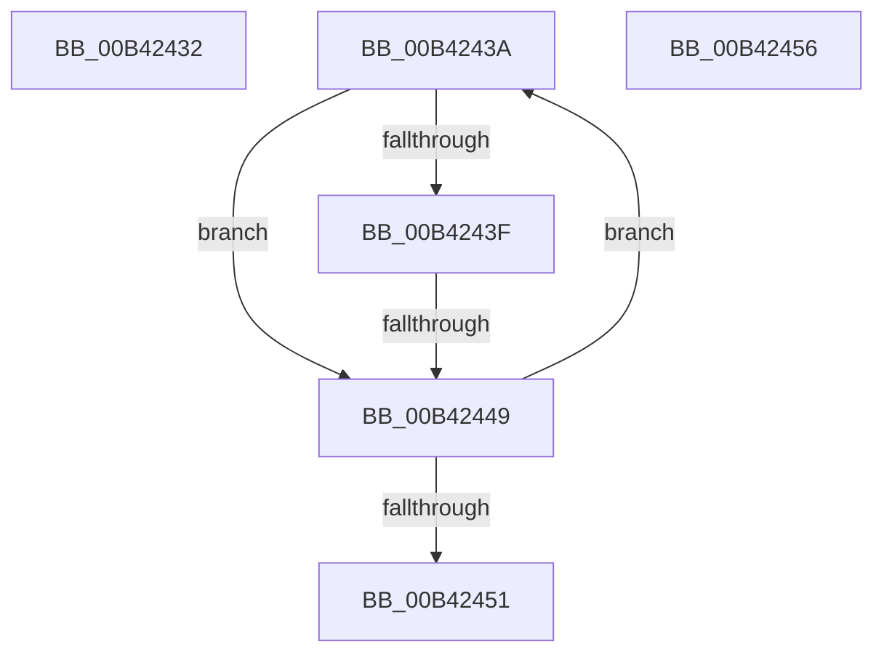

# sub_00B42432

- RVA: `0x00B42432`–`0x00B42460` (길이 `46` bytes)
- VA: `0x0000000140B42432`
- 실행 섹션: `PAGE`
- PDB 이름 있음: `아니요`; PDB Function 태그: `아니요`
- unwind 정보 RVA: `0x000B642C`
- 디코드: `12`개 명령, `46/46` bytes 표시
- 미해석 바이트: `0` (있으면 어셈블리에 `.byte`로 보존)

> 이 문서는 커널 이미지의 기계어와 PDB 기호를 분석해 생성했습니다. 4번과 5번은 함수 원형과 자료형을 바이너리 사용 방식에서 추정한 C 해석이며 원본 소스 복구 결과는 아닙니다.

## 1. Dependencies

- 직접 호출 지점: **0**; 고유 호출 대상: **0**
- 직접 호출자로 확인된 함수: **0**
- RIP 상대 이미지 참조: **0**

### Outgoing calls
- 직접 디코드된 call 명령이 없습니다.

### Direct callers
- 이 함수 시작 RVA로 연결되는 직접 call은 확인되지 않았습니다. 간접 호출은 완전히 역산할 수 없습니다.

### Static image references
- 디코드된 RIP-relative 메모리 참조가 없습니다.

## 2. Other-region calls and transfers

- 다른 실행 섹션으로 향하는 call: **0**
- call이 아닌 외부 분기/꼬리 이동: **4**
  - `0x00B42435` → [PiControlGetDevicePowerData + 0x151](../A7/PiControlGetDevicePowerData_function_00A7A808.md) (`tail-transfer`)
  - `0x00B42443` → [PiControlGetDevicePowerData + 0x192](../A7/PiControlGetDevicePowerData_function_00A7A808.md) (`tail-transfer`)
  - `0x00B42451` → [PiControlGetDevicePowerData + 0x192](../A7/PiControlGetDevicePowerData_function_00A7A808.md) (`tail-transfer`)
  - `0x00B4245B` → [PiControlGetDevicePowerData + 0x1C5](../A7/PiControlGetDevicePowerData_function_00A7A808.md) (`tail-transfer`)

## 3. Assembly (complete function range)

```asm
00B42432  89 4D 97                        mov dword ptr [rbp - 0x69], ecx
00B42435  E9 1F 85 F3 FF                  jmp 0x140a7a959
00B4243A  39 5D E7                        cmp dword ptr [rbp - 0x19], ebx
00B4243D  74 0A                           je 0x140b42449
00B4243F  44 39 4D E7                     cmp dword ptr [rbp - 0x19], r9d
00B42443  0F 8E 51 85 F3 FF               jle 0x140a7a99a
00B42449  45 2B C5                        sub r8d, r13d
00B4244C  45 3B C5                        cmp r8d, r13d
00B4244F  7D E9                           jge 0x140b4243a
00B42451  E9 44 85 F3 FF                  jmp 0x140a7a99a
00B42456  BB 05 00 00 80                  mov ebx, 0x80000005
00B4245B  E9 6D 85 F3 FF                  jmp 0x140a7a9cd
```

## 4. C-style interpretation (structured pseudocode)

```c
void __fastcall sub_00B42432(int a1, __int64 a2, int a3, int a4)
{
    *(unsigned int *)(v_rbp - 105) = a1;
}
```

## 5. (Beta) C Style

```c
void sub_00B42432(int32_t Arg1, int64_t Arg2, int32_t Arg3, int32_t Arg4)
{
    *(uint32_t *)(local_rbp - 0x69) = Arg1;
}
```

## 6. Execution-region graph

[열기: 2D/3D 그래프와 함수 탐색 컨트롤 패널](../../../control-panel.html?section=page&rva=0x00B42432&view=graph)

- 2D 그래프는 위에서 아래로 흐르고, 3D 그래프는 빈 공간을 드래그해 회전합니다. Shift+드래그는 이동, 휠은 확대·축소, 함수 노드 선택은 대상 보고서 이동입니다.

### Static fallback


