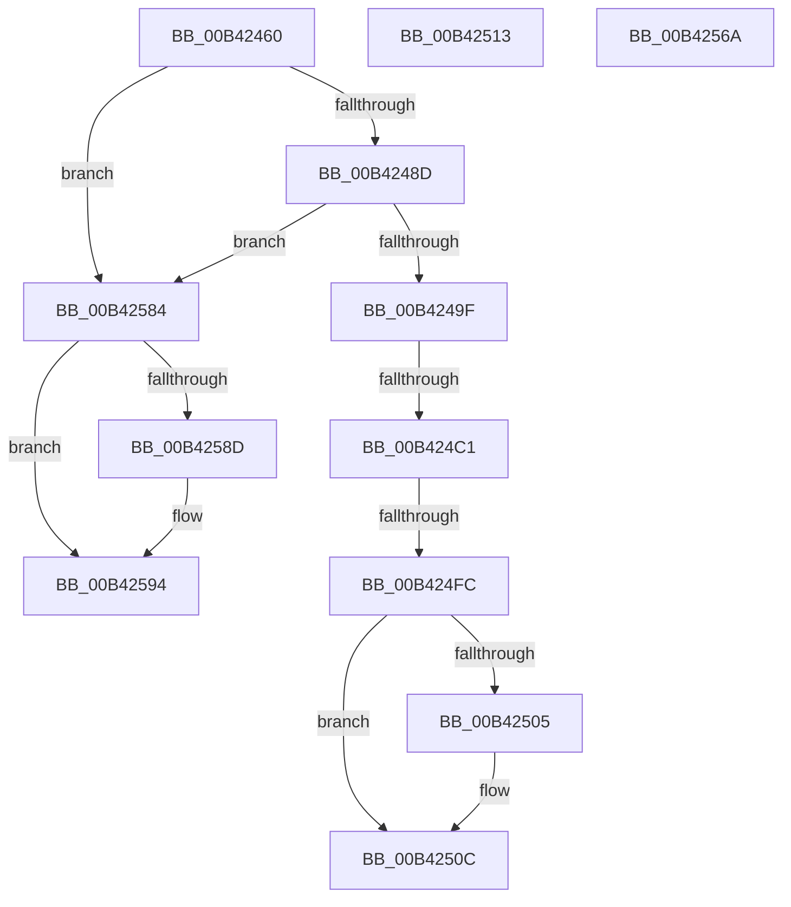

# sub_00B42460

- RVA: `0x00B42460`–`0x00B4259E` (길이 `318` bytes)
- VA: `0x0000000140B42460`
- 실행 섹션: `PAGE`
- PDB 이름 있음: `아니요`; PDB Function 태그: `아니요`
- unwind 정보 RVA: `0x000B65C4`
- 디코드: `84`개 명령, `318/318` bytes 표시
- 미해석 바이트: `0` (있으면 어셈블리에 `.byte`로 보존)

> 이 문서는 커널 이미지의 기계어와 PDB 기호를 분석해 생성했습니다. 4번과 5번은 함수 원형과 자료형을 바이너리 사용 방식에서 추정한 C 해석이며 원본 소스 복구 결과는 아닙니다.

## 1. Dependencies

- 직접 호출 지점: **9**; 고유 호출 대상: **7**
- 직접 호출자로 확인된 함수: **0**
- RIP 상대 이미지 참조: **1**

### Outgoing calls
- `0x00B42467` → [ExpGetDriveGeometry](../AC/ExpGetDriveGeometry_function_00ACA760.md) (function, `0x00ACA760`)
- `0x00B424B0` → [ExAllocatePool2](../../poolcode/B8/ExAllocatePool2_function_00B820F0.md) (function, `0x00B820F0`)
- `0x00B424D7` → [swprintf_s](../../text/50/swprintf_s_function_00504B20.md) (function, `0x00504B20`)
- `0x00B424E3` → [ExpTranslateSymbolicLink](../A7/ExpTranslateSymbolicLink_function_00A7B38C.md) (function, `0x00A7B38C`)
- `0x00B424EF` → [ExFreePoolWithTag](../../poolcode/B8/ExFreePoolWithTag_function_00B82870.md) (function, `0x00B82870`)
- `0x00B42507` → [ExFreePoolWithTag](../../poolcode/B8/ExFreePoolWithTag_function_00B82870.md) (function, `0x00B82870`)
- `0x00B4255F` → [ExpCreateOutputSIGNATURE](../7C/ExpCreateOutputSIGNATURE_function_007CB404.md) (function, `0x007CB404`)
- `0x00B42579` → [ExpCreateOutputARC](../7C/ExpCreateOutputARC_function_007CB30C.md) (function, `0x007CB30C`)
- `0x00B4258F` → [ExFreePoolWithTag](../../poolcode/B8/ExFreePoolWithTag_function_00B82870.md) (function, `0x00B82870`)

### Direct callers
- 이 함수 시작 RVA로 연결되는 직접 call은 확인되지 않았습니다. 간접 호출은 완전히 역산할 수 없습니다.

### Static image references
- `0x00B424C8` → RVA `0x00B08940` (` ?? ::NNGAKEGL::`string'`; read)

## 2. Other-region calls and transfers

- 다른 실행 섹션으로 향하는 call: **5**
  - `0x00B424B0` → [ExAllocatePool2](../../poolcode/B8/ExAllocatePool2_function_00B820F0.md) (`PAGE` → `POOLCODE`)
  - `0x00B424D7` → [swprintf_s](../../text/50/swprintf_s_function_00504B20.md) (`PAGE` → `.text`)
  - `0x00B424EF` → [ExFreePoolWithTag](../../poolcode/B8/ExFreePoolWithTag_function_00B82870.md) (`PAGE` → `POOLCODE`)
  - `0x00B42507` → [ExFreePoolWithTag](../../poolcode/B8/ExFreePoolWithTag_function_00B82870.md) (`PAGE` → `POOLCODE`)
  - `0x00B4258F` → [ExFreePoolWithTag](../../poolcode/B8/ExFreePoolWithTag_function_00B82870.md) (`PAGE` → `POOLCODE`)
- call이 아닌 외부 분기/꼬리 이동: **6**
  - `0x00B424BB` → [ExpTranslateEfiPath + 0x1BE](../A7/ExpTranslateEfiPath_function_00A7AF84.md) (`tail-transfer`)
  - `0x00B424F6` → [ExpTranslateEfiPath + 0x147](../A7/ExpTranslateEfiPath_function_00A7AF84.md) (`tail-transfer`)
  - `0x00B4250E` → [ExpTranslateEfiPath + 0x17F](../A7/ExpTranslateEfiPath_function_00A7AF84.md) (`tail-transfer`)
  - `0x00B42565` → [ExpTranslateEfiPath + 0x169](../A7/ExpTranslateEfiPath_function_00A7AF84.md) (`tail-transfer`)
  - `0x00B4257F` → [ExpTranslateEfiPath + 0x169](../A7/ExpTranslateEfiPath_function_00A7AF84.md) (`tail-transfer`)
  - `0x00B42599` → [ExpTranslateEfiPath + 0x17F](../A7/ExpTranslateEfiPath_function_00A7AF84.md) (`tail-transfer`)

## 3. Assembly (complete function range)

```asm
00B42460  48 8D 55 07                     lea rdx, [rbp + 7]
00B42464  41 8B CF                        mov ecx, r15d
00B42467  E8 F4 82 F8 FF                  call 0x140aca760
00B4246C  8B 4D 1B                        mov ecx, dword ptr [rbp + 0x1b]
00B4246F  85 C0                           test eax, eax
00B42471  49 8B C5                        mov rax, r13
00B42474  41 0F 48 CE                     cmovs ecx, r14d
00B42478  33 D2                           xor edx, edx
00B4247A  44 8B C9                        mov r9d, ecx
00B4247D  49 F7 F1                        div r9
00B42480  89 4D 1B                        mov dword ptr [rbp + 0x1b], ecx
00B42483  48 39 47 08                     cmp qword ptr [rdi + 8], rax
00B42487  0F 85 F7 00 00 00               jne 0x140b42584
00B4248D  33 D2                           xor edx, edx
00B4248F  48 8B C3                        mov rax, rbx
00B42492  49 F7 F1                        div r9
00B42495  48 39 47 10                     cmp qword ptr [rdi + 0x10], rax
00B42499  0F 85 E5 00 00 00               jne 0x140b42584
00B4249F  45 8A EE                        mov r13b, r14b
00B424A2  BA 5E 00 00 00                  mov edx, 0x5e
00B424A7  41 B8 45 6E 76 72               mov r8d, 0x72766e45
00B424AD  8D 4A E2                        lea ecx, [rdx - 0x1e]
00B424B0  E8 3B FC 03 00                  call 0x140b820f0
00B424B5  48 8B D8                        mov rbx, rax
00B424B8  48 85 C0                        test rax, rax
00B424BB  0F 84 81 8C F3 FF               je 0x140a7b142
00B424C1  45 8B CF                        mov r9d, r15d
00B424C4  89 74 24 20                     mov dword ptr [rsp + 0x20], esi
00B424C8  4C 8D 05 71 64 FC FF            lea r8, [rip - 0x39b8f]
00B424CF  BA 2F 00 00 00                  mov edx, 0x2f
00B424D4  48 8B C8                        mov rcx, rax
00B424D7  E8 44 26 9C FF                  call 0x140504b20
00B424DC  48 8D 55 F7                     lea rdx, [rbp - 9]
00B424E0  48 8B CB                        mov rcx, rbx
00B424E3  E8 A4 8E F3 FF                  call 0x140a7b38c
00B424E8  33 D2                           xor edx, edx
00B424EA  48 8B CB                        mov rcx, rbx
00B424ED  8B F0                           mov esi, eax
00B424EF  E8 7C 03 04 00                  call 0x140b82870
00B424F4  85 F6                           test esi, esi
00B424F6  0F 89 CF 8B F3 FF               jns 0x140a7b0cb
00B424FC  48 8B 4D AF                     mov rcx, qword ptr [rbp - 0x51]
00B42500  48 85 C9                        test rcx, rcx
00B42503  74 07                           je 0x140b4250c
00B42505  33 D2                           xor edx, edx
00B42507  E8 64 03 04 00                  call 0x140b82870
00B4250C  8B DE                           mov ebx, esi
00B4250E  E9 F0 8B F3 FF                  jmp 0x140a7b103
00B42513  8B 47 04                        mov eax, dword ptr [rdi + 4]
00B42516  4C 8D 47 18                     lea r8, [rdi + 0x18]
00B4251A  48 8B 55 D7                     mov rdx, qword ptr [rbp - 0x29]
00B4251E  4C 8D 4D B7                     lea r9, [rbp - 0x49]
00B42522  89 45 B7                        mov dword ptr [rbp - 0x49], eax
00B42525  41 8B C6                        mov eax, r14d
00B42528  48 0F AF 47 08                  imul rax, qword ptr [rdi + 8]
00B4252D  41 8B CE                        mov ecx, r14d
00B42530  48 0F AF 4F 10                  imul rcx, qword ptr [rdi + 0x10]
00B42535  48 89 45 CF                     mov qword ptr [rbp - 0x31], rax
00B42539  8A 45 A7                        mov al, byte ptr [rbp - 0x59]
00B4253C  88 44 24 38                     mov byte ptr [rsp + 0x38], al
00B42540  48 8D 45 C7                     lea rax, [rbp - 0x39]
00B42544  48 89 74 24 30                  mov qword ptr [rsp + 0x30], rsi
00B42549  48 89 44 24 28                  mov qword ptr [rsp + 0x28], rax
00B4254E  48 8D 45 CF                     lea rax, [rbp - 0x31]
00B42552  48 89 4D C7                     mov qword ptr [rbp - 0x39], rcx
00B42556  48 8B 4D DF                     mov rcx, qword ptr [rbp - 0x21]
00B4255A  48 89 44 24 20                  mov qword ptr [rsp + 0x20], rax
00B4255F  E8 A0 8E C8 FF                  call 0x1407cb404
00B42564  90                              nop
00B42565  E9 83 8B F3 FF                  jmp 0x140a7b0ed
00B4256A  48 8B 55 D7                     mov rdx, qword ptr [rbp - 0x29]
00B4256E  4C 8D 45 F7                     lea r8, [rbp - 9]
00B42572  48 8B 4D DF                     mov rcx, qword ptr [rbp - 0x21]
00B42576  4C 8B CE                        mov r9, rsi
00B42579  E8 8E 8D C8 FF                  call 0x1407cb30c
00B4257E  90                              nop
00B4257F  E9 69 8B F3 FF                  jmp 0x140a7b0ed
00B42584  48 8B 4D AF                     mov rcx, qword ptr [rbp - 0x51]
00B42588  48 85 C9                        test rcx, rcx
00B4258B  74 07                           je 0x140b42594
00B4258D  33 D2                           xor edx, edx
00B4258F  E8 DC 02 04 00                  call 0x140b82870
00B42594  BB 0D 00 00 C0                  mov ebx, 0xc000000d
00B42599  E9 65 8B F3 FF                  jmp 0x140a7b103
```

## 4. C-style interpretation (structured pseudocode)

```c
__int64 __fastcall sub_00B42460(void)
{
    __int64 result;
    unsigned int v_stack_p20;
    unsigned __int64 v_stack_p28;
    unsigned __int64 v_stack_p30;
    unsigned __int8 v_stack_p38;

    result = ExpGetDriveGeometry((unsigned int)((unsigned int)(v_r15)), v_rbp + 7, a3, a4);
    a1 = (unsigned int)(*(unsigned int *)(v_rbp + 27));
    if (sign_flag) { a1 = (unsigned int)(v_r14); }
    a2 = 0;
    *(unsigned int *)(v_rbp + 27) = (unsigned int)(a1);
    if ((*(unsigned __int64 *)(v_rdi + 8)) != v_r13) goto loc_00B42584;
    a2 = 0;
    if ((*(unsigned __int64 *)(v_rdi + 16)) != v_rbx) goto loc_00B42584;
    result = ExAllocatePool2(94 - 30, 94, (unsigned int)(0x72766E45ULL), (unsigned int)((unsigned int)(a1)));
    v_stack_p20 = (unsigned int)(v_rsi);
    result = swprintf_s(result, 47, v_rip - 236431, (unsigned int)((unsigned int)(v_r15)));
    result = ExpTranslateSymbolicLink(result, v_rbp - 9, v_rip - 236431, (unsigned int)((unsigned int)(v_r15)));
    a2 = 0;
    result = ExFreePoolWithTag(result, a2, v_rip - 236431, (unsigned int)((unsigned int)(v_r15)));
    if (*(unsigned __int64 *)(v_rbp - 81) != 0) {
        a2 = 0;
        result = ExFreePoolWithTag(*(unsigned __int64 *)(v_rbp - 81), a2, v_rip - 236431, (unsigned int)((unsigned int)(v_r15)));
    }
loc_00B42584:
    if (*(unsigned __int64 *)(v_rbp - 81) != 0) {
        a2 = 0;
        result = ExFreePoolWithTag(*(unsigned __int64 *)(v_rbp - 81), a2, v_rip - 236431, (unsigned int)((unsigned int)(v_r15)));
    }
}
```

## 5. (Beta) C Style

```c
void sub_00B42460(void)
{
    int64_t result;
    uint32_t v_stack_p20;
    uint64_t v_stack_p28;
    uint64_t v_stack_p30;
    uint8_t v_stack_p38;

    result = ExpGetDriveGeometry((uint32_t)((uint32_t)(local_r15)), local_rbp + 7, a3, a4);
    a1 = (uint32_t)(*(uint32_t *)(local_rbp + 0x1B));
    if (sign_flag) { a1 = (uint32_t)(local_r14); }
    a2 = 0;
    *(uint32_t *)(local_rbp + 0x1B) = (uint32_t)(a1);
    if ((*(uint64_t *)(local_rdi + 0x8)) != local_r13) goto loc_00B42584;
    a2 = 0;
    if ((*(uint64_t *)(local_rdi + 0x10)) != local_rbx) goto loc_00B42584;
    result = ExAllocatePool2(94 - 30, 94, (uint32_t)(0x72766E45ULL), (uint32_t)((uint32_t)(a1)));
    v_stack_p20 = (uint32_t)(local_rsi);
    result = swprintf_s(result, 47, v_rip - 236431, (uint32_t)((uint32_t)(local_r15)));
    result = ExpTranslateSymbolicLink(result, local_rbp - 9, v_rip - 236431, (uint32_t)((uint32_t)(local_r15)));
    a2 = 0;
    result = ExFreePoolWithTag(result, a2, v_rip - 236431, (uint32_t)((uint32_t)(local_r15)));
    if (*(uint64_t *)(local_rbp - 0x51) != 0) {
        a2 = 0;
        result = ExFreePoolWithTag(*(uint64_t *)(local_rbp - 0x51), a2, v_rip - 236431, (uint32_t)((uint32_t)(local_r15)));
    }
loc_00B42584:
    if (*(uint64_t *)(local_rbp - 0x51) != 0) {
        a2 = 0;
        result = ExFreePoolWithTag(*(uint64_t *)(local_rbp - 0x51), a2, v_rip - 236431, (uint32_t)((uint32_t)(local_r15)));
    }
}
```

## 6. Execution-region graph

[열기: 2D/3D 그래프와 함수 탐색 컨트롤 패널](../../../control-panel.html?section=page&rva=0x00B42460&view=graph)

- 2D 그래프는 위에서 아래로 흐르고, 3D 그래프는 빈 공간을 드래그해 회전합니다. Shift+드래그는 이동, 휠은 확대·축소, 함수 노드 선택은 대상 보고서 이동입니다.

### Static fallback


