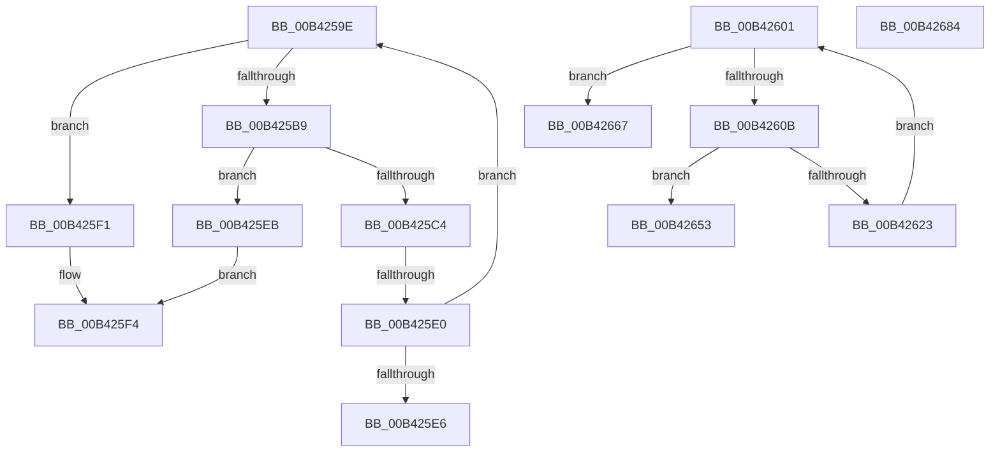

# sub_00B4259E

- RVA: `0x00B4259E`–`0x00B4268E` (길이 `240` bytes)
- VA: `0x0000000140B4259E`
- 실행 섹션: `PAGE`
- PDB 이름 있음: `아니요`; PDB Function 태그: `아니요`
- unwind 정보 RVA: `0x000B65F0`
- 디코드: `70`개 명령, `240/240` bytes 표시
- 미해석 바이트: `0` (있으면 어셈블리에 `.byte`로 보존)

> 이 문서는 커널 이미지의 기계어와 PDB 기호를 분석해 생성했습니다. 4번과 5번은 함수 원형과 자료형을 바이너리 사용 방식에서 추정한 C 해석이며 원본 소스 복구 결과는 아닙니다.

## 1. Dependencies

- 직접 호출 지점: **2**; 고유 호출 대상: **2**
- 직접 호출자로 확인된 함수: **0**
- RIP 상대 이미지 참조: **0**

### Outgoing calls
- `0x00B42631` → [memcpy](../../text/6C/memcpy_function_006C6840.md) (function, `0x006C6840`)
- `0x00B42658` → [ExFreePoolWithTag](../../poolcode/B8/ExFreePoolWithTag_function_00B82870.md) (function, `0x00B82870`)

### Direct callers
- 이 함수 시작 RVA로 연결되는 직접 call은 확인되지 않았습니다. 간접 호출은 완전히 역산할 수 없습니다.

### Static image references
- 디코드된 RIP-relative 메모리 참조가 없습니다.

## 2. Other-region calls and transfers

- 다른 실행 섹션으로 향하는 call: **2**
  - `0x00B42631` → [memcpy](../../text/6C/memcpy_function_006C6840.md) (`PAGE` → `.text`)
  - `0x00B42658` → [ExFreePoolWithTag](../../poolcode/B8/ExFreePoolWithTag_function_00B82870.md) (`PAGE` → `POOLCODE`)
- call이 아닌 외부 분기/꼬리 이동: **6**
  - `0x00B425DA` → [ExpParseEfiPath + 0x82](../A7/ExpParseEfiPath_function_00A7B218.md) (`tail-transfer`)
  - `0x00B425E6` → [ExpParseEfiPath + 0x82](../A7/ExpParseEfiPath_function_00A7B218.md) (`tail-transfer`)
  - `0x00B425FC` → [ExpParseEfiPath + 0x82](../A7/ExpParseEfiPath_function_00A7B218.md) (`tail-transfer`)
  - `0x00B42662` → [ExpParseEfiPath + 0xE2](../A7/ExpParseEfiPath_function_00A7B218.md) (`tail-transfer`)
  - `0x00B4267F` → [ExpParseEfiPath + 0xAC](../A7/ExpParseEfiPath_function_00A7B218.md) (`tail-transfer`)
  - `0x00B42689` → [ExpParseEfiPath + 0xE2](../A7/ExpParseEfiPath_function_00A7B218.md) (`tail-transfer`)

## 3. Assembly (complete function range)

```asm
00B4259E  41 0F B6 52 03                  movzx edx, byte ptr [r10 + 3]
00B425A3  8D 4E FC                        lea ecx, [rsi - 4]
00B425A6  45 0F B6 42 02                  movzx r8d, byte ptr [r10 + 2]
00B425AB  C1 E2 08                        shl edx, 8
00B425AE  41 8B C0                        mov eax, r8d
00B425B1  0B C2                           or eax, edx
00B425B3  03 C8                           add ecx, eax
00B425B5  3B CE                           cmp ecx, esi
00B425B7  72 38                           jb 0x140b425f1
00B425B9  8B F1                           mov esi, ecx
00B425BB  42 8D 0C 30                     lea ecx, [rax + r14]
00B425BF  41 3B CE                        cmp ecx, r14d
00B425C2  72 27                           jb 0x140b425eb
00B425C4  44 8B F1                        mov r14d, ecx
00B425C7  8B DF                           mov ebx, edi
00B425C9  8B CA                           mov ecx, edx
00B425CB  49 0B C8                        or rcx, r8
00B425CE  4C 03 D1                        add r10, rcx
00B425D1  41 8A 0A                        mov cl, byte ptr [r10]
00B425D4  8A C1                           mov al, cl
00B425D6  24 7F                           and al, 0x7f
00B425D8  3C 04                           cmp al, 4
00B425DA  0F 85 BA 8C F3 FF               jne 0x140a7b29a
00B425E0  41 38 42 01                     cmp byte ptr [r10 + 1], al
00B425E4  74 B8                           je 0x140b4259e
00B425E6  E9 AF 8C F3 FF                  jmp 0x140a7b29a
00B425EB  41 83 CE FF                     or r14d, 0xffffffff
00B425EF  EB 03                           jmp 0x140b425f4
00B425F1  83 CE FF                        or esi, 0xffffffff
00B425F4  41 8A 0A                        mov cl, byte ptr [r10]
00B425F7  BB 95 00 00 C0                  mov ebx, 0xc0000095
00B425FC  E9 99 8C F3 FF                  jmp 0x140a7b29a
00B42601  41 8A 04 24                     mov al, byte ptr [r12]
00B42605  24 7F                           and al, 0x7f
00B42607  3C 7F                           cmp al, 0x7f
00B42609  74 5C                           je 0x140b42667
00B4260B  41 0F B6 6C 24 03               movzx ebp, byte ptr [r12 + 3]
00B42611  41 0F B6 44 24 02               movzx eax, byte ptr [r12 + 2]
00B42617  C1 E5 08                        shl ebp, 8
00B4261A  0B E8                           or ebp, eax
00B4261C  83 ED 04                        sub ebp, 4
00B4261F  3B EE                           cmp ebp, esi
00B42621  73 30                           jae 0x140b42653
00B42623  41 8B CF                        mov ecx, r15d
00B42626  49 8D 54 24 04                  lea rdx, [r12 + 4]
00B4262B  48 03 CF                        add rcx, rdi
00B4262E  44 8B C5                        mov r8d, ebp
00B42631  E8 0A 42 B8 FF                  call 0x1406c6840
00B42636  41 0F B6 4C 24 03               movzx ecx, byte ptr [r12 + 3]
00B4263C  2B F5                           sub esi, ebp
00B4263E  41 0F B6 44 24 02               movzx eax, byte ptr [r12 + 2]
00B42644  44 03 FD                        add r15d, ebp
00B42647  48 C1 E1 08                     shl rcx, 8
00B4264B  48 0B C8                        or rcx, rax
00B4264E  4C 03 E1                        add r12, rcx
00B42651  EB AE                           jmp 0x140b42601
00B42653  33 D2                           xor edx, edx
00B42655  48 8B CF                        mov rcx, rdi
00B42658  E8 13 02 04 00                  call 0x140b82870
00B4265D  B8 9A 00 00 C0                  mov eax, 0xc000009a
00B42662  E9 93 8C F3 FF                  jmp 0x140a7b2fa
00B42667  48 8B 6C 24 68                  mov rbp, qword ptr [rsp + 0x68]
00B4266C  41 8B C7                        mov eax, r15d
00B4266F  4C 8B 7C 24 70                  mov r15, qword ptr [rsp + 0x70]
00B42674  48 D1 E8                        shr rax, 1
00B42677  45 33 E4                        xor r12d, r12d
00B4267A  66 44 89 24 47                  mov word ptr [rdi + rax*2], r12w
00B4267F  E9 40 8C F3 FF                  jmp 0x140a7b2c4
00B42684  B8 0D 00 00 C0                  mov eax, 0xc000000d
00B42689  E9 6C 8C F3 FF                  jmp 0x140a7b2fa
```

## 4. C-style interpretation (structured pseudocode)

```c
__int64 __fastcall sub_00B4259E(void)
{
    __int64 result;
    __int64 v_r10;
    __int64 v_r14;
    __int64 v_rsi;
    unsigned __int64 v_stack_p68;
    unsigned __int64 v_stack_p70;

    a2 = (unsigned int)((*(unsigned __int8 *)(v_r10 + 3)) << (8));
    result = (unsigned int)(((unsigned int)((unsigned int)(*(unsigned __int8 *)(v_r10 + 2)))) | ((unsigned int)(a2)));
    a1 = (unsigned int)((v_rsi - 4) + ((unsigned int)(result)));
    if (((unsigned int)(a1)) < ((unsigned int)(v_rsi))) goto loc_00B425F1;
    if (((unsigned int)(result + v_r14 * 1)) < ((unsigned int)(v_r14))) goto loc_00B425EB;
    a1 = ((unsigned int)((unsigned int)(a2))) | (*(unsigned __int8 *)(v_r10 + 2));
    v_r10 = (v_r10) + (a1);
    result = (unsigned __int8)(((unsigned __int8)(*(unsigned __int8 *)(v_r10))) & (127));
    if ((*(unsigned __int8 *)(v_r10 + 1)) == ((unsigned __int8)(result))) goto loc_00B4259E;
loc_00B425EB:
    v_r14 = (unsigned int)(((unsigned int)((unsigned int)(result + v_r14 * 1))) | (0xFFFFFFFFULL));
    goto loc_00B425F4;
loc_00B425F1:
    v_rsi = (unsigned int)(((unsigned int)((unsigned int)(a1))) | (0xFFFFFFFFULL));
loc_00B425F4:
}
```

## 5. (Beta) C Style

```c
void sub_00B4259E(void)
{
    int64_t result;
    int64_t local_r10;
    int64_t local_r14;
    int64_t local_rsi;
    uint64_t v_stack_p68;
    uint64_t v_stack_p70;

    a2 = (uint32_t)((*(uint8_t *)(local_r10 + 0x3)) << (8));
    result = (uint32_t)(((uint32_t)((uint32_t)(*(uint8_t *)(local_r10 + 0x2)))) | ((uint32_t)(a2)));
    a1 = (uint32_t)((local_rsi - 4) + ((uint32_t)(result)));
    if (((uint32_t)(a1)) < ((uint32_t)(local_rsi))) goto loc_00B425F1;
    if (((uint32_t)(result + local_r14 * 1)) < ((uint32_t)(local_r14))) goto loc_00B425EB;
    a1 = ((uint32_t)((uint32_t)(a2))) | (*(uint8_t *)(local_r10 + 0x2));
    local_r10 = (local_r10) + (a1);
    result = (uint8_t)(((uint8_t)(*(uint8_t *)(local_r10))) & (127));
    if ((*(uint8_t *)(local_r10 + 0x1)) == ((uint8_t)(result))) goto loc_00B4259E;
loc_00B425EB:
    local_r14 = (uint32_t)(((uint32_t)((uint32_t)(result + local_r14 * 1))) | (0xFFFFFFFFULL));
    goto loc_00B425F4;
loc_00B425F1:
    local_rsi = (uint32_t)(((uint32_t)((uint32_t)(a1))) | (0xFFFFFFFFULL));
loc_00B425F4:
}
```

## 6. Execution-region graph

[열기: 2D/3D 그래프와 함수 탐색 컨트롤 패널](../../../control-panel.html?section=page&rva=0x00B4259E&view=graph)

- 2D 그래프는 위에서 아래로 흐르고, 3D 그래프는 빈 공간을 드래그해 회전합니다. Shift+드래그는 이동, 휠은 확대·축소, 함수 노드 선택은 대상 보고서 이동입니다.

### Static fallback


