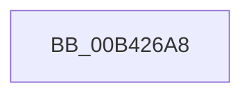

# sub_00B426A8

- RVA: `0x00B426A8`–`0x00B42737` (길이 `143` bytes)
- VA: `0x0000000140B426A8`
- 실행 섹션: `PAGE`
- PDB 이름 있음: `아니요`; PDB Function 태그: `아니요`
- unwind 정보 RVA: `0x000B66E0`
- 디코드: `33`개 명령, `143/143` bytes 표시
- 미해석 바이트: `0` (있으면 어셈블리에 `.byte`로 보존)

> 이 문서는 커널 이미지의 기계어와 PDB 기호를 분석해 생성했습니다. 4번과 5번은 함수 원형과 자료형을 바이너리 사용 방식에서 추정한 C 해석이며 원본 소스 복구 결과는 아닙니다.

## 1. Dependencies

- 직접 호출 지점: **1**; 고유 호출 대상: **1**
- 직접 호출자로 확인된 함수: **0**
- RIP 상대 이미지 참조: **2**

### Outgoing calls
- `0x00B4272C` → [EtwWrite](../../text/41/EtwWrite_function_0041C720.md) (function, `0x0041C720`)

### Direct callers
- 이 함수 시작 RVA로 연결되는 직접 call은 확인되지 않았습니다. 간접 호출은 완전히 역산할 수 없습니다.

### Static image references
- `0x00B426AD` → RVA `0x00010AF8` (`.rdata`; read)
- `0x00B4270B` → RVA `0x00E662D0` (`.data`; read)

## 2. Other-region calls and transfers

- 다른 실행 섹션으로 향하는 call: **1**
  - `0x00B4272C` → [EtwWrite](../../text/41/EtwWrite_function_0041C720.md) (`PAGE` → `.text`)
- call이 아닌 외부 분기/꼬리 이동: **1**
  - `0x00B42732` → [PnpDiagRundownConnectionResourceForEachDevice + 0x9F](../A7/PnpDiagRundownConnectionResourceForEachDevice_function_00A7B920.md) (`tail-transfer`)

## 3. Assembly (complete function range)

```asm
00B426A8  41 8B 44 8E 20                  mov eax, dword ptr [r14 + rcx*4 + 0x20]
00B426AD  48 8D 15 44 E4 4C FF            lea rdx, [rip - 0xb31bbc]
00B426B4  89 45 F3                        mov dword ptr [rbp - 0xd], eax
00B426B7  41 B9 04 00 00 00               mov r9d, 4
00B426BD  41 8B 44 8E 1C                  mov eax, dword ptr [r14 + rcx*4 + 0x1c]
00B426C2  45 33 C0                        xor r8d, r8d
00B426C5  41 0F B7 4F 28                  movzx ecx, word ptr [r15 + 0x28]
00B426CA  83 65 03 00                     and dword ptr [rbp + 3], 0
00B426CE  83 65 13 00                     and dword ptr [rbp + 0x13], 0
00B426D2  83 65 23 00                     and dword ptr [rbp + 0x23], 0
00B426D6  83 65 33 00                     and dword ptr [rbp + 0x33], 0
00B426DA  89 45 EF                        mov dword ptr [rbp - 0x11], eax
00B426DD  49 8D 47 20                     lea rax, [r15 + 0x20]
00B426E1  48 89 45 F7                     mov qword ptr [rbp - 9], rax
00B426E5  48 8D 45 EF                     lea rax, [rbp - 0x11]
00B426E9  48 89 45 07                     mov qword ptr [rbp + 7], rax
00B426ED  8B C1                           mov eax, ecx
00B426EF  D1 E8                           shr eax, 1
00B426F1  89 45 E7                        mov dword ptr [rbp - 0x19], eax
00B426F4  48 8D 45 E7                     lea rax, [rbp - 0x19]
00B426F8  48 89 45 17                     mov qword ptr [rbp + 0x17], rax
00B426FC  49 8B 47 30                     mov rax, qword ptr [r15 + 0x30]
00B42700  48 89 45 27                     mov qword ptr [rbp + 0x27], rax
00B42704  48 8D 45 F7                     lea rax, [rbp - 9]
00B42708  89 4D 2F                        mov dword ptr [rbp + 0x2f], ecx
00B4270B  48 8B 0D BE 3B 32 00            mov rcx, qword ptr [rip + 0x323bbe]
00B42712  48 89 44 24 20                  mov qword ptr [rsp + 0x20], rax
00B42717  C7 45 FF 08 00 00 00            mov dword ptr [rbp - 1], 8
00B4271E  C7 45 0F 08 00 00 00            mov dword ptr [rbp + 0xf], 8
00B42725  C7 45 1F 04 00 00 00            mov dword ptr [rbp + 0x1f], 4
00B4272C  E8 EF 9F 8D FF                  call 0x14041c720
00B42731  90                              nop
00B42732  E9 88 92 F3 FF                  jmp 0x140a7b9bf
```

## 4. C-style interpretation (structured pseudocode)

```c
__int64 __fastcall sub_00B426A8(__int64 a1, __int64 a2, int a3)
{
    __int64 result;
    unsigned __int64 v_stack_p20;

    *(unsigned int *)(v_rbp - 13) = (unsigned int)((unsigned int)(*(unsigned int *)(v_r14 + a1 * 4 + 32)));
    a3 = 0;
    *(unsigned int *)(v_rbp - 17) = (unsigned int)((unsigned int)(*(unsigned int *)(v_r14 + a1 * 4 + 28)));
    *(unsigned __int64 *)(v_rbp - 9) = v_r15 + 32;
    *(unsigned __int64 *)(v_rbp + 7) = v_rbp - 17;
    result = (unsigned int)(((unsigned int)((unsigned int)(*(unsigned __int16 *)(v_r15 + 40)))) >> (1));
    *(unsigned int *)(v_rbp - 25) = (unsigned int)(result);
    *(unsigned __int64 *)(v_rbp + 23) = v_rbp - 25;
    *(unsigned __int64 *)(v_rbp + 39) = *(unsigned __int64 *)(v_r15 + 48);
    *(unsigned int *)(v_rbp + 47) = (unsigned int)(*(unsigned __int16 *)(v_r15 + 40));
    v_stack_p20 = v_rbp - 9;
    *(unsigned int *)(v_rbp - 1) = 8;
    *(unsigned int *)(v_rbp + 15) = 8;
    *(unsigned int *)(v_rbp + 31) = 4;
    result = EtwWrite(*(unsigned __int64 *)(v_rip + 3292094), v_rip - 11738044, a3, 4);
}
```

## 5. (Beta) C Style

```c
int64_t sub_00B426A8(int64_t Arg1, int64_t Arg2, int32_t Arg3)
{
    int64_t result;
    uint64_t v_stack_p20;

    *(uint32_t *)(local_rbp - 0xD) = (uint32_t)((uint32_t)(*(uint32_t *)(local_r14 + Arg1 * 4 + 0x20)));
    Arg3 = 0;
    *(uint32_t *)(local_rbp - 0x11) = (uint32_t)((uint32_t)(*(uint32_t *)(local_r14 + Arg1 * 4 + 0x1C)));
    *(uint64_t *)(local_rbp - 0x9) = local_r15 + 32;
    *(uint64_t *)(local_rbp + 0x7) = local_rbp - 17;
    result = (uint32_t)(((uint32_t)((uint32_t)(*(uint16_t *)(local_r15 + 0x28)))) >> (1));
    *(uint32_t *)(local_rbp - 0x19) = (uint32_t)(result);
    *(uint64_t *)(local_rbp + 0x17) = local_rbp - 25;
    *(uint64_t *)(local_rbp + 0x27) = *(uint64_t *)(local_r15 + 0x30);
    *(uint32_t *)(local_rbp + 0x2F) = (uint32_t)(*(uint16_t *)(local_r15 + 0x28));
    v_stack_p20 = local_rbp - 9;
    *(uint32_t *)(local_rbp - 0x1) = 8;
    *(uint32_t *)(local_rbp + 0xF) = 8;
    *(uint32_t *)(local_rbp + 0x1F) = 4;
    result = EtwWrite(*(uint64_t *)(v_rip + 0x323BBE), v_rip - 11738044, Arg3, 4);
}
```

## 6. Execution-region graph

[열기: 2D/3D 그래프와 함수 탐색 컨트롤 패널](../../../control-panel.html?section=page&rva=0x00B426A8&view=graph)

- 2D 그래프는 위에서 아래로 흐르고, 3D 그래프는 빈 공간을 드래그해 회전합니다. Shift+드래그는 이동, 휠은 확대·축소, 함수 노드 선택은 대상 보고서 이동입니다.

### Static fallback


