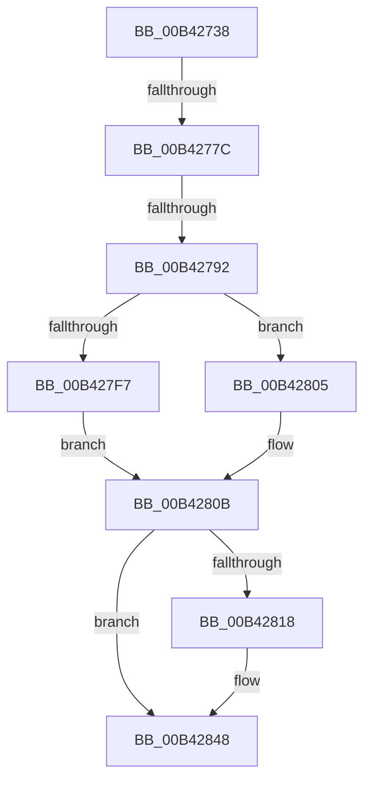

# sub_00B42738

- RVA: `0x00B42738`–`0x00B42863` (길이 `299` bytes)
- VA: `0x0000000140B42738`
- 실행 섹션: `PAGE`
- PDB 이름 있음: `아니요`; PDB Function 태그: `아니요`
- unwind 정보 RVA: `0x000B67EC`
- 디코드: `76`개 명령, `299/299` bytes 표시
- 미해석 바이트: `0` (있으면 어셈블리에 `.byte`로 보존)

> 이 문서는 커널 이미지의 기계어와 PDB 기호를 분석해 생성했습니다. 4번과 5번은 함수 원형과 자료형을 바이너리 사용 방식에서 추정한 C 해석이며 원본 소스 복구 결과는 아닙니다.

## 1. Dependencies

- 직접 호출 지점: **4**; 고유 호출 대상: **4**
- 직접 호출자로 확인된 함수: **0**
- RIP 상대 이미지 참조: **0**

### Outgoing calls
- `0x00B4276F` → [ExpFindDiskSignature](../A7/ExpFindDiskSignature_function_00A7B608.md) (function, `0x00A7B608`)
- `0x00B42785` → [ExpGetDriveGeometry](../AC/ExpGetDriveGeometry_function_00ACA760.md) (function, `0x00ACA760`)
- `0x00B4279A` → [memset](../../text/6C/memset_function_006C6C40.md) (function, `0x006C6C40`)
- `0x00B4283B` → [memcpy](../../text/6C/memcpy_function_006C6840.md) (function, `0x006C6840`)

### Direct callers
- 이 함수 시작 RVA로 연결되는 직접 call은 확인되지 않았습니다. 간접 호출은 완전히 역산할 수 없습니다.

### Static image references
- 디코드된 RIP-relative 메모리 참조가 없습니다.

## 2. Other-region calls and transfers

- 다른 실행 섹션으로 향하는 call: **2**
  - `0x00B4279A` → [memset](../../text/6C/memset_function_006C6C40.md) (`PAGE` → `.text`)
  - `0x00B4283B` → [memcpy](../../text/6C/memcpy_function_006C6840.md) (`PAGE` → `.text`)
- call이 아닌 외부 분기/꼬리 이동: **3**
  - `0x00B42776` → [ExpCreateOutputEFI + 0x7D](../A7/ExpCreateOutputEFI_function_00A7BE84.md) (`tail-transfer`)
  - `0x00B4278C` → [ExpCreateOutputEFI + 0x7D](../A7/ExpCreateOutputEFI_function_00A7BE84.md) (`tail-transfer`)
  - `0x00B4285E` → [ExpCreateOutputEFI + 0x77](../A7/ExpCreateOutputEFI_function_00A7BE84.md) (`tail-transfer`)

## 3. Assembly (complete function range)

```asm
00B42738  8B 00                           mov eax, dword ptr [rax]
00B4273A  4C 8D 44 24 30                  lea r8, [rsp + 0x30]
00B4273F  44 8A AC 24 D8 00 00 00         mov r13b, byte ptr [rsp + 0xd8]
00B42747  48 8D 54 24 34                  lea rdx, [rsp + 0x34]
00B4274C  33 C9                           xor ecx, ecx
00B4274E  44 88 6C 24 28                  mov byte ptr [rsp + 0x28], r13b
00B42753  48 89 4C 24 50                  mov qword ptr [rsp + 0x50], rcx
00B42758  0F 57 C0                        xorps xmm0, xmm0
00B4275B  49 8B CF                        mov rcx, r15
00B4275E  89 44 24 34                     mov dword ptr [rsp + 0x34], eax
00B42762  45 33 C9                        xor r9d, r9d
00B42765  48 89 74 24 20                  mov qword ptr [rsp + 0x20], rsi
00B4276A  0F 11 44 24 40                  movups xmmword ptr [rsp + 0x40], xmm0
00B4276F  E8 94 8E F3 FF                  call 0x140a7b608
00B42774  85 C0                           test eax, eax
00B42776  0F 88 85 97 F3 FF               js 0x140a7bf01
00B4277C  8B 4C 24 30                     mov ecx, dword ptr [rsp + 0x30]
00B42780  48 8D 54 24 40                  lea rdx, [rsp + 0x40]
00B42785  E8 D6 7F F8 FF                  call 0x140aca760
00B4278A  85 C0                           test eax, eax
00B4278C  0F 88 6F 97 F3 FF               js 0x140a7bf01
00B42792  44 8B C5                        mov r8d, ebp
00B42795  33 D2                           xor edx, edx
00B42797  48 8B CF                        mov rcx, rdi
00B4279A  E8 A1 44 B8 FF                  call 0x1406c6c40
00B4279F  48 8B 44 24 38                  mov rax, qword ptr [rsp + 0x38]
00B427A4  33 D2                           xor edx, edx
00B427A6  8B 4C 24 54                     mov ecx, dword ptr [rsp + 0x54]
00B427AA  41 B8 01 00 00 00               mov r8d, 1
00B427B0  44 89 07                        mov dword ptr [rdi], r8d
00B427B3  89 6F 04                        mov dword ptr [rdi + 4], ebp
00B427B6  C7 47 08 04 00 00 00            mov dword ptr [rdi + 8], 4
00B427BD  48 83 C7 0C                     add rdi, 0xc
00B427C1  C7 07 04 01 2A 00               mov dword ptr [rdi], 0x2a0104
00B427C7  8B 00                           mov eax, dword ptr [rax]
00B427C9  89 47 04                        mov dword ptr [rdi + 4], eax
00B427CC  48 8B 84 24 C0 00 00 00         mov rax, qword ptr [rsp + 0xc0]
00B427D4  48 8B 00                        mov rax, qword ptr [rax]
00B427D7  48 F7 F1                        div rcx
00B427DA  33 D2                           xor edx, edx
00B427DC  48 89 47 08                     mov qword ptr [rdi + 8], rax
00B427E0  48 8B 84 24 C8 00 00 00         mov rax, qword ptr [rsp + 0xc8]
00B427E8  48 8B 00                        mov rax, qword ptr [rax]
00B427EB  48 F7 F1                        div rcx
00B427EE  48 89 47 10                     mov qword ptr [rdi + 0x10], rax
00B427F2  45 3A E8                        cmp r13b, r8b
00B427F5  75 0E                           jne 0x140b42805
00B427F7  41 0F 10 07                     movups xmm0, xmmword ptr [r15]
00B427FB  41 B0 02                        mov r8b, 2
00B427FE  F3 0F 7F 47 18                  movdqu xmmword ptr [rdi + 0x18], xmm0
00B42803  EB 06                           jmp 0x140b4280b
00B42805  41 8B 07                        mov eax, dword ptr [r15]
00B42808  89 47 18                        mov dword ptr [rdi + 0x18], eax
00B4280B  44 88 47 28                     mov byte ptr [rdi + 0x28], r8b
00B4280F  44 88 47 29                     mov byte ptr [rdi + 0x29], r8b
00B42813  4D 85 F6                        test r14, r14
00B42816  74 30                           je 0x140b42848
00B42818  48 83 C7 2A                     add rdi, 0x2a
00B4281C  8D 43 04                        lea eax, [rbx + 4]
00B4281F  4C 8D 43 FE                     lea r8, [rbx - 2]
00B42823  49 8B D6                        mov rdx, r14
00B42826  66 C7 07 04 04                  mov word ptr [rdi], 0x404
00B4282B  48 8D 4F 04                     lea rcx, [rdi + 4]
00B4282F  88 47 02                        mov byte ptr [rdi + 2], al
00B42832  8D 43 04                        lea eax, [rbx + 4]
00B42835  C1 E8 08                        shr eax, 8
00B42838  88 47 03                        mov byte ptr [rdi + 3], al
00B4283B  E8 00 40 B8 FF                  call 0x1406c6840
00B42840  48 D1 EB                        shr rbx, 1
00B42843  66 89 74 5F 02                  mov word ptr [rdi + rbx*2 + 2], si
00B42848  0F B6 57 03                     movzx edx, byte ptr [rdi + 3]
00B4284C  0F B6 4F 02                     movzx ecx, byte ptr [rdi + 2]
00B42850  48 C1 E2 08                     shl rdx, 8
00B42854  48 0B D1                        or rdx, rcx
00B42857  C7 04 17 7F FF 04 00            mov dword ptr [rdi + rdx], 0x4ff7f
00B4285E  E9 98 96 F3 FF                  jmp 0x140a7befb
```

## 4. C-style interpretation (structured pseudocode)

```c
__int64 __fastcall sub_00B42738(int a1, __int64 a2, __int64 a3, int a4, __int64 a5, unsigned int a6, __int64 a7, __int64 a8, __int64 a9, __int64 a10, __int64 a11, __int64 a12, __int64 a13, __int64 a14, __int64 a15, __int64 a16, __int64 a17, __int64 a18, __int64 a19, __int64 a20, __int64 a21, __int64 a22, __int64 a23, __int64 a24, __int64 a25, __int64 a26, unsigned __int8 a27)
{
    __int64 result;
    __int64 v_rbx;
    __int64 v_rdi;
    unsigned __int64 v_stack_p20;
    unsigned __int8 v_stack_p28;
    unsigned __int64 v_stack_p34;
    unsigned __int64 v_stack_p50;
    unsigned int v_stack_p54;

    a1 = 0;
    v_stack_p28 = a27;
    v_stack_p50 = 0;
    v_stack_p34 = (unsigned int)((unsigned int)(*(unsigned int *)(result)));
    a4 = 0;
    v_stack_p20 = v_rsi;
    a8 = v_xmm0;
    result = ExpFindDiskSignature(v_r15, v_stack_p34, a6, a4);
    result = ExpGetDriveGeometry((unsigned int)(a6), a8, a6, a4);
    a2 = 0;
    result = memset(v_rdi, a2, (unsigned int)((unsigned int)(v_rbp)), a4);
    a2 = 0;
    *(unsigned int *)(v_rdi) = 1;
    *(unsigned int *)(v_rdi + 4) = (unsigned int)(v_rbp);
    *(unsigned int *)(v_rdi + 8) = 4;
    v_rdi = (v_rdi) + (12);
    *(unsigned int *)(v_rdi) = 0x2A0104ULL;
    *(unsigned int *)(v_rdi + 4) = (unsigned int)((unsigned int)(*(unsigned int *)(a7)));
    a2 = 0;
    *(unsigned __int64 *)(v_rdi + 8) = *(unsigned __int64 *)(a24);
    *(unsigned __int64 *)(v_rdi + 16) = *(unsigned __int64 *)(a25);
    if (a27 != 1) goto loc_00B42805;
    *(unsigned __int64 *)(v_rdi + 24) = v_xmm0;
    goto loc_00B4280B;
loc_00B42805:
    *(unsigned int *)(v_rdi + 24) = (unsigned int)((unsigned int)(*(unsigned int *)(v_r15)));
loc_00B4280B:
    *(unsigned __int8 *)(v_rdi + 40) = 2;
    *(unsigned __int8 *)(v_rdi + 41) = 2;
    result = (unsigned int)(*(unsigned int *)(v_r15));
    if (v_r14 != 0) {
        v_rdi = (v_rdi) + (42);
        result = v_rbx + 4;
        a3 = v_rbx - 2;
        a2 = v_r14;
        *(unsigned __int16 *)(v_rdi) = 0x404ULL;
        a1 = v_rdi + 4;
        *(unsigned __int8 *)(v_rdi + 2) = (unsigned __int8)(result);
        result = v_rbx + 4;
        result = (unsigned int)((result) >> (8));
        *(unsigned __int8 *)(v_rdi + 3) = (unsigned __int8)(result);
        result = memcpy(a1, a2, a3, a4);
        v_rbx = (v_rbx) >> (1);
        *(unsigned __int16 *)(v_rdi + v_rbx * 2 + 2) = (unsigned __int16)(v_rsi);
    }
    a2 = (*(unsigned __int8 *)(v_rdi + 3)) << (8);
    a2 = (a2) | (*(unsigned __int8 *)(v_rdi + 2));
    *(unsigned int *)(v_rdi + a2 * 1) = 0x4FF7FULL;
}
```

## 5. (Beta) C Style

```c
int64_t sub_00B42738(int32_t Arg1, int64_t Arg2, int64_t Arg3, int32_t Arg4, uint64_t Arg5, uint32_t Arg6, void *Arg7, int64_t Arg8, uint64_t Arg9, uint64_t Arg10, uint64_t Arg11, uint64_t Arg12, uint64_t Arg13, uint64_t Arg14, uint64_t Arg15, uint64_t Arg16, uint64_t Arg17, uint64_t Arg18, uint64_t Arg19, uint64_t Arg20, uint64_t Arg21, uint64_t Arg22, uint64_t Arg23, void *Arg24, void *Arg25, uint64_t Arg26, uint8_t Arg27)
{
    uint8_t *arg7 = (uint8_t *)Arg7;
    uint8_t *arg24 = (uint8_t *)Arg24;
    uint8_t *arg25 = (uint8_t *)Arg25;

    int64_t result;
    int64_t local_rbx;
    int64_t local_rdi;
    uint64_t v_stack_p20;
    uint8_t v_stack_p28;
    uint64_t v_stack_p34;
    uint64_t v_stack_p50;
    uint32_t v_stack_p54;

    Arg1 = 0;
    v_stack_p28 = Arg27;
    v_stack_p50 = 0;
    v_stack_p34 = (uint32_t)((uint32_t)(*(uint32_t *)(result)));
    Arg4 = 0;
    v_stack_p20 = local_rsi;
    Arg8 = v_xmm0;
    result = ExpFindDiskSignature(local_r15, v_stack_p34, Arg6, Arg4);
    result = ExpGetDriveGeometry((uint32_t)(Arg6), Arg8, Arg6, Arg4);
    Arg2 = 0;
    result = memset(local_rdi, Arg2, (uint32_t)((uint32_t)(local_rbp)), Arg4);
    Arg2 = 0;
    *(uint32_t *)(local_rdi) = 1;
    *(uint32_t *)(local_rdi + 0x4) = (uint32_t)(local_rbp);
    *(uint32_t *)(local_rdi + 0x8) = 4;
    local_rdi = (local_rdi) + (12);
    *(uint32_t *)(local_rdi) = 0x2A0104ULL;
    *(uint32_t *)(local_rdi + 0x4) = (uint32_t)((uint32_t)(*(uint32_t *)(arg7)));
    Arg2 = 0;
    *(uint64_t *)(local_rdi + 0x8) = *(uint64_t *)(arg24);
    *(uint64_t *)(local_rdi + 0x10) = *(uint64_t *)(arg25);
    if (Arg27 != 1) goto loc_00B42805;
    *(uint64_t *)(local_rdi + 0x18) = v_xmm0;
    goto loc_00B4280B;
loc_00B42805:
    *(uint32_t *)(local_rdi + 0x18) = (uint32_t)((uint32_t)(*(uint32_t *)(local_r15)));
loc_00B4280B:
    *(uint8_t *)(local_rdi + 0x28) = 2;
    *(uint8_t *)(local_rdi + 0x29) = 2;
    result = (uint32_t)(*(uint32_t *)(local_r15));
    if (local_r14 != 0) {
        local_rdi = (local_rdi) + (42);
        result = local_rbx + 4;
        Arg3 = local_rbx - 2;
        Arg2 = local_r14;
        *(uint16_t *)(local_rdi) = 0x404ULL;
        Arg1 = local_rdi + 4;
        *(uint8_t *)(local_rdi + 0x2) = (uint8_t)(result);
        result = local_rbx + 4;
        result = (uint32_t)((result) >> (8));
        *(uint8_t *)(local_rdi + 0x3) = (uint8_t)(result);
        result = memcpy(Arg1, Arg2, Arg3, Arg4);
        local_rbx = (local_rbx) >> (1);
        *(uint16_t *)(local_rdi + local_rbx * 2 + 0x2) = (uint16_t)(local_rsi);
    }
    Arg2 = (*(uint8_t *)(local_rdi + 0x3)) << (8);
    Arg2 = (Arg2) | (*(uint8_t *)(local_rdi + 0x2));
    *(uint32_t *)(local_rdi + Arg2 * 1) = 0x4FF7FULL;
}
```

### 관측된 메모리 오프셋

구조체 형식이 확인되지 않은 접근은 인자 기준의 오프셋으로만 기록했습니다.

| 기준 인자 | 오프셋 표현 | 폭 (bit) | 접근 |
|---|---:|---:|---|
| `Arg7` | `+ 0x0` | `32` | `R` |
| `Arg24` | `+ 0x0` | `64` | `R` |
| `Arg25` | `+ 0x0` | `64` | `R` |

## 6. Execution-region graph

[열기: 2D/3D 그래프와 함수 탐색 컨트롤 패널](../../../control-panel.html?section=page&rva=0x00B42738&view=graph)

- 2D 그래프는 위에서 아래로 흐르고, 3D 그래프는 빈 공간을 드래그해 회전합니다. Shift+드래그는 이동, 휠은 확대·축소, 함수 노드 선택은 대상 보고서 이동입니다.

### Static fallback


