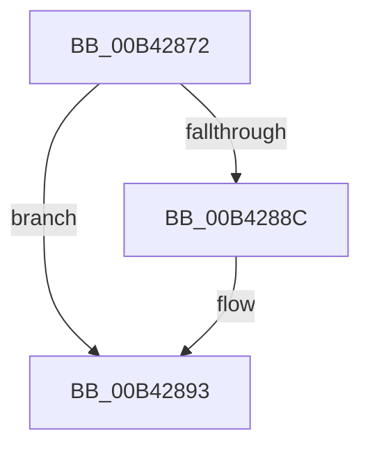

# sub_00B42872

- RVA: `0x00B42872`–`0x00B428A9` (길이 `55` bytes)
- VA: `0x0000000140B42872`
- 실행 섹션: `PAGE`
- PDB 이름 있음: `아니요`; PDB Function 태그: `아니요`
- unwind 정보 RVA: `0x000B6968`
- 디코드: `13`개 명령, `55/55` bytes 표시
- 미해석 바이트: `0` (있으면 어셈블리에 `.byte`로 보존)

> 이 문서는 커널 이미지의 기계어와 PDB 기호를 분석해 생성했습니다. 4번과 5번은 함수 원형과 자료형을 바이너리 사용 방식에서 추정한 C 해석이며 원본 소스 복구 결과는 아닙니다.

## 1. Dependencies

- 직접 호출 지점: **1**; 고유 호출 대상: **1**
- 직접 호출자로 확인된 함수: **0**
- RIP 상대 이미지 참조: **2**

### Outgoing calls
- `0x00B4287B` → [CmpLockGlobalKeyLockTrackerExclusive](../7E/CmpLockGlobalKeyLockTrackerExclusive_function_007EDE78.md) (function, `0x007EDE78`)

### Direct callers
- 이 함수 시작 RVA로 연결되는 직접 call은 확인되지 않았습니다. 간접 호출은 완전히 역산할 수 없습니다.

### Static image references
- `0x00B42880` → RVA `0x00EF5870` (`.data`; read)
- `0x00B4289D` → RVA `0x00EF5870` (`.data`; write)

## 2. Other-region calls and transfers

- 다른 실행 섹션으로 향하는 call: **0**
- call이 아닌 외부 분기/꼬리 이동: **1**
  - `0x00B428A4` → [CmpGlobalLockKeyForWrite + 0x62](../A7/CmpGlobalLockKeyForWrite_function_00A7CD88.md) (`tail-transfer`)

## 3. Assembly (complete function range)

```asm
00B42872  B8 80 00 00 00                  mov eax, 0x80
00B42877  66 09 46 08                     or word ptr [rsi + 8], ax
00B4287B  E8 F8 B5 CA FF                  call 0x1407ede78
00B42880  48 8B 05 E9 2F 3B 00            mov rax, qword ptr [rip + 0x3b2fe9]
00B42887  48 39 28                        cmp qword ptr [rax], rbp
00B4288A  74 07                           je 0x140b42893
00B4288C  B9 03 00 00 00                  mov ecx, 3
00B42891  CD 29                           int 0x29
00B42893  48 89 2B                        mov qword ptr [rbx], rbp
00B42896  48 89 43 08                     mov qword ptr [rbx + 8], rax
00B4289A  48 89 18                        mov qword ptr [rax], rbx
00B4289D  48 89 1D CC 2F 3B 00            mov qword ptr [rip + 0x3b2fcc], rbx
00B428A4  E9 41 A5 F3 FF                  jmp 0x140a7cdea
```

## 4. C-style interpretation (structured pseudocode)

```c
__int64 __fastcall sub_00B42872(void)
{
    __int64 result;

    result = CmpLockGlobalKeyLockTrackerExclusive(a1, a2, a3, a4);
    if ((*(unsigned __int64 *)(*(unsigned __int64 *)(v_rip + 3878889))) != v_rbp) {
        a1 = 3;
    }
    *(unsigned __int64 *)(v_rbx) = v_rbp;
    *(unsigned __int64 *)(v_rbx + 8) = *(unsigned __int64 *)(v_rip + 3878889);
    *(unsigned __int64 *)(*(unsigned __int64 *)(v_rip + 3878889)) = v_rbx;
    *(unsigned __int64 *)(v_rip + 3878860) = v_rbx;
}
```

## 5. (Beta) C Style

```c
void sub_00B42872(void)
{
    int64_t result;

    result = CmpLockGlobalKeyLockTrackerExclusive(a1, a2, a3, a4);
    if ((*(uint64_t *)(*(uint64_t *)(v_rip + 0x3B2FE9))) != local_rbp) {
        a1 = 3;
    }
    *(uint64_t *)(local_rbx) = local_rbp;
    *(uint64_t *)(local_rbx + 0x8) = *(uint64_t *)(v_rip + 0x3B2FE9);
    *(uint64_t *)(*(uint64_t *)(v_rip + 0x3B2FE9)) = local_rbx;
    *(uint64_t *)(v_rip + 0x3B2FCC) = local_rbx;
}
```

## 6. Execution-region graph

[열기: 2D/3D 그래프와 함수 탐색 컨트롤 패널](../../../control-panel.html?section=page&rva=0x00B42872&view=graph)

- 2D 그래프는 위에서 아래로 흐르고, 3D 그래프는 빈 공간을 드래그해 회전합니다. Shift+드래그는 이동, 휠은 확대·축소, 함수 노드 선택은 대상 보고서 이동입니다.

### Static fallback


