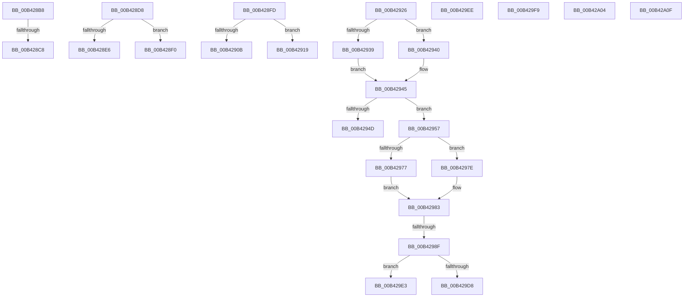

# sub_00B428B8

- RVA: `0x00B428B8`–`0x00B42A1A` (길이 `354` bytes)
- VA: `0x0000000140B428B8`
- 실행 섹션: `PAGE`
- PDB 이름 있음: `아니요`; PDB Function 태그: `아니요`
- unwind 정보 RVA: `0x000B6B18`
- 디코드: `89`개 명령, `354/354` bytes 표시
- 미해석 바이트: `0` (있으면 어셈블리에 `.byte`로 보존)

> 이 문서는 커널 이미지의 기계어와 PDB 기호를 분석해 생성했습니다. 4번과 5번은 함수 원형과 자료형을 바이너리 사용 방식에서 추정한 C 해석이며 원본 소스 복구 결과는 아닙니다.

## 1. Dependencies

- 직접 호출 지점: **13**; 고유 호출 대상: **5**
- 직접 호출자로 확인된 함수: **0**
- RIP 상대 이미지 참조: **0**

### Outgoing calls
- `0x00B428D8` → [HvpGetCellPaged](../85/HvpGetCellPaged_function_00854CB0.md) (function, `0x00854CB0`)
- `0x00B428FD` → [HvpGetCellPaged](../85/HvpGetCellPaged_function_00854CB0.md) (function, `0x00854CB0`)
- `0x00B42939` → [HvpGetCellFlat](../85/HvpGetCellFlat_function_00854C60.md) (function, `0x00854C60`)
- `0x00B42940` → [HvpGetCellPaged](../85/HvpGetCellPaged_function_00854CB0.md) (function, `0x00854CB0`)
- `0x00B42977` → [HvpGetCellFlat](../85/HvpGetCellFlat_function_00854C60.md) (function, `0x00854C60`)
- `0x00B4297E` → [HvpGetCellPaged](../85/HvpGetCellPaged_function_00854CB0.md) (function, `0x00854CB0`)
- `0x00B429C0` → [CmpQueryKeyValueData](../85/CmpQueryKeyValueData_function_00856650.md) (function, `0x00856650`)
- `0x00B429D8` → [HvpReleaseCellFlat](../85/HvpReleaseCellFlat_function_0085CC20.md) (function, `0x0085CC20`)
- `0x00B429E3` → [HvpReleaseCellPaged](../85/HvpReleaseCellPaged_function_00855F40.md) (function, `0x00855F40`)
- `0x00B429EE` → [HvpReleaseCellPaged](../85/HvpReleaseCellPaged_function_00855F40.md) (function, `0x00855F40`)
- `0x00B429F9` → [HvpReleaseCellPaged](../85/HvpReleaseCellPaged_function_00855F40.md) (function, `0x00855F40`)
- `0x00B42A04` → [HvpReleaseCellPaged](../85/HvpReleaseCellPaged_function_00855F40.md) (function, `0x00855F40`)
- `0x00B42A0F` → [HvpReleaseCellPaged](../85/HvpReleaseCellPaged_function_00855F40.md) (function, `0x00855F40`)

### Direct callers
- 이 함수 시작 RVA로 연결되는 직접 call은 확인되지 않았습니다. 간접 호출은 완전히 역산할 수 없습니다.

### Static image references
- 디코드된 RIP-relative 메모리 참조가 없습니다.

## 2. Other-region calls and transfers

- 다른 실행 섹션으로 향하는 call: **0**
- call이 아닌 외부 분기/꼬리 이동: **14**
  - `0x00B428C2` → [CmEnumerateValueKeyFromMergedView + 0x153](../A7/CmEnumerateValueKeyFromMergedView_function_00A7D650.md) (`tail-transfer`)
  - `0x00B428D3` → [CmEnumerateValueKeyFromMergedView + 0x153](../A7/CmEnumerateValueKeyFromMergedView_function_00A7D650.md) (`tail-transfer`)
  - `0x00B428EB` → [CmEnumerateValueKeyFromMergedView + 0x31D](../A7/CmEnumerateValueKeyFromMergedView_function_00A7D650.md) (`tail-transfer`)
  - `0x00B428F8` → [CmEnumerateValueKeyFromMergedView + 0x158](../A7/CmEnumerateValueKeyFromMergedView_function_00A7D650.md) (`tail-transfer`)
  - `0x00B42914` → [CmEnumerateValueKeyFromMergedView + 0x307](../A7/CmEnumerateValueKeyFromMergedView_function_00A7D650.md) (`tail-transfer`)
  - `0x00B42921` → [CmEnumerateValueKeyFromMergedView + 0x162](../A7/CmEnumerateValueKeyFromMergedView_function_00A7D650.md) (`tail-transfer`)
  - `0x00B42952` → [CmEnumerateValueKeyFromMergedView + 0x2ED](../A7/CmEnumerateValueKeyFromMergedView_function_00A7D650.md) (`tail-transfer`)
  - `0x00B42989` → [CmEnumerateValueKeyFromMergedView + 0x2E3](../A7/CmEnumerateValueKeyFromMergedView_function_00A7D650.md) (`tail-transfer`)
  - `0x00B429DE` → [CmEnumerateValueKeyFromMergedView + 0x2E8](../A7/CmEnumerateValueKeyFromMergedView_function_00A7D650.md) (`tail-transfer`)
  - `0x00B429E9` → [CmEnumerateValueKeyFromMergedView + 0x2E8](../A7/CmEnumerateValueKeyFromMergedView_function_00A7D650.md) (`tail-transfer`)
  - `0x00B429F4` → [CmEnumerateValueKeyFromMergedView + 0x2F6](../A7/CmEnumerateValueKeyFromMergedView_function_00A7D650.md) (`tail-transfer`)
  - `0x00B429FF` → [CmEnumerateValueKeyFromMergedView + 0x2FF](../A7/CmEnumerateValueKeyFromMergedView_function_00A7D650.md) (`tail-transfer`)
  - `0x00B42A0A` → [CmEnumerateValueKeyFromMergedView + 0x312](../A7/CmEnumerateValueKeyFromMergedView_function_00A7D650.md) (`tail-transfer`)
  - `0x00B42A15` → [CmEnumerateValueKeyFromMergedView + 0x31D](../A7/CmEnumerateValueKeyFromMergedView_function_00A7D650.md) (`tail-transfer`)

## 3. Assembly (complete function range)

```asm
00B428B8  49 8B CC                        mov rcx, r12
00B428BB  49 39 B7 20 01 00 00            cmp qword ptr [r15 + 0x120], rsi
00B428C2  0F 85 DB AE F3 FF               jne 0x140a7d7a3
00B428C8  49 8D 87 18 01 00 00            lea rax, [r15 + 0x118]
00B428CF  48 89 45 C7                     mov qword ptr [rbp - 0x39], rax
00B428D3  E9 CB AE F3 FF                  jmp 0x140a7d7a3
00B428D8  E8 D3 23 D1 FF                  call 0x140854cb0
00B428DD  48 89 45 D7                     mov qword ptr [rbp - 0x29], rax
00B428E1  48 85 C0                        test rax, rax
00B428E4  75 0A                           jne 0x140b428f0
00B428E6  BB 9A 00 00 C0                  mov ebx, 0xc000009a
00B428EB  E9 7D B0 F3 FF                  jmp 0x140a7d96d
00B428F0  48 83 C0 24                     add rax, 0x24
00B428F4  48 89 45 CF                     mov qword ptr [rbp - 0x31], rax
00B428F8  E9 AB AE F3 FF                  jmp 0x140a7d7a8
00B428FD  E8 AE 23 D1 FF                  call 0x140854cb0
00B42902  48 89 45 DF                     mov qword ptr [rbp - 0x21], rax
00B42906  48 85 C0                        test rax, rax
00B42909  75 0E                           jne 0x140b42919
00B4290B  BB 9A 00 00 C0                  mov ebx, 0xc000009a
00B42910  49 8D 75 20                     lea rsi, [r13 + 0x20]
00B42914  E9 3E B0 F3 FF                  jmp 0x140a7d957
00B42919  48 83 C0 24                     add rax, 0x24
00B4291D  48 89 45 C7                     mov qword ptr [rbp - 0x39], rax
00B42921  E9 8C AE F3 FF                  jmp 0x140a7d7b2
00B42926  49 8B 0E                        mov rcx, qword ptr [r14]
00B42929  4C 8D 45 A7                     lea r8, [rbp - 0x59]
00B4292D  8B 52 04                        mov edx, dword ptr [rdx + 4]
00B42930  40 84 B9 8C 00 00 00            test byte ptr [rcx + 0x8c], dil
00B42937  74 07                           je 0x140b42940
00B42939  E8 22 23 D1 FF                  call 0x140854c60
00B4293E  EB 05                           jmp 0x140b42945
00B42940  E8 6B 23 D1 FF                  call 0x140854cb0
00B42945  4C 8B F8                        mov r15, rax
00B42948  48 85 C0                        test rax, rax
00B4294B  75 0A                           jne 0x140b42957
00B4294D  BB 9A 00 00 C0                  mov ebx, 0xc000009a
00B42952  E9 E6 AF F3 FF                  jmp 0x140a7d93d
00B42957  2B 5D 47                        sub ebx, dword ptr [rbp + 0x47]
00B4295A  4C 8D 44 24 40                  lea r8, [rsp + 0x40]
00B4295F  4D 8B 2E                        mov r13, qword ptr [r14]
00B42962  41 8B 0C 9F                     mov ecx, dword ptr [r15 + rbx*4]
00B42966  8B D1                           mov edx, ecx
00B42968  89 4D C3                        mov dword ptr [rbp - 0x3d], ecx
00B4296B  49 8B CD                        mov rcx, r13
00B4296E  41 84 BD 8C 00 00 00            test byte ptr [r13 + 0x8c], dil
00B42975  74 07                           je 0x140b4297e
00B42977  E8 E4 22 D1 FF                  call 0x140854c60
00B4297C  EB 05                           jmp 0x140b42983
00B4297E  E8 2D 23 D1 FF                  call 0x140854cb0
00B42983  4C 8B E0                        mov r12, rax
00B42986  48 85 C0                        test rax, rax
00B42989  0F 84 A4 AF F3 FF               je 0x140a7d933
00B4298F  48 8B 4D 9F                     mov rcx, qword ptr [rbp - 0x61]
00B42993  48 8B 44 24 48                  mov rax, qword ptr [rsp + 0x48]
00B42998  4D 8B C4                        mov r8, r12
00B4299B  44 8B 4D 67                     mov r9d, dword ptr [rbp + 0x67]
00B4299F  8B 55 C3                        mov edx, dword ptr [rbp - 0x3d]
00B429A2  48 89 44 24 48                  mov qword ptr [rsp + 0x48], rax
00B429A7  48 8B 45 7F                     mov rax, qword ptr [rbp + 0x7f]
00B429AB  48 89 44 24 30                  mov qword ptr [rsp + 0x30], rax
00B429B0  8B 45 77                        mov eax, dword ptr [rbp + 0x77]
00B429B3  89 44 24 28                     mov dword ptr [rsp + 0x28], eax
00B429B7  48 8B 45 6F                     mov rax, qword ptr [rbp + 0x6f]
00B429BB  48 89 44 24 20                  mov qword ptr [rsp + 0x20], rax
00B429C0  E8 8B 3C D1 FF                  call 0x140856650
00B429C5  48 8D 54 24 40                  lea rdx, [rsp + 0x40]
00B429CA  8B D8                           mov ebx, eax
00B429CC  49 8B CD                        mov rcx, r13
00B429CF  41 84 BD 8C 00 00 00            test byte ptr [r13 + 0x8c], dil
00B429D6  74 0B                           je 0x140b429e3
00B429D8  E8 43 A2 D1 FF                  call 0x14085cc20
00B429DD  90                              nop
00B429DE  E9 55 AF F3 FF                  jmp 0x140a7d938
00B429E3  E8 58 35 D1 FF                  call 0x140855f40
00B429E8  90                              nop
00B429E9  E9 4A AF F3 FF                  jmp 0x140a7d938
00B429EE  E8 4D 35 D1 FF                  call 0x140855f40
00B429F3  90                              nop
00B429F4  E9 4D AF F3 FF                  jmp 0x140a7d946
00B429F9  E8 42 35 D1 FF                  call 0x140855f40
00B429FE  90                              nop
00B429FF  E9 4B AF F3 FF                  jmp 0x140a7d94f
00B42A04  E8 37 35 D1 FF                  call 0x140855f40
00B42A09  90                              nop
00B42A0A  E9 53 AF F3 FF                  jmp 0x140a7d962
00B42A0F  E8 2C 35 D1 FF                  call 0x140855f40
00B42A14  90                              nop
00B42A15  E9 53 AF F3 FF                  jmp 0x140a7d96d
```

## 4. C-style interpretation (structured pseudocode)

```c
__int64 __fastcall sub_00B428B8(__int64 a1, __int64 a2)
{
    unsigned __int64 v_stack_p20;
    unsigned int v_stack_p28;
    unsigned __int64 v_stack_p30;
    unsigned __int64 v_stack_p40;
    unsigned __int64 v_stack_p48;

    *(unsigned __int64 *)(v_rbp - 57) = v_r15 + 280;
}
```

## 5. (Beta) C Style

```c
int64_t sub_00B428B8(int64_t Arg1, int64_t Arg2)
{
    uint64_t v_stack_p20;
    uint32_t v_stack_p28;
    uint64_t v_stack_p30;
    uint64_t v_stack_p40;
    uint64_t v_stack_p48;

    *(uint64_t *)(local_rbp - 0x39) = local_r15 + 280;
}
```

## 6. Execution-region graph

[열기: 2D/3D 그래프와 함수 탐색 컨트롤 패널](../../../control-panel.html?section=page&rva=0x00B428B8&view=graph)

- 2D 그래프는 위에서 아래로 흐르고, 3D 그래프는 빈 공간을 드래그해 회전합니다. Shift+드래그는 이동, 휠은 확대·축소, 함수 노드 선택은 대상 보고서 이동입니다.

### Static fallback


