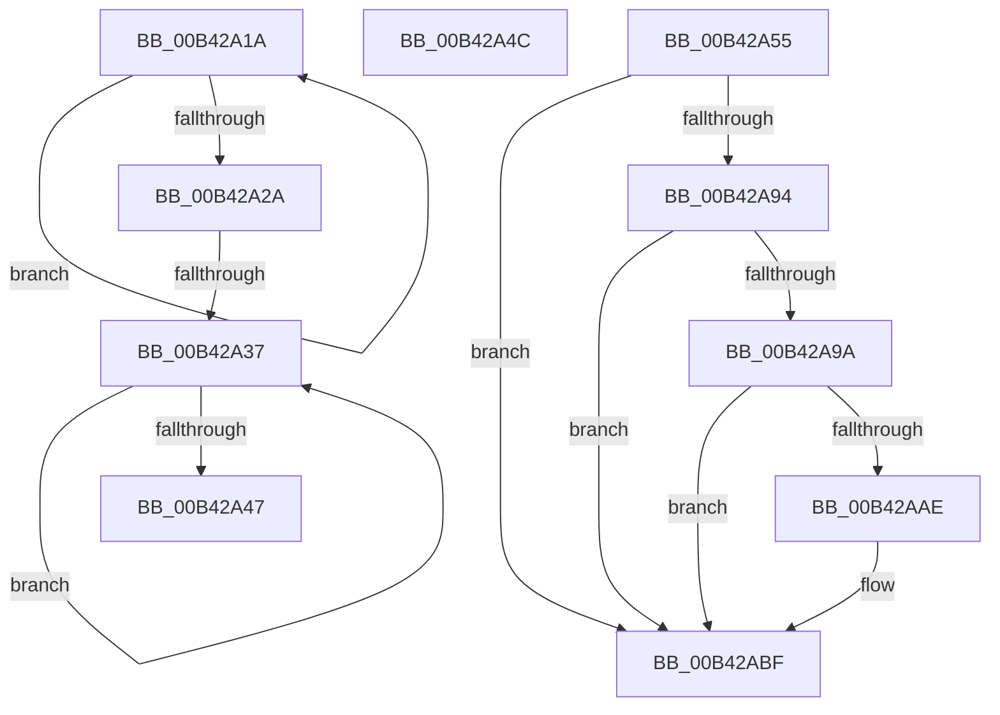

# sub_00B42A1A

- RVA: `0x00B42A1A`–`0x00B42AC8` (길이 `174` bytes)
- VA: `0x0000000140B42A1A`
- 실행 섹션: `PAGE`
- PDB 이름 있음: `아니요`; PDB Function 태그: `아니요`
- unwind 정보 RVA: `0x000B6B44`
- 디코드: `44`개 명령, `174/174` bytes 표시
- 미해석 바이트: `0` (있으면 어셈블리에 `.byte`로 보존)

> 이 문서는 커널 이미지의 기계어와 PDB 기호를 분석해 생성했습니다. 4번과 5번은 함수 원형과 자료형을 바이너리 사용 방식에서 추정한 C 해석이며 원본 소스 복구 결과는 아닙니다.

## 1. Dependencies

- 직접 호출 지점: **6**; 고유 호출 대상: **4**
- 직접 호출자로 확인된 함수: **0**
- RIP 상대 이미지 참조: **1**

### Outgoing calls
- `0x00B42A1D` → [MiGetPteAddress](../../text/43/MiGetPteAddress_function_0043E130.md) (function, `0x0043E130`)
- `0x00B42A62` → [MiGetUltraMapping](../../text/32/MiGetUltraMapping_function_00323270.md) (function, `0x00323270`)
- `0x00B42A6D` → [MiGetPteAddress](../../text/43/MiGetPteAddress_function_0043E130.md) (function, `0x0043E130`)
- `0x00B42A81` → [MiMakeValidPte](../../text/2C/MiMakeValidPte_function_002C5590.md) (function, `0x002C5590`)
- `0x00B42AA4` → [MiGetPteAddress](../../text/43/MiGetPteAddress_function_0043E130.md) (function, `0x0043E130`)
- `0x00B42ABA` → [MiCheckLinearProtectedPteAccessedBit](../../text/29/MiCheckLinearProtectedPteAccessedBit_function_00292D80.md) (function, `0x00292D80`)

### Direct callers
- 이 함수 시작 RVA로 연결되는 직접 call은 확인되지 않았습니다. 간접 호출은 완전히 역산할 수 없습니다.

### Static image references
- `0x00B42A86` → RVA `0x00FC6A88` (`ALMOSTRO`; read)

## 2. Other-region calls and transfers

- 다른 실행 섹션으로 향하는 call: **6**
  - `0x00B42A1D` → [MiGetPteAddress](../../text/43/MiGetPteAddress_function_0043E130.md) (`PAGE` → `.text`)
  - `0x00B42A62` → [MiGetUltraMapping](../../text/32/MiGetUltraMapping_function_00323270.md) (`PAGE` → `.text`)
  - `0x00B42A6D` → [MiGetPteAddress](../../text/43/MiGetPteAddress_function_0043E130.md) (`PAGE` → `.text`)
  - `0x00B42A81` → [MiMakeValidPte](../../text/2C/MiMakeValidPte_function_002C5590.md) (`PAGE` → `.text`)
  - `0x00B42AA4` → [MiGetPteAddress](../../text/43/MiGetPteAddress_function_0043E130.md) (`PAGE` → `.text`)
  - `0x00B42ABA` → [MiCheckLinearProtectedPteAccessedBit](../../text/29/MiCheckLinearProtectedPteAccessedBit_function_00292D80.md) (`PAGE` → `.text`)
- call이 아닌 외부 분기/꼬리 이동: **4**
  - `0x00B42A31` → [MiUpdateForkMaps + 0x89](../A7/MiUpdateForkMaps_function_00A7DAF8.md) (`tail-transfer`)
  - `0x00B42A47` → [MiUpdateForkMaps + 0x89](../A7/MiUpdateForkMaps_function_00A7DAF8.md) (`tail-transfer`)
  - `0x00B42A50` → [MiUpdateForkMaps + 0x176](../A7/MiUpdateForkMaps_function_00A7DAF8.md) (`tail-transfer`)
  - `0x00B42AC3` → [MiUpdateForkMaps + 0x1B6](../A7/MiUpdateForkMaps_function_00A7DAF8.md) (`tail-transfer`)

## 3. Assembly (complete function range)

```asm
00B42A1A  48 8B CE                        mov rcx, rsi
00B42A1D  E8 0E B7 8F FF                  call 0x14043e130
00B42A22  48 8B F0                        mov rsi, rax
00B42A25  4C 2B CF                        sub r9, rdi
00B42A28  75 F0                           jne 0x140b42a1a
00B42A2A  48 83 C6 08                     add rsi, 8
00B42A2E  45 85 C0                        test r8d, r8d
00B42A31  0F 84 4A B1 F3 FF               je 0x140a7db81
00B42A37  48 C1 E6 19                     shl rsi, 0x19
00B42A3B  48 2B F5                        sub rsi, rbp
00B42A3E  48 C1 FE 10                     sar rsi, 0x10
00B42A42  48 2B D7                        sub rdx, rdi
00B42A45  75 F0                           jne 0x140b42a37
00B42A47  E9 35 B1 F3 FF                  jmp 0x140a7db81
00B42A4C  48 83 E3 EF                     and rbx, 0xffffffffffffffef
00B42A50  E9 19 B2 F3 FF                  jmp 0x140a7dc6e
00B42A55  45 33 C9                        xor r9d, r9d
00B42A58  4C 8B C7                        mov r8, rdi
00B42A5B  48 8B CE                        mov rcx, rsi
00B42A5E  41 8D 51 03                     lea edx, [r9 + 3]
00B42A62  E8 09 08 7E FF                  call 0x140323270
00B42A67  48 8B C8                        mov rcx, rax
00B42A6A  4C 8B F8                        mov r15, rax
00B42A6D  E8 BE B6 8F FF                  call 0x14043e130
00B42A72  48 8B C8                        mov rcx, rax
00B42A75  41 B8 04 00 00 A0               mov r8d, 0xa0000004
00B42A7B  48 8B D3                        mov rdx, rbx
00B42A7E  48 8B E8                        mov rbp, rax
00B42A81  E8 0A 2B 78 FF                  call 0x1402c5590
00B42A86  48 0F BA 25 F9 3F 48 00 24      bt qword ptr [rip + 0x483ff9], 0x24
00B42A8F  48 8B F8                        mov rdi, rax
00B42A92  73 2B                           jae 0x140b42abf
00B42A94  40 F6 C7 20                     test dil, 0x20
00B42A98  75 25                           jne 0x140b42abf
00B42A9A  48 B9 00 00 00 00 00 80 FF FF   movabs rcx, 0xffff800000000000
00B42AA4  E8 87 B6 8F FF                  call 0x14043e130
00B42AA9  48 3B E8                        cmp rbp, rax
00B42AAC  72 11                           jb 0x140b42abf
00B42AAE  41 B8 80 00 00 00               mov r8d, 0x80
00B42AB4  48 8B D7                        mov rdx, rdi
00B42AB7  48 8B CD                        mov rcx, rbp
00B42ABA  E8 C1 02 75 FF                  call 0x140292d80
00B42ABF  48 89 7D 00                     mov qword ptr [rbp], rdi
00B42AC3  E9 E6 B1 F3 FF                  jmp 0x140a7dcae
```

## 4. C-style interpretation (structured pseudocode)

```c
__int64 __fastcall sub_00B42A1A(__int64 a1, __int64 a2, int a3, __int64 a4)
{
    __int64 result;
    __int64 v_rsi;

    result = MiGetPteAddress(v_rsi, a2, a3, a4);
    a4 = (a4) - (v_rdi);
    if (condition_is_not_equal) goto loc_00B42A1A;
    v_rsi = (result) + (8);
loc_00B42A37:
    v_rsi = (v_rsi) << (25);
    v_rsi = (v_rsi) - (v_rbp);
    v_rsi = (v_rsi) >> (16);
    a2 = (a2) - (v_rdi);
    if (condition_is_not_equal) goto loc_00B42A37;
}
```

## 5. (Beta) C Style

```c
int64_t sub_00B42A1A(int64_t Arg1, int64_t Arg2, int32_t Arg3, int64_t Arg4)
{
    int64_t result;
    int64_t local_rsi;

    result = MiGetPteAddress(local_rsi, Arg2, Arg3, Arg4);
    Arg4 = (Arg4) - (local_rdi);
    if (condition_is_not_equal) goto loc_00B42A1A;
    local_rsi = (result) + (8);
loc_00B42A37:
    local_rsi = (local_rsi) << (25);
    local_rsi = (local_rsi) - (local_rbp);
    local_rsi = (local_rsi) >> (16);
    Arg2 = (Arg2) - (local_rdi);
    if (condition_is_not_equal) goto loc_00B42A37;
}
```

## 6. Execution-region graph

[열기: 2D/3D 그래프와 함수 탐색 컨트롤 패널](../../../control-panel.html?section=page&rva=0x00B42A1A&view=graph)

- 2D 그래프는 위에서 아래로 흐르고, 3D 그래프는 빈 공간을 드래그해 회전합니다. Shift+드래그는 이동, 휠은 확대·축소, 함수 노드 선택은 대상 보고서 이동입니다.

### Static fallback


