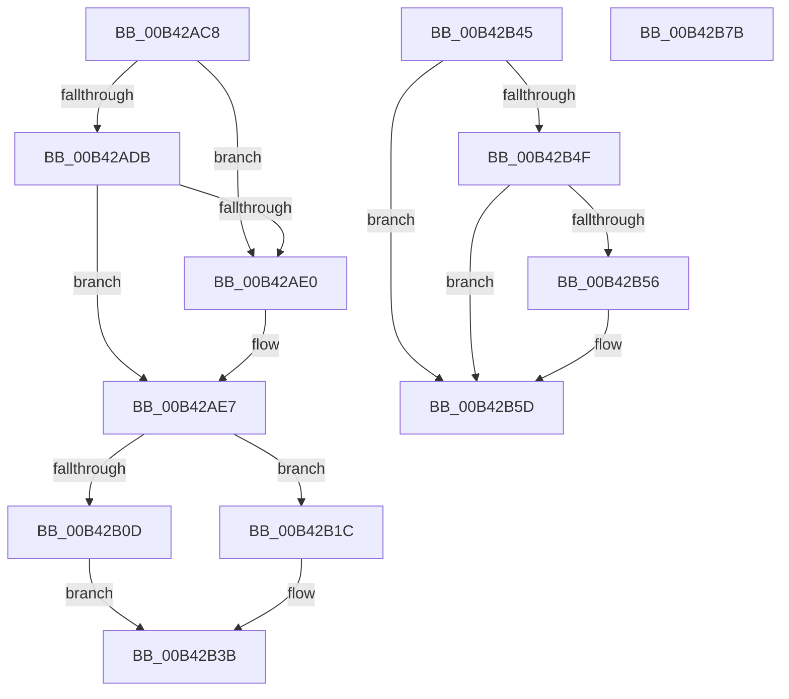

# sub_00B42AC8

- RVA: `0x00B42AC8`–`0x00B42B88` (길이 `192` bytes)
- VA: `0x0000000140B42AC8`
- 실행 섹션: `PAGE`
- PDB 이름 있음: `아니요`; PDB Function 태그: `아니요`
- unwind 정보 RVA: `0x000B6C9C`
- 디코드: `47`개 명령, `192/192` bytes 표시
- 미해석 바이트: `0` (있으면 어셈블리에 `.byte`로 보존)

> 이 문서는 커널 이미지의 기계어와 PDB 기호를 분석해 생성했습니다. 4번과 5번은 함수 원형과 자료형을 바이너리 사용 방식에서 추정한 C 해석이며 원본 소스 복구 결과는 아닙니다.

## 1. Dependencies

- 직접 호출 지점: **4**; 고유 호출 대상: **3**
- 직접 호출자로 확인된 함수: **0**
- RIP 상대 이미지 참조: **0**

### Outgoing calls
- `0x00B42AF5` → [ExAllocatePool2](../../poolcode/B8/ExAllocatePool2_function_00B820F0.md) (function, `0x00B820F0`)
- `0x00B42B15` → [memcpy](../../text/6C/memcpy_function_006C6840.md) (function, `0x006C6840`)
- `0x00B42B31` → [memcpy](../../text/6C/memcpy_function_006C6840.md) (function, `0x006C6840`)
- `0x00B42B58` → [ExFreePoolWithTag](../../poolcode/B8/ExFreePoolWithTag_function_00B82870.md) (function, `0x00B82870`)

### Direct callers
- 이 함수 시작 RVA로 연결되는 직접 call은 확인되지 않았습니다. 간접 호출은 완전히 역산할 수 없습니다.

### Static image references
- 디코드된 RIP-relative 메모리 참조가 없습니다.

## 2. Other-region calls and transfers

- 다른 실행 섹션으로 향하는 call: **4**
  - `0x00B42AF5` → [ExAllocatePool2](../../poolcode/B8/ExAllocatePool2_function_00B820F0.md) (`PAGE` → `POOLCODE`)
  - `0x00B42B15` → [memcpy](../../text/6C/memcpy_function_006C6840.md) (`PAGE` → `.text`)
  - `0x00B42B31` → [memcpy](../../text/6C/memcpy_function_006C6840.md) (`PAGE` → `.text`)
  - `0x00B42B58` → [ExFreePoolWithTag](../../poolcode/B8/ExFreePoolWithTag_function_00B82870.md) (`PAGE` → `POOLCODE`)
- call이 아닌 외부 분기/꼬리 이동: **3**
  - `0x00B42B40` → [NtNotifyChangeSession + 0x176](../A7/NtNotifyChangeSession_function_00A7E630.md) (`tail-transfer`)
  - `0x00B42B76` → [NtNotifyChangeSession + 0x176](../A7/NtNotifyChangeSession_function_00A7E630.md) (`tail-transfer`)
  - `0x00B42B83` → [NtNotifyChangeSession + 0x176](../A7/NtNotifyChangeSession_function_00A7E630.md) (`tail-transfer`)

## 3. Assembly (complete function range)

```asm
00B42AC8  4B 8D 04 3C                     lea rax, [r12 + r15]
00B42ACC  48 BA 00 00 FF FF FF 7F 00 00   movabs rdx, 0x7fffffff0000
00B42AD6  48 3B C2                        cmp rax, rdx
00B42AD9  77 05                           ja 0x140b42ae0
00B42ADB  49 3B C7                        cmp rax, r15
00B42ADE  73 07                           jae 0x140b42ae7
00B42AE0  8A 02                           mov al, byte ptr [rdx]
00B42AE2  4C 8B 74 24 48                  mov r14, qword ptr [rsp + 0x48]
00B42AE7  41 B8 49 6F 53 6E               mov r8d, 0x6e536f49
00B42AED  49 8B D4                        mov rdx, r12
00B42AF0  B9 00 01 00 00                  mov ecx, 0x100
00B42AF5  E8 F6 F5 03 00                  call 0x140b820f0
00B42AFA  48 8B D8                        mov rbx, rax
00B42AFD  48 89 44 24 40                  mov qword ptr [rsp + 0x40], rax
00B42B02  4D 8B C4                        mov r8, r12
00B42B05  49 8B D7                        mov rdx, r15
00B42B08  48 85 C0                        test rax, rax
00B42B0B  74 0F                           je 0x140b42b1c
00B42B0D  40 88 74 24 30                  mov byte ptr [rsp + 0x30], sil
00B42B12  48 8B C8                        mov rcx, rax
00B42B15  E8 26 3D B8 FF                  call 0x1406c6840
00B42B1A  EB 1F                           jmp 0x140b42b3b
00B42B1C  48 8D 9C 24 B0 00 00 00         lea rbx, [rsp + 0xb0]
00B42B24  48 89 5C 24 40                  mov qword ptr [rsp + 0x40], rbx
00B42B29  48 8D 8C 24 B0 00 00 00         lea rcx, [rsp + 0xb0]
00B42B31  E8 0A 3D B8 FF                  call 0x1406c6840
00B42B36  40 88 74 24 31                  mov byte ptr [rsp + 0x31], sil
00B42B3B  44 8B 64 24 50                  mov r12d, dword ptr [rsp + 0x50]
00B42B40  E9 61 BC F3 FF                  jmp 0x140a7e7a6
00B42B45  48 8B 4C 24 40                  mov rcx, qword ptr [rsp + 0x40]
00B42B4A  48 85 C9                        test rcx, rcx
00B42B4D  74 0E                           je 0x140b42b5d
00B42B4F  80 7C 24 30 01                  cmp byte ptr [rsp + 0x30], 1
00B42B54  75 07                           jne 0x140b42b5d
00B42B56  33 D2                           xor edx, edx
00B42B58  E8 13 FD 03 00                  call 0x140b82870
00B42B5D  33 DB                           xor ebx, ebx
00B42B5F  48 89 5C 24 40                  mov qword ptr [rsp + 0x40], rbx
00B42B64  45 33 E4                        xor r12d, r12d
00B42B67  33 FF                           xor edi, edi
00B42B69  8D 73 01                        lea esi, [rbx + 1]
00B42B6C  4C 8B 74 24 48                  mov r14, qword ptr [rsp + 0x48]
00B42B71  44 8B 6C 24 58                  mov r13d, dword ptr [rsp + 0x58]
00B42B76  E9 2B BC F3 FF                  jmp 0x140a7e7a6
00B42B7B  40 88 74 24 31                  mov byte ptr [rsp + 0x31], sil
00B42B80  49 8B DF                        mov rbx, r15
00B42B83  E9 1E BC F3 FF                  jmp 0x140a7e7a6
```

## 4. C-style interpretation (structured pseudocode)

```c
__int64 __fastcall sub_00B42AC8(__int64 a1, __int64 a2, __int64 a3, __int64 a4, __int64 a5, __int64 a6, __int64 a7, __int64 a8, __int64 a9, unsigned int a10, __int64 a11, __int64 a12, __int64 a13, __int64 a14, __int64 a15, __int64 a16, __int64 a17, __int64 a18, __int64 a19, __int64 a20, __int64 a21, __int64 a22)
{
    __int64 result;
    __int64 v_r14;
    unsigned __int8 v_stack_p30;
    unsigned __int8 v_stack_p31;
    unsigned __int64 v_stack_p40;
    unsigned __int64 v_stack_p48;
    unsigned int v_stack_p58;

    if ((v_r12 + v_r15 * 1) > a2) goto loc_00B42AE0;
    result = v_r12 + v_r15 * 1;
    if ((v_r12 + v_r15 * 1) < v_r15) {
        result = *(unsigned __int8 *)(a2);
        v_r14 = a9;
    }
    result = ExAllocatePool2(256, v_r12, (unsigned int)(0x6E536F49ULL), a4);
    v_stack_p40 = result;
    if (result == 0) goto loc_00B42B1C;
    v_stack_p30 = (unsigned __int8)(v_rsi);
    result = memcpy(result, v_r15, v_r12, a4);
    goto loc_00B42B3B;
loc_00B42B1C:
    v_stack_p40 = a22;
    result = memcpy(a22, v_r15, v_r12, a4);
    v_stack_p31 = (unsigned __int8)(v_rsi);
loc_00B42B3B:
}
```

## 5. (Beta) C Style

```c
int64_t sub_00B42AC8(int64_t Arg1, int64_t Arg2, int64_t Arg3, int64_t Arg4, uint64_t Arg5, uint64_t Arg6, uint64_t Arg7, uint64_t Arg8, int64_t Arg9, uint32_t Arg10, uint64_t Arg11, uint64_t Arg12, uint64_t Arg13, uint64_t Arg14, uint64_t Arg15, uint64_t Arg16, uint64_t Arg17, uint64_t Arg18, uint64_t Arg19, uint64_t Arg20, uint64_t Arg21, int64_t Arg22)
{
    int64_t result;
    int64_t local_r14;
    uint8_t v_stack_p30;
    uint8_t v_stack_p31;
    uint64_t v_stack_p40;
    uint64_t v_stack_p48;
    uint32_t v_stack_p58;

    if ((local_r12 + local_r15 * 1) > Arg2) goto loc_00B42AE0;
    result = local_r12 + local_r15 * 1;
    if ((local_r12 + local_r15 * 1) < local_r15) {
        result = *(uint8_t *)(Arg2);
        local_r14 = Arg9;
    }
    result = ExAllocatePool2(256, local_r12, (uint32_t)(0x6E536F49ULL), Arg4);
    v_stack_p40 = result;
    if (result == 0) goto loc_00B42B1C;
    v_stack_p30 = (uint8_t)(local_rsi);
    result = memcpy(result, local_r15, local_r12, Arg4);
    goto loc_00B42B3B;
loc_00B42B1C:
    v_stack_p40 = Arg22;
    result = memcpy(Arg22, local_r15, local_r12, Arg4);
    v_stack_p31 = (uint8_t)(local_rsi);
loc_00B42B3B:
}
```

## 6. Execution-region graph

[열기: 2D/3D 그래프와 함수 탐색 컨트롤 패널](../../../control-panel.html?section=page&rva=0x00B42AC8&view=graph)

- 2D 그래프는 위에서 아래로 흐르고, 3D 그래프는 빈 공간을 드래그해 회전합니다. Shift+드래그는 이동, 휠은 확대·축소, 함수 노드 선택은 대상 보고서 이동입니다.

### Static fallback


